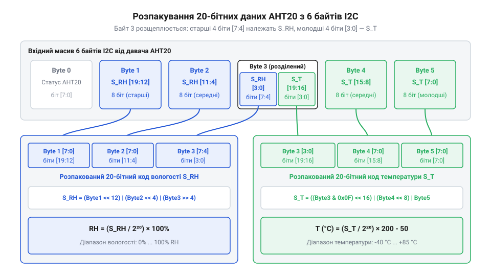

# Математичні формули перетворення 20-бітних сирих даних AHT20 у вологість та температуру

<preknowlist>
- [AHT20 + BMP280 — температура, вологість, тиск](root:cat-hw-sensors/aht20-bmp280) — призначення давача AHT20 та загальна схема зчитування байтового масиву через інтерфейс I2C
- [Формула Магнуса-Тетенса для водяної пари](root:cat-hw-sensors/magnus-formula) — фізичне визначення відносної вологості повітря як співвідношення парціального та насиченого тисків водяної пари
</preknowlist>

## Проблема сирих байтів у шині I2C

Коли мікроконтролер запитує дані вимірювання від давача AHT20 через послідовну шину @@en|I2C@@ (англ. Inter-Integrated Circuit, «міжмікросхемний зв'язок»), у відповідь надходить сирий масив байтів. Жоден із цих байтів не містить готового значення температури в градусах Цельсія чи вологості у відсотках. На відміну від простих аналогових давачів, як-от [термістор KY-013](root:cat-hw-sensors/ky-013-thermistor), чи цифрових пристроїв зі стандартними 16-бітними регістрами на кшталт [модуля GY-21](root:cat-hw-sensors/gy-21), давач AHT20 передає результати вимірювання у вигляді двох 20-бітних цілих чисел.

Причина такого формату полягає в будові внутрішнього аналогово-цифрового перетворювача (англ. Analog-to-Digital Converter, ADC) @@en|ADC@@. Для досягнення високої роздільної здатності @@en|ADC@@ давача квантує виміряні значення вологості й температури на 2²⁰ = 1048576 дискретних рівнів. Проте протокол @@en|I2C@@ оперує виключно 8-бітними байтами. Оскільки 20 бітів не кратні 8, одне число неможливо розмістити у двох байтах (2 × 8 = 16 бітів — замало), а три байти (3 × 8 = 24 біти) залишають 4 біти невикористаними.

Щоб не витрачати марно пропускну здатність шини, розробники AHT20 упакували два 20-бітних значення (загалом 40 бітів даних) у 5 послідовних байтів (5 × 8 = 40 бітів), яким передує один байт стану. У результаті один із байтів масиву виявився гібридним: його старша половина належить до коду вологості, а молодша — до коду температури. Спроба зчитати такі дані як звичайні цілі числа `uint16_t` або `uint32_t` безпосередньо з пам'яті призведе до отримання хаотичних числових значень.

Для відновлення фізичних величин прошивка мікроконтролера повинна розрізати цей байтовий потік, провести побітові зсуви й маскування, виділити два чистих 20-бітних значення `S_RH` та `S_T`, а потім масштабувати їх за математичними формулами.

## Розпакування 20-бітних кодів із байтів

Після завершення циклу вимірювання та зчитування 6 байтів через шину @@en|I2C@@, прошивка отримує масив `raw[6]`. У цьому масиві байти розподілені наступним чином: перший байт `raw[0]` відображає поточний стан (англ. status byte) @@en|status byte@@ давача (прапорці готовності та калібрування), а наступні п'ять байтів (`raw[1]`–`raw[5]`) містять стиснені 20-бітні коди відносної вологості `S_RH` та температури `S_T`.

Для наочного розуміння розміщення бітів у масиві даних розглянемо їхню структуру:
- Байт `raw[1]` містить 8 найстарших бітів `S_RH[19:12]` (найстарший байт, англ. Most Significant Byte, MSB) @@en|MSB@@. - Байт `raw[2]` містить 8 середніх бітів `S_RH[11:4]`. - Байт `raw[3]` розділений навпіл: його старші 4 біти (біти 7–4) містять наймолодші біти вологості `S_RH[3:0]`, а молодші 4 біти (біти 3–0) — найстарші біти температури `S_T[19:16]`. - Байт `raw[4]` містить 8 середніх бітів `S_T[15:8]`. - Байт `raw[5]` містить 8 наймолодших бітів `S_T[7:0]` (наймолодший байт, англ. Least Significant Byte, LSB) @@en|LSB@@.


*Розподіл 20 бітів вологості S_RH та 20 бітів температури S_T у 6-байтовому масиві даних давача AHT20.*

Щоб зібрати 20-бітне значення вологості `S_RH` у 32-бітну змінну, необхідно виконати три побітові операції:
1. Байт `raw[1]` зсунути вліво на 12 позицій, щоб його біти зайняли розряди від 19 до 12. 2. Байт `raw[2]` зсунути вліво на 4 позиції, перемістивши його біти в розряди від 11 до 4. 3. Байт `raw[3]` зсунути вправо на 4 позиції, виділивши його старший півбайт у розряди від 3 до 0.

Результати цих трьох операцій об'єднуються побітовим «АБО» (`|`). У результаті отримуємо формулу виділення коду вологості:

```
S_RH = (raw[1] << 12) | (raw[2] << 4) | (raw[3] >> 4)
```

Для виділення 20-бітного коду температури `S_T` використовується побітова маска (англ. bitmask) @@en|bitmask@@:
1. Із байта `raw[3]` за допомогою маски `0x0F` (двійкове `00001111`) виділяються молодші 4 біти, після чого вони зсуваються вліво на 16 позицій у розряди від 19 до 16. 2. Байт `raw[4]` зсувається вліво на 8 позицій у розряди від 15 до 8. 3. Байт `raw[5]` додається без зсуву в розряди від 7 до 0.

Математично операція розпакування температури виглядає так:

```
S_T = ((raw[3] & 0x0F) << 16) | (raw[4] << 8) | raw[5]
```

Розглянемо практичну реалізацію розпакування у прошивці мікроконтролера.

:::tabs
@tab C (ESP-IDF)
:::code math-aht20-data-conversion/c/esp-idf/aht20-unpack-raw.c
@tab C++ (Arduino)
:::code math-aht20-data-conversion/cpp/arduino/aht20rawdata.cpp
:::

Використання явного приведення типів `(uint32_t)` перед побітовими зсувами є критично важливим. Без цього 8-бітний байт при зсуві вліво більше ніж на 7 позицій вийде за межі розрядності за замовчуванням і спричинить втрату найстарших бітів.

## Математичне масштабування відносної вологості

Отримане 20-бітне значення `S_RH` є безрозмірним цифровим кодом @@en|ADC@@, який лежить у діапазоні від 0 до 2²⁰ - 1 (тобто від 0 до 1048575). Цей код лінійно пропорційний відносній вологості повітря `RH` у діапазоні від 0% до 100%. Фізичне значення відносної вологості визначається як відношення поточного парціального тиску водяної пари до тиску насиченої пари за даної температури, про що детальніше йдеться у матеріалі про [формулу Магнуса-Тетенса](root:cat-hw-sensors/magnus-formula).

Для лінійного відображення коду `S_RH` на діапазон від 0% до 100% застосовується формула пропорційної інтерполяції. Оскільки повна шкала @@en|ADC@@ відповідає дільнику 2²⁰ = 1048576, математичне співвідношення виводиться наступним чином:

```
RH = (S_RH ÷ 2²⁰) × 100%
   = (S_RH × 100) ÷ 1048576      [розкриття дужок для цілочисельних обчислень]
```

Кожен крок зміни коду `S_RH` на одиницю відповідає теоретичній роздільній здатності (англ. resolution) @@en|resolution@@ вимірювання вологості:

```
ΔRH = 100% ÷ 2²⁰
    = 100 ÷ 1048576              [заміна 2²⁰ на числове значення]
    ≈ 0.00009537%                [теоретичний крок квантування АЦП]
```

Теоретична роздільна здатність давача становить близько 0.0001%, що значно перевищує реальну фізичну точність вимірювального елемента (яка для AHT20 становить ±2%). Проте така висока розрядність дозволяє згладжувати шуми та відстежувати мінімальні динамічні тенденції зміни вологості без виникнення помилок округлення.

## Математичне перетворення коду температури

20-бітний код температури `S_T` також охоплює 2²⁰ = 1048576 дискретних відліків @@en|ADC@@. На відміну від вологості, шкала температури AHT20 має від'ємне зміщення нуля. Повний діапазон вимірювальної шкали @@en|ADC@@ становить 200 °C — від -50 °C до +150 °C.

Хоча паспортний робочий діапазон давача обмежений межами від -40 °C до +85 °C, математичне формульне перетворення розраховується відносно повної шкали @@en|ADC@@ 200 °C зі зміщенням -50 °C. Для порівняння, аналогові давачі на кшталт [LM35DZ](root:cat-hw-sensors/lm35) вимагають аналогово-цифрового перетворення на боці мікроконтролера, а платинові терморезистори [PT100](root:cat-hw-sensors/pt100-rtd) потребують складних нелінійних розрахунків за стандартом IEC. У давачі AHT20 нелінійність сенсорного елемента вже компенсована внутрішнім контролером, тому вихідний код `S_T` повністю лінійний.

Формула перетворення коду `S_T` у фізичну температуру `T` у градусах Цельсія виводиться шляхом множення коду на масштабний коефіцієнт 200 / 2²⁰ та віднімання зміщення 50:

```
T = (S_T ÷ 2²⁰) × 200 - 50
  = (S_T × 200) ÷ 1048576 - 50    [множення на масштаб 200 °C та віднімання зміщення]
```

Теоретична роздільна здатність вимірювання температури обчислюється як крок одного відліку @@en|ADC@@:

```
ΔT = 200°C ÷ 2²⁰
   = 200 ÷ 1048576                [заміна 2²⁰ на числове значення]
   ≈ 0.00019073°C                 [дискретність одного відліку]
```

Розглянемо практичний приклад обчислення температури для значення коду `S_T = 393216`.

**Умова:** Розпакований код АЦП температури `S_T = 393216`.

```
T = (393216 ÷ 1048576) × 200 - 50
  = 0.375 × 200 - 50              [ділення коду АЦП на 2²⁰]
  = 75 - 50                       [масштабування на інтервал 200 °C]
  = 25 °C                         [врахування зміщення -50 °C]
```

Таким чином, коду @@en|ADC@@ 393216 відповідає температура +25 °C.

## Обчислювальна точність та запобігання переповненню

При реалізації математичних формул AHT20 у прошивці мікроконтролера розробник стикається з вибором між обчисленнями з плаваючою крапкою (англ. floating-point) @@en|floating-point@@ та цілочисельною арифметикою з фіксованою крапкою (англ. fixed-point) @@en|fixed-point@@.

Застосування чисел із плаваючою крапкою `float` є найпростішим шляхом, оскільки воно виключає втрату точності при діленні. Проте на 32-бітних мікроконтролерах без апаратного модуля обчислень з плаваючою крапкою (англ. Floating-Point Unit, FPU) @@en|FPU@@ кожна операція з `float` підключає важкі програмні бібліотеки емуляції, що збільшує розмір прошивки та споживання процесорного часу.

Якщо ж виконувати обчислення виключно в цілих числах для отримання вологості й температури з точністю до сотих часток (наприклад, вологості у сотих відсотка 0.01% або температури в сотих градуса 0.01 °C), виникає пастка цілочисельного переповнення (англ. integer overflow) @@en|integer overflow@@.

Розглянемо математичну пастку переповнення при цілочисельному обчисленні вологості. Нехай ми хочемо отримати вологість у сотих відсотка: `rh_x100 = (S_RH * 10000) / 1048576`. Максимальне значення 20-бітного коду `S_RH` дорівнює 1048575. Обчислимо добуток у чисельнику:

```
1048575 × 10000 = 10485750000     [проміжне значення чисельника]
```

Максимальне значення стандартного 32-бітного знакового цілого числа `int32_t` становить 2147483647 (2³¹ - 1), а беззнакового `uint32_t` — 4294967295 (2³² - 1). Значення 10485750000 перевищує межу `uint32_t` більше ніж удвічі (10485750000 > 4294967295). Спроба виконати таке множення в 32-бітній змінній призведе до відкидання старших бітів, від'ємних або спотворених результатів.

Для безпечного обчислення цілочисельних виразів без втрати точності чисельникам необхідно явно надати 64-бітний тип `uint64_t`. Крім того, ділення на 2²⁰ = 1048576 у цілочисельній арифметиці можна замінити надшвидким побітовим зсувом вправо на 20 позицій (`>> 20`).

:::tabs
@tab C (ESP-IDF)
:::code math-aht20-data-conversion/c/esp-idf/aht20-calculate-float.c
@tab C++ (Arduino)
:::code math-aht20-data-conversion/cpp/arduino/aht20values.cpp
:::

Використання типу `uint64_t` у поєднанні зі зсувом `>> 20` гарантує як повну математичну точність без втрати дискретності, так і максимальну швидкість виконання на будь-якому 32-бітному архітектурному ядрі.