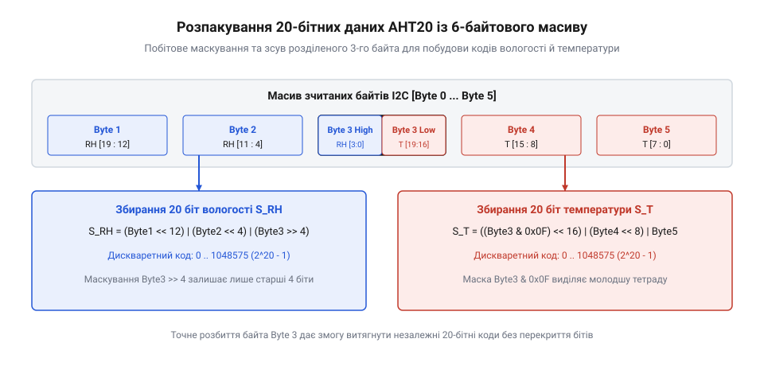

# Математичний алгоритм перетворення 20-бітних даних @@en

<preknowlist>
- [AHT20 + BMP280](root:cat-hw-sensors/aht20-bmp280) — Порядок зчитування 6-байтового масиву даних давача @@en|AHT20@@ через інтерфейс @@en|I2C@@ та призначення окремих байтів у пакеті.
- [SHT30](root:cat-hw-sensors/sht30) — Принципи представлення виміряних значень у вигляді цифрових кодувань та їх відповідність фізичним величинам вологості й температури.
</preknowlist>

## Проблема упакування 20 бітів у байти

Спроба зчитати фізичні показники з цифрового давача @@en|AHT20@@ шляхом прямого копіювання байтів у стандартні цілочисельні змінні призводить до отримання хаотичних і викривлених значень. Причина полягає у розбіжності між байтовою організацією пам'яті мікроконтролера та розрядністю внутрішніх регістрів давача. Мікроконтролери працюють із вирівняними блоками по 8, 16 або 32 біти, тоді як аналого-цифровий перетворювач @@en|AHT20@@ формує значення відносної вологості й температури у вигляді 20-бітних чисел.

При запиті вимірювання через шину @@en|I2C@@ давач повертає пакет даних, у якому 20 бітів вологості та 20 бітів температури розміщені в п'яти послідовних байтах (з другого по шостий):

- `Byte[0]` — байт стану, що містить прапорці готовності та калібрування.
- `Byte[1]` — містить старші 8 бітів коду вологості.
- `Byte[2]` — містить середні 8 бітів коду вологості.
- `Byte[3]` — перехідний байт, розрізаний навпіл. Його верхня тетрада (від грец. *τετράς* — четвірка), тобто біти `7..4`, містить молодші 4 біти вологості, а нижня тетрада, тобто біти `3..0`, містить старші 4 біти температури.
- `Byte[4]` — містить середні 8 бітів коду температури.
- `Byte[5]` — містить молодші 8 бітів коду температури.

Оскільки межа між даними вологості та температури проходить посередині `Byte[3]`, жодна з цих величин не лежить у пам'яті як суцільний 8-бітний чи 16-бітний блок. Прямолінійне об'єднання байтів без урахування 20-бітного розрядного розбиття змішує біти двох різних фізичних величин, роблячи подальші обчислення повністю неправильними. Для виділення чистих числових кодів потрібен математичний апарат побітових маніпуляцій.

## Побітове витягнення коду вологості й температури

Щоб відновити цілісно 20-бітне число відносної вологості `S_H` та 20-бітне число температури `S_T`, необхідно виконати побітові зсуви та маскування (від фр. *masque* — личина, накладка). Маскування дозволяє обнулити непотрібні біти в спільному байті, а побітові зсуви переміщують розряди на відповідні вагові позиції 32-бітного регістра.

*Побайтовий розподіл бітів вологості й температури в масиві AHT20 та принципи їх зсуву й маскування.*

Формування 20-бітного коду вологості `S_H` здійснюється з трьох фрагментів. Байт `Byte[1]` зсувається вліво на 12 позицій, щоб зайняти розряди з 19 по 12. Байт `Byte[2]` зсувається вліво на 4 позиції для розрядів з 11 по 4. З байта `Byte[3]` беруться лише старші 4 біти шляхом зсуву вправо на 4 позиції, що розміщує їх у розрядах з 3 по 0. Об'єднання виконується побітовою операцією @@en|OR@@ (`|`):

    S_H = (Byte[1] << 12) | (Byte[2] << 4) | (Byte[3] >> 4)

Формування 20-бітного коду температури `S_T` також потребує трьох кроків. З байта `Byte[3]` виділяється нижня тетрада за допомогою маски `0x0F` (побітове @@en|AND@@ `&`), після чого ці 4 біти зсуваються вліво на 16 позицій для розрядів з 19 по 16. Байт `Byte[4]` зсувається вліво на 8 позицій для розрядів з 15 по 8. Байт `Byte[5]` залишається без зсуву в молодших 8 бітах. Підсумковий вираз має вигляд:

    S_T = ((Byte[3] & 0x0F) << 16) | (Byte[4] << 8) | Byte[5]

У результаті побітового витягнення ми отримуємо два 32-бітних беззнакових цілих числа `S_H` та `S_T`, значення яких лежать у діапазоні від `0` до `2²⁰ - 1` (тобто від `0` до `1048575`). На відміну від [інших цифрових давачів](root:cat-hw-sensors/sht30), які видають 16-бітні коди, 20-бітна шкала @@en|AHT20@@ забезпечує значно вищу дискретність первинного цифрового сигналу.

## Математичні формули лінійного нормування кодів

Отримані 20-бітні числа `S_H` та `S_T` є абстрактними цифровими кодами. Для перетворення їх у реальні фізичні величини застосовується лінійне нормування (від лат. *norma* — правило, зразок) усього діапазону від `0` до `2²⁰`.

Для відносної вологості `RH` (у відсотках @@en|RH@@) інтервал цілочисельних кодів від `0` до `1048576` відповідає фізичному діапазону від `0%` до `100%`. Математична формула лінійного масштабування має вигляд:

    RH = (S_H / 2²⁰) × 100
       = (S_H / 1048576) × 100      [підстановка 2²⁰ = 1048576]
       = (S_H × 100) / 1048576      [перегрупування множення і ділення]

Для температури `T` (у градусах Цельсія) шкала давача @@en|AHT20@@ нормована так, що нулеві відповідає мінус `50°C`, а повний діапазон `2²⁰` відповідає інтервалу в `200°C` (що повністю перекриває робочий діапазон давача від мінус `40°C` до плюс `85°C`). Формула перетворення задається виразом:

    T = (S_T / 2²⁰) × 200 - 50
      = (S_T / 1048576) × 200 - 50      [підстановка 2²⁰ = 1048576]
      = (S_T × 200) / 1048576 - 50      [перегрупування множення і ділення]

**Обчислення фізичних величин для контрольного значення коду**

Припустимо, що в результаті побітового розпакування отримано коди `S_H = 524288` (що відповідає половині 20-бітної шкали) та `S_T = 393216`. Розрахунок фізичних значень відбувається кроками:

    RH = (524288 × 100) / 1048576
       = 52428800 / 1048576         [перемноження коду на масштабувальний множник]
       = 50                         [підсумкова відносна вологість 50% RH]

    T = (393216 × 200) / 1048576 - 50
      = 78643200 / 1048576 - 50     [перемноження коду на температурний коефіцієнт]
      = 75 - 50                     [ділення на повну шкалу 2²⁰]
      = 25                          [підсумкова температура +25°C]

Таким чином, розраховані значення становлять `50%` @@en|RH@@ відносної вологості та `+25°C` температури.

## Арифметика з фіксованою крапкою для мікроконтролерів

Пряме застосування формул з плаваючою крапкою (`float`) на 8-бітних або 32-бітних мікроконтролерах без апаратного блоку обчислень @@en|FPU@@ (від грец. *ἀριθμός* — число) вимагає підключення програмної бібліотеки емуляції. Це призводить до надмірного витрачання пам'яті програм та сповільнення виконання обчислень. Для оптимізації використовується арифметика з фіксованою крапкою (від нім. *Maßstab* — міра довжини), коли результати масштабуються у цілочисельний формат (наприклад, сотні часток відсотка та градуса).

Щоб обчислити вологість у сотнях часток відсотка `RH_100` (де `5000` означає `50.00%`), початкову формулу необхідно помножити на `100`:

    RH_100 = (S_H × 10000) / 1048576

Пряме множення `S_H × 10000` для максимального коду `1048575` дає `10485750000`, що перевищує межу 32-бітного беззнакового числа (`4294967295`) і спричиняє переповнення. Для уникнення переповнення та заміни ділення на швидкий побітовий зсув скоротимо чисельник і знаменник на `16` (`2⁴`):

    10000 / 16 = 625
    1048576 / 16 = 65536 = 2¹⁶

Тепер максимальний добуток `S_H × 625 = 655359375` вільно вміщується у 32-бітну змінну, а ділення на `65536` замінюється зсувом вправо на 16 бітів (`>> 16`). З урахуванням математичного округлення до найближчого цілого (додаванням половини дільника `2¹⁵ = 32768`) формула набуває вигляду:

    RH_100 = ((S_H × 625) + 32768) >> 16      [цілочисельне нормування вологості з округленням]

Аналогічно для температури у сотнях часток градуса `T_100` (де `2500` означає `25.00°C`), помноживши вираз на `100` та скоротивши коефіціенти `20000 / 1048576` на `16`, отримуємо:

    T_100 = (((S_T × 1250) + 32768) >> 16) - 5000      [цілочисельне нормування температури]

Похибка округлення при цілочисельному зсуві з додаванням константи `32768` не перевищує `±0.5` сотні частки (тобто `±0.005%` @@en|RH@@ та `±0.005°C`), що в рази менше за власну апаратну похибку давача @@en|AHT20@@ (`±2%` @@en|RH@@ та `±0.3°C`). Такий підхід забезпечує максимальну швидкість обчислень, що критично під час роботи з [суміщеними модулями AHT20 та BMP280](root:cat-hw-sensors/aht20-bmp280) у системах з обмеженими ресурсами.
