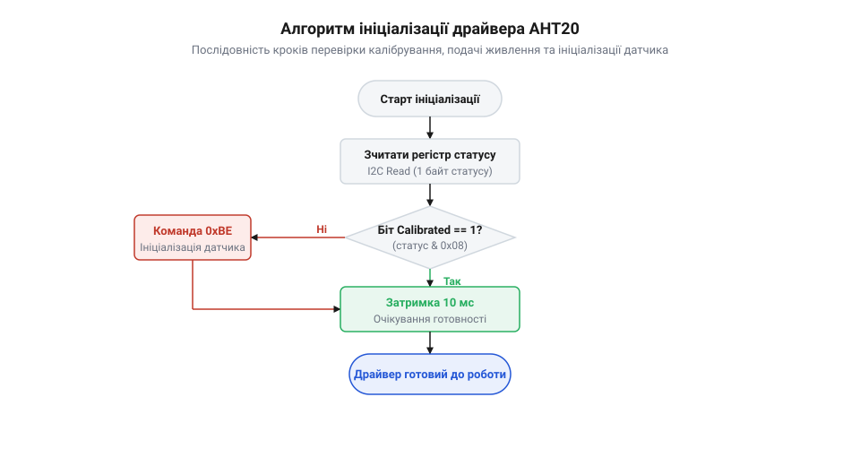
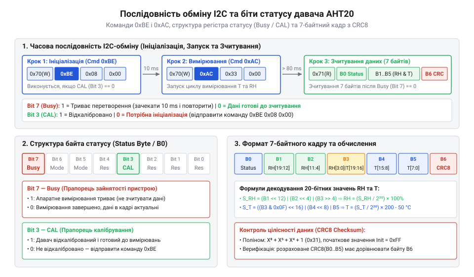
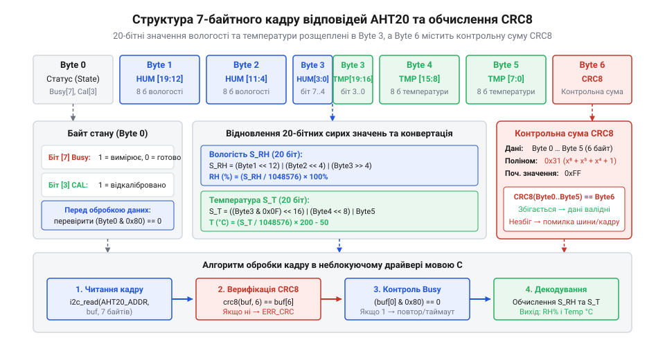

# Розробка драйвера AHT20 на C з перевіркою калібрування та CRC8

<preknowlist>
- [SHT30 — температура й вологість (I2C)](root:cat-hw-sensors/sht30) — принципи побудови I2C-транзакцій для зчитування комбінованих даних температури й вологості
- [AHT20 + BMP280 — температура, вологість, тиск](root:cat-hw-sensors/aht20-bmp280) — фізичні характеристики та апаратні особливості сенсорного модуля AHT20
</preknowlist>

## Проблема недовіри до даних довкілля

У кліматичних системах та інкубаторах вимірювання температури й вологості безпосередньо керують виконавчими механізмами. Хибне показання перевантажує охолодження чи вмикає нагрівачі. Зчитування через цифровий давач @@en|AHT20@@ здається простим, проте сирі дані з шини без апаратної верифікації є ненадійними.

Перша вразливість — фізична нестабільність послідовної шини @@en|I2C@@ (від англ. *Inter-Integrated Circuit* — міжінтегральна схема) на лініях типу відкритий стік (@@en|open-drain@@, від англ. *open drain* — відкритий стік) з підтягувальними резисторами (@@en|pull-up@@, від англ. *pull-up* — підтягування догори). Імпульсні завади здатні спотворити біти. Без контрольної суми @@en|CRC-8@@ (від англ. *Cyclic Redundancy Check* — циклічний надлишковий контроль) інверсія біта перетворює кімнатну температуру на аварійну.

Друга небезпека — внутрішній стан кристала. Давач поєднує ємнісний чутливий елемент мікроелектромеханічних систем (@@en|MEMS@@, від англ. *Micro-Electro-Mechanical Systems* — мікроелектромеханічні системи) з мікросхемою @@en|ASIC@@ (від англ. *Application-Specific Integrated Circuit* — інтегральна схема спеціального призначення). Після живлення ядро завантажує поправочні коефіцієнти з пам'яті @@en|OTP@@ (від англ. *One-Time Programmable* — одноразово програмований). Якщо чип пропускає це, давач лишається без @@fr|калібрування@@ (від фр. *calibre* — вимірювальний шаблон, точна підгонка), повертаючи зміщені числа.

Третя проблема — часова розбіжність. Перетворення в [архітектурі сенсорного вузла](root:cat-hw-sensors/aht20-mems-architecture) потребує часу. Читання до завершення циклу дає сміття, а нескінченне очікування при збої шини блокує мікроконтролер. Без захисного ліміту часу (@@en|timeout@@, від англ. *time-out* — вичерпання ліміту часу) потрібен сторожовий таймер (@@en|watchdog@@, від англ. *watchdog* — вартовий пес) або [відновлення завислої шини](root:com-devices/i2c-bus-recovery).

Надійний драйвер вимагає витримки живлення, перевірки калібрування, контролю за таймаутом та перевірки пакетів за @@en|CRC-8@@.

## Ініціалізація AHT20 та перевірка калібрування

Після подачі живлення внутрішній аналоговий тракт @@en|AHT20@@ потребує щонайменше 100 мс для виходу на робочий режим, інакше шина @@en|I2C@@ поверне сигнал непідтвердження (@@en|NACK@@). 

Для перевірки готовності мікроконтролер звертається за адресою `0x38` і зчитує статус (команда `0x71` або пряме читання):
- Біт 7 (`0x80`): прапорець зайнятості @@en|Busy@@. - Біт 3 (`0x08`): прапорець @@fr|калібрування@@ (одиниця означає, що коефіцієнти завантажені з @@en|OTP@@ у регістри).

Якщо біт калібрування нульовий, драйвер надсилає командну трійку `{0xBE, 0x08, 0x00}` для примусового завантаження коефіцієнтів, витримує паузу 10 мс і повторно перевіряє статус. Програмне скидання (@@en|Soft Reset@@) здійснюється командою `0xBA` із затримкою 20 мс.


*Блок-схема показує послідовність кроків ініціалізації драйвера AHT20 із перевіркою прапорця калібрування та надсиланням команди 0xBE.*

:::tabs
== C

:::code proj-aht20-i2c-driver-c/c/src/aht20.c 32-74

== C++

:::code proj-aht20-i2c-driver-c/cpp/src/aht20_driver.cpp 162-189
:::

У C функція `aht20_init` виконує стартову паузу, зчитує статус і за потреби відправляє ініціалізаційну послідовність. У C++ об'єктно-орієнтований драйвер спирається на парадигму @@en|RAII@@: обгортка `I2cBusGuard` керує шиною, а конструктор автоматично ініціалізує пристрій і перевіряє калібрування.

## Запуск вимірювання та очікування готовності

Щоб запобігти паразитному саморозігріву та заощаджувати заряд батареї, @@en|AHT20@@ не веде безперервного фонового перетворення, перебуваючи в режимі очікування до команди мікроконтролера.

Запуск вимірювального циклу здійснюється записом трибайтової команди на шину @@en|I2C@@: код тригера `0xAC`, за яким слідують аргументи `0x33` та `0x00`, що активують аналоговий тракт і перемикають внутрішній мультиплексор.

:::tabs
== C

:::code proj-aht20-i2c-driver-c/c/src/aht20.c 91-108

== C++

:::code proj-aht20-i2c-driver-c/cpp/src/aht20_driver.cpp 191-203
:::

Отримавши команду, мікросхема повертає підтвердження (@@en|ACK@@) і виставляє старший біт 7 байта стану (@@en|State byte@@) — прапорець @@en|Busy@@. Апаратне вимірювання триває 75–80 мс, протягом яких зчитування повертає сміття.

Для очікування готовності існують ризики:
- Фіксована затримка на 80 мс без перевірки статусу може захопити незавершений кадр через уповільнення генератора. - Суцільне опитування (@@en|polling@@) створює електромагнітні завади біля обкладок @@en|MEMS@@ та навантажує мікроконтролер.

Оптимальна архітектура поєднує базову паузу на 80 мс із подальшим м'яким опитуванням прапорця @@en|Busy@@ з мікропаузами в 2–10 мс. Для захисту від зависання при апаратному збої опитування обмежується таймаутом (@@en|timeout@@) у 150–200 мс.

:::tabs
== C

:::code proj-aht20-i2c-driver-c/c/src/aht20.c 135-154

== C++

:::code proj-aht20-i2c-driver-c/cpp/src/aht20_driver.cpp 208-230
:::


*Послідовність команд ініціалізації 0xBE та запуску вимірювання 0xAC на шині I2C демонструє необхідні затримки стабілізації та опитування байта стану.*

Щойно біт @@en|Busy@@ скидається в 0, результати зафіксовано у буферах чипа для зчитування.

## Парсинг 20-бітних вимірів та обчислення

Щойно прапорець @@en|Busy@@ скидається в нуль, мікроконтролер зчитує шість байтів вимірювань і один байт контрольної суми. Внутрішнє ядро давача формує відліки з розрядністю 20 бітів як для температури, так і для відносної вологості (2²⁰ = 1 048 576 градацій). Оскільки шина @@en|I2C@@ передає дані байтами, два 20-бітні числа щільно спаковані у п'ять байтів (після байта @@en|State byte@@): третій байт ділиться навпіл між старшими бітами температури та молодшими вологості.


*Побайтове мапування семибайтної відповіді AHT20 демонструє розділення байта 3 на два напівбайти між 20-бітними вибірками вологості й температури перед обчисленням контрольної суми CRC-8.*

Для відновлення 20-бітних значень програма застосовує побітові зсуви. Сирий код вологості `raw_humidity` збирається з першого, другого та старшої половини третього байта з приведенням до `uint32_t` для захисту від переповнення. Сире значення температури `raw_temp` витягується з молодшого напівбайта третього байта, а також четвертого й п'ятого байтів.

Отриманий код вологості масштабується у відсотки, а код температури — у градуси Цельсія за формулами:

```
RH
= (S_rh ÷ 2²⁰) × 100 %          [масштабування до повного діапазону шкали]
= (S_rh ÷ 1048576) × 100 %      [підстановка розрядності АЦП]
```

```
T
= (S_t ÷ 2²⁰) × 200 - 50        [масштабування розмаху зі зміщенням нуля]
= (S_t ÷ 1048576) × 200 - 50    [підстановка розрядності АЦП]
```

**Розрахунок вологості й температури для вибірки `buffer = {0x1C, 0x8D, 0xD4, 0x75, 0xF7, 0xF5, 0x9B}`**

```
S_rh = (0x8D << 12) | (0xD4 << 4) | (0x75 >> 4) = 580935
RH   = (580935 ÷ 1048576) × 100 %               = 55.40 %
S_t  = ((0x75 & 0x0F) << 16) | (0xF7 << 8) | 0xF5 = 391157
T    = (391157 ÷ 1048576) × 200 - 50           = 24.58 °C
```

Обчислені значення дають 55.40 % відносної вологості та 24.58 °C температури.

:::tabs
== C

:::code proj-aht20-i2c-driver-c/c/src/aht20.c 180-215

== C++

:::code proj-aht20-i2c-driver-c/cpp/src/aht20_driver.cpp 270-290
:::

## Контроль цілісності кадру за CRC8

Завади на шині @@en|I2C@@ здатні спотворити байти вимірювань, тому специфікація @@en|AHT20@@ передбачає обчислення циклічного надлишкового коду @@en|CRC-8@@ у шостому байті кадру. Контрольна сума є залишком від ділення інформаційного полінома на фіксований генераторний @@el|поліном@@ `x⁸ + x⁵ + x⁴ + 1` (`0x31`).

Обчислення починається з початкового вектора `0xFF` і охоплює перші шість байтів пакета: від стану `buffer[0]` до молодшого байта температури `buffer[5]`. Побайтовий алгоритм послідовно накладає байти через @@en|XOR@@ та зсуває регістр, підмішуючи поліном `0x31`, якщо старший біт дорівнює одиниці. Отриманий результат порівнюється з байтом `buffer[6]`, і при невідповідності повертається помилка `AHT20_ERR_CRC`.

:::tabs
== C

:::code proj-aht20-i2c-driver-c/c/src/aht20.c 13-30

== C++

:::code proj-aht20-i2c-driver-c/cpp/include/aht20_crc.hpp 21-49
:::

## Збирання модульного C-драйвера @@en|AHT20@@

Якщо процедури звернення до шини та витримки пауз жорстко прив'язати до периферійних функцій конкретного мікроконтролера, будь-яка зміна апаратної плати вимагатиме повного переписування драйвера. Надійний драйвер проектується як автономний програмний @@la|модуль@@, повністю ізольований від заліза за допомогою @@en|Hardware Abstraction Layer@@ (`HAL`).

Драйвер взаємодіє з фізичним каналом через таблицю інтерфейсних покажчиків `i2c_bus_t`. Структура містить покажчик на функцію (@@en|function pointer@@) для запису буфера на шину, покажчик для зчитування, функцію затримки мікроконтролера та таймер отримання поточного часу в мілісекундах. Стан сенсора зберігається в окремому дескриптoрі `aht20_t`, куди входять вказівник на екземпляр шини, 7-бітна адреса пристрою `0x38` та прапорець ініціалізації. Результати роботи функцій стандартизуються через типізоване перерахування `aht20_err_t`.

:::tabs
== C

:::code proj-aht20-i2c-driver-c/c/include/i2c_bus.h 27-60

== C++

:::code proj-aht20-i2c-driver-c/cpp/include/aht20_driver.hpp 31-77
:::

:::tabs
== C

:::code proj-aht20-i2c-driver-c/c/include/aht20.h 50-87

== C++

:::code proj-aht20-i2c-driver-c/cpp/include/aht20_driver.hpp 83-134
:::

Центральна функція `aht20_read_data` оркеструє всі етапи отримання достовірних даних в єдиний конвеєр: надсилає команду запуску вимірювання `{0xAC, 0x33, 0x00}`, робить базову витримку 80 мс, опитує статусний біт @@en|Busy@@ з інтервалами 2 мс та лімітом @@en|timeout@@ 200 мс, зчитує 7-байтний пакет, верифікує контрольний код за допомогою функції `aht20_calc_crc8` та обчислює фізичну вологість у % RH і температуру в °C.

:::tabs
== C

:::code proj-aht20-i2c-driver-c/c/src/aht20.c 124-178

== C++

:::code proj-aht20-i2c-driver-c/cpp/src/aht20_driver.cpp 205-247
:::

У головному циклі програми дескриптор сенсора ініціалізується один раз на старті. На відміну від аналогових рішень на кшталт [KY-013](root:cat-hw-sensors/ky-013-thermistor) чи [LM35DZ](root:cat-hw-sensors/lm35), які вимагають фільтрації шумів та калібрування каналів АЦП, цифровий модуль @@en|AHT20@@ переносить метрологічну обробку всередину кристала.

:::tabs
== C

:::code proj-aht20-i2c-driver-c/c/src/main.c 134-174

== C++

:::code proj-aht20-i2c-driver-c/cpp/src/main.cpp 29-67
:::