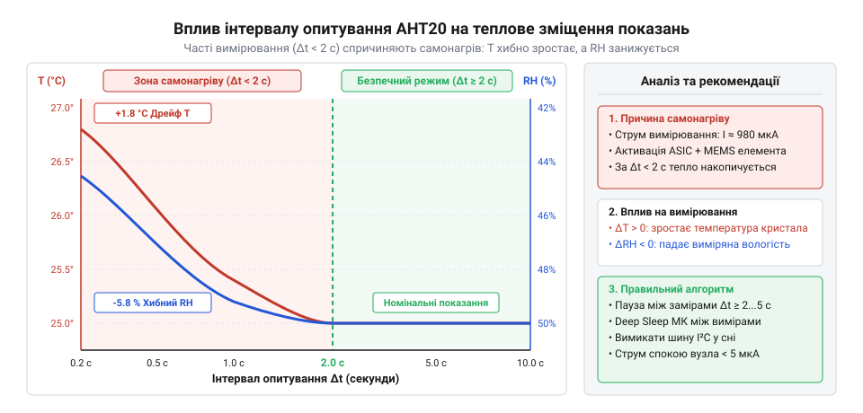
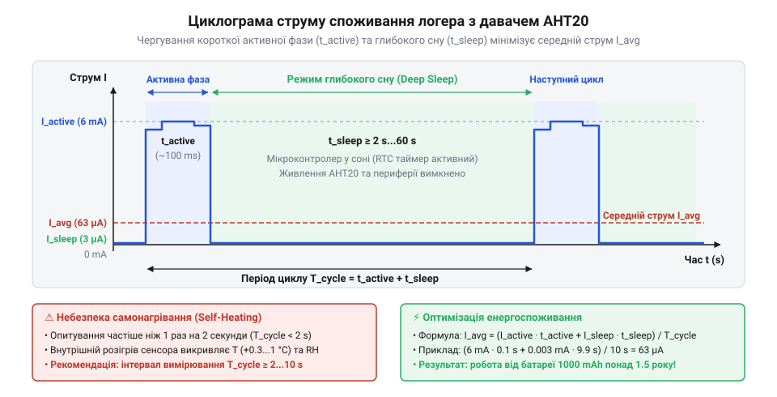

# Низькоспоживаючий логер мікроклімату з контролем самонагрівання AHT20

<preknowlist>
- [AHT20 + BMP280 — температура, вологість, тиск](root:cat-hw-sensors/aht20-bmp280) — Базовий протокол обміну I2C, каскад ініціалізації та формат первинних даних давача AHT20
- [Формула Магнуса-Тетенса для водяної пари](root:cat-hw-sensors/magnus-formula) — Фізична залежність між температурою та відносною вологістю для розуміння впливу тепловіддачі на похибку вимірювання
</preknowlist>

## Проблема спотворення показань при частому опитуванні

Коли мікроконтролер безперервно зчитує дані з давача @@en|AHT20@@ без пауз або з інтервалом у сотні мілісекунд, виникає систематична похибка: температура нерухомого повітря на графіку поступово повзе вгору, а відносна вологість синхронно падає. Давач справний, шина @@en|I2C@@ (англ. @@en|I2C@@, від англ. *Inter-Integrated Circuit* — міжінтегральна схема) повертає валідні байти, але показання зміщуються на 1–2 °C за температурою та на 3–6% за вологістю. Причина спотворення полягає в порушенні теплового балансу чутливого вузла.

Давач @@en|AHT20@@ поєднує в єдиному корпусі розміром 3×3×1 мм мікроелектромеханічні структури (англ. @@en|MEMS@@, від англ. *microelectromechanical systems*) та інтегральну схему обробки сигналів (англ. @@en|ASIC@@, від англ. *application-specific integrated circuit*), розроблені за [архітектурою сенсорного вузла](root:cat-hw-sensors/aht20-mems-architecture). За командою вимірювання внутрішня схема активує вимірювальний міст і 24-бітний аналогово-цифровий перетворювач. Перетворення триває 75–80 мс, протягом яких струм споживання зростає зі стану спокою 0.25 мкА до 1 мА при напрузі 3.3 В. Електрична потужність 3.3 мВт виділяється як джоулеве тепло на кремнієвому кристалі площею менше квадратного міліметра.

Кристал захищений пластиковим корпусом із мембраною, тому конвекція повітря у внутрішній мікрокамері відсутня. Тепловідведення крізь мініатюрні виводи на плату обмежене тепловим опором матеріалів. Якщо черговий замір запускається відразу після попереднього, кристал не встигає скинути тепло назовні. Теплова енергія підсумовується від циклу до циклу. Це явище має назву термодинамічне самонагрівання (англ. @@en|self-heating@@, від англ. *self* — сам, та *heat* — нагрівати). Температура чутливого шару стає вищою за температуру навколишнього середовища.

Найсильніше @@en|self-heating@@ спотворює відносну вологість (англ. @@en|relative humidity@@, від лат. *relativus* — відносний, та *humiditas* — вологість). Відносна вологість `RH` визначається відношенням парціального тиску водяної пари `e` до тиску насиченої пари `e_s(T)` за температури `T`:

```
RH = (e / e_s(T)) · 100%
```

Крізь мембрану парціальний тиск пари `e` у камері сенсора вирівнюється з кімнатним повітрям. Проте тиск насичення `e_s(T)` залежить виключно від температури поверхні кристала. Зі зростанням температури здатність повітря утримувати вологу збільшується експоненційно, що описує [залежність тиску насичення від нагріву](root:cat-hw-sensors/magnus-formula). За кімнатної температури близько 25 °C нагрів кристала лише на 1 °C збільшує знаменник `e_s` на 6%. Оскільки чисельник `e` не змінюється, виміряна вологість штучно падає на 3% абсолютних одиниць при реальних 50%. Давач вимірює вологість створеного ним перегрітого мікросередовища.


*Залежність температури сенсора та відносної вологості від інтервалу опитування AHT20: зі скороченням пауз нижче двох секунд самонагрівання кристала завищує температуру та штучно занижує вологість.*

Програмні фільтри не усувають цього систематичного зсуву, бо лише згладжують шум навколо хибного зміщення. Єдиним розв'язком є перехід від безперервного опитування до періодичного з розрахованими паузами, протягом яких кристал охолоджується до температури середовища.

## Розрахунок інтервалів опитування та теплового балансу

Тепловий стан сенсора описує баланс між підведеною потужністю та її розсіюванням у середовище. Під час перетворення кристал гріється, а в паузах охолоджується через виводи плати та прилегле повітря. Тепловий опір (англ. @@en|thermal resistance@@, від грец. *therme* — тепло, та лат. *resistere* — чинити опір) `R_th` корпусу DFN до повітря у спокійній атмосфері становить приблизно 300 °C/Вт.

Середню розсіювану потужність `P_avg` визначає шпаруватість вимірювання (англ. @@en|duty cycle@@, від англ. *duty* — служба, обов'язок, та грец. *kyklos* — коло, цикл) `D`, тобто відношення часу активного перетворення `t_meas` до періоду опитування `t_poll`:

```
D = t_meas / t_poll
```

Якщо активна потужність дорівнює `P_meas = V_dd · I_meas`, а потужність спокою мізерна, усталений перегрів кристала `ΔT` над середовищем отримують як добуток середньої потужності на тепловий опір:

```
ΔT = P_avg · R_th
   = V_dd · I_meas · (t_meas / t_poll) · R_th    [підстановка середньої потужності]
```

де `V_dd` — напруга живлення, `I_meas` — струм перетворення, `t_meas` — час перетворення, `t_poll` — період опитування, `R_th` — тепловий опір вузла.

**Розрахунок теплового перегріву та зсуву вологості при інтервалі 200 мс:**
Для напруги `V_dd = 3.3` В, струму `I_meas = 0.98` мА, часу перетворення `t_meas = 0.08` с і періоду `t_poll = 0.2` с:

```
P_meas = 3.3 · 0.00098
       = 0.003234 Вт                              [добуток робочої напруги і струму]
P_avg  = 0.003234 · (0.08 / 0.2)
       = 0.001294 Вт                              [врахування шпаруватості D = 0.4]
ΔT     = 0.001294 · 300
       ≈ 0.388 °C                                 [множення на тепловий опір корпусу]
```

При 25 °C перегрів на `ΔT ≈ 0.39` °C збільшує тиск насиченої пари з коефіцієнтом `γ ≈ 0.06` 1/°C. Для повітря з вологістю 50% відхилення показань становить:

```
ΔRH = - RH · γ · ΔT
    = - 50 · 0.06 · 0.388                        [відносний спад вологості]
    ≈ - 1.16%                                    [розрахована похибка]
```

При безперервному зчитуванні кожні 100 мс (`D ≈ 0.8`) перегрів кристала досягає 0.78 °C, а похибка заниження вологості перевищує 2.3%, що руйнує точність вимірювання @@en|AHT20@@ (±2% RH).

**Розрахунок теплового балансу при безпечному інтервалі дві секунди:**
Підставимо рекомендований інтервал `t_poll = 2.0` с:

```
P_avg = 0.003234 · (0.08 / 2.0)
      = 0.000129 Вт                              [шпаруватість D = 0.04]
ΔT    = 0.000129 · 300
      ≈ 0.039 °C                                 [усталений перегрів кристала]
ΔRH   = - 50 · 0.06 · 0.039                      [розрахунок зсуву вологості]
      ≈ - 0.12%                                  [залишкова похибка вимірювання]
```

При двосекундній паузі перегрів становить менше 0.04 °C, а похибка вологості спадає до 0.12%, що є нехтовним. Тому дві секунди — мінімально безпечний інтервал опитування @@en|AHT20@@ у спокійному повітрі. Для автономних логерів інтервал збільшують до 10, 30 чи 60 секунд.


*Часова циклограма струму споживання логера під час виходу з Deep Sleep, зчитування I2C та повернення у сон: активна фаза триває мілісекунди, забезпечуючи повне охолодження кристала у паузі.*

У реальних пристроях сенсор часто встановлюють у закритому корпусі без вільного руху повітря, де `R_th` зростає. Перевірити достатність паузи для конкретного корпусу дозволяє тест холодного старту. Логер витримують вимкненим 30 хвилин для зрівняння з температурою середовища. Після запуску записують перші 30–50 вимірів. Якщо температура плавно зростає, а вологість спадає перед виходом на плато, тепло накопичується в корпусі. У такому разі паузу подовжують доти, доки перше показання після старту не збігатиметься з наступними.

Для витримування пауз мікроконтролер після зчитування за [протоколом передавання первинних кадрів](root:cat-hw-sensors/aht20-bmp280) переводять у режим глибокого сну (англ. @@en|deep sleep@@, від англ. *deep* — глибокий, та *sleep* — сон). Це відновлює тепловий баланс кристала й заощаджує заряд джерела живлення.

## Апаратна схема живлення та керування шиною

В автономному логері мікроконтролер понад 99% часу проводить у режимі сну, тому баланс енергії визначає не робочий струм під час обчислень, а витік струму периферійного кола в паузах. Власний кристал давача @@en|AHT20@@ у стані спокою споживає лише 0.25 мкА. Проте типові готові модулі містять світлодіод індикації живлення, який неперервно споживає 1–3 мА, та дешевий стабілізатор напруги зі струмом спокою у кілька міліамперів. Щоб побудувати логер із роками автономної роботи, індикатор демонтують, а вузол живлять безпосередньо від батареї або через лінійний стабілізатор із малим падінням напруги (англ. @@en|LDO@@, від англ. *low dropout* — низьке падіння) з ультранизьким власним струмом спокою (англ. @@en|quiescent current@@, від лат. *quiescere* — спочивати, перебувати в спокої) порядку 1–2 мкА.

Коли стабілізатор не створює фонового витоку, головна інженерна розвилка полягає у виборі способу живлення самого сенсора: повне знеструмлення між вимірюваннями чи безперервне чергування в очікуванні.

При спробі повністю знеструмити сенсор через польовий транзистор із металооксидною брамою (англ. @@en|MOSFET@@, від англ. *metal-oxide-semiconductor field-effect transistor*) у верхньому плечі розробники часто потрапляють у пастку: ключ розмикає шину живлення `V_dd`, але підтягувальні резистори (англ. @@en|pull-up@@, від англ. *pull* — тягнути, та *up* — вгору) ліній SDA та SCL лишаються з'єднаними з постійною лінією 3.3 В. У такій схемі виникає паразитне живлення (англ. @@en|phantom powering@@, від грец. *phantasma* — привид, ілюзія). Струм від шини живлення мікроконтролера протікає крізь резистори @@en|pull-up@@ у внутрішні захисні діоди шини @@en|I2C@@ всередині знеструмленого кристала @@en|AHT20@@.

Через це сенсор опиняється під неповною напругою 2.5–2.8 В, що живить його цифрову логіку в нештатному режимі. Витік струму крізь підтяжки сягає сотень мікроамперів, руйнуючи енергозбереження, а вбудований контролер давача блокується у завислому стані. Якщо застосовується комутація живлення (англ. @@en|power gating@@, від англ. *power* — живлення, та *gate* — перемикач, брама), верхні виводи резисторів @@en|pull-up@@ обов'язково підключають до тієї ж комутованої лінії живлення за ключем, а виводи мікроконтролера перед сном переводять у високоомний стан (Hi-Z). Крім того, при кожній подачі напруги чип вимагає очікування не менше 100 мс на стабілізацію та апаратне скидання, як цього вимагає [каскад ініціалізації давача](root:cat-hw-sensors/aht20-bmp280).

Альтернативний і надійніший шлях — постійне живлення чутливого вузла без додаткових ключів. Оскільки струм спокою кристала @@en|AHT20@@ поза процесом вимірювання не перевищує 0.25 мкА, сенсор практично не навантажує батарею. Щоб виключити паразитні витоки через лінії зв'язку під час сну мікроконтролера, номінал підтягувальних резисторів збільшують зі стандартних 4.7 кОм до 10 кОм. Для низької частоти шини 100 кГц і коротких ліній зв'язку плати цього опору достатньо для формування крутих фронтів, а струм при передачі нульового біта зменшується вдвічі:

```
I_pull = V_dd ÷ R_pull
       = 3.3 ÷ 10000                     [закон Ома для підтягувального резистора 10 кОм]
       = 0.00033 А                       [розрахований динамічний струм шини]
       = 0.33 мА                         [переведення значення струму в міліампери]
```

Під час глибокого сну виводи мікроконтролера утримують у високому логічному рівні або ізолюють. Різниця потенціалів між обома кінцями підтягувальних резисторів дорівнює нулю, і статичний струм крізь них не протікає, що гарантує струм спокою всієї шини нижче 1 мкА.

## Програмний алгоритм Deep Sleep та циклограми

Мінімізація середнього енергоспоживання досягається побудовою програмного циклу, в якому активний час роботи процесора скорочений до часток секунди, а решту періоду система проводить у режимі глибокого сну (@@en|deep sleep@@). У стані @@en|deep sleep@@ процесорне ядро, високочастотні генератори та основна пам'ять знеструмлені. Працює виключно енергоефективний контролер із таймером реального часу (англ. @@en|RTC@@, від англ. *real-time clock* — годинник реального часу) та виділеною енергонезалежною областю пам'яті RTC SRAM, споживаючи менше 5–10 мкА.

Коли таймер @@en|RTC@@ відраховує заданий інтервал паузи, мікроконтролер виходить зі сну. Програмний конвеєр реалізують у формі лінійного кінцевого автомата (англ. @@en|state machine@@, від англ. *state* — стан, та *machine* — машина):

1. `STATE_WAKEUP`: Зчитування причини пробудження. Якщо це регулярний таймер, завантажується стан лічильника з пам'яті RTC; якщо перший старт — калібруються структури даних. 2. `STATE_SENSOR_TRIGGER`: Активація контролера @@en|I2C@@ та надсилання команди запуску вимірювання `0xAC, 0x33, 0x00`. 3. `STATE_CONVERSION_WAIT`: Очікування готовності даних тривалістю 75–80 мс. Тут виникає типова помилка розробників — використання блокуючої затримки з активним циклом, за якої мікроконтролер споживає 20–40 мА на максимальній частоті. Енергоефективне рішення — переведення чипа в легкий сон (англ. @@en|light sleep@@, від англ. *light* — легкий, та *sleep* — сон) на 80 мс. У цьому режимі ядра зупиняються, тактові генератори вимикаються, а периферія та оперативна пам'ять зберігають стан при струмі лише 0.8–1.5 мА. 4. `STATE_READ_VALIDATE`: Пробудження за таймером легкого сну, зчитування 7 байтів з адреси `0x38` шини @@en|I2C@@. Перевірка старшого біта зайнятості у першому байті та валідація вмісту за алгоритмом циклічного надлишкового коду (англ. @@en|CRC@@, від англ. *cyclic redundancy check* — циклічна перевірка надлишковості). Обчислення температури та відносної вологості за формулами [паспортної точності AHT20](root:cat-hw-sensors/aht20). За потреби на цьому ж кроці розраховують точку роси, де застосовується [формула насиченої пари](root:cat-hw-sensors/magnus-formula), або згладжують дрібні флуктуації, застосовуючи [алгоритми цифрової фільтрації](root:cat-hw-sensors/digital-filtering-environmental-sensors). 5. `STATE_STORE_DATA`: Збереження отриманих значень. Запис кожного відліку у зовнішню Flash-пам'ять призводить до марнування заряду на стирання блоків. Натомість точки накопичують у компактному кільцевому буфері пам'яті RTC SRAM, а скидання пачки даних на накопичувач виконують раз на кілька десятків циклів, оптимізуючи [енергоефективне збереження вимірів](root:cat-hw-sensors/low-power-non-volatile-storage). 6. `STATE_ENTER_SLEEP`: Деініціалізація шини @@en|I2C@@ із закріпленням стану виводів, програмування наступного пробудження таймера @@en|RTC@@ та перехід у @@en|deep sleep@@.

:::tabs
== ESP-IDF

:::code proj-aht20-low-power-logger/c/esp-idf/aht20-crc8.c

== Arduino

:::code proj-aht20-low-power-logger/cpp/arduino/aht20-crc8.cpp
:::

Використання легкого сну на час очікування готовності скорочує активну витрату заряду під час заміру майже у п'ятнадцять разів порівняно зі звичайним активним опитуванням.

## Оцінка енергобалансу та розрахунок автономності

Щоб розрахувати прогнозований термін служби автономного вузла, необхідно визначити інтегральний заряд, який пристрій витрачає за один повний цикл роботи, та врахувати хімічні втрати в самому джерелі струму.

Період опитування `t_poll` розбивається на дві фази: коротку активну фазу тривалістю `t_active` та тривалу фазу глибокого сну тривалістю `t_sleep`:

```
t_poll = t_active + t_sleep
```

де `t_poll` — інтервал між вимірюваннями, `t_active` — час активної роботи мікроконтролера, `t_sleep` — тривалість глибокого сну.

Електричний заряд активної фази `Q_active` складається з витрат на послідовних стадіях: пробудження процесора зі струмом `I_wake` протягом часу `t_wake`, паузи очікування перетворення в легкому сні зі струмом `I_wait` протягом часу `t_wait`, та зчитування шиною @@en|I2C@@ з обробкою зі струмом `I_read` протягом часу `t_read`. Заряд активної фази визначається сумою:

```
Q_active = I_wake · t_wake + I_wait · t_wait + I_read · t_read
```

де `I_wake` та `t_wake` — струм і тривалість запуску, `I_wait` та `t_wait` — струм і час очікування перетворення, `I_read` та `t_read` — струм і час зчитування та обробки даних.

Заряд фази глибокого сну `Q_sleep` визначається добутком сумарного струму спокою системи `I_sleep` (мікроконтролер, сенсор та стабілізатор) на час сну `t_sleep`:

```
Q_sleep = I_sleep · t_sleep
```

де `I_sleep` — струм системи в режимі глибокого сну, `t_sleep` — тривалість фази сну.

Середній струм споживання системи `I_avg` за період опитування `t_poll` дорівнює відношенню сумарного заряду до тривалості періоду:

```
I_avg = (Q_active + Q_sleep) ÷ t_poll
```

де `Q_active` — заряд активної фази, `Q_sleep` — заряд фази сну, `t_poll` — загальний період опитування.

**Розрахунок середнього струму споживання для інтервалу опитування 60 секунд:**
Для напруги живлення 3.3 В, параметрів активної фази `I_wake = 15` мА при `t_wake = 0.010` с, `I_wait = 2.2` мА (чип у легкому сні та давач у режимі перетворення) при `t_wait = 0.080` с, `I_read = 18` мА при `t_read = 0.010` с (разом `t_active = 0.10` с), та струму глибокого сну `I_sleep = 0.0068` мА (6.8 мкА) упродовж `t_sleep = 59.9` с:

```
Q_active = 15 · 0.010 + 2.2 · 0.080 + 18 · 0.010
         = 0.150 + 0.176 + 0.180                  [добутки струмів на тривалості підфаз]
         = 0.506 мА·с                             [сумарний активний заряд за цикл]
Q_sleep  = 0.0068 · 59.9
         ≈ 0.407 мА·с                             [заряд, витрачений у фазі глибокого сну]
Q_total  = 0.506 + 0.407
         = 0.913 мА·с                             [повний заряд за один період опитування]
I_avg    = 0.913 ÷ 60
         ≈ 0.0152 мА                              [середній інтегральний струм системи]
```

Активна фаза формує 55% витрати заряду, хоча займає лише 0.17% загального часу. Середній струм становить 15.2 мкА. Для порівняння, у подібних кліматичних вузлах на базі [комбінованих цифрових сенсорах](root:cat-hw-sensors/sensor-digital-sht-bme-family) досягають зіставних показників лише за умови коректного розрахунку часової шпаруватості.

Крім споживання схеми, будь-яке хімічне джерело поступово втрачає енергію через внутрішній саморозряд (англ. @@en|self-discharge@@, від англ. *self* — сам, та *discharge* — розряджати). Швидкість втрат задається річним коефіцієнтом `η_self` у відсотках. Для корисної ємності батареї `C_usable` у міліампер-годинах еквівалентний струм саморозряду `I_self` за тривалість року `t_year = 8760` годин виражається як:

```
I_self = (C_usable · (η_self ÷ 100)) ÷ 8760
```

де `C_usable` — корисна ємність джерела живлення, `η_self` — річний відсоток саморозряду, 8760 — кількість годин у році.

Тоді повний еквівалентний струм навантаження батареї `I_total` та прогнозований термін служби `T_life` у роках обчислюються за формулами:

```
I_total = I_avg + I_self
T_life  = C_usable ÷ (I_total · 8760)
```

де `I_avg` — середній струм схеми, `I_self` — струм саморозряду, `C_usable` — ємність джерела.

**Розрахунок автономності від дискового літієвого елемента CR2032:**
Дисковий елемент CR2032 має номінальну ємність 220 мА·год, проте через зростання внутрішнього опору під час імпульсів струму 15–20 мА реально віддавана ємність становить `C_usable = 200` мА·год. При саморозряді `η_self = 1.5%` на рік та середньому струмі схеми `I_avg = 0.0152` мА:

```
I_self  = (200 · 0.015) ÷ 8760
        = 3.0 ÷ 8760                             [втрата ємності за рік на кількість годин]
        ≈ 0.00034 мА                             [еквівалентний струм саморозряду 0.34 мкА]
I_total = 0.0152 + 0.00034
        = 0.01554 мА                             [повний струм розряду джерела 15.54 мкА]
T_hours = 200 ÷ 0.01554
        ≈ 12870 год                              [розрахунковий час автономної роботи в годинах]
T_life  = 12870 ÷ 8760
        ≈ 1.47 року                              [прогнозований термін автономності вузла]
```

Один дисковий елемент забезпечує 17 місяців роботи. Якщо інтервал опитування збільшити до 300 секунд (5 хвилин), заряд активної фази лишається незмінним (`0.506` мА·с), заряд сну зростає до `Q_sleep = 0.0068 · 299.9 ≈ 2.039` мА·с, а сумарний середній струм спадає до `I_avg ≈ 0.00848` мА (8.48 мкА). Повний струм із саморозрядом становить `8.82` мкА, що подовжує автономність до 2.59 року.

Спроба верифікувати цей розрахунок звичайним цифровим мультиметром дає хибний результат. Мультиметри вимірюють сигнал з частотою лише 2–4 рази на секунду, тому або повністю пропускають мілісекундні імпульси активної фази, або фіксують випадкові піки. На мікроамперних межах вхідний шунт приладу має опір у сотні ом. У момент стрибка активного струму до 20 мА на цьому опорі виникає спад напруги на шунті (англ. @@en|burden voltage@@, від англ. *burden* — тягар, та *voltage* — напруга), напруга на виводах мікроконтролера просідає нижче межі скидання (2.0–2.2 В), і чип входить у нескінченне перезавантаження.

Для достовірного контролю застосовують спеціалізовані цифрові аналізатори живлення з динамічним перемиканням діапазонів або прецизійний шунт малого опору (0.1–1.0 Ом) у земляному розриві із виведенням сигналу на вхід швидкого диференційного підсилювача чи цифрового осцилографа.