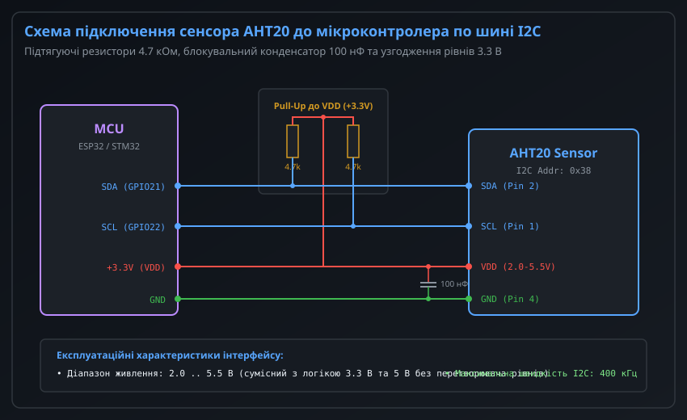
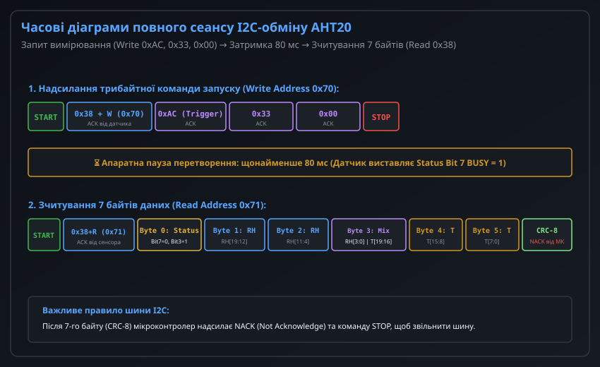
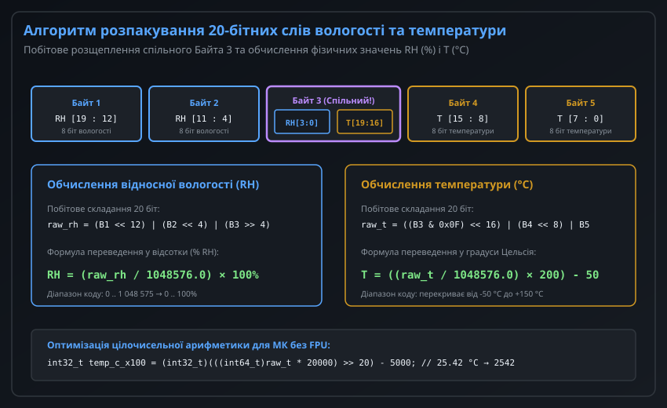
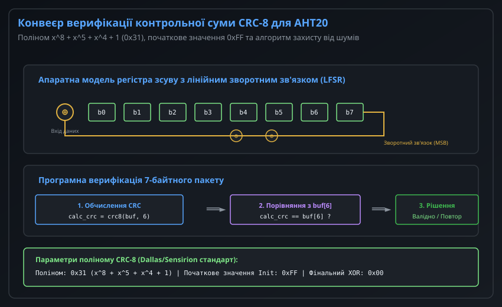
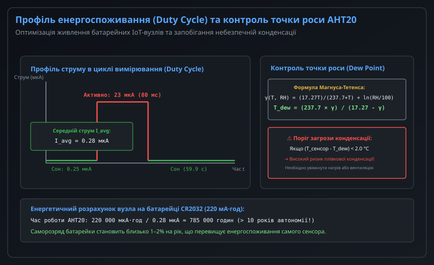

# Давач температури й вологості AHT20

Цифровий датчик AHT20 виробництва компанії ASAIR є сучасним інтегрованим рішенням для точного вимірювання відносної вологості (RH) та температури навколишнього повітря. Побудований на базі високочутливого мікроелектромеханічного (MEMS) напівпровідникового осередку та спеціалізованого ASIC-перетворювача, AHT20 прийшов на заміну застарілим давачам серій DHT11 та DHT22.

Датчик відрізняється ультракомпактними розмірами (SMD-корпус 3.0 × 3.0 × 1.0 мм), широким діапазоном напруги живлення від 2.0 В до 5.5 В, високою роздільною здатністю вихідних 20-бітних слів та комунікацією через стандартизовану шину I2C з апаратною перевіркою цілісності даних алгоритмом CRC-8.

---

## 1. Огляд сенсора AHT20, характеристики та схема базового підключення до МК

AHT20 забезпечує калібровані цифрові покази безпосередньо з заводу, що виключає необхідність складної аналогової підгонки або ручного калібрування з боку розробника вбудованих систем.



### Основні технічні параметри

| Параметр | Діапазон вимірювання | Типова похибка | Роздільна здатність |
| :--- | :--- | :--- | :--- |
| **Відносна вологість** | 0 .. 100% RH | +/-2.0% RH (при 25 °C) | 0.024% RH (20 біт) |
| **Температура** | -40 .. +85 °C | +/-0.3 °C (при 25 °C) | 0.01 °C (20 біт) |
| **Напруга живлення (VDD)** | 2.0 .. 5.5 В постійного струму | — | — |
| **Струм у режимі сну (Sleep)** | 0.25 мкА (типово при 3.3 В) | — | — |
| **Струм під час вимірювання** | 23 мкА (типово) | 40 мкА (максимально) | — |
| **Інтерфейс передачі даних** | Стандартна шина I2C | — | До 400 кГц (Fast Mode) |

### Схема електричного підключення до мікроконтролера

Для підключення AHT20 до будь-якого сучасного мікроконтролера (ESP32, STM32, Arduino, Raspberry Pi Pico) потрібні лише 4 лінії зв'язку:
1. **Лінія живлення VDD (вивід 3):** Підключається до шини стабілізованого живлення +3.3 В або +5.0 В. Широкий допустимий діапазон (2.0–5.5 В) дозволяє живити датчик безпосередньо від 3.3 В шини мікроконтролера або 5 В шини Arduino без проміжних лінійних стабілізаторів LDO.
2. **Спільний провід GND (вивід 4):** З'єднується зі спільною шиною заземлення схеми (0 В).
3. **Сигнальні лінії I2C (SDA — вивід 2, SCL — вивід 1):** Обидва виводи мають вихідний каскад з відкритим стоком (Open-Drain), тому кожна лінія повинна бути підтягнута до шини VDD зовнішнім резистором підтяжки R_pull номіналом **4.7 кОм** (допустимий діапазон від 2.2 кОм до 10 кОм залежно від ємності лінії).
4. **Блокувальний конденсатор живлення:** Безпосередньо біля виводів живлення AHT20 (на відстані не більше 3–5 мм) обов'язково встановлюється керамічний SMD-конденсатор номіналом **100 нФ (0.1 мкФ)** з діелектриком X7R для фільтрації високочастотних перешкод по лінії живлення.

---

## 2. Протокол шини I2C, формат фреймів та статусні прапорці AHT20

Датчик AHT20 функціонує в режимі веденого пристрою (I2C Slave) і має фіксовану 7-бітну апаратну адресу:

```
I2C_ADDR = 0x38  (У 8-бітному форматі: 0x70 для запису, 0x71 для читання)
```



### Алгоритм взаємодії та часові інтервали

Повний цикл взаємодії складається з чітких кроків:

1. **Фаза стартової готовності (Power-On):** Після подачі живлення сенсор вимагає витримки часу не менше 100 мс на завершення внутрішнього самотестування та зарядки внутрішніх ємностей.
2. **Перевірка стану калібрування:** Хост надсилає команду опитування статусу (читання одного байта за адресою 0x71). Якщо біт 3 байта стану `CAL_EN` дорівнює 0, необхідно надіслати команду калібрування: байт `0xBE`, за яким слідують два байти конфігурації `0x08` та `0x00`, після чого почекати 10 мс.
3. **Запуск вимірювання (Trigger Measurement):** Хост генерує стан START і надсилає трибайтний пакет запису:
   ```
   [0x38 + W (0x70)] ──► [0xAC (Команда запуску)] ──► [0x33] ──► [0x00] ──► [STOP]
   ```
4. **Апаратна пауза перетворення:** Внутрішній 20-бітний АЦП виконує інтегрування та децимацію. Тривалість перетворення становить **80 мс**. Спроба прочитати дані раніше призведе або до повернення застарілих значень, або до утримання лінії в стані зайнятості.
5. **Зчитування результатів (Read 7 Bytes):** Хост формує стан START і зчитує 7 послідовних байтів:
   ```
   [0x38 + R (0x71)] ──► [Байт 0: Статус] ──► [Байти 1..5: Дані RH і T] ──► [Байт 6: CRC-8]
   ```
   Після прийому 7-го байту мікроконтролер формує сигнал **NACK** (Not Acknowledge) та стан **STOP**, звільняючи шину I2C.

### Інтерпретація байта стану (Байт 0)

- **Біт 7 (BUSY):** Якщо біт 7 дорівнює **1**, датчик усе ще зайнятий вимірюванням; дані в буфері недійсні. Зчитувати вимірювання дозволяється лише тоді, коли `BUSY == 0`.
- **Біт 3 (CAL_EN):** Якщо біт дорівнює **1**, калібрувальні матриці успішно завантажені з OTP-пам'яті, результати достовірні. Якщо біт дорівнює **0**, датчик потребує ініціалізації командою 0xBE.

---

## 3. Алгоритм декодування 20-бітних даних та обчислення вологості й температури

Семибайтний масив, отриманий від AHT20, містить упаковані 20-бітні значення вологості та температури. Головна особливість структури полягає в тому, що Байт 3 розділений між двома фізичними величинами.



### Побітова розпаковка 20-бітних слів

Отриманий буфер `rx_buf[7]` декодується за допомогою операцій побітового зсуву та логічного маскування:

```c
/* Розпаковка 20-бітного слова відносної вологості (RH) */
uint32_t raw_rh = ((uint32_t)rx_buf[1] << 12) | 
                  ((uint32_t)rx_buf[2] << 4)  | 
                  ((uint32_t)rx_buf[3] >> 4);

/* Розпаковка 20-бітного слова температури (T) */
uint32_t raw_temp = (((uint32_t)rx_buf[3] & 0x0F) << 16) | 
                    ((uint32_t)rx_buf[4] << 8)            | 
                    ((uint32_t)rx_buf[5]);
```

### Формули обчислення фізичних величин

Повна шкала 20-бітного АЦП становить 2^20 = 1 048 576 градацій. Фізичні величини обчислюються за формулами:

1. **Відносна вологість (% RH):**
   ```
   RH (%) = ( (float)raw_rh / 1048576.0f ) * 100.0f
   ```
2. **Температура навколишнього середовища (°C):**
   ```
   T (°C) = ( (float)raw_temp / 1048576.0f ) * 200.0f - 50.0f
   ```

*Приклад розрахунку:*
Якщо отримано `raw_rh = 576716` та `raw_temp = 393216`:
- `RH = (576716.0 / 1048576.0) * 100.0 = 55.0% RH`
- `T = (393216.0 / 1048576.0) * 200.0 - 50.0 = 0.375 * 200.0 - 50.0 = +25.0 °C`

### Оптимізація обчислень у форматі цілих чисел (Fixed-Point)

Для бюджетних мікроконтролерів без апаратного блоку операцій з рухомою комою (FPU, наприклад Cortex-M0/M0+) ділення на `float` займає сотні тактів процесора. Замість цього використовують швидкі цілочисельні зсуви:

```c
/* Обчислення вологості у сотих частках відсотка (5500 = 55.00% RH) */
int32_t humidity_x100 = (int32_t)(((int64_t)raw_rh * 10000) >> 20);

/* Обчислення температури у сотих частках градуса (2500 = 25.00 °C) */
int32_t temp_c_x100 = (int32_t)(((int64_t)raw_temp * 20000) >> 20) - 5000;
```

---

## 4. Валідація даних: розрахунок та перевірка контрольної суми CRC-8

Останній (7-й) байт пакету AHT20 містить апаратну контрольну суму CRC-8, обчислену за першими 6 байтами переданого фрейму (включаючи байт стану).



### Параметри алгоритму CRC-8

Алгоритм відповідає промисловому стандарту Sensirion/Dallas CRC-8:
- **Генераторний поліном:** x^8 + x^5 + x^4 + 1 (бінарний запис: 100110001, шістнадцяткове значення: **0x31**).
- **Початкове значення (Initialization Vector):** **0xFF**.
- **Фінальна операція XOR:** **0x00** (без інверсії).

### Програмна реалізація перевірки CRC-8

Нижче наведено компактну та надійну реалізацію функції валідації на мові C:

```c
#include <stdint.h>
#include <stdbool.h>
#include <stddef.h>

/**
 * @brief Обчислення контрольної суми CRC-8 для фрейму AHT20
 * @param data Вказівник на буфер даних (перші 6 байтів)
 * @param len Кількість байтів для розрахунку (зазвичай 6)
 * @return Розраховане 8-бітне значення контрольної суми
 */
uint8_t aht20_compute_crc8(const uint8_t *data, size_t len) {
    uint8_t crc = 0xFF;
    for (size_t i = 0; i < len; ++i) {
        crc ^= data[i];
        for (uint8_t bit = 8; bit > 0; --bit) {
            if (crc & 0x80) {
                crc = (crc << 1) ^ 0x31;
            } else {
                crc = (crc << 1);
            }
        }
    }
    return crc;
}

/**
 * @brief Перевірка валідності прийнятого пакету AHT20
 */
bool aht20_is_packet_valid(const uint8_t *rx_buf) {
    /* Перевіряємо перші 6 байтів, результат порівнюємо з 7-м байтом (rx_buf[6]) */
    uint8_t calculated_crc = aht20_compute_crc8(rx_buf, 6);
    return (calculated_crc == rx_buf[6]);
}
```

Якщо функція `aht20_is_packet_valid` повертає `false`, це свідчить про наявність завади на шині I2C. Такий пакет відкидається, а драйвер ініціює повторне опитування сенсора.

---

## 5. Практична інтеграція, енергозбереження та захист від конденсації й дрейфу

AHT20 розроблений з прицілом на автономні сенсорні вузли інтернету речей (IoT), де пристрій роками живиться від однієї мініатюрної дискової батарейки (наприклад, CR2032).



### Профіль низького енергоспоживання (Duty Cycle)

Датчик не потребує спеціальної команди переведення в режим сну: після завершення оцифрування та передачі даних по I2C внутрішній контролер ASIC **автоматично** переходить в ультранизькоспоживаючий режим Deep Sleep зі струмом споживання менше **0.25 мкА**.

Розрахунок середнього струму споживання для вузла з періодом опитування 1 раз на 60 секунд:
- Струм у стані сну (59.92 с): `0.25 мкА`.
- Струм активного вимірювання (0.08 с): `23.0 мкА`.
- Середній струм споживання:
  ```
  I_avg = (0.25 мкА * 59.92 с + 23.0 мкА * 0.08 с) / 60.0 с ≈ (14.98 + 1.84) / 60.0 ≈ 0.28 мкА
  ```

При ємності батарейки CR2032 у 220 мА·год теоретичний час роботи датчика перевищує 10 років, що значно більше за строк природного саморозряду самого хімічного джерела струму.

### Розрахунок точки роси та запобігання конденсації

Якщо температура корпусу датчика опускається нижче точки роси навколишнього повітря, на полімерній мембрані утворюється рідка водяна плівка, що призводить до залипання виходу на рівні 100% RH.

Для моніторингу загрози конденсації у прошивку вбудовують розрахунок точки роси за спрощеною формулою Магнуса:

```c
#include <math.h>

/**
 * @brief Розрахунок точки роси (Dew Point) у градусах Цельсія
 */
float aht20_calculate_dew_point(float temp_c, float humidity_rh) {
    const float a = 17.27f;
    const float b = 237.7f;
    float alpha = ((a * temp_c) / (b + temp_c)) + logf(humidity_rh / 100.0f);
    float dew_point = (b * alpha) / (a - alpha);
    return dew_point;
}
```

Якщо різниця між поточною температурою та точкою роси скорочується до значення менше **2.0 °C** (`T - T_dew < 2.0 °C`), мікроконтролер повинен видати попередження про небезпеку випадання роси або увімкнути систему підігріву повітряного каналу.

### Рекомендації з інженерного монтажу

1. **Термоізоляція від джерел тепла:** Сенсор не можна розташовувати поблизу Wi-Fi антен, силових транзисторів, радіаторів або стабілізаторів живлення. Підігрів датчика на 1 °C спричиняє заниження показів вологості на 3–5% RH.
2. **Орієнтація перфорації:** Корпус датчика рекомендується орієнтувати дифузійним отвором донизу або вертикально, щоб запобігти осіданню пилу та крапель рідини всередину камери.
3. **Хімічна чистота середовища:** Слід уникати тривалого контакту сенсора з концентрованими парами кислот, аміаку, хлору, ацетону та спиртів. У разі тимчасового забруднення сенсор відновлюють процедурою прогріву в сушильній шафі (Baking при 60 °C протягом 6–12 годин).
