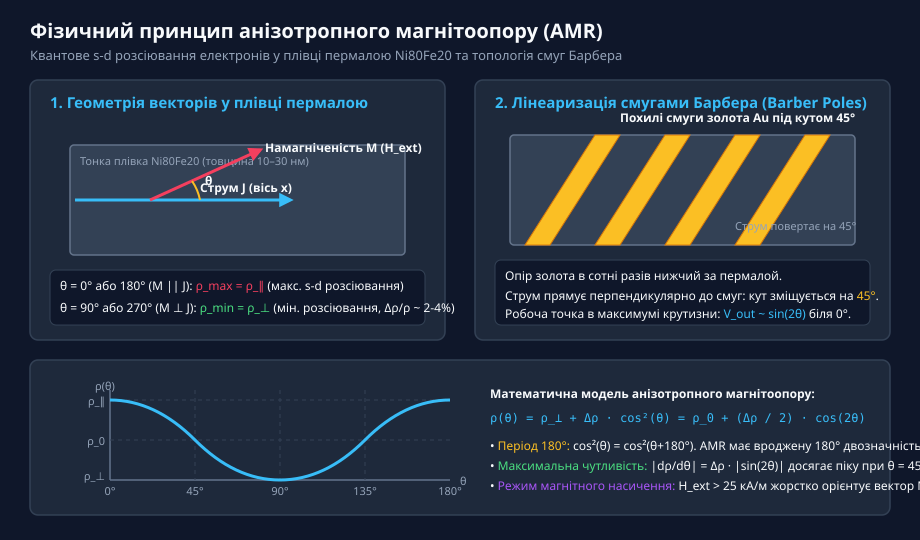
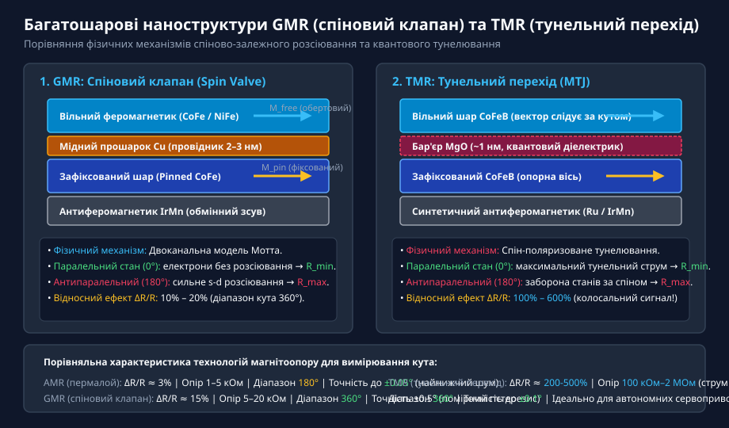
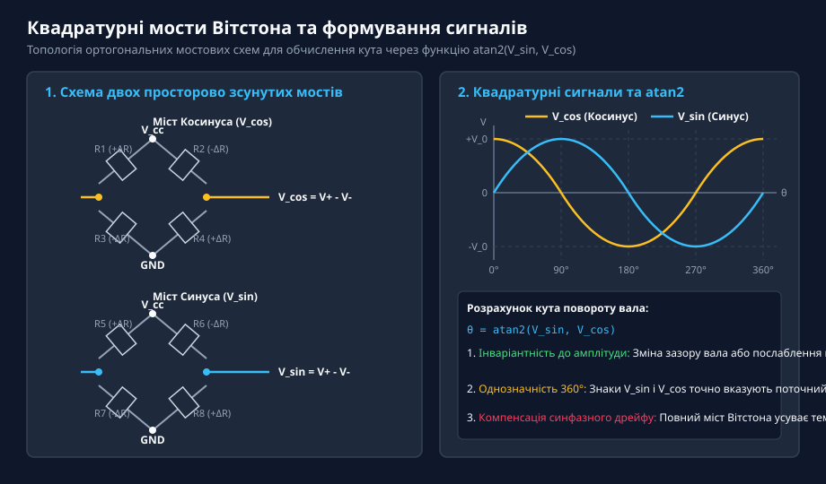
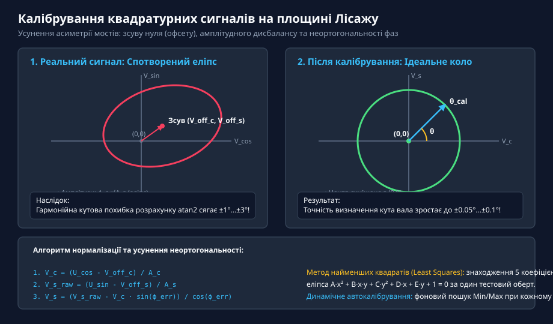
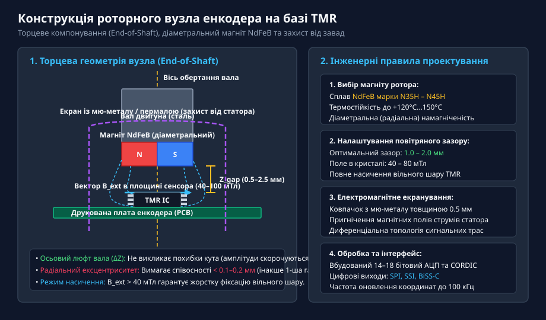

# Магніторезистивні сенсори кута AMR, GMR та TMR

<preknowlist>
- [Енкодери кутового та лінійного переміщення](root:cat-hw-sensors/optical-and-magnetic-encoders) — Принципи дискретизації кута, роздільну здатність, квадратурний зсув сигналів та відмінність між абсолютними й інкрементальними вимірювачами
- [Датчики кутового положення сервоприводів: потенціометри та магнітні енкодери](root:cat-hw-sensors/servo-feedback-potentiometers-and-magnetic-encoders) — Вимоги до зворотного зв'язку сервоприводів за точністю та обмеження контактних давачів
- [Магнітний енкодер кута AS5048](root:cat-hw-sensors/as5048-magnetic-encoder) — Загальний принцип побудови безконтактних магнітних енкодерів кута з торцевим розміщенням магніту на валу
</preknowlist>

## Обмеження контактних та холлівських давачів

Точне вимірювання кутового положення обертового вала є критичною ланкою у побудові сучасних робототехнічних систем, прецизійних сервоприводів, верстатів з числовим програмним керуванням (ЧПК) та автомобільних систем активного кермування. Вимоги до швидкодії та гладкості руху в таких приводах визначаються точністю зворотного зв'язку за кутом: будь-яка похибка або зашумленість виміряної координати викликає пульсації крутного моменту, додатковий акустичний шум, підвищений нагрів обмоток двигуна та втрату точності позиціонування.

Історично першим і найпростішим рішенням для вимірювання кутового положення слугували контактні резистивні сенсори — кутові потенціометри. Механічна конструкція потенціометра містить струмопровідну доріжку з вуглецевого композиту, високоомного металевого сплаву або електропровідного пластику, по якій ковзає пружний металевий скребок (пружна контактна щітка), жорстко зв'язана з обертовим валом. Проте в умовах інтенсивної експлуатації, вібрацій та циклічних реверсивних рухів [потенціометри та магнітні енкодери](root:cat-hw-sensors/servo-feedback-potentiometers-and-magnetic-encoders) контактного типу виявляють катастрофічні обмеження надійності:
* **Механічне зношування та деградація поверхонь:** Постійне сухе тертя призводить до стирання резистивного шару, появи мікротріщин, накопичення токопровідного пилу та зміни профілю опору. Це викликає швидке зростання локальної нелінійності характеристики. * **Контактний шум та фліккер-шум:** При високих швидкостях обертання або вібраціях металевий скребок зазнає мікровідскоків від доріжки. Нестабільний електричний контакт генерує високочастотні сплески напруги (@@en|contact noise@@) та фліккер-шум (@@en|1/f noise@@), які унеможливлюють точне цифрове диференціювання сигналу для розрахунку кутової швидкості. * **Додатковий момент тертя та окиснення:** Механічний притиск щітки створює статичний момент тертя, що критично для малопотужних мікроприводів. У свою чергу, наявність агресивних випарів або вологи спричиняє окиснення контактних поверхонь, аж до повного розриву вимірювального кола.

Для усунення механічного контакту були розроблені оптичні енкодери кутового переміщення. Вони забезпечують високу роздільну здатність та точність за допомогою прозорого скляного або пластикового диска з нанесеними промененепрозорими штрихами, який просвічується світлодіодом на масив фотоприймачів. Проте класичні [енкодери кутового переміщення](root:cat-hw-sensors/optical-and-magnetic-encoders) оптичного типу мають високу чутливість до умов довкілля:
* **Вразливість до забруднень:** Потрапляння найдрібніших частинок пилу, масляного туману або утворення конденсату на растровій доріжці призводить до перекриття або заломлення світлового променя. Це викликає пропуски імпульсів у інкрементальних каналах або зчитування помилкових кодових комбінацій у абсолютних датчиках. * **Низька вібро- та ударна стійкість:** Крихкий скляний диск під дією інтенсивних радіальних або осьових вібрацій серводвигуна може розтріскатися або деформуватися. Крім того, навіть невеликий осьовий люфт вала змінює фокусну відстань оптичної системи, що спотворює амплітуду квадратурних сигналів.

У важкому машинобудуванні та авіаційній техніці для роботи в екстремальних умовах використовують електромагнітні індуктивні перетворювачі — [обертові трансформаторні кутоміри](root:cat-hw-sensors/synchro-and-resolver-transducers) (резольвери) та [диференціальні трансформатори RVDT](root:cat-hw-sensors/rvdt-rotary-variable-differential-transformers). Завдяки відсутності електронних компонентів та крихких елементів усередині самого датчика, резольвери демонструють виняткову надійність, стійкість до радіації, бруду та температур до +150 °C. Однак індуктивні давачі мають суттєві конструктивні та схемотехнічні недоліки:
* **Складність тракту кондиціонування:** Резольвери вимагають живлення первинної обмотки високочастотним синусоїдальним струмом збудження (2–10 кГц) та реалізації високоточної обробки вихідних амплітудно-модульованих сигналів, яка включає [синхронне детектування сигналів](root:cat-hw-sensors/synchronous-demodulation-for-inductive-transducers) та спеціалізовані перетворювачі «резольвер-код». * **Масогабаритні показники та енергоспоживання:** Наявність багатовиткових мідних обмоток та важкого шихтованого магнітопроводу робить індуктивні давачі громіздкими, а реактивні втрати в обмотках спричиняють суттєве енергоспоживання.

Пошук компактного, суцільнотвердотільного безконтактного рішення привів до масового впровадження напівпровідникових датчиків на основі ефекту Холла (@@en|Hall effect@@, названий на честь фізика Едвіна Холла). Ефект Холла виникає при проходженні електричного струму крізь напівпровідникову пластину, розміщену у зовнішньому магнітному полі. Під дією сили Лоренца (@@en|Lorentz force@@) носії заряду відхиляються до бічних граней пластини, створюючи поперечну напругу Холла, пропорційну індукції перпендикулярного магнітного поля. Сучасні інтегровані мікросхеми, як-от [магнітний енкодер AS5048](root:cat-hw-sensors/as5048-magnetic-encoder), містять хрестоподібні масиви холлівських елементів для зчитування кутового положення роторного магніту.

Незважаючи на простоту інтеграції у кремнієві мікросхеми, датчики Холла мають принципові фізичні обмеження у прецизійних вимірювачах кута:
1. **Низька магнітна чутливість:** Відносний магніторезистивний відгук напівпровідникових елементів Холла є вкрай малим (напруговий коефіцієнт становить одиниці мілівольт на тесла). Для отримання розмаху сигналу у кілька вольт потрібні підсилювачі з коефіцієнтом підсилення 100–500, що призводить до накопичення власних шумів напівпровідникового p-n переходу та обмеження роздільної здатності. 2. **Високий температурний дрейф:** Рухливість носіїв заряду та питомий опір кремнію суттєво залежать від температури. У діапазоні від -40 °C до +125 °C коефіцієнт підсилення холлівського елемента та його початковий зсув (офсет) дрейфують на десятки відсотків, вимагаючи складного цифрового термокалібрування. 3. **Чутливість до витоків та перекосів полів:** Класичний планарний холлівський елемент вимірює лише перпендикулярну компоненту магнітної індукції Bz. Будь-які просторові невіосності розміщення магніту щодо мікросхеми або витоки магнітного поля від статорних обмоток двигуна викликають спотворення квадратурної форми сигналів.

Радикальним розв'язком зазначених проблем стало використання тонкоплівкових металевих магніторезистивних сенсорів, які реагують не на абсолютне значення перпендикулярного поля, а на напрямок вектора індукції в площині кристала. Зазирнувши в історичний контекст, можна побачити, як створювалися фундаментальні відкриття у цій галузі: [історії розвитку магнітоопору](root:cat-hw-sensors/amr-gmr-tmr-magnetic-sensors/hist-magnetoresistance-evolution.md) висвітлює шлях від відкриття Томсоном анізотропії опору в масивних феромагнетиках до розробки сучасних спін-клапанних та тунельних наноструктур. Магніторезистивні сенсори функціонують у режимі магнітного насичення, що повністю знімає залежність від нестабільності робочого зазору та забезпечує гігантський сигнал без дрейфу.

## Анізотропний магнітоопір та його фізика

Фізичним фундаментом першого покоління високоефективних безконтактних магніторезистивних кутомірів став ефект анізотропного магнітоопору (@@en|AMR@@, від @@en|Anisotropic Magnetoresistance@@). Фізичне явище @@en|AMR@@ полягає у зміні питомого електричного опору феромагнітного провідника залежно від кута між напрямком векторного струму провідності та орієнтацією вектора внутрішньої намагніченості матеріалу.

Найбільша величина ефекту @@en|AMR@@ спостерігається у тонких металевих плівках пермалою (@@en|permalloy@@ — сплав складу 80% нікелю Ni та 20% заліза Fe). Пермалоєві плівки товщиною від 10 до 50 нанометрів мають унікальну комбінацію магнітних властивостей: високу магнітну проникність, низьку коерцитивну силу (менше 80 А/м) та практично відсутню магнітострикцію. Це дозволяє легко управляти напрямком намагніченості плівки за допомогою відносно слабких зовнішніх магнітних полів.

В основі ефекту @@en|AMR@@ лежить квантово-механічна спін-орбітальна взаємодія (@@en|spin-orbit coupling@@ — взаємодія між орбітальним рухом електрона провідності та його власним внутрішнім спіновим моментом) і пов'язане з нею спіново-залежне s-d розсіювання носіїв заряду. У феромагнітному пермалої електронна d-зона розщеплена потужним внутрішнім обмінним полем на дві підзони з орієнтацією спінів за та проти напрямку намагніченості. Електричний струм у металі переноситься переважно високорухливими s-електронами. Під час руху вздовж кристалічної ґратки s-електрони зазнають квантових переходів (розсіювання) у вільні стани d-зони.

Коли зовнішнє магнітне поле орієнтує вектор намагніченості плівки M паралельно вектору густини струму J (кут θ = 0° або 180°), електронні хмари d-орбіталей під дією спін-орбітальної взаємодії деформуються у просторі так, що їхній переріз розсіювання для s-електронів стає максимальним. У результаті середня довжина вільного пробігу електронів зменшується, а питомий опір плівки досягає максимального значення ρ_∥. Якщо ж вектор намагніченості M спрямований перпендикулярно до вектора струму J (кут θ = 90° або 270°), ефективний переріз s-d розсіювання є мінімальним, що відповідає мінімальному питомому опору ρ_⊥.

Залежність питомого опору плівки пермалою від кута θ між вектором густини струму J та вектором намагніченості M описується наступною математичною моделлю:

ρ(θ) = ρ_⊥ + (ρ_∥ - ρ_⊥) · cos²(θ)
     = ρ_⊥ + Δρ · cos²(θ)                     [вираження через різницю опорів Δρ]
     = ρ_⊥ + Δρ · (1/2 + 1/2 · cos(2θ))       [тригонометрична тотожність cos²(θ) = (1 + cos(2θ))/2]
     = ρ_0 + (Δρ / 2) · cos(2θ)               [виділення середнього опору ρ_0 = ρ_⊥ + Δρ/2]

У наведеному розрахунковому блоці застосовано такі позначення величин:
* `ρ(θ)` — питомий опір тонкоплівкового елемента при куті `θ` між струмом та намагніченістю [Ом·м];
* `ρ_∥` — питомий опір матеріалу при паралельній орієнтації струму та намагніченості (`θ = 0°` або `180°`) [Ом·м];
* `ρ_⊥` — питомий опір матеріалу при перпендикулярній орієнтації струму та намагніченості (`θ = 90°` або `270°`) [Ом·м];
* `Δρ = ρ_∥ - ρ_⊥` — абсолютна величина анізотропної зміни питомого опору [Ом·м];
* `ρ_0 = (ρ_∥ + ρ_⊥) / 2` — середній ізотропний опір плівки [Ом·м];
* `θ` — кут між вектором густини струму `J` та вектором внутрішньої намагніченості `M` [рад або град].

Відносний коефіцієнт магнітоопору `Δρ / ρ_0` для якісних тонких плівок пермалою при кімнатній температурі становить від 2% до 4%. Незважаючи на відносно невелику величину зміни опору, гармонічна залежність від подвійного кута `cos(2θ)` визначає всі базові характеристики @@en|AMR@@-сенсорів.


*Геометрія струму та магнітної індукції в тонкій плівці пермалою: при паралельній орієнтації векторів опір максимальний, а при перпендикулярній — мінімальний.*

Аналіз тригонометричної моделі виявляє три фундаментальні фізичні особливості @@en|AMR@@-структур:
1. **Квадратична симетрія та кутова двозначність 180°:** Оскільки `cos²(θ) = cos²(θ + 180°)`, опір @@en|AMR@@-елемента набуває однакового значення для кутів `θ` та `θ + 180°`. Подекуди це створює кутову двозначність: одиночна магніторезистивна плівка @@en|AMR@@ принципово не здатна відрізнити протилежні напрямки магнітного поля, задовольняючи вимірювальний діапазон лише від 0° до 180°. 2. **Максимальна крутизна характеристики при 45°:** Чудові характеристики лінійності давача досягаються при функціонуванні поблизу робочої точки `θ = 45°`. Похідна опору за кутом `dρ/dθ = -Δρ · sin(2θ)` досягає свого абсолютного максимуму при `θ = 45°` та `135°`, де коефіцієнт перетворення кута у зміну опору є найвищим. Натомість біля `θ = 0°` та `θ = 90°` чутливість падає до нуля. 3. **Робота у режимі магнітного насичення:** Щоб вектор намагніченості пермалою M строго слідував за кутом повороту зовнішнього роторного магніту, зовнішнє магнітне поле H_ext повинно перевищувати поле анізотропії та насичення плівки `H_ext > H_sat` (зазвичай понад 25–30 кА/м, що відповідає магнітній індукції понад 30 мТл). У режимі насичення магнітний вектор плівки M жорстко зафіксований уздовж зовнішнього поля H_ext. Завдяки цьому будь-які бічні коливання амплітуди поля або зміни робочого зазору між магнітом та мікросхемою не змінюють опір `ρ(θ)`, гарантуючи виняткову завадостійкість.

Для лінеаризації характеристики та усунення нечутливості поблизу `θ = 0°` розробники застосовують спеціальну топологічну конструкцію — смуги Барбера (@@en|barber pole@@ смуги, названі за аналогією з яскравими смугастими стовпами перукарень).

Конструктивно смуги Барбера виготовляють у вигляді похилих еквіпотенціальних смужок з високопровідного металу (золота або алюмінію), висаджених під кутом 45° поверх смуги пермалою. Оскільки питомий опір золота в сотні разів нижчий за опір пермалою, електричний струм прямує найкоротшим шляхом і входить у пермаловий шар строго перпендикулярно до граней золотих смуг. У результаті вектор густини струму J усередині пермалою повертається на 45° відносно поздовжньої осі елемента. Це штучно зміщує початкову робочу точку до `θ = 45°`, де крутизна характеристики є максимальною, а вихідна напруга стає прямо пропорційною `sin(2θ)`.

Завдяки впровадженню смуг Барбера та мостових схем, @@en|AMR@@-сенсори забезпечують високий коефіцієнт підсилення, низький температурний дрейф та кутову точність до 0.1°. Однак обмеженість кутового діапазону в 180° та порівняно невеликий відносний магнітоопір (2–4%) створили передумови для подальшого квантово-фізичного стрибка — переходу до багатошарових спінових клапанів @@en|GMR@@ та тунельних структур @@en|TMR@@.

## Спіново-залежне розсіювання та тунелювання електронів

Головне обмеження анізотропного магнітоопору полягає в тому, що ефект @@en|AMR@@ залежить виключно від кута між напрямком електричного струму та вектором намагніченості плівки. Оскільки тригонометрична залежність `cos²(θ)` приймає однакові значення через кожні 180°, сенсор фізично не здатний відрізнити кут `0°` від `180°`. Для побудови прецизійних кутомірів із однозначним вимірювальним діапазоном у 360° знадобився фізичний механізм, опір якого визначається не відносним орієнтуванням струму й намагніченості, а кутом між двома окремими векторами намагніченості тонкоплівкових шарів.

Такий механізм забезпечує гігантський магнітоопір (англ. *giant magnetoresistance*, від *giant* — велетенський та *magnetoresistance* — опір під дією магнітного поля) @@en|GMR@@. В основі його роботи лежить базова тонкоплівкова гетероструктура, відома як спіновий клапан (англ. *spin valve*, від *spin* — власний момент електрона та *valve* — вентиль) @@en|spin valve@@. Вона складається з двох феромагнітних металевих шарів (наприклад, сплавів `CoFe` або `NiFe`), розділених надтонким немагнітним провідним прошарком (найчастіше міддю `Cu` товщиною близько 2–3 нм).

Товщину мідного прошарку обирають з особливою точністю: вона має бути достатньо великою, щоб усунути прямий феромагнітний обмінний зв'язок між шарами, але меншою за довжину вільного пробігу та довжину спінової дифузії електронів. Це дозволяє електронам перетинати немагнітний шар без втрати своєї спінової орієнтації.

Один із феромагнітних шарів виконують як вільний (англ. *free layer*) @@en|free layer@@. Його вектор намагніченості вільно повертається під дією зовнішнього магнітного поля роторного магніту. Другий шар роблять зафіксованим (англ. *pinned layer*, від *pin* — пришпилювати) @@en|pinned layer@@. Напрямок його намагніченості жорстко заблокований у заданій осі завдяки явищу обмінного зсуву, що виникає при безпосередньому контакті з суміжним шаром антиферомагнетика (наприклад, `IrMn` або `PtMn`).


*Пошарова структура плівок GMR та TMR: при паралельній орієнтації векторів намагніченості опір елемента мінімальний, а при антипаралельній — максимальний.*

Проходження електричного струму крізь спіновий клапан описується двоканальною моделлю Мотта. Через розщеплення d-зон у феромагнетиках густина електронних станів на рівні Фермі для електронів зі спіном «вгору» та «вниз» є неоднаковою. Спіново-залежне розсіювання електронів на межах розділу та всередині шарів створює два паралельні канали провідності:
- Коли вектори намагніченості вільного та зафіксованого шарів паралельні (кут між ними `θ = 0°`), електрони зі спіном, паралельним напрямку намагніченості, проходять крізь обидва шари майже без розсіювання. Цей низькоомний канал провідності шунує структуру, забезпечуючи мінімальний електричний опір `R_min`. - Коли вектори намагніченості антипаралельні (`θ = 180°`), електрони обох спінових груп зазнають сильного розсіювання: перша група розсіюється у зафіксованому шарі, а друга — у вільному. У результаті обидва канали провідності мають високий опір, що створює максимальний опір елемента `R_max`.

Залежність опору елемента @@en|GMR@@ від кута `θ` між вектором намагніченості вільного шару та фіксованим вектором опорного шару описується косинусною функцією першого порядку:

```
R(θ) = R_0 - (ΔR / 2) · cos(θ)
```
[де R_0 — середній опір елемента, ΔR — амплітуда зміни опору R_max - R_min, θ — кут повороту зовнішнього поля]

Оскільки функція `cos(θ)` є монотонною на проміжку від 0° до 180° і приймає протилежні за знаком значення на інтервалі від 180° до 360°, сенсори @@en|GMR@@ дозволяють однозначно визначати абсолютне кутове положення вала у повному діапазоні 360°. Еволюційний шлях від перших дослідів із магнітоопором до створення сучасних спінових структур висвітлено у матеріалі про [еволюції магніторезистивних ефектів](root:cat-hw-sensors/amr-gmr-tmr-magnetic-sensors/hist-magnetoresistance-evolution.md).

Наступним кроком у розвитку тонкоплівкових магнітних технологій став тунельний магнітоопір (англ. *tunnel magnetoresistance*, від *tunnel* — тунелювати, пробивати квантовий бар'єр) @@en|TMR@@. У цій структурі немагнітний металевий шар міді замінено на надтонкий диелектричний бар'єр (наприклад, оксид магнію `MgO` товщиною близько 1 нм). Така система утворює магнітний тунельний перехід (англ. *magnetic tunnel junction*, від *junction* — з'єднання) @@en|MTJ@@.

Класичний струм провідності крізь диелектричний прошарок проходити не може. Електрони долають потенціальний бар'єр виключно завдяки ефекту квантово-механічного тунелювання. Ймовірність тунелювання електрона прямо пропорційна добутку густини електронних станів на рівні Фермі вихідного та приймального феромагнітних електродів для відповідної спінової проєкції:
- При паралельній намагніченості вільного та зафіксованого шарів напрямки спінів електронів збігаються з вільними станами в приймальному шарі. Це викликає високу ймовірність тунелювання і формує низький опір переходу `R_min`. - При антипаралельній намагніченості електрони основної спінової групи вихідного шару стикаються з відсутністю вільних станів відповідного спіну в приймальному шарі. Тунельний струм різко падає, створюючи максимальний опір `R_max`.

Кристалічні бар'єри `MgO` додатково забезпечують ефект симетрійного спінового фільтра: вони пропускають лише симетричні хвильові функції електронів, які у феромагнетиках `CoFeB` є на 100% спіново-поляризованими. Завдяки цьому відносний магніторезистивний ефект `ΔR / R_min` у тунельних переходах @@en|TMR@@ сягає 100–600% за кімнатної температури, порівняно з 10–20% у @@en|GMR@@ та 2–3% у @@en|AMR@@.

Крім колосального сигналу, квантове тунелювання визначає високий базовий опір елементів @@en|TMR@@ (від десятків кілоом до мегаом). Це зменшує робочий струм місткових схем до мікроамперних значень, роблячи @@en|TMR@@ оптимальним рішенням для автономних вимірювальних систем і вузлів [зворотного зв'язку сервоприводів](root:cat-hw-sensors/servo-feedback-potentiometers-and-magnetic-encoders) із критичними вимогами до енергоефективності.

## Квадратурні мости та формування сигналів

Окремий магніторезистивний елемент має високий початковий опір `R_0` та порівняно невелику відносну зміну `ΔR`. Пряме вимірювання опору одиночного елемента ускладнюється дрейфом температури, нестабільністю напруги живлення та технологічним розкидом товщини тонких плівок. Для компенсації синфазних завад і виділення корисного сигналу магніторезистори об'єднують у мостову схему Вітстона (англ. *Wheatstone bridge*, на честь Чарльза Вітстона) @@en|Wheatstone bridge@@.

Класичний повний міст містить чотири резистивні плечі, розміщені на спільному кремнієвому кристалі. При зміні напрямку зовнішнього магнітного поля опір протилежних діагональних плечей змінюється у дзеркальних напрямках: два резистори збільшують свій опір на `ΔR`, а два інші — зменшують на `ΔR`. Диференціальна вихідна напруга моста прямо пропорційна напрузі живлення `V_cc` і не залежить від однакового для всіх чотирьох плечей температурного дрейфу початкового опору `R_0`.

Проте один міст Вітстона формує лише один скалярний гармонічний сигнал, наприклад `V_out = V_0 · cos(θ)`. Оскільки функція косинуса є парною, її значення збігаються для кутів `+θ` та `-θ` (або `θ` та `360° - θ`). Одиночний міст не здатний визначити напрямок обертання ротора. Щоб усунути цю невизначеність, формують квадратурний сигнал (англ. *quadrature signal*, від лат. *quadratura* — зсув на 90 градусів) @@en|quadrature signals@@ за допомогою двох окремих мостів, вихідні напруги яких зсунуті по фазі на 90°.


*Топологія квадратурних мостів Вітстона та вихідні дифсигнали: ортогональне розташування елементів формує синусну та косинусну напруги для обчислення кута.*

Спосіб створення квадратурного фазового зсуву залежить від фізики використовуваного магніторезистивного ефекту:
- У сенсорах @@en|AMR@@ елементи першого моста орієнтують під кутом 0° та 90°, а другого — під кутом 45° та 135°. Оскільки опір @@en|AMR@@ залежить від подвійного кута `cos(2θ)`, геометричний зсув плівок на 45° дає електричний фазовий зсув у 90°. Вихідні дифсигнали мають вигляд `V_cos = V_0 · cos(2θ)` та `V_sin = V_0 · sin(2θ)` з періодом 180°. - У сенсорах @@en|GMR@@ та @@en|TMR@@ зафіксовані шари елементів першого моста спрямовують ортогонально (під кутом 90°) до зафіксованих шарів другого моста. Завдяки лінійній косинусній залежності від `cos(θ)` це формує квадратурні напруги `V_cos = V_0 · cos(θ)` та `V_sin = V_0 · sin(θ)` з періодом 360°.

Наявність двох ортогональних каналів напруги дозволяє обчислити поточний кут повороту `θ` у всьому діапазоні за допомогою чотириквадрантного арктангенса (англ. *four-quadrant arctangent*) @@en|atan2@@:

```
V_sin = V_0 · sin(θ)
V_cos = V_0 · cos(θ)

θ = atan2(V_sin, V_cos)
```
[обчислення кута за співвідношенням ортогональних складових напруги]

Функція @@en|atan2@@ аналізує знаки обох аргументів і точно визначає квадрант (від I до IV), у якому перебуває вектор намагніченості. Важлива математична властивість ділення `V_sin / V_cos` полягає в його інваріантності до зміни амплітуди `V_0`. Якщо індукція магнітного поля ротора коливається через торцевий розкид зазору або температурне ослаблення магніту, амплітуди обох каналів змінюються в однакову кількість разів і повністю скорочуються під час обчислення тангенса.

Теоретичні засади побудови [тригонометричної моделі квадратури](root:cat-hw-sensors/amr-gmr-tmr-magnetic-sensors/math-magnetoresistive-quadrature-atan2.md) описують ідеальні мостові схеми. Однак у реальних аналогових трактах квадратурний сигнал зазнає спотворень під дією трьох основних похибок:
1. Постійний зсув напруги (офсет `V_off`): виникає через технологічну асиметрію плечей моста або зсув нуля операційного підсилювача. 2. Амплітудний дисбаланс (`A_sin ≠ A_cos`): викликаний різницею коефіцієнтів підсилення каналів синуса й косинуса. 3. Неортогональний фазовий зсув (`ϕ ≠ 90°`): виникає при відхиленні просторового кута між зафіксованими шарами від 90°.


*Калібрувальний еліпс Лісажу: деформація кругової траєкторії спричинена похибками тракту, а її корекція повертає точне значення арктангенса.*

На параметричній площині Лісажу, де по осі X відкладено косинусну напругу, а по осі Y — синусну, ідеальний квадратурний сигнал створює коло з центром у початку координат. Постійний офсет зміщує центр кола, а амплітудний дисбаланс і фазова неортогональність деформують коло в похилий еліпс. Обчислення арктангенса за невідкаліброваними сигналами призводить до виникнення циклічної кутової похибки. Для відновлення колової траєкторії застосовують математичні процедури [алгоритмів калібрування зсуву](root:cat-hw-sensors/amr-gmr-tmr-magnetic-sensors/math-angle-sensor-calibration-error-correction.md).

Схемотехніка первинного нормування сигналів та [підключення аналогового моста](root:cat-hw-sensors/amr-gmr-tmr-magnetic-sensors/api-magnetoresistive-sensor-hw.md) вимагає використання дифпідсилювачів із високим коефіцієнтом приглушення синфазних завад.

Нижче наведено базову реалізацію обчислення кута з попереднім нормуванням офсету та амплітудного співвідношення каналів:

:::tabs
@tab C
:::code amr-gmr-tmr-magnetic-sensors-d/c/calculate-angle-deg.c
@tab C++
:::code amr-gmr-tmr-magnetic-sensors-d/cpp/quadratureangleprocessor.cpp
:::

У порівнянні з традиційними вимірювачами на [оптичних та магнітних енкодерах](root:cat-hw-sensors/optical-and-magnetic-encoders) або [трансформаторних резольверах](root:cat-hw-sensors/synchro-and-resolver-transducers), квадратурні мостові матриці на @@en|TMR@@ та @@en|GMR@@ забезпечують високу роздільну здатність у компактному монолітному виконанні. Зчитаний аналогово-цифровим перетворювачем кутовий код передається у мікроконтролер через стандартизовані канали [цифрового інтерфейсу SSI](root:cat-hw-sensors/ssi-bissc-digital-interfaces) або SPI, а принцип фазової демодуляції нагадує алгоритми у [перетворювачах резольвер-код](root:cat-hw-sensors/resolver-to-digital-converters). Завдяки технологічності такі квадратурні елементи інтегрують безпосередньо в кристали інтегральних кутомірів на кшталт [магнітному кутомірі AS5048](root:cat-hw-sensors/as5048-magnetic-encoder).

## Розрахунок кута та методи калібрування

Отримання квадратурних вихідних напруг синуса й косинуса з мостових схем є лише першим етапом вимірювального тракту. Головна математична задача полягає в перетворенні двох неперервних аналогових сигналів `V_sin` та `V_cos` у єдиний скалярний параметр — абсолютний кут повороту ротора `θ`.

Пряме відношення напруги синуса до напруги косинуса дає тригонометричний тангенс кута `tan(θ) = V_sin / V_cos`. Однак спроба обчислити кут за допомогою класичної одноаргументної функції арктангенса `atan(V_sin / V_cos)` стикається з двома нездоланними обмеженнями:
1. При кутах 90° та 270° напруга косинуса дорівнює нулю, що призводить до математичної невизначеності через ділення на нуль. 2. Функція тангенса має період 180° (`tan(θ) = tan(θ + 180°)`), тому одноаргументний арктангенс повертає значення лише в діапазоні від -90° до +90°. Внаслідок цього вимірювальна система не здатна відрізнити перший квадрант (де обидва сигнали додатні) від третього квадранта (де обидва сигнали від'ємні), а також другий квадрант від четвертого.

Для однозначного відновлення абсолютного кутового положення у повному просторовому діапазоні 360° (для @@en|GMR@@ та @@en|TMR@@ сенсорів) або 180° (для @@en|AMR@@ сенсорів) застосовують функцію двох аргументів (англ. *two-argument arctangent*, від *arc* — дуга та *tangent* — тангенс) @@en|atan2@@.

Алгоритм @@en|atan2@@ приймає окремо обидва аналогові значення — чисельник `V_sin` та знаменник `V_cos` — і визначає знак кожного з них. Залежно від комбінації знаків обчислювач тотожно відновлює поточний квадрант:
- Якщо `V_cos > 0` та `V_sin ≥ 0`, кут належить I квадранту (`0` до `π/2`). - Якщо `V_cos < 0`, кут обчислюється як `atan(V_sin / V_cos) + π`, що відповідає II та III квадрантам (`π/2` до `3π/2`). - Якщо `V_cos > 0` та `V_sin < 0`, кут обчислюється як `atan(V_sin / V_cos) + 2π`, що відповідає IV квадранту (`3π/2` до `2π`). - Якщо `V_cos = 0`, алгоритм повертає `+π/2` при `V_sin > 0` або `-π/2` при `V_sin < 0`, запобігаючи помилці ділення на нуль.

Фундаментальні математичні засади [обчислення через atan2](root:cat-hw-sensors/amr-gmr-tmr-magnetic-sensors/math-magnetoresistive-quadrature-atan2.md) гарантують повну нечутливість результату до синхронної зміни амплітуд обох сигналів. Якщо температурне ослаблення магніту або коливання робочого зазору змінюють амплітуду синуса й косинуса в однакову кількість разів, їхнє співвідношення під знаком арктангенса лишається незмінним.

Проте в реальних аналогових трактах квадратурні напруги відхиляються від ідеальних тригонометричних функцій. На виходи мостів Вітстона впливають три основні види технологічних похибок:
1. Постійний зсув нуля (офсет) `V_off_c` та `V_off_s`: виникає через неминучий розкид опорів плечей моста при виготовленні кристала та постійну напругу зсуву операційних підсилювачів. 2. Амплітудний дисбаланс: різниця між максимальними амплітудами синуса `A_s` та косинуса `A_c`, зумовлена розбалансом коефіцієнтів підсилення двох аналогових каналів. 3. Неортогональність фазового зсуву: відхилення просторового кута між чутливими елементами двох мостів від ідеальних 90° на величину кутової похибки фази `ϕ_err`.

Якщо побудувати параметричний графік залежності напруги синуса від напруги косинуса (діаграму Лісажу), то ідеальні квадратурні сигнали створюють точне коло з центром у початку координат `(0,0)`. Постійний офсет зміщує центр цього кола на вектор `(V_off_c, V_off_s)`. Амплітудний дисбаланс витягує коло в еліпс, осі якого паралельні координаційним осям. Фазова неортогональність повертає осі еліпса під похилим кутом.

Обчислення арктангенса за невідкаліброваними сигналами спотвореного еліпса призводить до виникнення періодичної кутової помилки — гармонічної похибки (англ. *harmonic error*, від *harmonia* — співзвуччя) @@en|harmonic error@@, яка повторюється від 1 до 4 разів за один повний оберт вала.

Для приведення спотворених напруг до ідеального одиничного кола застосовується двовимірна матриця калібрування (англ. *calibration matrix*, від араб. *qālib* — форма, калібр та *matrix* — матриця) @@en|calibration matrix@@.

Розрахунок відкоригованих ортогональних компонентів косинуса `V_c` та синуса `V_s` здійснюється з сирих напруг `U_cos` та `U_sin`, де амплітуди позначено як `A_c` і `A_s`, офсети як `V_off_c` і `V_off_s`, а кут фазового відхилення як `ϕ_err`.

Для послідовного усунення зсуву нуля, вирівнювання амплітуд та ортогоналізації фази виконують такі математичні перетворення:

```
V_c = (U_cos - V_off_c) / A_c
    = cos(θ)                                        [усунення офсету та нормування косинуса]

V_s_raw = (U_sin - V_off_s) / A_s
        = sin(θ + ϕ_err)                           [усунення офсету та нормування синуса]
        = sin(θ) · cos(ϕ_err) + cos(θ) · sin(ϕ_err) [розклад синуса суми кутів]

V_s = (V_s_raw - V_c · sin(ϕ_err)) / cos(ϕ_err)
    = sin(θ)                                        [віднімання проекції косинуса та фазова ортогоналізація]
```

Отримані значення `V_c` та `V_s` являють собою чисті ортогональні функції `cos(θ)` та `sin(θ)`, відкладені на одиничному колі. Застосування функції @@en|atan2(V_s, V_c)@@ до цих відкоригованих величин дає абсолютний кут `θ` без гармонічних спотворень.

Визначення параметрів калібрувальної матриці `V_off_c`, `V_off_s`, `A_c`, `A_s` та `ϕ_err` здійснюється двома основними методами:
- **Заводське офлайн-калібрування**: Роторний вал повертають на повний оберт 360° із постійною швидкістю за допомогою тестового сервоприводу. Масив знятих аналогово-цифровим перетворювачем точок обробляється алгоритмом еліптичної апроксимації, в основі якого лежить метод найменших квадратів (англ. *least squares method*, від *least* — найменший та *square* — квадрат) @@en|Least Squares Method@@. Отримані коефіцієнти записують у перезаписувану пам'ять мікроконтролера або застосовують [випалювання OTP-пам'яті](root:cat-hw-sensors/as5048-otp-programming-guide) безпосередньо у кристал сенсора. - **Динамічне онлайн-калібрування**: Алгоритм у реальному часі відстежує мінімальні та максимальні значення напруг синуса й косинуса за кілька обертів вала. Оновлення значень офсетів та амплітуд дозволяє компенсувати температурний дрейф моста в процесі тривалої роботи пристрою.

Детальний математичний апарат [калібрування та корекції](root:cat-hw-sensors/amr-gmr-tmr-magnetic-sensors/math-angle-sensor-calibration-error-correction.md) містить розрахунок вищих гармонік за допомогою фур'є-компенсації (на честь Жозефа Фур'є) @@en|Fourier compensation@@, що усуває залишок нелінійностей магнітного поля.

Нижче наведено практичну реалізацію алгоритму калібрування квадратурних сигналів та обчислення кута:

:::tabs
@tab C
:::code amr-gmr-tmr-magnetic-sensors-d/c/calculate-calibrated-angle.c
@tab C++
:::code amr-gmr-tmr-magnetic-sensors-d/cpp/sensorcalibration.cpp
:::

## Практичне проєктування та вибір технології

Побудова реального кутомірного вузла вимагає обґрунтованого вибору між трьома ключовими тонкоплівковими технологіями: @@en|AMR@@, @@en|GMR@@ та @@en|TMR@@. Вибір опирається на компроміс між кутовою точністю, вимірювальним діапазоном, енергоспоживанням, робочим зазором та стійкістю до зовнішніх магнітних завад.

Порівняльний аналіз технологій дає такі критерії для інженерного вибору:
- **Анізотропний магнітоопір (AMR)**: Забезпечує найвищу кутову точність (похибка до ±0.05°…±0.1°), оскільки однорідна структура плівок пермалою має низький рівень флікер-шуму. Однак фізичне обмеження залежністю `cos(2θ)` обмежує однозначний кутовий діапазон величиною 180°. Для вимірювання повного оберту 360° сенсор @@en|AMR@@ вимагає допоміжного елемента Холла або складного дводоріжкового магніту. Базовий опір плівок становить 1–5 кОм, а споживання струму сягає одиниць міліампер. - **Гігантський магнітоопір (GMR)**: Забезпечує повний кутовий діапазон 360° на одному кристалі завдяки лінійній косинусній залежності спинового клапана `cos(θ)`. Амплітуда корисного сигналу у 5–10 разів вища, ніж у @@en|AMR@@, але точність є помірною (±0.5°…±1.0°) через магнітну гістерезисність зафіксованого шару та шорсткість міжшарових меж. - **Тунельний магнітоопір (TMR)**: Поєднує повний діапазон 360°, високу кутову точність (±0.1°…±0.3°) та рекордну амплітуду вихідного сигналу (зміна опору 100–600%). Головна перевага @@en|TMR@@ — колосальний базовий опір тунельного переходу (від 100 кОм до 2 МегОм). Це знижує струм споживання моста до 1–10 мкА при напрузі 3.3 В, роблячи @@en|TMR@@ ідеальним вибором для автономних пристроїв та вузлів [зворотного зв'язку сервоприводів](root:cat-hw-sensors/servo-feedback-potentiometers-and-magnetic-encoders).

Історичну ретроспективу розвитку цих ефектів наведено в описі [еволюції магніторезистивних ефектів](root:cat-hw-sensors/amr-gmr-tmr-magnetic-sensors/hist-magnetoresistance-evolution.md).

При розробці безконтактного кутомірного модуля для робототехнічних сервоприводів найчастіше обирають технологію @@en|TMR@@. Типова конструкція роторного вузла передбачає торцеве розміщення (англ. *end-of-shaft configuration*, від *end* — кінець та *shaft* — вал) @@en|end-of-shaft@@, при якому мікросхема сенсора монтується на друкованій платі напроти торця обертового вала.


*Конструктивна схема роторного кутомірного вузла: роторний магніт на валу двигуна створює однорідне магнітне поле в площині TMR-сенсора.*

Конструювання роторного вузла вимагає дотримання трьох основних геометричних та магнітних параметрів:
1. **Геометрія та матеріал магніту**: На торці вала закріплюють циліндричний неодимовий магніт (марки `NdFeB` N35H або N42H) з діаметральною намагніченістю. Вектор напрямку магнітного поля лежить у площині, паралельній поверхні кристала сенсора, і повертається синхронно з валом. 2. **Робочий повітряний зазор**: Відстань `Z_gap` між корпусом сенсора та поверхнею магніту зазвичай становить від 0.5 мм до 3.0 мм. Величина магнітної індукції в площині сенсора має перевищувати поріг насичення вільного шару (зазвичай 30–80 кА/м або 40–100 мТл). У режимі насичення вільний шар жорстко слідує за вектором поля без кутового запізнення. 3. **Механічні допуски**: Завдяки математичній властивості нормування в @@en|atan2@@, аксіальне зміщення вала (зміна зазору `Z_gap` на ±0.5 мм) не викликає кутової похибки, оскільки амплітуди обох каналів змінюються пропорційно. Натомість радіальне ексцентричне зміщення (незосність понад ±0.2 мм) формує першу гармоніку кутової похибки і вимагає прецизійного співосного вирівнювання плати відносно осі обертання.

Детальний приклад практичної реалізації роторного модуля подано в проекті [прецизійного енкодера кута](root:cat-hw-sensors/amr-gmr-tmr-magnetic-sensors/proj-tmr-angle-encoder-servo-module.md).

Аналоговий тракт нормування вихідного сигналу будується на базі диференціального вимірювального підсилювача (англ. *instrumentation amplifier*, від *instrument* — прилад та *amplifier* — підсилювач) @@en|instrumentation amplifier@@ з низьким рівнем власних шумів. Оскільки вихідний сигнал @@en|TMR@@ моста сягає сотень мілівольт, коефіцієнт підсилення становить від 2 до 10, що суттєво спрощує схемотехніку порівняно з елементами Холла. Для подавлення високочастотних завад від ШІМ-інвертора двигуна на входах підсилювача встановлюють симетричні RC-фільтри низьких частот. Схематичне розведення та нормування описано у матеріалі про [залізному інтерфейсі сенсорів](root:cat-hw-sensors/amr-gmr-tmr-magnetic-sensors/api-magnetoresistive-sensor-hw.md).

У сучасних інтегрованих кутомірах аналоговий міст, підсилювач, 14-бітовий АЦП та цифровий обчислювальний процесор об'єднані на одному кремнієвому кристалі. Зчитаний кутовий код передається у керуючий контролер сервоприводу через високошвидкісні стандартизовані канали [цифрового інтерфейсу SPI](root:cat-hw-sensors/amr-gmr-tmr-magnetic-sensors/api-integrated-tmr-angle-sensor-spi.md) або протоколи [шини SSI](root:cat-hw-sensors/ssi-bissc-digital-interfaces).

Захист сенсорного вузла від зовнішніх завадових магнітних полів (створюваних струмами обмоток статора або потужними силовими кабелями) досягається двома шляхами:
- Робота сенсора в режимі глибокого магнітного насичення, коли корисне поле роторного магніту (50–100 мТл) суттєво перевищує амплітуду зовнішньої завади (1–5 мТл). - Застосування зовнішнього екранування — магнітне екранування (англ. *magnetic shielding*, від *shield* — щит) @@en|magnetic shielding@@ за допомогою ковпачка з пермалою або мю-металу з високою магнітною проникністю, який перенаправляє силові лінії завади в обхід чутливого кристала.

У порівнянні з класичними індуктивними пристроями — [трансформаторними LVDT](root:cat-hw-sensors/lvdt-linear-variable-differential-transformers), [поворотними давачами RVDT](root:cat-hw-sensors/rvdt-rotary-variable-differential-transformers) та [сельсинами та резольверами](root:cat-hw-sensors/synchro-and-resolver-transducers) — магніторезистивні сенсори не потребують високовольтного генератора збудження та складної схемотехніки [синхронної демодуляції](root:cat-hw-sensors/synchronous-demodulation-for-inductive-transducers). Порівняно з оптичними [енкодерами переміщення](root:cat-hw-sensors/optical-and-magnetic-encoders), сенсори @@en|TMR@@ та @@en|GMR@@ абсолютно стійкі до запилення, оливного забруднення та механічних вібрацій, перевершуючи традиційні інтегральні рішення на кшталт [магнітному кутомірі AS5048](root:cat-hw-sensors/as5048-magnetic-encoder) за точністю та енергоефективністю.