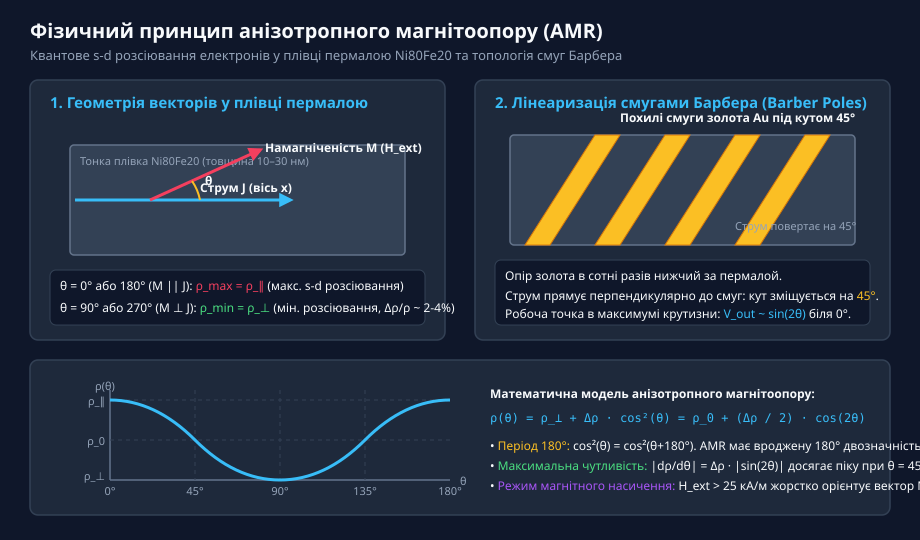
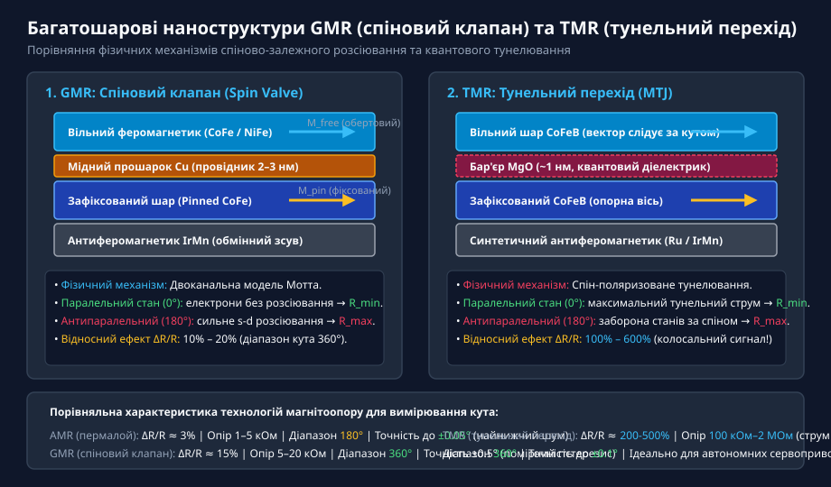
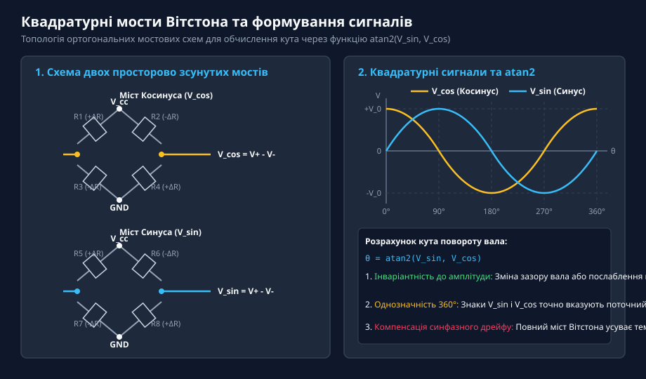
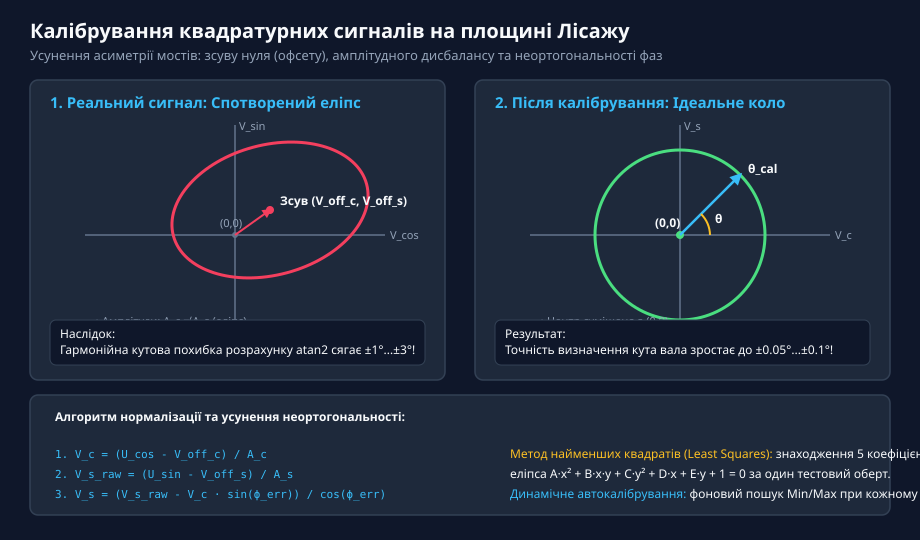
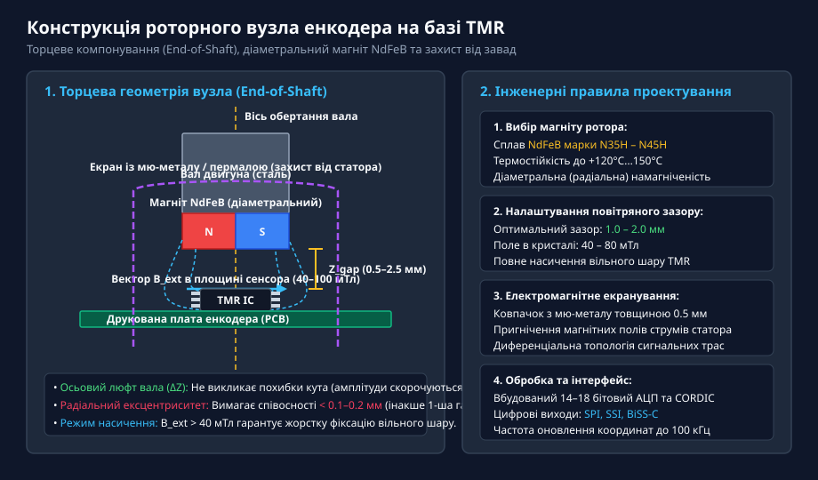

# Магніторезистивні сенсори кута AMR, GMR та TMR

<preknowlist>
- [Енкодери кутового та лінійного переміщення](root:cat-hw-sensors/optical-and-magnetic-encoders) — базові принципи квадратурного зчитування переміщення та відмінності між інкрементальними й абсолютними енкодерами
- [Магнітний енкодер кута AS5048](root:cat-hw-sensors/as5048-magnetic-encoder) — архітектура інтегральних магнітних кутомірів із торцевим розміщенням магніту відносно чутливого кристала
</preknowlist>

## Обмеження контактних та холлівських давачів

Прецизійне вимірювання кутового положення вала є критичною задачею у сервоприводах промислових роботів, верстатах із ЧПК та системах керування рухом. Історично перші контактні потенціометри страждають від механічного стирання струмопровідної доріжки, високого контактного шуму при вібраціях та деградації поверхонь.

Оптичні енкодери забезпечують найвищу роздільну здатність, але крихкі скляні диски та оптичні тракти надзвичайно чутливі до пилу, масляного туману, конденсату та сильних ударів. Індуктивні резольвери та перетворювачі RVDT забезпечують надійність, проте мають значні габарити, масу та потребують складної схемотехніки високочастотного збудження й синхронної демодуляції.

Напівпровідникові датчики на ефекті Холла дозволили створити твердотільні кутоміри, проте планарні елементи Холла мають низьку магнітну чутливість (одиниці мілівольт на тесла), значний власний шум, суттєвий температурний дрейф коефіцієнта підсилення та чутливість до зміни робочого зазору. 

Розв'язанням цих проблем став перехід до тонкоплівкових магніторезистивних сенсорів (AMR, GMR, TMR), які працюють у режимі магнітного насичення і реагують не на напруженість поля, а безпосередньо на кутовий напрямок вектора магнітної індукції.

## Анізотропний магнітоопір та його фізика

Ефект анізотропного магнітоопору (AMR, англ. @@en|Anisotropic Magnetoresistance@@) ґрунтується на квантовому спін-орбітальному розсіюванні електронів провідності у тонких плівках пермалою (сплав 80% нікелю та 20% заліза Ni80Fe20 товщиною 10–30 нм).

Коли вектор намагніченості плівки M орієнтований паралельно до вектора густини електричного струму J, орбіталі d-електронів деформуються так, що переріз розсіювання s-електронів провідності стає максимальним. Опір плівки досягає максимуму ρ_∥. При перпендикулярній орієнтації векторів переріз розсіювання мінімальний, а опір падає до ρ_⊥.

Залежність питомого опору від кута θ описується співвідношенням:

```
ρ(θ) = ρ_⊥ + Δρ · cos²(θ) = ρ_0 + (Δρ / 2) · cos(2θ)
```

де Δρ = ρ_∥ - ρ_⊥ — величина магнітоопору (для пермалою відносна зміна Δρ/ρ_0 становить 2–4%).


*Фізичний принцип анізотропного магнітоопору: залежність опору плівки пермалою від подвійного кута cos(2θ) та поворот вектора струму на 45° за допомогою похилих смуг Барбера.*

Через залежність від cos²(θ) одиночний AMR-елемент має період 180° і вроджену кутову двозначність (не відрізняє напрямки θ та θ + 180°). Для лінеаризації робочої характеристики та підвищення чутливості застосовують смуги Барбера — похилі смужки золота або алюмінію під кутом 45°, що повертають лінії струму всередині пермалою в точку максимальної крутизни характеристики біля 45°.

## Спіново-залежне розсіювання та тунелювання електронів

Для забезпечення однозначного робочого діапазону 360° було створено багатошарові тонкоплівкові структури — гігантський магнітоопір (GMR) та тунельний магнітоопір (TMR). Опір цих структур визначається кутом між двома магнітними шарами: вільним (який повертається разом із роторним магнітом) та зафіксованим (закріпленим антиферомагнітним обмінним зсувом).

У спіновому клапані GMR два феромагнітні шари розділені надтонким провідним шаром міді Cu (2–3 нм):
- При паралельній орієнтації намагніченостей вільних і зафіксованих шарів (θ = 0°) електрони провідності відповідного спінового каналу проходять структуру практично без розсіювання, формуючи низький опір R_min.
- При антипаралельній орієнтації (θ = 180°) електрони обох спінових каналів зазнають сильного розсіювання на інтерфейсах, викликаючи максимальний опір R_max. Відносний ефект ΔR/R сягає 10–20%.

У тунельних структурах TMR провідний мідний шар замінено на діелектричний квантовий бар'єр з оксиду магнію MgO товщиною близько 1 нм (магнітний тунельний перехід MTJ).


*Конструкція плівок GMR та TMR: квантово-механічне проходження струму через металевий мідний прошарок (GMR) або діелектричний тунельний бар'єр MgO (TMR).*

Оскільки електрони крізь MgO проходять завдяки квантово-механічному тунелюванню з високою спіновою фільтрацією, магніторезистивний ефект ΔR/R у TMR досягає рекордних 100–600%. Базовий опір TMR-елементів становить від 100 кОм до кількох мегаом, що зменшує споживання струму сенсора до лічених мікроамперів.

## Квадратурні мости та формування сигналів

Окремий магніторезистор чутливий до температурного дрейфу початкового опору R_0. Для його усунення чутливі елементи об'єднують у два мости Вітстона, просторово зсунуті між собою для створення ортогональних квадратурних виходів — каналу синуса та косинуса:

```
V_cos = V_0 · cos(θ)
V_sin = V_0 · sin(θ)
```

Повний диференціальний міст компенсує синфазні коливання напруги та температури, а обчислення кута здійснюється за допомогою функції чотириквадрантного арктангенса:

```
θ = atan2(V_sin, V_cos)
```

Ділення синуса на косинус під знаком арктангенса робить результат інваріантним до амплітуди поля V_0: коливання зазору вала або ослаблення магніту скорочуються й не впливають на розрахований кут.


*Квадратурні мости Вітстона: ортогональне розташування мостових каналів забезпечує формування сигналів синуса й косинуса для функції atan2.*

У реальних схемах внаслідок виробничих допусків виникають три похибки: постійний зсув нуля (офсет), амплітудний дисбаланс каналів та фазова неортогональність. На площині Лісажу вони перетворюють ідеальне коло на деформований і нахилений еліпс, викликаючи циклічну гармонійну похибку розрахунку кута.


*Калібрування квадратурних сигналів: перетворення спотвореного еліпса Лісажу на одиничне коло повертає похибку atan2 до величини менше 0.1°.*

Застосування алгоритмів калібрування (офлайн-апроксимація методом найменших квадратів або динамічне онлайнове стеження за екстремумами) усуває офсети та ортогоналізує фазу, повертаючи точність кутоміра до рівня ±0.05°…±0.1°.

## Практичне проєктування та вибір технології

Вибір між AMR, GMR та TMR ґрунтується на технічних вимогах системи керування:
- **AMR (анізотропний опір):** Забезпечує найнижчий рівень шуму та похибку менше ±0.05°, проте кутовий діапазон обмежений 180° (потрібен додатковий датчик для повного оберту).
- **GMR (гігантський опір):** Дає однозначний діапазон 360° при помірній точності (±0.5°) через власний гістерезис.
- **TMR (тунельний опір):** Забезпечує кутовий діапазон 360°, високу точність (±0.1°), рекордну вихідну напругу сотні мілівольт та ультранизьке енергоспоживання (1–10 мкА).


*Конструкція роторного вузла енкодера: торцеве розміщення діаметрально намагніченого магніту на валу двигуна навпроти TMR-сенсора в режимі насичення.*

При конструюванні торцевого роторного вузла (англ. @@en|end-of-shaft@@) слід дотримуватися трьох ключових правил:
1. Застосовувати циліндричний неодимовий магніт NdFeB із діаметральною намагніченістю, що створює поле 40–100 мТл у площині сенсора для введення плівок у стан насичення.
2. Підтримувати радіальну співвісність вала та мікросхеми краще ніж 0.1–0.2 мм (аксіальний люфт зазору Z_gap автоматично компенсується в atan2).
3. Забезпечувати екранування вузла ковпачком із мю-металу або пермалою для захисту від паразитних магнітних полів струмів статора двигуна.
