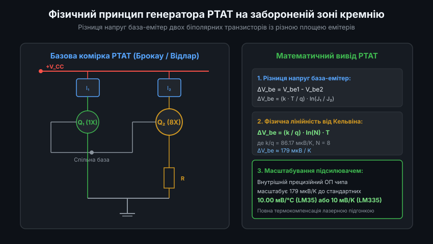
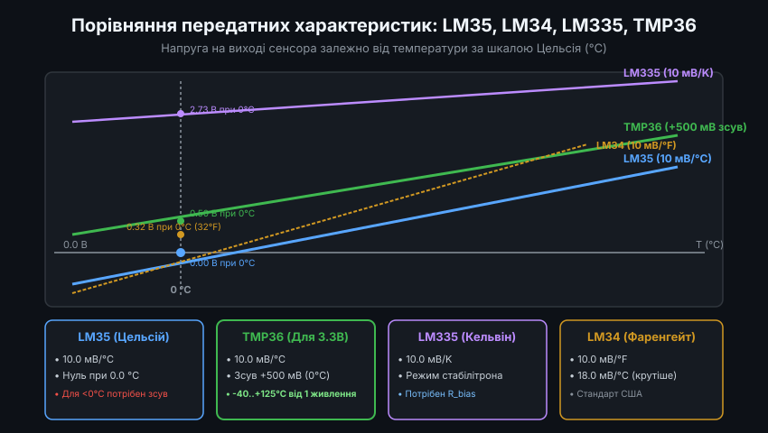
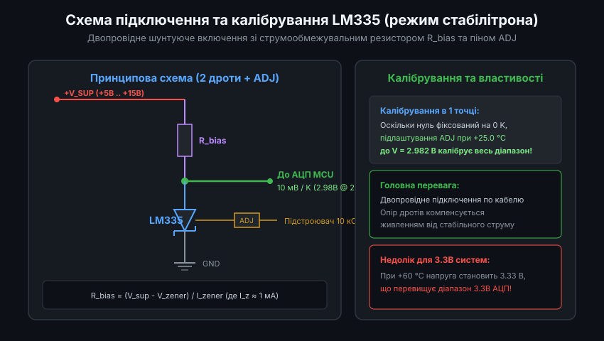
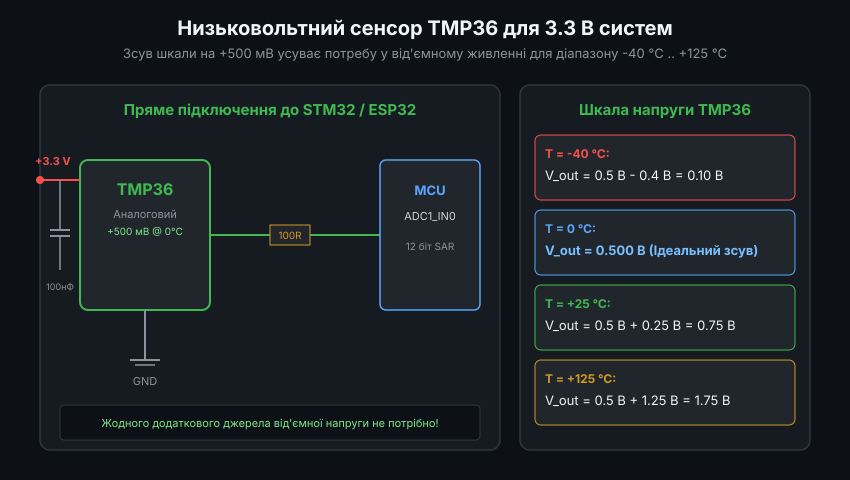
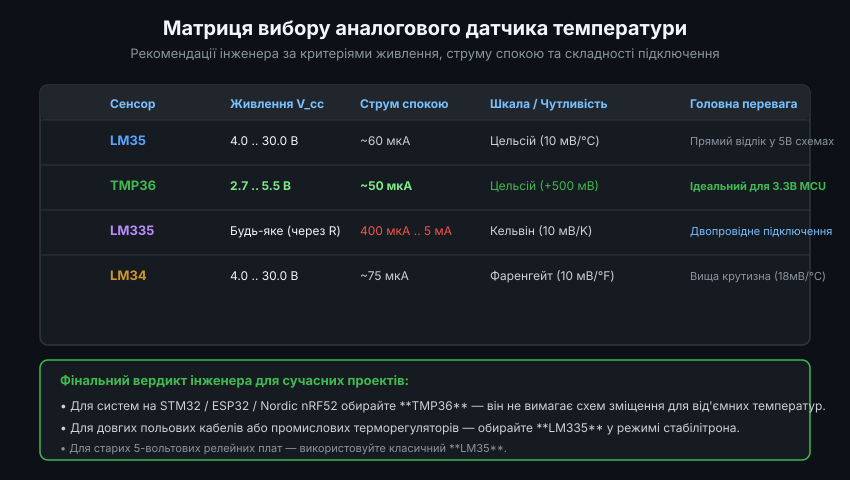

# Родина напівпровідникових аналогових давачів температури (LM35, LM34, LM335, TMP36): Порівняльний аналіз, схемотехніка та драйвери

Інтегральні аналогові перетворювачі температури на основі кремнієвих p-n переходів залишаються базовими вимірювальними компонентами в сучасній промисловій та споживчій електроніці. Вони вирізняються повною відсутністю необхідності складної програмної лінеаризації (на відміну від NTC термісторів чи термопар), низьким вихідним опором та високою довготривалою стабільністю калібрування. Проте вибір між шкалами (Цельсій, Кельвін, Фаренгейт), схемотехнічними топологіями (трививідні джерела напруги проти двовивідних шунтових стабілітронів) та робочими напругами живлення визначає схемотехнічну простоту та метрологічну достовірність проекту.

---

### 1. Фізика генератора PTAT та напівпровідникової забороненої зони (Bandgap)

Робота всіх інтегральних аналогових давачів базується на логарифмічній залежності напруги прямого зміщення переходу база-емітер кремнієвого біполярного транзистора від струму колектора:
`V_be = (k * T / q) * ln(I_c / I_s)`

де:
- `k` — стала Больцмана (`1.3806 * 10^-23 Дж/K`).
- `q` — елементарний заряд електрона (`1.6022 * 10^-19 Кл`).
- `T` — термодинамічна температура в Кельвінах.
- `I_s` — насипний струм насичення, який сам по собі експоненційно залежить від температури через ширину забороненої зони кремнію (близько 1.12 еВ).



Для усунення впливу сильно нелінійного струму `I_s` класична комірка Брокау (Brokaw Cell) використовує два узгоджені транзистори Q1 та Q2 на спільному монокристалічному кремнієвому чипі, виготовлені з різною площею емітерів (`A2 = N * A1`, де типово `N = 8` або `N = 10`):
- Струмові дзеркала змушують колекторні струми транзисторів бути строго однаковими: `I_c1 = I_c2`.
- Густина струму в транзисторі Q2 у N разів нижча, ніж у Q1: `J1 / J2 = N`.
- Різниця напруг між двома переходами база-емітер становить:
  `Delta_V_be = V_be1 - V_be2 = (k * T / q) * ln(I_c / I_s) - (k * T / q) * ln(I_c / (N * I_s)) = (k / q) * ln(N) * T`

У цьому рівнянні всі технологічні фактори та струм насичення `I_s` повністю скорочуються! Залишається лише стала Больцмана, заряд електрона, константа геометрії `N` та температура `T`. Різниця напруг `Delta_V_be` є ідеально пропорційною абсолютній температурі Кельвіна (PTAT):
`Delta_V_be = 86.17 мкВ/K * ln(8) * T ≈ 179.2 мкВ/K * T`

Ця напруга надходить на внутрішній масштабуючий підсилювач на ОП, коефіцієнт підсилення якого задається співвідношенням тонкоплівкових ніхромових або полікремнієвих резисторів, які підганяються імпульсним лазером на стадії кремнієвої пластини (Wafer Trimming).

---

### 2. Порівняльна матриця параметрів родини: LM35, LM34, LM335, TMP36



#### Зведена інженерна таблиця характеристик:

| Параметр | LM35 (Texas Inst.) | LM34 (Texas Inst.) | LM335 (ST / TI) | TMP36 (Analog Devices) |
| :--- | :--- | :--- | :--- | :--- |
| **Опорна шкала** | Цельсій (°C) | Фаренгейт (°F) | Кельвін (K) | Цельсій (°C) з +500 мВ зсувом |
| **Чутливість** | 10.0 мВ/°C | 10.0 мВ/°F (18.0 мВ/°C) | 10.0 мВ/K | 10.0 мВ/°C |
| **Напруга при 0.0 °C**| 0.00 В | +320 мВ (32 °F) | +2.731 В (273.15 K) | **+500 мВ (+0.50 В)** |
| **Напруга при 25.0 °C**| +250 мВ | +770 мВ (77 °F) | +2.982 В (298.15 K) | +750 мВ (+0.75 В) |
| **Робочий діапазон** | -55 °C .. +150 °C | -50 °F .. +300 °F | -40 °C .. +100 °C | -40 °C .. +125 °C |
| **Напруга живлення** | 4.0 .. 30.0 В | 4.0 .. 30.0 В | Через струм (400мкА..5мА)| **2.7 .. 5.5 В (сумісний з 3.3В)**|
| **Струм спокою** | ~60 мкА | ~75 мкА | 400 мкА .. 5000 мкА | **~50 мкА** |
| **Тип виходу** | Джерело напруги (3 вив.)| Джерело напруги (3 вив.)| Шунтовий стабілітрон (2 вив.)| Джерело напруги (3 вив.)|
| **Похибка (номінал)** | ±0.5 °C (при 25°C) | ±1.0 °F (при 77°F) | ±1.0 °C (калібр. 1 точка)| ±1.0 °C (при 25°C) |

Ключова перевага **TMP36** полягає в тому, що при живленні від єдиної шини +3.3 В він дозволяє фіксувати мінусові температури до -40 °C (вихід 100 мВ) без негативних джерел і без додаткових діодних ланцюгів.

---

### 3. Двопровідне підключення LM335: математика підбору R_bias та калібрування ADJ

Сенсор LM335 функціонує як температурно-залежний прецизійний стабілітрон. Його еквівалентний динамічний опір становить менше 0.6 Ом у діапазоні струмів стабілізації від 400 мкА до 5 мА.



#### 3.1. Розрахунок баластного резистора R_bias
Струм стабілізації повинен підтримуватися стабільним у всьому діапазоні робочих напруг живлення:
`R_bias = (V_supply_min - V_zener_max) / I_zener_target`

Для живлення від джерела +12 В при максимальній температурі +100 °C (373 K, `V_zener = 3.73 В`) та цільовому струмі `I_z = 1.0 мА`:
`R_bias = (12.0 В - 3.73 В) / 0.001 А = 8.27 кОм → обираємо 8.2 кОм (E24)`

Потужність розсіювання на резисторі:
`P_R = (12.0 - 2.98)^2 / 8200 ≈ 10 мВт` (підходить стандартний типорозмір SMD 0805 або 0603).

#### 3.2. Калібрування в одній точці (Single-Point Calibration)
Оскільки напруга LM335 строго пропорційна абсолютній температурі, її передатна лінія на графіку проходить точно крізь нуль: `V = T_K * slope`. Будь-яка виробнича похибка є похибкою крутизни нахилу (Gain error), а не зміщенням (Offset).

Тому підключення змінного потенціометра 10 кОм між катодом, анодом та виводом `ADJ` дозволяє відкалібрувати сенсор в одній точці:
- Поміщаємо сенсор у середовище з точно відомою температурою (наприклад, +25.0 °C за контролем лабораторного ртутного термометра).
- Розраховуємо цільову напругу: `V_target = (25.0 + 273.15) * 0.010 В = 2.9815 В`.
- Обертанням підстроювального резистора виставляємо на виході сенсора рівно 2.982 В.
Після цієї простої одноточкової операції похибка сенсора у всьому робочому діапазоні від -40 °C до +100 °C не перевищує ±0.5 °C.

---

### 4. Ємнісна стійкість аналогових виходів та запобігання самозбудженню

Поширеною інженерною проблемою при використанні LM35, LM34 та TMP36 є їхня схильність до високочастотного самозбудження при підключенні до довгих кабелів або паралельних конденсаторів фільтрації АЦП.

Вихідний каскад цих мікросхем володіє замкненим контуром зворотного зв'язку. Ємність навантаження `C_load > 50 .. 100 пФ` (а погонна ємність екранованого кабелю становить 70-120 пФ на метр!) створює додатковий полюс на вихідному імпедансі мікросхеми, зменшуючи запас фази нижче 45 градусів. Сенсор перетворюється на високочастотний генератор (частота 100 кГц .. 2 МГц), а його постійна вихідна напруга зміщується на сотні мілівольт через детектування коливань на внутрішніх переходах.



#### Схемотехнічні заходи забезпечення стійкості:
1. **Послідовний ізолюючий резистор `R_iso`**:
   Між виходом сенсора та кабелем встановлюється резистор номіналом `R_iso = 75 .. 200 Ом`. Він відділяє ємність кабелю від виходу внутрішнього ОП, повністю гасячи коливання.
2. **Демпфуючий RC-ланцюг (Snubber)**:
   Безпосередньо на виході встановлюється послідовний ланцюг: конденсатор 1 мкФ послідовно з резистором 1-2 Ом на землю.
3. **Розрахунок самонагріву кристала (Self-Heating)**:
   Потужність, що виділяється на кристалі:
   `P_diss = V_supply * I_quiescent + (V_supply - V_out) * I_load`
   Для LM35 при VDD = 5 В і I_q = 60 мкА: `P_diss ≈ 300 мкВт`.
   При тепловому опорі корпусу TO-92 `Theta_JA = 180 °C/Вт` підвищення температури становить:
   `Delta_T_self = 0.0003 Вт * 180 °C/Вт = 0.054 °C` (повністю нехтовно мале).
   Проте для LM335 при струмі 5 мА: `P_diss = 3 В * 5 мА = 15 мВт`, що дає самонагрів `Delta_T = 0.015 * 180 = 2.7 °C`! Тому струм LM335 не слід обирати більшим за 1.0 мА.

---

### 5. Універсальний програмний модуль обробки для STM32 / ESP32 мовою C

Нижче наведено універсальну модульну бібліотеку, яка підтримує всі 4 типи сенсорів з урахуванням напруги опорного джерела VREF, розрядності АЦП та захисту від наведень.



```c
#include <stdint.h>
#include <stdbool.h>

typedef enum {
    SENSOR_TYPE_LM35,   // Цельсій: 10 мВ/°C (0 В @ 0°C)
    SENSOR_TYPE_LM34,   // Фаренгейт: 10 мВ/°F (0.32 В @ 0°C)
    SENSOR_TYPE_LM335,  // Кельвін: 10 мВ/K (2.731 В @ 0°C)
    SENSOR_TYPE_TMP36   // Цельсій зі зсувом: 10 мВ/°C (+500 мВ @ 0°C)
} sensor_model_t;

typedef struct {
    sensor_model_t model;
    float vref_volts;      // Напруга опорного джерела АЦП (напр., 3.300f)
    uint32_t adc_max_code; // Максимальний код АЦП (напр., 4095 для 12-біт)
    float calib_offset_c;  // Поправка зміщення нуля (°C)
} analog_temp_cfg_t;

float analog_sensor_code_to_celsius(const analog_temp_cfg_t *cfg, uint16_t adc_raw_code)
{
    // Розрахунок фізичної напруги на вході АЦП у вольтах
    float v_measured = ((float)adc_raw_code * cfg->vref_volts) / (float)cfg->adc_max_code;
    float temp_celsius = 0.0f;

    switch (cfg->model) {
        case SENSOR_TYPE_LM35:
            // 10 мВ на градус Цельсія
            temp_celsius = v_measured / 0.010f;
            break;

        case SENSOR_TYPE_LM34: {
            // 10 мВ на градус Фаренгейта: T_F = V / 0.010f
            float temp_f = v_measured / 0.010f;
            // Перевід Фаренгейтів у Цельсій: T_C = (T_F - 32) * 5 / 9
            temp_celsius = (temp_f - 32.0f) * (5.0f / 9.0f);
            break;
        }

        case SENSOR_TYPE_LM335: {
            // 10 мВ на градус Кельвіна: T_K = V / 0.010f
            float temp_kelvin = v_measured / 0.010f;
            // Перевід Кельвінів у Цельсій: T_C = T_K - 273.15
            temp_celsius = temp_kelvin - 273.15f;
            break;
        }

        case SENSOR_TYPE_TMP36:
            // Зсув +500 мВ при 0°C: T_C = (V - 0.500) / 0.010f
            temp_celsius = (v_measured - 0.500f) / 0.010f;
            break;

        default:
            temp_celsius = -999.0f;
            break;
    }

    return temp_celsius + cfg->calib_offset_c;
}
```

Використання єдиного уніфікованого модуля дозволяє легко перемикати тип встановленого сенсора на рівні конфігурації прошивки без зміни алгоритмів системи керування кліматом.
