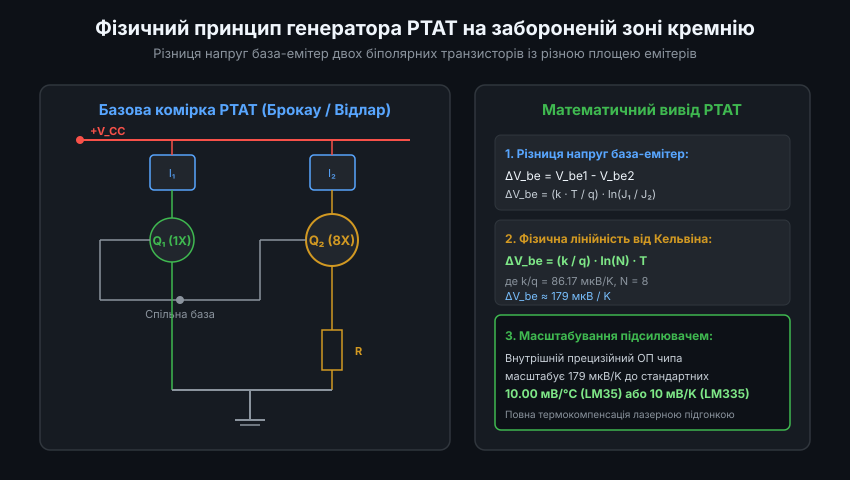
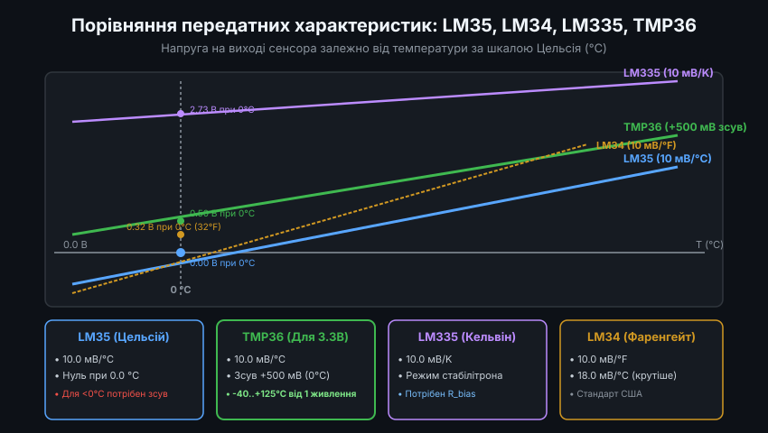
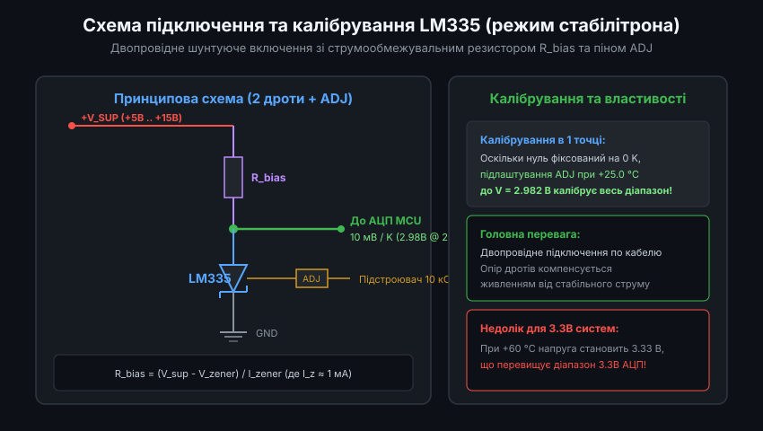
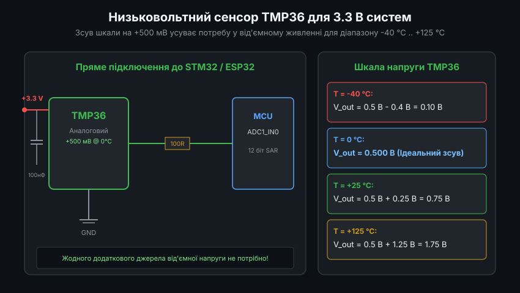
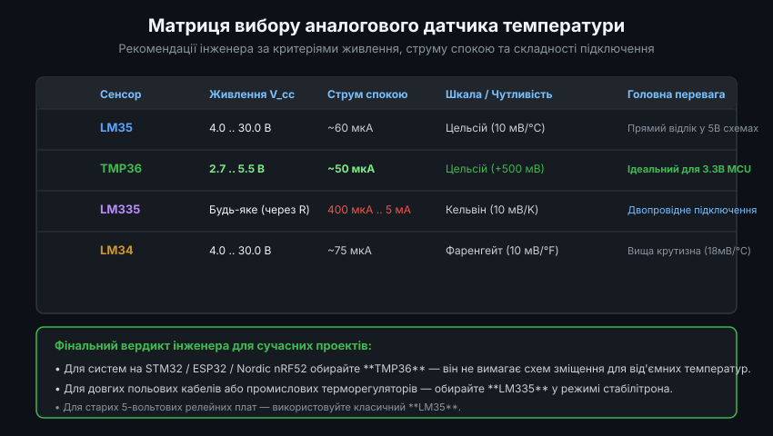

# Огляд родини напівпровідникових аналогових давачів температури (LM35, LM34, LM335, TMP36)

Напівпровідникові інтегральні давачі температури займають важливе місце в аналоговій схемотехніці та вимірювальних системах. На відміну від термопар, що вимагають компенсації холодного спаю, та терморезисторів NTC із нелінійною експоненційною залежністю, інтегральні сенсори видають попередньо лінеаризований вихідний сигнал напруги, строго пропорційний температурі. У даному огляді розглядаються чотири класичні представники цієї родини: **LM35**, **LM34**, **LM335** та сучасний низьковольтний **TMP36**.

---

### 1. Фізичний принцип PTAT на базі забороненої зони кремнію

В основі функціонування всіх напівпровідникових інтегральних термоперетворювачів лежить фундаментальна залежність характеристик p-n переходу від термодинамічної температури. 

Ядром мікросхеми є так званий генератор струму або напруги, пропорційної абсолютній температурі (Proportional to Absolute Temperature, PTAT):
- Схема містить два біполярних транзистори (Q1 та Q2), що працюють при однакових струмах колектора, але мають різну площу емітерних переходів (співвідношення площ 1:N, типово N = 8 або N = 10).
- Різниця напруг між їхніми переходами база-емітер становить:
  `Delta_V_be = V_be1 - V_be2 = (k * T / q) * ln(N)`
  де `k` — стала Больцмана, `q` — заряд електрона, а `T` — абсолютна температура в Кельвінах.
- Оскільки константи `(k / q) * ln(N)` є фізичними величинами, напруга `Delta_V_be` строго лінійно залежить від температури Кельвіна (близько 179 мкВ/K).
- Вбудований масштабуючий підсилювач на кристалі помножує цю різницю на фіксований коефіцієнт підсилення, формуючи зручний калібрований вихід 10.0 мВ на одиницю температури.

---

### 2. Порівняння передатних характеристик: LM35, LM34, LM335 та TMP36

Кожен із чотирьох датчиків орієнтований на власну температурну шкалу та топологію живлення.

Головні відмінності між сенсорами:
- **LM35**: шкала Цельсія. Чутливість `10.0 мВ/°C`. Напруга при 0.0 °C дорівнює 0.00 В. Діапазон від -55 °C (-0.55 В) до +150 °C (+1.50 В).
- **LM34**: шкала Фаренгейта. Чутливість `10.0 мВ/°F` (що еквівалентно 18.0 мВ/°C). Нуль напруги припадає на 0.0 °F (-17.78 °C), а при 0 °C (32 °F) напруга становить +320 мВ. Популярний у США.
- **LM335**: абсолютна шкала Кельвіна. Чутливість `10.0 мВ/K`. При температурі танення льоду 0.0 °C (273.15 K) вихідна напруга становить +2.731 В, а при кімнатній температурі +25.0 °C (298.15 K) дорівнює +2.982 В.
- **TMP36**: низьковольтний аналог LM35 від Analog Devices. Має шкалу Цельсія (10.0 мВ/°C), але з апаратним зсувом на **+500 мВ** при 0.0 °C. Завдяки цьому при температурі -40 °C вихід становить +100 мВ, а при +125 °C — +1.75 В. Напруга завжди строго додатна!

---

### 3. Двопровідне підключення сенсора LM335 у режимі стабілітрона

Сенсор LM335 принципово відрізняється від інших представників: він працює як прецизійний двовивідний регульований стабілітрон (Zener Shunt), напруга пробою якого прямо пропорційна температурі Кельвіна.

Особливості схемотехніки LM335:
- **Баластний резистор R_bias**: датчик вмикається послідовно з резистором підтяжки до джерела живлення. Номінал вибирається так, щоб забезпечити робочий струм через чип у межах від 400 мкА до 5 мА:
  `R_bias = (V_sup - 2.98 В) / 1 мА`
- **Калібрування в одній точці**: мікросхема має третій вивід `ADJ`. Оскільки передатна пряма жорстко зафіксована в точці абсолютного нуля (0 В при 0 K), калібрування зводиться до підстроювання потенціометром вихідної напруги до значення `2.982 В` при точно відомій температурі +25.0 °C. Це гарантує калібрування всього діапазону від -40 °C до +100 °C!
- **Стійкість до довгих ліній**: струмове живлення нівелює падіння напруги на опорі підвідних проводів, що робить LM335 чудовим вибором для виносних датчиків.

---

### 4. Низьковольтний сенсор TMP36 для мікроконтролерів із живленням 3.3 В

Класичні сенсори LM35 та LM34 розроблялися в епоху 5-вольтової або 12-вольтової схемотехніки: їхнє мінімальне живлення становить 4.0 В, а вимірювання мінусових температур вимагає негативного джерела живлення.

Сенсор TMP36 усуває всі ці обмеження:
- **Діапазон живлення від 2.7 В до 5.5 В**: дозволяє живити чип безпосередньо від шини 3.3 В сучасних мікроконтролерів (STM32, ESP32, RP2040, nRF52).
- **Вбудований зсув +500 мВ**: діапазон температур від -40 °C до +125 °C транслюється у вихідну напругу від 0.10 В до 1.75 В. Весь цей діапазон ідеально вписується в шкалу 3.3-вольтового АЦП без жодного операційного підсилювача чи негативного джерела живлення.
- **Ультранизьке енергоспоживання**: власний струм спокою становить лише 50 мкА, що майже не викликає самонагріву кристала (менше 0.05 °C у нерухомому повітрі).

Для підключення TMP36 до мікроконтролера достатньо лише трьох ліній: живлення 3.3 В, земля та сигнальний вивід на будь-який пін АЦП.

---

### 5. Інженерна матриця вибору сенсора під прикладні проекти

Порівняльний аналіз технічних параметрів дозволяє однозначно обрати оптимальний компонент під конкретні вимоги проекту.

Рекомендації щодо вибору сенсора:
1. **Для сучасних 32-бітних мікроконтролерів з живленням 3.3 В (STM32 / ESP32)**: однозначним фаворитом є **TMP36**. Він забезпечує повний температурний діапазон, низьке енергоспоживання та не потребує додаткових компонентів зміщення рівня.
2. **Для класичних 5-вольтових плат (Arduino Uno, промислові контролери на AVR/PIC)**: найкраще підходить **LM35** у діапазоні від 0 до +100 °C завдяки прямій відповідності "10 мВ = 1 °C".
3. **Для віддалених датчиків із довгим двопровідним кабелем**: ідеальним є **LM335**, увімкнений за схемою двополюсника зі струмовим живленням.
4. **Для систем, орієнтованих на ринок США (HVAC-контролери)**: пряме застосування **LM34** позбавляє прошивку від перерахунків зі шкали Цельсія у Фаренгейти.
