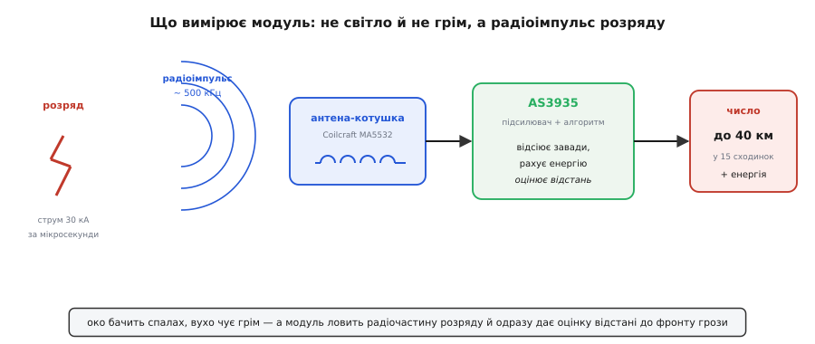
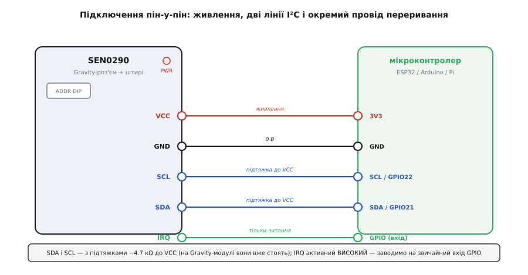
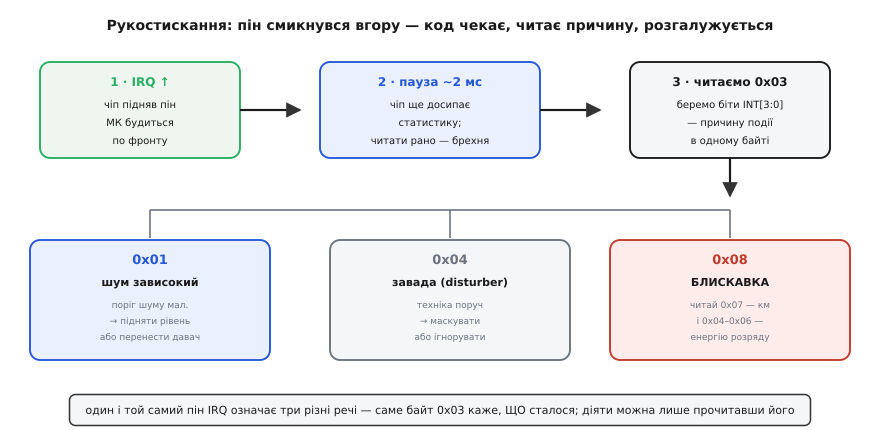
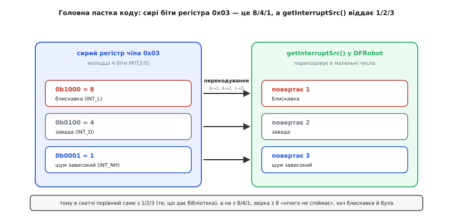
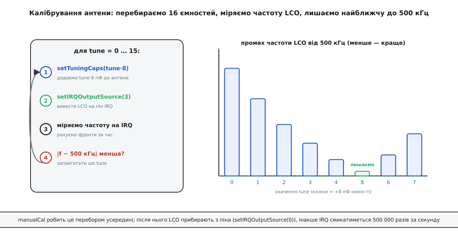

# DFRobot SEN0290 (AS3935) — давач блискавок

Модуль **DFRobot SEN0290** на основі спеціалізованої мікросхеми **ams AS3935 Franklin Lightning Sensor** є унікальним радіоелектронним сенсором раннього сповіщення про наближення грози. На відміну від оптичних чи акустичних датчиків (які фіксують спалах світла чи звук грому лише в зоні прямої видимості), AS3935 реєструє низькочастотне електромагнітне випромінювання іскрового розряду на відстані до **40 кілометрів**.

Сенсор активно застосовується в автономних метеостанціях, системах безпеки відкритих спортивних споруд, станціях захисту сонячних електростанцій та в польових дослідницьких таборах.

---

### 1. Фізичний принцип роботи та антена на 500 кГц

Електричний розряд блискавки (як між хмарою та землею, так і всередині хмари) діє як гігантська антена, генеруючи потужний електромагнітний імпульс у діапазоні довгих радіохвиль.



- **Резонансний контур на 500 кГц:** На платі модуля встановлено прецизійну котушку індуктивності з феритовим осердям, налаштовану в резонанс із внутрішньою ємнісною матрицею сенсора на частоту **500 кГц (±3.5%)**.
- **Діапазон виявлення:** Сенсор оцінює відстань до грозового фронту в межах від **1 до 40 км** (дискретна шкала на 14 кроків) та обчислює відносну енергію розряду.
- **Цифрова дискримінація форми сигналу:** Вбудований DSP-процесор аналізує форму прийнятого радіоімпульсу. Якщо сигнал за часовими параметрами не відповідає типовому профілю розряду блискавки (наприклад, виникає іскра від перемикання реле, вимикача світла або колекторного двигуна), сенсор класифікує його як **заваду (Disturber)** і не генерує помилкової тривоги.

---

### 2. Схемотехніка модуля DFRobot SEN0290 та підключення

Модуль SEN0290 від DFRobot оснащений перемикачем вибору інтерфейсу та зручною колодкою контактів:



- **Живлення:** Робоча напруга чіпа становить **3.3 В .. 5.0 В** (на платі передбачено регулятор та узгодження ліній).
- **Інтерфейси зв'язку:** Підтримуються шини **I2C** та **SPI** (вибираються апаратним перемикачем на платі). За замовчуванням найчастіше використовується шина I2C:
  - `SDA` та `SCL` — лінії передачі даних;
  - `ADDR` — біт вибору адреси I2C (`0x03` при підтяжці до землі, або `0x01` / `0x02` залежно від перемичок);
  - **`IRQ` (Interrupt Request):** Критично важливий вивід апаратного переривання. Чіп переводить лінію IRQ у високий стан (HIGH) щоразу, коли детектує подію.

---

### 3. Архітектура обробки переривань (IRQ Flow)

Мікроконтролер не повинен постійно опитувати сенсор у циклічному поллінгу — це неефективно та створює непотрібний радіочастотний шум на платі. Взаємодія будується строго за подіями переривання:



1. **Очікування переривання:** Мікроконтролер спить або виконує поточні завдання. Лінія `IRQ` перебуває в стані LOW.
2. **Виникнення події:** При появі радіосигналу внутрішній компаратор AS3935 зводить лінію `IRQ` у HIGH.
3. **Затримка зчитування (Handshake delay):** Перед зчитуванням регістрів керуюча програма повинна витримати паузу не менше **2 мілісекунд** (час завершення аналізу форми хвилі та розрахунку енергії в DSP).
4. **Читання регістра джерела переривання (0x03):** 
   - Молодші 4 біти вказують на тип події:
     - `0x08` — **Дійсна блискавка (Lightning detected)**: можна читати відстань та енергію;
     - `0x04` — **Штучна завада (Disturber detected)**: ігнорується або відкидається;
     - `0x01` — **Високий рівень фонового шуму (Noise level too high)**: потребує адаптації порогу шуму.



---

### 4. Калібрування резонансної антени

Для того щоб радіотракт мав максимальну чутливість на частоті 500 кГц, індуктивність антени повинна резонувати з точною ємністю контуру. Через технологічний розкид монтажу LC-ланцюг потребує підлаштування:



- AS3935 містить внутрішню 4-бітну банку підлаштувальних конденсаторів (16 градацій ємності від 0 до 120 пФ із кроком 8 пФ).
- Під час ініціалізації мікроконтролер виводить частоту коливального контуру на пін IRQ через внутрішній дільник (наприклад, на 16 або 32), вимірює її апаратним таймером і знаходить значення регістра `TUN_CAP` (0..15), яке забезпечує найменше відхилення від еталонних **500 кГц (31.25 кГц після ділення на 16)**.
- Більшість готових бібліотек (зокрема `DFRobot_AS3935`) мають вбудовану функцію автоматичного сканування під час виклику `begin()`.

---

### 5. Приклад підключення мовою C++ (Arduino)

Нижче наведено базовий приклад перехоплення блискавок із використанням офіційної бібліотеки `DFRobot_AS3935`:

```cpp
#include <Wire.h>
#include <DFRobot_AS3935.h>

#define IRQ_PIN 2

// Ініціалізація I2C інтерфейсу (адреса модуля за замовчуванням 0x03)
DFRobot_AS3935_I2C lightning(0x03);

volatile bool event_triggered = false;

void IRAM_ATTR on_lightning_irq() {
  event_triggered = true;
}

void setup() {
  Serial.begin(115200);
  Wire.begin();
  pinMode(IRQ_PIN, INPUT);

  // Очікування ініціалізації
  while (lightning.begin() != 0) {
    Serial.println("Помилка зв'язку з AS3935! Перевірте живлення та адресу I2C.");
    delay(1000);
  }

  // Скидання налаштувань за замовчуванням
  lightning.defInit();

  // Режим роботи: на вулиці (OUTDOOR) або в приміщенні (INDOOR)
  // У приміщенні чутливість знижується для відсікання побутових завад
  lightning.manualSetIndoorOutdoor(INDOOR);

  // Автоматичне калібрування резонансної частоти антени
  lightning.setTuningCaps(0x05); // Або автоматичний підбір

  // Налаштування обробника зовнішнього переривання по фронту RISING
  attachInterrupt(digitalPinToInterrupt(IRQ_PIN), on_lightning_irq, RISING);

  Serial.println("Сенсор AS3935 готовий до моніторингу блискавок.");
}

void loop() {
  if (event_triggered) {
    event_triggered = false;

    // Пауза 2 мс для завершення розрахунку алгоритму DSP
    delay(2);

    // Читання причини переривання
    uint8_t int_src = lightning.getInterruptSrc();

    if (int_src == 1) {
      // Дійсний розряд блискавки
      uint8_t distance_km = lightning.getLightningDistApprox();
      uint32_t energy = lightning.getStrikeEnergyRaw();

      Serial.println("УВАГА! ВИЯВЛЕНО РОЗРЯД БЛИСКАВКИ!");
      Serial.print("Відстань до фронту: ");
      Serial.print(distance_km);
      Serial.println(" км");
      Serial.print("Відносна енергія розряду: ");
      Serial.println(energy);
    } else if (int_src == 2) {
      Serial.println("Повідомлення: виявлено штучну заваду (Disturber відфільтровано).");
    } else if (int_src == 3) {
      Serial.println("Попередження: надто високий рівень фонового електромагнітного шуму!");
    }
  }
}
```

---

### Підсумки та висновки

1. DFRobot SEN0290 (AS3935) надає завчасне (до 40 км) попередження про грозовий фронт, реєструючи радіоімпульси частотою 500 кГц.
2. Вбудована цифрова дискримінація успішно відфільтровує штучні індустріальні та побутові завади.
3. Програмна робота повинна базуватися виключно на апаратних перериваннях лінії IRQ із обов'язковою затримкою 2 мс перед зчитуванням регістрів.
