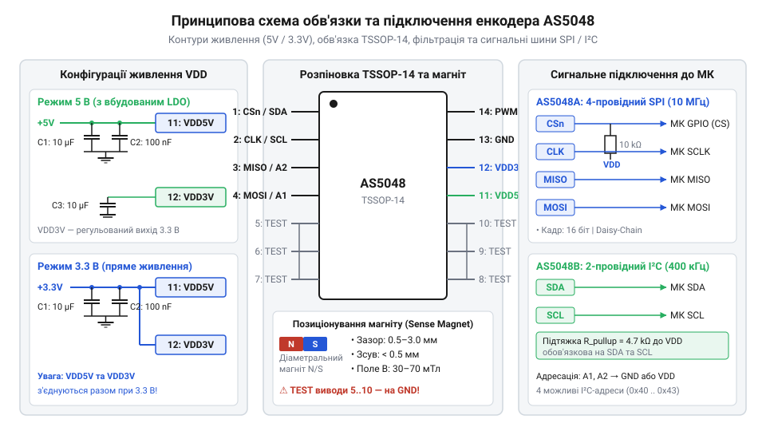
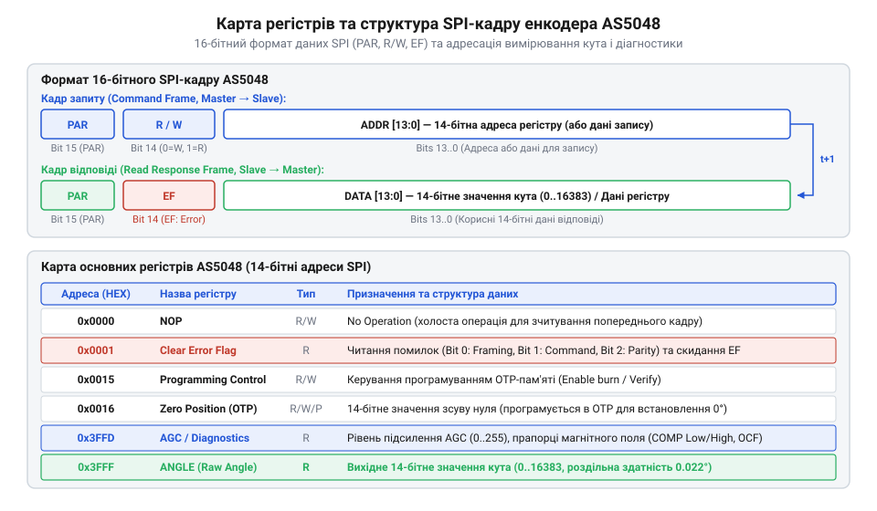

# Залізний інтерфейс AS5048: розводка, схеми підключення та карта регістрів

<preknowlist>
- [Енкодери кутового та лінійного переміщення](root:cat-hw-sensors/optical-and-magnetic-encoders) — принципи квантування кута, відмінності між абсолютними та інкрементними енкодерами, роздільна здатність вимірювання.
- [Датчики кутового положення сервоприводів: потенціометри та магнітні енкодери](root:cat-hw-sensors/servo-feedback-potentiometers-and-magnetic-encoders) — загальний принцип дії ефекту Холла та використання обертового магнітного поля для вимірювання кута.
</preknowlist>

## Проблема втрати абсолютного кута в робототехніці

Раптове знеструмлення або перезавантаження системного контролера у робототехнічному маніпуляторі позбавляє привод відомостей про поточний стан кожного суглоба. Коли в системі встановлено звичайні [інкрементні енкодери](root:cat-hw-sensors/optical-and-magnetic-encoders) (від лат. *incrementum* — приріст), після увімкнення живлення мікроконтролер бачить лише порожні лічильники відліків. Щоб відновити відлік позиції, привод змушений запускати процедуру базовування: рухати маніпулятор до фізичного спрацьовування кінцевого вимикача або механічного упору. У важких промислових маніпуляторах або сервоприводах під навантаженням такий рух «всліпу» загрожує пошкодженням редуктора, зіткненням із робочим інструментом та втратою калібрування.

Ще одна уразливість інкрементного відліку пов'язана з імпульсними перешкодами в довгих сигнальних лініях та механічним проковзуванням. Якщо високовольтний шум від комутації [безколекторних двигунів](root:cat-hw-sensors/servo-feedback-potentiometers-and-magnetic-encoders) створить хибний фронт на фазних лініях `A` чи `B`, лічильник кута зсунеться на один або кілька відліків. Оскільки пропущені імпульси накопичуються під час тривалої роботи, виникає накопичувальна помилка кута, яка призводить до розкачування контуру векторного керування та аварійного відключення силових ключів. За аналогією до того, як працюють [обертові резольвери](root:cat-hw-sensors/synchro-and-resolver-transducers), вимірювання має спиратися на абсолютний фізичний стан поля, а не на підрахунок проміжних подій.

Розв'язанням цієї проблеми є перехід на магнітний @@en|encoder@@ (від англ. *encoder* — пристрій кодування), який забезпечує миттєвий відлік абсолютного кута одразу в момент подачі живлення. На відміну від контактних рішень, таких як [потенціометричні датчики](root:cat-hw-sensors/servo-feedback-potentiometers-and-magnetic-encoders), або оптичних дисків, схильних до забруднення пилом і мастилом, датчик на основі ефекту Холла вимірює вектор обертового магнітного поля без прямого механічного контакту. Мікросхема AS5048 поєднує чутливу матрицю елементів Холла, аналогово-цифровий перетворювач та цифровий сигнальний процесор для обчислення кута методом @@en|CORDIC@@ (від англ. *Coordinate Rotation Digital Computer*). Завдяки цьому система керування отримує точне 14-бітне значення позиції вала через цифровий @@en|interface@@ (від англ. *interface* — межа зв'язку) без ризику втрати точки відліку та без потреби у процедурах базовування.

## Фізичне позиціонування та електрична обв'язка AS5048

Точність вимірювання абсолютного кута безпосередньо залежить від геометрії магнітного поля, яке створює ротор відносно корпуса мікросхеми. На відміну від лінійних вимірювачів, таких як [трансформатори LVDT](root:cat-hw-sensors/lvdt-linear-variable-differential-transformers), де осередком є поздовжнє переміщення осердя, для роботи AS5048 використовують циліндричний магніт із діаметральною намагніченістю, закріплений на торці обертового вала. Матриця датчиків Холла розміщена в центрі корпуса TSSOP-14, тому будь-яке відхилення центровки чи надмірний повітряний зазор викривляють синусоїдальний розподіл магнітної індукції.

Оптимальний повітряний зазор між поверхнею магніту та верхньою гранню корпуса становить від `1.0 mm` до `1.5 mm`. Допустимий робочий діапазон лежить у межах від `0.5 mm` до `2.5 mm`. Якщо зазор перевищує `2.5 mm`, напруженість магнітного поля падає нижче порогу спрацьовування внутрішнього підсилювача. Радіальний зсув осі магніту відносно центра мікросхеми не повинен перевищувати `0.5 mm`. Перекіс осі викликає нелінійні спотворення виміряного кута, які неможливо повністю компенсувати програмними зсувами.

Виробник випускає мікросхему у двох модифікаціях цифрового шинного інтерфейсу: AS5048A працює через послідовний протокол @@en|SPI protocol@@ (від англ. *Serial Peripheral Interface*), а AS5048B використовує шину @@en|I2C bus@@ (від англ. *Inter-Integrated Circuit*). Обидві версії також мають допоміжний вихід широтно-імпульсної модуляції (ШІМ), який продубльовано на окремому виводі.


*Принципова схема підключення AS5048A/B з контурами живлення 3.3 В та 5 В, фільтруючими конденсаторами та підтягуючими резисторами.*

Схема обв'язки живлення визначається робочою напругою системи. Мікросхема містить вбудований малошумний лінійний @@en|LDO regulator@@ (від англ. *Low Drop-Out*). При живленні від джерела `5 V` напруга подається на вивід `VDD5V`. При цьому вивід `VDD3V3` слугує виходом внутрішнього LDO на `3.3 V` і потребує підключення керамічного шунтуючого конденсатора ємністю `100 nF` паралельно з танталовим конденсатором `10 µF` для пригнічення високочастотних пульсацій. Якщо система працює від джерела `3.3 V`, виводи `VDD5V` та `VDD3V3` з'єднують між собою та підключають до спільної лінії живлення `3.3 V`.

Для версії AS5048B шинні лінії `SDA` та `SCL` вимагають встановлення зовнішніх підтягуючих резисторів до лінії живлення. Значення опору підтяжки добирають у межах від `2.2 kΩ` до `4.7 kΩ` залежно від ємності траси та частоти шини. У версії AS5048A для сигналів `CSn`, `SCLK` та `MOSI` рекомендовано передбачити підтягуючі резистори `10 kΩ` до лінії `VDD`, щоб запобігти плаванню логічних рівнів під час стадії ініціалізації мікроконтролера.

## Карта внутрішніх регістрів та цифровий протокол

Після завершення апаратного монтажу мікроконтролер має зчитувати обчислені значення кута та діагностичний стан пристрою шляхом звернення до внутрішньої пам'яті. Доступ до функціоналу AS5048 здійснюється через карту адресації, де кожен внутрішній @@en|register@@ (від середньовічного лат. *registrum* — список) відповідає за конкретний параметр датчика.

Обмін даними за протоколом @@en|SPI protocol@@ у версії AS5048A виконується 16-бітними кадрами в режимі SPI Mode 1 (`CPOL = 0`, `CPHA = 1`). Структура кадру передбачає суворий розподіл розрядів.


*Структура карти внутрішніх регістрів AS5048 та формат 16-бітного SPI-кадру з контролем парності і прапорцями стану.*

У командному кадрі, який передається від мікроконтролера до AS5048 по лінії `MOSI`:
- Біт 15 містить контроль @@en|parity@@ (від лат. *paritas* — рівність): біт парності @@en|even parity@@, який доповнює загальну кількість одиниць у 16-бітному слові до парного числа. - Біт 14 виступає прапорцем напрямку передачі: `1` означає операцію читання (Read), `0` — операцію запису (Write). - Біти від 13 до 0 задають 14-бітну адресу регістру або дані для запису.

Особливістю протоколу @@en|SPI protocol@@ в AS5048 є конвеєрне виконання команд. Коли контролер надсилає запит на читання регістру в кадрі `N`, відповідь із даними цього регістру повертається по лінії `MISO` лише у наступному кадрі `N+1`. Зворотний кадр відповіді містить біт @@en|parity@@ у розряді 15, прапорець помилки `EF` (Error Flag) у розряді 14 та 14 бітів корисних даних.

Основними регістрами карти AS5048 є:
- `0x3FFF` (Angle): регістр 14-бітного абсолютного кута. Значення змінюється від `0` до `16383`, що відповідає повному оберту на `360°`. - `0x3FFE` (Magnitude): регістр амплітуди вектора @@en|CORDIC@@, що відображає поточну потужність магнітного поля. - `0x3FFD` (AGC / Diagnostic): регістр автоматичного регулювання підсилення та первинної діагностики. - `0x0001` (Clear Error Flag): регістр скидання та зчитування деталізованого коду помилки. - `0x0000` (NOP): порожня команда для виштовхування відповіді з конвеєра @@en|SPI protocol@@.

Для обчислення фізичного кута у градусах розрядність `14 bit` масштабують за співвідношенням:

```
Angle_deg = (Angle_raw × 360) ÷ 16384
```

Значення `16384` визначається кількістю комбінацій 14-бітного лічильника (`2¹⁴ = 16384`), що забезпечує кутову роздільну здатність близько `0.0219°` на один молодший розряд.

## Встановлення нуля та калібрування в OTP

Під час механічного збирання приводного вузла фізичний нуль ротора рідко збігається з нульовим відліком датчика `0x0000`. Фізичне повертання корпуса енкодера або магніту на валу для точного суміщення є трудовитратною операцією, яка знижує точність монтажу. Замість механічного юстування AS5048 надає програмні та апаратні інструменти встановлення цифрового нуля.

Перший метод полягає у програмній компенсації на боці мікроконтролера. При вимкненому навантаженні привод встановлюють у базову позицію, після чого зчитують поточне значення з регістру `0x3FFF` і зберігають його у флеш-пам'яті контролера як константу зсуву `Zero_offset`. У робочому циклі обчислення скоригованого кута виконують із урахуванням циклічного переповнення `16384`:

```
Angle_raw   = 12288
Zero_offset = 4096
Angle_diff  = Angle_raw - Zero_offset       [обчислення різниці відносно нуля]
            = 8192                          [абсолютна позиція у відліках]
Angle_deg   = (8192 × 360) ÷ 16384         [переведення у фізичний кут]
            = 180°                          [підсумковий кут повороту вала]
```

Другий метод передбачає апаратне збереження нуля безпосередньо у внутрішній енергонезалежній пам'яті енкодера @@en|OTP@@ (від англ. *One-Time Programmable* — одноразово програмована). AS5048 містить регістри зсуву нуля `0x0016` (OTP Zero Position High, біти [7:0]) та `0x0017` (OTP Zero Position Low, біти [5:0]).

Для запису нуля в апаратну пам'ять виконують таку послідовність кроків:
1. Встановлюють вал у необхідну механічну позицію нуля. 2. Зчитують поточний абсолютний кут `Angle_raw` з регістру `0x3FFF`. 3. Записують значення `Angle_raw` у регістри `0x0016` та `0x0017`. 4. Надсилають команду випалювання плавких перемичок у регістр керування програмуванням `0x0003` (Programming Control).

Під час процедури програмування @@en|OTP@@ напруга живлення `VDD5V` має бути суворо стабілізована на рівні `5.0 V` (або `3.3 V` у відповідній конфігурації), оскільки просідання напруги призводить до неповного випалювання перемичок. Оскільки комірки @@en|OTP@@ є одноразовими, записане значення стає постійним апаратним нулем пристрою, який автоматично віднімається з вихідного кута при кожному включенні живлення. Докладну інструкцію з часовими діаграмами та вимогами до живлення під час фіксації нуля дивіться у статті про [програмування та випалювання OTP-пам'яті в енкодерах AS504x](root:cat-hw-sensors/as5048-otp-programming-guide).

## Діагностика помилок та контроль магнітного поля

Захист силового приводу від аварійних режимів вимагає постійної перевірки достовірності даних кута перед їх використанням у контурі керування. Поломка підшипника, зсув магніту або електрична перешкода на шині зв'язку не повинні призводити до видачі хибних координат на векторний обчислювач.

Діагностична логіка AS5048 працює на двох рівнях: на рівні перевірки цілісності цифрового кадру та на рівні аналітичного моніторингу магнітного поля. Первинним показником збою в кадрі відповіді є прапорець `EF` (Error Flag) у біті 14 відповіді по шині @@en|SPI protocol@@. Якщо біт `EF = 1`, це свідчить про виникнення апаратного збою під час виконання попередньої команди.

Для з'ясування причини помилки мікроконтролер надсилає запит на читання регістру `0x0001` (Clear Error Flag). Читання цього регістру повертає бітове поле помилок та одночасно скидає прапорець `EF`:
- `Framing Error` (помилка @@en|framing error@@): виникає при невідповідності кількості тактових імпульсів `SCLK` у кадрі (наприклад, замість 16 тактів передано 15 або 17). - `Command Invalid`: свідчить про спробу звернення до неіснуючої адреси або запису в регістр тільки для читання. - `Parity Error`: вказує на розходження контрольної суми парності @@en|even parity@@ у командному кадрі через завади на лінії `MOSI`.

Другий рівень діагностики контролює фізичний стан магнітної системи через регістр `0x3FFD` (AGC / Diagnostic):

```
+--------+--------+----------+-----------+-----+-----+-----+-----+
| Bit 13 | Bit 12 |  Bit 11  |  Bit 10   | Bit9| Bit8| ... |Bit 0|
+--------+--------+----------+-----------+-----+-----+-----+-----+
|  COMP  |  COMP  |   COF    |    OCF    |      AGC [7:0]        |
|  HIGH  |  LOW   | Overflow | Completed |                      |
+--------+--------+----------+-----------+-----+-----+-----+-----+
```

Прапорець `COMP_LOW` (біт 12) сигналізує про занадто слабке магнітне поле. Це відбувається при зміщенні магніту вздовж осі вгору, збільшенні повітряного зазору понад `2.5 mm` або відсутності магніту. Прапорець `COMP_HIGH` (біт 13) вказує на занадто сильне магнітне поле при занадто близькому розташуванні магніту.

Поле `AGC [7:0]` відображає значення автоматичного регулювання підсилення @@en|AGC@@ (від англ. *Automatic Gain Control*) від `0` до `255`. У нормі значення AGC знаходиться в середньому діапазоні (наприклад, від `30` до `200`). Наближення значення AGC до крайніх меж попереджає про деградацію магнітної системи до того, як спрацюють прапорці `COMP_LOW` або `COMP_HIGH`. Перевірка прапорців `OCF` (Offset Compensation Finished) гарантує, що внутрішня компенсація постійної складової автокалібрування завершена успішно.