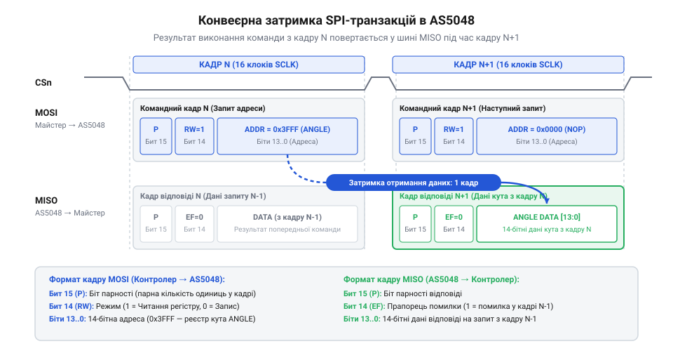
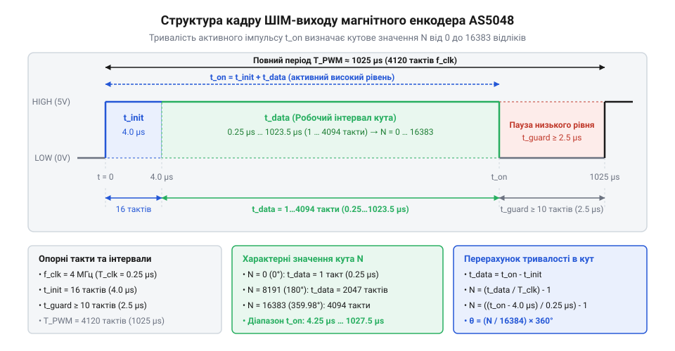

# Програмний інтерфейс AS5048: SPI кадр, I2C протокол та ШІМ вихід

<preknowlist>
- [Енкодери кутового та лінійного переміщення](root:cat-hw-sensors/optical-and-magnetic-encoders) — поняття абсолютного кутового положення та дискретизації вимірювання
- [Датчики кутового положення сервоприводів: потенціометри та магнітні енкодери](root:cat-hw-sensors/servo-feedback-potentiometers-and-magnetic-encoders) — принципи знімання кутового сигналу в контурах керування сервоприводами
</preknowlist>

## Спотворення кута при прямому зчитуванні

Пряме зчитування даних з абсолютного магнітного енкодера @@en|AS5048 encoder@@ здається інженерною задачею виклику однієї функції читання регістру: розробник надсилає адресний запит через @@en|SPI protocol@@ (від англ. *Serial Peripheral Interface*) або @@en|I2C bus@@ (від англ. *Inter-Integrated Circuit*) та очікує негайно отримати 14-бітний код поточного кута повороту вала. Проте спроба обробляти відліки датчика як звичайну пам'ять прямого доступу призводить до катастрофічних помилок у контурі керування приводом. Мікроконтролер отримує застарілі значення кута, хаотичні зсуви або сміттєві кадри, через що регулятор формує некоректний струм обмоток, викликаючи механічні удари та дрижання (від англ. @@en|jitter@@ — коливання, дрижання).

Головна причина спотворення кутових даних при роботі через шину SPI криється у внутрішній конвеєрній архітектурі енкодера — так званій затримці кадрів (від англ. @@en|pipelining delay@@ — конвеєрна затримка). Коли системний контролер передає командний кадр N по лінії @@en|MOSI line@@ (від англ. *Master Out Slave In*), запитуючи вміст регістру кута `0x3FFF`, мікросхема AS5048 тільки починає дешифрувати цю адресу та завантажувати обчислене значення з цифрового процесора @@en|CORDIC@@ (від англ. *Coordinate Rotation Digital Computer*). Одночасно з цим по лінії @@en|MISO line@@ (від англ. *Master In Slave Out*) енкодер повертає результат виконання попередньої команди N-1. Якщо керуюча програма виконує одноразовий поодинокий запит кута, вона зчитує не поточну позицію вала, а відгук на ту команду, яка була надіслана в шину попереднього разу. За умови періодичного опитування із постійним інтервалом система отримує кут із затримкою в один цикл, а при чергуванні запитів кута з іншими регістрами (наприклад, діагностики) замість координати в контур керування потрапляють службові прапорці.

Другим джерелом спотворень є високочастотні електромагнітні завади від комутації силових ключів [сервоприводів](root:cat-hw-sensors/servo-feedback-potentiometers-and-magnetic-encoders). На відміну від ситуації, де використовуються [оптичні та магнітні енкодери](root:cat-hw-sensors/optical-and-magnetic-encoders) з передачею відносних квадратурних імпульсів, цифровий кадр AS5048 передається у вигляді 16-бітного слова. Спотворення хоча б одного розряду внаслідок наводки перетворює відлік `2048` (`0x0800`) на `10240` (`0x2800`), що відповідає хибному повороту вала на 180°. Без систематичної перевірки парності (від англ. @@en|parity check@@ — перевірка парності) драйвер сприймає цей шум за реальний рух і намагається його компенсувати.

Крім того, прямому зчитуванню заважає ігнорування службових розрядів кадру. У протоколі AS5048 старший біт відповідає за контроль парності @@en|even parity@@ (від англ. *even parity* — парна контрольність), а біт 14 виступає прапорцем помилки `EF` (Error Flag). Якщо в енкодері виникає апаратне просідання живлення або збій тактування, мікросхема виставляє `EF = 1`. Якщо програма просто зсуває 16-бітний відгук без маскування та перевірки `EF`, біт помилки додає до значення кута величину 16384, що повністю руйнує обчислення позиції. На відміну від аналогових датчиків, як-от [диференціальні трансформатори LVDT](root:cat-hw-sensors/lvdt-linear-variable-differential-transformers) або [обертові сельсини та резольвери](root:cat-hw-sensors/synchro-and-resolver-transducers), цифровий інтерфейс AS5048 вимагає двокрокового циклу транзакцій та суворої валідації кожного кадру.

## Двокрокові SPI-транзакції та парність кадрів

Надійна програмна взаємодія з магнітним енкодером AS5048A через шину SPI вимагає чіткого дотримання структури 16-бітного кадру та конвеєрного циклу зчитування. Обмін даними здійснюється у режимі SPI Mode 1 (`CPOL = 0`, `CPHA = 1`), де вибір мікросхеми виконується низьким рівнем на лінії `CSn`.

Командний кадр, який контролер передає по лінії @@en|MOSI line@@, складається з 16 бітів:
- Біт 15 (`P`): біт парності @@en|even parity@@, що розраховується для бітів [14:0];
- Біт 14 (`RW`): прапорець напрямку (`1` — зчитування, `0` — запис);
- Біти [13:0] (`ADDR`): 14-бітна адреса регістру (для зчитування кута використовується адреса `0x3FFF`).

Кадр відповіді, який повертається по лінії @@en|MISO line@@ у наступному такті шини, має таку ж довжину:
- Біт 15 (`P`): біт парності @@en|even parity@@ для повертаного 16-бітного слова;
- Біт 14 (`EF`): прапорець апаратної помилки `EF` (`1` — зафіксовано помилку виконуваної команди);
- Біти [13:0] (`DATA`): 14-бітні корисні дані (значення кута в діапазоні від `0` до `16383`).

Для гарантії цілісності передачі використовується алгоритм парної контрольності @@en|even parity@@: значення біта `P` добирається таким чином, щоб загальна кількість логічних одиниць у 16-бітному кадрі була парною. Для запиту зчитування регістру кута `0x3FFF` обчислення здійснюється за кроками:

```
ADDR_bits  = 0x3FFF                  [14-бітна адреса: 11 1111 1111 1111₂ (14 одиниць)]
RW_bit     = 1                       [прапорець зчитання в біті 14 (1 одиниця)]
ones_sum   = 14 + 1 = 15             [сума одиниць у молодших 15 бітах є непарною]
P_bit      = 1                       [біт 15 приймає значення 1 для забезпечення 16 одиниць]
CMD_frame  = 0xFFFF                  [підсумковий 16-бітний командний кадр зчитування кута]
```

Оскільки передача даних конвеєризована, зчитування кута виконується у два кроки. У першому кадрі N мікроконтролер передає команду `0xFFFF`. Енкодер приймає команду, але по лінії @@en|MISO line@@ повертає дані попереднього запиту. У другому кадрі N+1 мікроконтролер надсилає порожню команду NOP (`0x0000`) або наступний запит `0xFFFF`, виштовхуючи з внутрішнього буфера AS5048 кадр із затребуваним 14-бітним кутом.


*Часова послідовність двох 16-бітних SPI-кадрів із прапорцями парності та конвеєрною видачею даних.*

Після отримання відповіді програмний @@en|driver@@ виконує декодування: перевіряє парність слова, переконується у відсутності прапорця помилки (`EF = 0`) та виділяє 14-бітне значення кута за допомогою маски `0x3FFF`. Отриманий відлік перераховується у градуси за формулою:

```
angle_raw  = miso_frame & 0x3FFF      [маскування 14 молодших бітів кута]
angle_deg  = (angle_raw × 360) ÷ 16384 [переведення відліків у кутові градуси]
```

Нижче наведено практичну реалізацію двокрокового зчитування кута через SPI з повним контролем парності.

:::tabs
:::code api-as5048-protocol-spi-i2c-pwm/c/esp-idf/calculate-even-parity.c

:::code api-as5048-protocol-spi-i2c-pwm/cpp/arduino/as5048a-spi.cpp
:::

## Побайтовий доступ через шину I2C

Для систем із обмеженою кількістю сигнальних ліній випускається модифікація енкодера AS5048B, яка використовує двопровідний інтерфейс @@en|I2C bus@@. На відміну від SPI-версії, де дані передаються 16-бітними кадрами з конвеєрною затримкою, протокол @@en|I2C bus@@ забезпечує прямий побайтовий доступ до внутрішньої карти регістрів. Славе-адреса пристрою на шині задається апаратними виводами `A1` та `A2` (базова 7-бітна адреса за замовчуванням `0x40`).

14-бітне значення кута у версії AS5048B розділене між двома 8-бітними регістрами:
- Регістр `0xFE` (ANGLMSB): містить 8 старших бітів кута [13:6];
- Регістр `0xFF` (ANGLLSB): містить 6 молодших бітів кута [5:0] у позиціях розрядів [5:0].

Принциповою відмінністю @@en|I2C bus@@ є відсутність конвеєрної затримки в один кадр: під час зчитування регістру `0xFE` енкодер негайно повертає актуальні старші байти кута в поточній транзакції. Однак побайтовий доступ створює ризик розсинхронізації даних, якщо вал енкодера обертається безпосередньо в момент між зчитуванням старшого та молодшого байтів. Наприклад, якщо кут змінюється від `0x03FF` до `0x0400`, прочитаний старший байт може дорівнювати `0x03`, а молодший байт, зчитаний миттєвістю пізніше, — `0x00`. Це призведе до формування спотвореного значення `0x0000`.

Для запобігання такому розриву цілісності в AS5048B реалізовано механізм автоматичного фіксування (захоплення) молодшого байта. Коли мікроконтролер виконує зчитування регістру `0xFE`, внутрішня логіка датчика миттєво засуває поточний вміст молодших бітів у буферний регістр `0xFF`. Тому дотримання суворого порядку запитів — **спочатку регістр `0xFE`, а потім `0xFF`** — гарантує атомарність отриманого 14-бітного слова.

Процедура збірки 14-бітного кута з двох байтів виконується за алгоритмом:

```
msb_val   = read_i2c_byte(0xFE)      [зчитання 8 старших бітів з фіксацією молодших]
lsb_val   = read_i2c_byte(0xFF)      [зчитання 6 молодших бітів із буфера]
angle_raw = ((uint16_t)msb_val << 6) | (lsb_val & 0x3F) [збірка 14-бітного слова]
```

Порівняно з [датчиками кутового положення сервоприводів](root:cat-hw-sensors/servo-feedback-potentiometers-and-magnetic-encoders), шина I2C дає змогу підключати кілька енкодерів до однієї пари ліній `SDA`/`SCL`, однак максимальна частота оновлення обмежується швидкістю шини (до 400 кГц у режимі Fast-Mode).

:::tabs
:::code api-as5048-protocol-spi-i2c-pwm/c/esp-idf/as5048b-i2c-read-angle.c

:::code api-as5048-protocol-spi-i2c-pwm/cpp/arduino/as5048b-i2c.cpp
:::

## Декодування часових інтервалів ШІМ-виходу

Коли цифровий шинний інтерфейс недоступний або коли вимагається незалежний резервний канал вимірювання, кутове положення енкодера AS5048 зчитують із виходу широтно-імпульсної модуляції @@en|PWM@@ (від англ. *Pulse-Width Modulation*). Енкодер генерує на виході PWM безперервну послідовність прямокутних імпульсів із номінальною частотою близько 1 кГц (період T_PWM ≈ 1025 µs).

Кожен період ШІМ-кадру підпорядковується суворій часовій структурі, яка базується на 4096 внутрішніх тактових інтервалах (t_bit ≈ 250 нс):
- Стартовий імпульс (T_init): високий рівень тривалістю 16 тактових інтервалів (4 µs);
- Робочий інтервал (T_data): тривалість високого рівня від 1 до 4094 тактових інтервалів (0.25 µs — 1023.5 µs), пропорційна 14-бітному куту від `0` до `16383`;
- Захисний інтервал (T_guard): низький рівень тривалістю 8 тактових інтервалів (2.0 µs) перед початком наступного кадру.


*Тривалість імпульсу ШІМ-сигналу AS5048: захисні інтервали та робочий діапазон відліків від 0 до 16383.*

Для декодування тривалості імпульсу мікроконтролер використовує апаратний модуль захоплення вхідних сигналів @@en|input capture@@ (від англ. *input capture* — захоплення вхідного сигналу) таймера. Захоплення вимірює тривалість високого рівня T_high та повну тривалість періоду T_period. Коефіцієнт заповнення @@en|duty cycle@@ (від англ. *duty cycle* — коефіцієнт заповнення) перераховується у кутовий відлік за формулою:

```
T_high_us  = captured_high_ticks × timer_step_us [тривалість активного імпульсу]
T_data_us  = T_high_us - 4.0                      [віднімання стартового інтервалу 4 мкс]
angle_raw  = (T_data_us × 16383) ÷ 1023.0        [переведення тривалості у 14-бітну шкалу]
angle_deg  = (angle_raw × 360) ÷ 16384           [перетворення у фізичні кутові градуси]
```

Основною перевагою ШІМ-виходу є висока завадостійкість при передачі сигналу по довгих кабельних лініях, оскільки інформація кодується у часовому інтервалі, а не в амплітуді напруги. Головний недолік — обмежена частота оновлення (біля 1 кГц) та залежність точності від дискретності таймера мікроконтролера.

:::tabs
:::code api-as5048-protocol-spi-i2c-pwm/c/esp-idf/decode-as5048-pwm.c

:::code api-as5048-protocol-spi-i2c-pwm/cpp/arduino/as5048-pwm-decoder.cpp
:::

## Діагностика стану та обробка збоїв

Використання магнітного енкодера в критичних вузлах роботизованих систем вимагає безперервного моніторингу апаратного стану пристрою та якості магнітного поля. Вихід з ладу підшипників вала, деградація або зсув постійного магніту не повинні призводити до видачі аварійних даних у контур керування приводом.

Апаратна діагностика AS5048 функціонує на двох рівнях: аналіз цілісності системних регістрів та аналітичний моніторинг магнітного вектора.

Для з'ясування причин збоїв передачі використовується регістр скидання прапорців помилок `0x0001` (Clear Error Flag). Якщо в SPI-кадрі виявлено прапорець `EF = 1`, мікроконтролер надсилає команду читання `0x0001`, яка повертає код помилки та одночасно очищає стан `EF`:
- `PE` (Parity Error, біт 0): виникає при розходженні парності @@en|even parity@@ у командному кадрі по лінії MOSI через електричні завади;
- `INV` (Command Invalid, біт 1): вказує на спробу звернення до неіснуючої адреси або запису у захищений регістр;
- `FE` (Framing Error, біт 2): сигналізує про розсинхронізацію тактових імпульсів `SCLK` (кількість тактів у кадрі не дорівнює 16).

Аналітичний контроль магнітного поля здійснюється через регістр діагностики та підсилення `0x3FFD` (AGC / Diagnostic):
- `OCF` (Offset Compensation Finished, біт 10): приймає значення `1`, коли алгоритм @@en|CORDIC@@ завершив внутрішнє розрахункове узгодження (нормальна робота);
- `COF` (CORDIC Overflow, біт 11): сигналізує про математичне переповнення векторного обчислювача;
- `COMP_LOW` (біт 12): виставляється в `1`, коли магнітне поле надто слабке (`B < B_min`). Це свідчить про збільшення повітряного зазору понад 2.5 мм або втрату магніту;
- `COMP_HIGH` (біт 13): виставляється в `1`, якщо магнітне поле надто сильне або насичене (`B > B_max`). Причиною є наближення магніту ближче 0.5 мм або наявність стороннього джерела наводки;
- `AGC` (Automatic Gain Control, біти [7:0]): 8-бітне значення коефіцієнта автоматичного регулювання підсилення @@en|AGC@@ (від англ. *Automatic Gain Control*). Оптимальний робочий діапазон `AGC` лежить близько значення `128`. Наближення `AGC` до крайніх меж `0` або `255` дає змогу заздалегідь виявити деградацію магнітної системи до спрацьовування апаратних компараторів.

Подібно до того, як контролюються [обертові сельсини та резольвери](root:cat-hw-sensors/synchro-and-resolver-transducers), алгоритм захисту приводу повинен обробляти позаштатні ситуації за пріоритетами. При виявленні `COMP_LOW` або `COMP_HIGH` регулятор руху зобов'язаний негайно зняти силову напругу з двигуна та перевести систему в аварійний режим.

:::tabs
:::code api-as5048-protocol-spi-i2c-pwm/c/esp-idf/as5048-read-diagnostics.c

:::code api-as5048-protocol-spi-i2c-pwm/cpp/arduino/as5048-diagnostics.cpp
:::