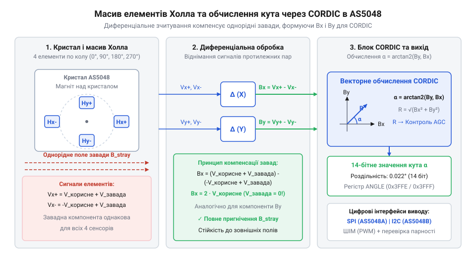
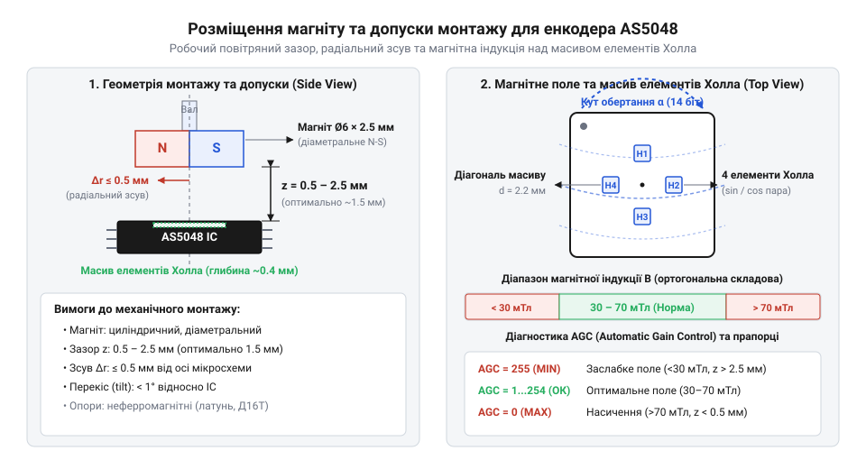
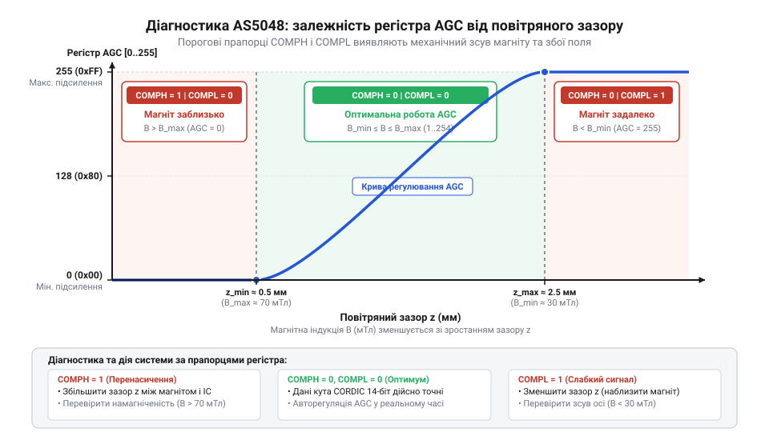
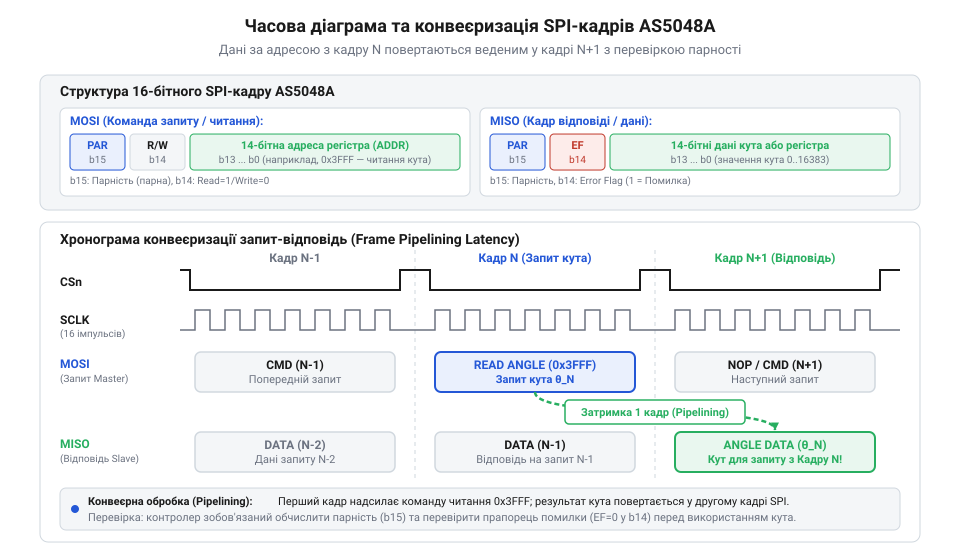
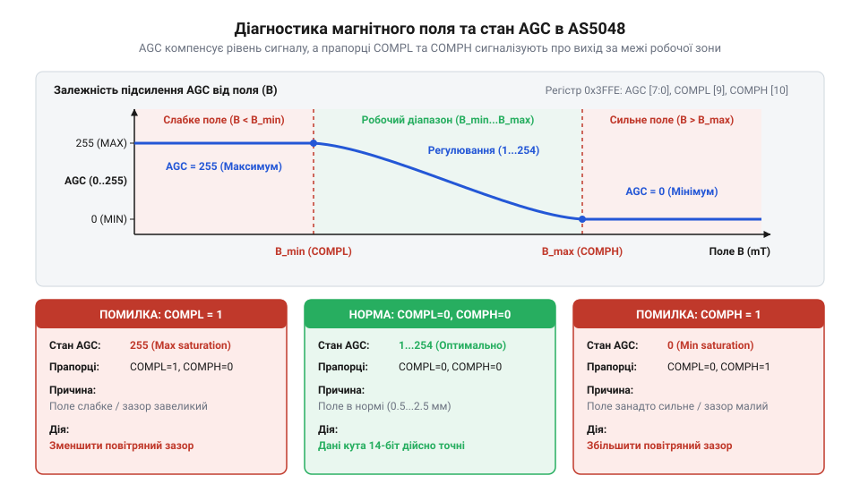
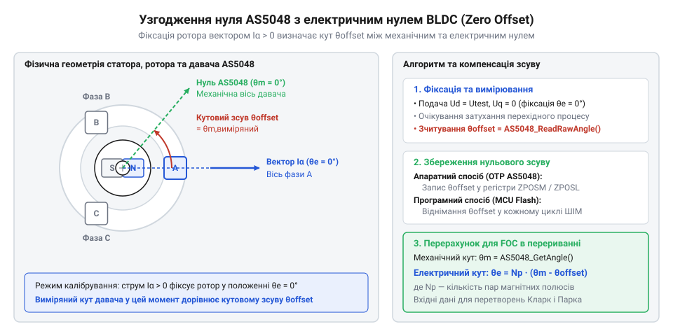

# Магнітний енкодер кута AS5048

<preknowlist>
- [Енкодери кутового та лінійного переміщення](root:cat-hw-sensors/optical-and-magnetic-encoders) — базові концепції кутового переміщення, роздільної здатності у бітах та різницю між інкрементальними й абсолютними вимірюваннями
- [Датчики кутового положення сервоприводів: потенціометри та магнітні енкодери](root:cat-hw-sensors/servo-feedback-potentiometers-and-magnetic-encoders) — вимоги до зворотного зв'язку за позицією в робототехнічних сервоприводах
</preknowlist>

## Проблема втрати положення в силових приводах

У сучасній робототехніці, верстатах із числовим програмним керуванням, безпілотних апаратах та високоточних силових електроприводах принципове значення має безперервний і точний зворотний зв'язок за кутовим положенням ротора. Серцем таких систем є безколекторні двигуни постійного струму (англ. @@en|Brushless Direct Current motor@@, або @@en|BLDC-двигун@@), віддача яких залежить від алгоритмів векторного керування (англ. @@en|Field-Oriented Control@@, або @@en|FOC@@). Для формування оптимального обертового моменту мікроконтролер повинен подавати фазні струми точно ортогонально до поточного векторного напрямку магнітного поля ротора. Механічний кут ротора `θ_mech` пов'язаний із електричним кутом `θ_el` через кількість пар полюсів двигуна `p`:

```
θ_el = p · θ_mech
```

У багатополюсних двигунах (наприклад, з `p = 7` або `p = 14` парами полюсів) навіть крихітна механічна похибка вимірювання кута в `1°` перетворюється на електричне зміщення у `7°` або `14°`. Якщо похибка вимірювання електричного кута перевищує `15°`, обертовий момент двигуна стрімко падає, оскільки корисна складова струму пропорційна `cos(Δθ_el)`, а залишок енергії перетворюється на паразитна тепло в обмотках статора. Втрата точного відліку кута в момент запуску приводу під навантаженням призводить до аварійних кидків струму, зворотного удару вала, пропуску кроків і руйнування механічних передач.

Історично для вимірювання кутового положення застосовували три основні класи давачів, кожен із яких володіє критичними обмеженнями в умовах високих динамічних навантажень:

Першим і найпростішим рішенням були резистивні @@en|потенціометри@@ (від лат. @@la|potentia@@ — сила та грец. @@el|metron@@ — міра). У цих пристроях металевий або графітовий ковзний контакт (англ. @@en|wiper@@) переміщується по резистивній доріжці, утворюючи регульований дільник напруги. Головною вадою потенціометрів є механічне тертя та неминучий знос контактної групи. Під дією вібрації та частих мікропереміщень струмопровідний шар руйнується, виникає графітовий пил та окиснення, що призводить до варіативності контактного опору (англ. @@en|Contact Resistance Variation@@, або @@en|CRV@@). Сигнал збагачується високочастотними шумами, виникають мертві зони, а лінійність характеристики катастрофічно погіршується. Окрім цього, потрапляння мастила чи пилу всередину корпусу унеможливлює надійну роботу. Як наслідок, [потенціометри та магнітні енкодери](root:cat-hw-sensors/servo-feedback-potentiometers-and-magnetic-encoders) демонструють принципову непридатність перших для тривалої експлуатації в сервоприводах безперервної дії.

Другим етапом розвитку стали @@en|інкрементальні оптичні енкодери@@ (від англ. @@en|encoder@@, від @@en|code@@ — код). Принцип їхньої дії базується на модуляції світлового потоку від світлодіода до фототранзистора через прозорий диск із нанесеними непрозорими штрихами. Оптичні енкодери забезпечують високу роздільну здатність, проте мають суттєві фізичні й логічні недоліки. З логічної точки зору, інкрементальний енкодер генерує лише відносні імпульси під час руху (канали `A` та `B`, зсунуті на 90°). При збої живлення або початковому увімкненні керуюча система «сліпа»: вона не знає точного абсолютного кута ротора і змушена виконувати процедуру пошуку нуля (англ. @@en|homing@@) до спрацьовування нульового індексного імпульсу (канал `Z`). У силових робототехнічних суглобах, підвісах або маніпуляторах таке початкове обертання вала для автокалібрування є неприпустимим, оскільки робочий орган під навантаженням може вдаритися про механічний упор.

З фізичного боку, оптичні енкодери вразливі до зовнішніх впливів: закурювання щілин, масляний туман, конденсація вологи повністю блокують оптичний шлях. При сильних імпульсних завадах (англ. @@en|EMI@@) від силових інверторів лічильник мікроконтролера може пропустити поодинокі імпульси каналів `A`/`B`, що викликає накопичувальний дрейф нуля — похибка вимірювання кута зростає з кожним обертом вала. Крім того, растрові скляні диски легко розбиваються від удару чи сильній вібрації. Проблематику вразливості оптичних каналів розгортають [оптичні та магнітні енкодери](root:cat-hw-sensors/optical-and-magnetic-encoders).

Третім рішенням для важких умов були електромагнітні @@en|резольвери@@ (від англ. @@en|resolver@@, від @@en|resolve@@ — розкладати) та [диференціальні трансформатори LVDT](root:cat-hw-sensors/lvdt-linear-variable-differential-transformers). Вони являють собою обертові трансформатори із високочастотним синусоїдальним збудженням. Їхні [обертові трансформаторні кутоміри](root:cat-hw-sensors/synchro-and-resolver-transducers) є абсолютно надійними й стійкими до високих температур, але вимагають складних та дорогих аналогово-цифрових перетворювачів типу «резольвер-цифра» (англ. @@en|Resolver-to-Digital Converter@@, або @@en|RDC@@), а самі датчики володіють значною масою й габаритами, що ускладнює їх інтеграцію в компактні мотор-редуктори.

Технологічна еволюція кутових вимірювачів пройшла шлях від механічних контактів і прозорих скляних дисків до створення монолітних кремнієвих мікросхем на основі напівпровідникових елементів Холла. Ранні магнітні сенсори компанії @@en|ams@@ (власна назва компанії ams AG) мали роздільну здатність 8–10 бітів і містили вбудовані аналогові підсилювачі та операційні підсилювачі для обробки сигналів. Проте досягнення мікроелектроніки дозволили об'єднати на одному кремнієвому кристалі площею лише кілька квадратних міліметрів масив елементів Холла, інтегральний підсилювач із системою автоматичного регулювання рівня, 14-бітний АЦП та цифровий математичний обчислювач @@en|CORDIC@@. Створений у результаті монолітний енкодер @@en|AS5048@@ забезпечив точність оптичних дисків, абсолютний відлік у момент увімкнення та повну механічну й екологічну захищеність безконтактних магнітних систем.

Для інтеграції в сучасні контури високоточного позиціонування та векторного керування двигунами абсолютний магнітний енкодер повинен відповідати чіткому набору критеріїв:

1. Абсолютність вимірювання — миттєве надання точного значення кута від 0° до 360° одразу після подачі живлення без виконання будь-яких механічних зсувів вала. 2. Повна безконтактність — відсутність механічного тертя й зносу, що гарантує необмежений термін служби та стійкість до пилу, вологи й мастила. 3. Висока роздільна здатність — 14 бітів (16 384 відліки на оберт, або `360° / 16384 ≈ 0.02197°` на один молодший значущий розряд LSB), що дає змогу вимірювати кут із точністю до `1.32` кутових мінут. 4. Вбудована цифрова фільтрація та інваріантність до зовнішніх однорідних магнітних полів і коливань напруги живлення. 5. Компактний корпус (наприклад, TSSOP-14) із стандартними цифровими інтерфейсами зв'язку.

Цим вимогам повністю відповідає інтегральний енкодер @@en|AS5048@@, який входить у загальну [родину магнітних енкодерів](root:hw-sensing/magnetic-absolute-encoders) та слугує основою для побудови систем [зворотного зв'язку за кутом](root:cat-hw-sensors/as5048-magnetic-encoder/proj-bldc-foc-as5048-feedback.md) у безколекторних електроприводах.

## Масив елементів Холла та векторна обробка

Вимірювання кутового положення в мікросхемі @@en|AS5048@@ базується на визначенні просторової орієнтації вектора магнітної індукції, що створюється циліндричним магнітом із діаметральною намагніченістю. Магніт закріплюється на торці обертового вала безпосередньо над центром корпусу мікросхеми. Детальний аналіз вимог до сплаву магніту (наприклад, NdFeB N35H), його розмірів та допустимих механічних допусків наведений у матеріалі про [вибір та монтаж магнітів](root:hw-components/diametric-magnets-encoder-selection).

У центрі кремнієвого кристала @@en|AS5048@@ розташована колова матриця з чотирьох інтегральних елементів Холла, розміщених під кутами 0°, 90°, 180° та 270°. @@en|Елемент Холла@@ (названий на честь фізика Едвіна Холла; англ. @@en|Hall effect@@) являє собою тонку напівпровідникову пластину, через яку протікає постійний струм зсуву `I_bias`. Коли перпендикулярна компонента магнітної індукції `B_z` пронизує пластину, на носії заряду (електрони) діє сила Лоренца `F = q · (v × B)`. Це викликає відхилення носіїв до бічних граней пластини й утворення холлівської різниці потенціалів `V_H`:

```
V_H = K_H · I_bias · B_z
```

де `K_H` — коефіцієнт чутливості елемента Холла.

Чотири елементи Холла на кристалі об'єднані у дві ортогональні диференціальні пари вздовж осей `X` та `Y`. При обертанні діаметрально намагніченого магніту на механічний кут `θ` вектор магнітної індукції створює на кристалі синусоїдальний розподіл поля. Перша диференціальна пара (елементи на 0° та 180°) вимірює горизонтальну компоненту індукції `B_x`, а друга пара (елементи на 90° та 270°) — вертикальну компоненту `B_y`:

```
B_x = B_max · cos(θ)
B_y = B_max · sin(θ)
```

де `B_max` — амплітудна індукція магнітного поля на поверхні кристала (зазвичай від 30 до 70 мТл).

Диференціальна обробка забезпечує подвійний захист від зовнішніх негативних чинників. По-перше, протилежні елементи кожної пари увімкнені так, що їхні вихідні напруги віднімаються: `B_x = V_{H,0°} - V_{H,180°}`. Якщо на мікросхему діє зовнішнє однорідне магнітне поле завади `B_ext` (створене, наприклад, високими фазними струмами обмоток статора двигуна), воно додає однакову величину напруги до обох елементів. Під час віднімання сигналів ця паразитна компонента повністю взаємно компенсується:

```
(B_x + B_ext) - (-B_x + B_ext) = 2 · B_x
```

По-друге, диференціальна схема компенсує власну постійну напругу зміщення кремнієвого субстрату (англ. @@en|offset voltage@@) та температурний дрейф напівпровідника.

По-третє, при зміні напруги живлення мікросхеми або зміні робочої температури величина амплітуди `B_max` може пропорційно змінюватися в обох каналах. Проте оскільки значення кута `θ` розраховується через тригонометричне відношення двох ортогональних компонент:

```
tan(θ) = B_y / B_x
= (B_max · sin(θ)) / (B_max · cos(θ))
= sin(θ) / cos(θ)
```

амплітудний множник `B_max` повністю скорочується в знаменнику! Отже, розрахований кут `θ = arctan(B_y / B_x)` є абсолютно інваріантним до коливань напруги живлення та до помірних технологічних розкидів повітряного зазору між магнітом і сенсором.


*Розташування чотирьох датчиків Холла на силіконовій матриці AS5048 та процес CORDIC-перетворення ортогональних компонентів індукції у 14-бітне значення кута.*

Прямий обчислювальний розрахунок функції арктангенса `arctan(B_y / B_x)` за допомогою степеневих рядів Тейлора чи таблиць ділення вимагає значних апаратних витрат кремнію. Замість цього в мікросхему @@en|AS5048@@ вбудовано спеціалізований цифровий апаратний обчислювач на основі алгоритму @@en|CORDIC@@ (англ. @@en|Coordinate Rotation Digital Computer@@, від @@en|coordinate@@ — координата та @@en|rotation@@ — обертання). Загальні принципи роботи цього математичного апарату розкриває [алгоритм CORDIC у цифровій техніці](root:hw-digital/cordic-algorithm-hardware), а геометрію векторних повертань наведено в матеріалі [обчислення кута через CORDIC](root:cat-hw-sensors/as5048-magnetic-encoder/math-cordic-magnetic-angle-calculation.md).

Алгоритм CORDIC виконує розрахунок кута шляхом послідовності ітераційних мікрообертань початкового вектора `[B_x, B_y]` на заздалегідь визначені кути `γ_i = arctan(2⁻ⁱ)`. На кожному кроці `i` (від `0` до `N-1`) конвеєр повертає вектор у бік горизонтальної осі `X` так, щоб вертикальна компонента `y` прямувала до нуля, одночасно накопичуючи кути повороту в акумуляторі `z`.

Вхідні значення описуються початковим станом `x₀ = B_x`, `y₀ = B_y`, `z₀ = 0`. На кожному ітераційному кроці `i` виконуються такі операції:

```
d_i = +1, якщо y_i < 0, інакше -1
x_{i+1} = x_i - d_i · y_i · 2⁻ⁱ        [побітовий зсув та додавання по осі X]
y_{i+1} = y_i + d_i · x_i · 2⁻ⁱ        [побітовий зсув та додавання по осі Y]
z_{i+1} = z_i - d_i · γ_i              [накопичення кута в акумуляторі z]
```

Оскільки множення на `2⁻ⁱ` в двійковій системі числення зводиться до звичайного побітового зсуву вправо на `i` розрядів, а значення кутів `γ_i` збережені у крихітній табличній пам'яті ROM, апаратний блок CORDIC не містить жодного апаратного множника чи дільника. Обертання вектора супроводжується масштабуванням його довжини на константний коефіцієнт розширення `K_N = ∏ √(1 + 2⁻²ⁱ) ≈ 1.64676`, який компенсується цифровим масштабуванням на виході конвеєра.

У мікросхемі @@en|AS5048@@ блок CORDIC виконує 14 послідовних ітерацій за 14 тактів вбудованого генератора, отримуючи вихідний 14-бітний цифровий код кута. Це забезпечує роздільну здатність у 16 384 кванти на оберт 360° (дискретність `0.02197°` на LSB). Конвеєр працює з частотою оновлення понад 10 кГц, що гарантує мікросекундну затримку зворотного зв'язку, необхідну для контурів FOC.

Перед подачею компонент на блок CORDIC аналогові сигнали з елементів Холла проходять через каскад автоматичного регулювання підсилення (англ. @@en|Automatic Gain Control@@, або @@en|AGC@@). Система AGC вимірює поточний модуль вектора магнітної індукції `|B| = √(B_x² + B_y²)` і динамічно змінює коефіцієнт підсилення вхідних підсилювачів (від 0 до 63 у 6-бітному регістрі AGC). Це дає змогу енкодеру стабільно працювати при зміні робочого зазору від 0.5 мм до 2.5 мм. Якщо магніт розташований занадто далеко або занадто близько, внутрішній компаратор виставляє діагностичні прапорці `COMPL` (слабке поле) або `COMPH` (сильне поле). Детальний довідник апаратної розводки виводів наведено у карті регістрів [карта регістрів та залізна схема](root:cat-hw-sensors/as5048-magnetic-encoder/api-as5048-hardware-schematics-registers.md), а часові діаграми зчитування даних — у довіднику [протоколи зчитування кадрів](root:cat-hw-sensors/as5048-magnetic-encoder/api-as5048-protocol-spi-i2c-pwm.md).

## Вимоги до магніту та механічного позиціонування

Точність вимірювання кутового положення кремнієвим кристалом @@en|AS5048@@ безпосередньо залежить від якості магнітного поля, яке пронизує поверхню масиву елементів Холла. Сенсор не вимірює безпосередньо механічний поворот вала — він визначає напрямок просторового вектора індукції. Тому правильний вибір магніту, його сплаву, орієнтації полюсів та геометричне вирівнювання відносно мікросхеми є критичними передумовами для отримання заявленої 14-бітної роздільної здатності.

Першою принциповою вимогою є тип намагнічування. Для роботи з матрицею Холла AS5048 застосовується виключно дисковий або кільцевий @@en|неодимовий магніт@@ (від англ. @@en|neodymium magnet@@, сплав @@en|NdFeB@@) із @@en|діаметральною намагніченістю@@ (від англ. @@en|diametric magnetization@@). У таких магнітах північний (N) та південний (S) полюси розташовані на протилежних бокових півколах циліндра, а вектор індукції спрямований паралельно до його пласкої торцевої поверхні. Ззвичайні аксіально намагнічені магніти (де полюси знаходяться на верхньому та нижньому торцях) категорично непридатні: при їх обертанні навколо своєї осі розподіл магнітної індукції у площині кристала залишається нерухомим, і сенсор не фіксує зміну кута.

Для промислових та робототехнічних приводів рекомендовано використовувати магніти класу @@en|N35H@@, @@en|N42H@@ або @@en|N45H@@ з діаметром 6 мм та висотою 2.5–3 мм. Суфікс H (англ. @@en|High Temperature@@) вказує на підвищену температурну стабільність сплаву з робочим діапазоном до 120–150 °C. Це принципово важливо, оскільки під час роботи силового двигуна ротор і корпус нагріваються, а звичайний неодимовий магніт без температурної градації втрачає намагніченість (явище зворотної або незворотної демагнетизації при досягненні точки Кюрі). Детальні рекомендації щодо геометрії та сплавів розкриває матеріал про [монтаж і вибір магнітів](root:hw-components/diametric-magnets-encoder-selection).

Другим фактором є нормальний @@en|повітряний зазор@@ (англ. @@en|air gap@@) між нижньою площиною магніту та верхньою поверхнею корпусу мікросхеми (TSSOP-14). Кремнієвий кристал розташований всередині пластикового корпусу на глибині близько 0.3 мм від його поверхні. Для забезпечення нормальної амплітуди магнітної індукції в межах від 30 до 70 мТл фізична відстань від магніту до корпусу повинна становити від 0.5 мм до 2.5 мм (ідеальний робочий діапазон 1.0–1.5 мм).


*Конструктивні вимоги до розміщення неодимового магніту над мікросхемою AS5048: дотримання нормального повітряного зазору та радіального центрування.*

Вихід магнітної індукції за вказані межі призводить до викривлення вимірювань і виклику внутрішнього захисту:

```
[Повітряний зазор < 0.5 мм] -> Індукція B > 70 мТл -> Насичення кристала -> Прапорець COMPH = 1
[Повітряний зазор 0.5-2.5 мм] -> Індукція B = 30..70 мТл -> Нормальна робота -> AGC = 0..63
[Повітряний зазор > 2.5 мм] -> Індукція B < 30 мТл -> Падіння сигнал/шум -> Прапорець COMPL = 1
```

Якщо зазор занадто малий (< 0.5 мм), амплітуда поля перевищує 70 мТл. Аналогові підсилювачі сенсора заходять у стан насичення, схема автоматичного регулювання підсилення зменшує свій коефіцієнт до мінімуму (значення регістра `AGC = 0`), а внутрішній компаратор виставляє прапорець перевантаження `COMPH` (англ. @@en|Comparator High@@). У цьому режимі формений синусоїдальний розподіл поля спотворюється, виникає нелінійне зрізання верхівок сигналів `B_x` та `B_y`, що створює значну кутову похибку.

Якщо зазор перевищує 2.5 мм, індукція падає нижче 30 мТл. Схема AGC виходить на максимальний коефіцієнт підсилення (`AGC = 255`), виставляється прапорець слабкого поля `COMPL` (англ. @@en|Comparator Low@@), а корисний сигнал зашумлюється власними тепловими флуктуаціями напівпровідника, що викликає дрижання (англ. @@en|jitter@@) молодших розрядів кута.


*Характеристика відгуку блоку AGC та спрацьовування компараторів COMPL/COMPH залежно від відстані до магніту.*

Третьою вимогою є @@en|радіальна неспіввісність@@ (від англ. @@en|radial mismatch@@, або @@en|eccentricity@@) — зміщення геометричної осі обертання магніту від центра масиву елементів Холла на кристалі. Оскільки чотири сенсори Холла розташовані по колу радіусом близько 1 мм, радіальний зсув `d_r` викликає несиметричний розподіл амплітуд сигналів між протилежними парами. Це формує системну похибку першої гармоніки, яка варіюється за синусоїдальним законом один раз за оберт. Для збереження точності вимірювань у межах заявленої специфікації радіальне зміщення не повинно перевищувати 0.25 мм. Кут непаралельності (перекіс торця магніту відносно площини мікросхеми) має бути меншим за 3°.

Окрім геометричного центрування, значення має вибір матеріалів несучого вала та кріплення. Вал двигуна або посадковий адаптер магніту повинні виготовлятися виключно з немагнітних матеріалів (нержавіюча сталь аустенітного класу марки 304/316, алюмінієві сплави, латунь або технічні термопласти). Використання конструкційної феромагнітної сталі шунтує магнітний потік, викривляє силові лінії неодимового магніту та створює паразитно нелінійні спотворення поля, які неможливо компенсувати алгоритмом CORDIC. Апаратні характеристики корпусу й схеми включення розглядає [карта регістрів та залізна схема](root:cat-hw-sensors/as5048-magnetic-encoder/api-as5048-hardware-schematics-registers.md).

## Протоколи опитування та часова діаграма кадрів

Після забезпечення механічної співвісності та оптимальної індукції поля обчислене 14-бітне значення кута стає доступним для зчитування зовнішнім мікроконтролером. Для гнучкості інтеграції виробник випускає енкодер у двох апаратних модифікаціях: @@en|AS5048A@@ з послідовним інтерфейсом @@en|SPI@@ (від англ. @@en|Serial Peripheral Interface@@) та @@en|AS5048B@@ з інтерфейсом @@en|I2C@@ (від англ. @@en|Inter-Integrated Circuit@@). Окрім цифрових шин, обидві модифікації оснащені постійним виходом @@en|ШІМ@@ (від англ. @@en|Pulse-Width Modulation@@, або @@en|PWM@@).

Основним протоколом для високодинамічних приводів є SPI в мікросхемі AS5048A. Шина працює в режимі SPI Mode 1 (`CPOL = 0`, `CPHA = 1`), де дані тактуються по спадному фронту тактового сигналу `SCLK` і зчитуються по наростаючому, з максимальною частотою тактування до 10 МГц. Обмін даними здійснюється 16-бітними кадрами.

Структура 16-бітного каду запиту від мікроконтролера до енкодера (Master -> Slave):

```
+----+----+---------------------------------------------+
| 15 | 14 | 13 . . . . . . . . . . . . . . . . . . .  0 |
+----+----+---------------------------------------------+
|PAR | RW |               ADDR / DATA                   |
+----+----+---------------------------------------------+
```

Де символи позначають такі поля:
- `PAR` (біт 15) — @@en|біт парності@@ (від англ. @@en|parity bit@@). Обчислюється як парна парність (англ. @@en|even parity@@) для всіх 16 бітів каду. Загальна кількість одиничних бітів у переданому кадрі (включаючи сам біт PAR) повинна бути парною. Якщо кількість одиниць у даних 0..14 парна, `PAR = 0`, якщо непарна — `PAR = 1`. - `RW` (біт 14) — напрямок операції: `0` відповідає запису даних у регістр, `1` відповідає зчитуванню. - `ADDR` (біти 13..0) — 14-бітна адреса регістра (наприклад, `0x3FFE` для регістру кута `ANGLE` або `0x3FFD` для регістра `AGC`).

Критичною особливістю роботи шини SPI в AS5048A є @@en|конвеєризація кадрів@@ (від англ. @@en|pipelining delay@@). Передача даних відбувається за принципом «запит у кадрі N — відповідь у кадрі N+1».


*Часова діаграма обміну кадрами по шині SPI: відображення затримки конвеєра на один кадр та перевірка біта парності PAR.*

Коли мікроконтролер надсилає кадр №1 із запитом адреси `0x3FFE`, сенсор приймає команду й фіксує значення кута. Проте на лінії MISO під час кадру №1 енкодер повертає дані попередньої виконаної команди (кадр №0). Актуальне значення кута, замовлене в кадрі №1, буде передане лінією MISO лише під час наступного кадру №2. Для безупинного опитування кута в реальному часі управляюча система надсилає послідовну серію однакових команд `Read ANGLE` (`0x3FFE` або холосту команду `0xFFFF`), зчитуючи на кожному кроці результат попереднього вимірювання з затримкою в один кадр SPI.

Структура відповіді від енкодера до мікроконтролера (Slave -> Master):
- `PAR` (біт 15) — біт парної парності каду відповіді. - `EF` (біт 14) — прапорець помилки (англ. @@en|Error Flag@@). Якщо `EF = 1`, це свідчить про виникнення апаратної помилки (збій парності в попередній команді, спроба зчитування неіснуючої адреси чи збій кадрування). Для скидання прапорця та зчитування коду помилки необхідно виконати читання регістра `Clear Error Flag` (`0x0001`). - `DATA` (біти 13..0) — 14-бітні корисні дані (значення кута `0`..`16383`).

У модифікації AS5048B замість SPI застосовується шина I2C із підтримкою стандартного (100 кГц) та швидкого режимів (Fast Mode, 400 кГц). Базова 7-бітна адреса I2C становить `0x40` (в двійковому вигляді `1000000b`), а два молодших біти адреси налаштовуються виводами `A1` та `A2` мікросхеми. Це дає змогу підключати до чотирьох енкодерів AS5048B до однієї пари ліній `SDA`/`SCL` без використання мультиплексорів. Значення 14-бітного кута в I2C розділене між двома 8-бітними регістрами: `ANGLEMSB` (`0xFE`, 6 старших бітів) та `ANGLELSB` (`0xFF`, 8 молодших бітів). Зчитування виконується послідовною передачею стартової умови, адреси I2C та зчитуванням двох байтів поспіль у режимі автовзростання адреси.

Окрім цифрових протоколів, обидві мікросхеми формують аналогоподібний сигнал ШІМ на виводі PWM. Період ШІМ становить 1000 мкс (частота близько 1 кГц). Тривалість високого рівня імпульсу `t_on` пропорційна поточному куту:

```
t_on = t_init + (angle / 16384) · t_d
```

де `t_init = 14 мкс` (початкова пауза синхронізації), а `t_d = 1166 мкс` (робочий інтервал даних). Зчитування ШІМ-сигналу таймером мікроконтролера (режим Input Capture) слугує надійним резервним каналом: якщо шина SPI чи I2C блокується завадами, системний контролер зберігає здатність визначати кут ротора. Детальні часові розрахунки шин містить [довідник програмних протоколів](root:cat-hw-sensors/as5048-magnetic-encoder/api-as5048-protocol-spi-i2c-pwm.md).

При монтажі енкодера на двигун кутовий нуль сенсора майже ніколи не збігається з електричною d-віссю ротора BLDC-двигуна. Для узгодження позицій використовують апаратне встановлення нуля в одноразово програмовану @@en|пам'ять OTP@@ (від англ. @@en|One-Time Programmable memory@@). В AS5048 передбачені регістри `OTP Register Zero Position High` (`0x0016`) та `Low` (`0x0017`). Управляюча система повертає вал двигуна у вихідне положення подачею тестового струму у фази, зчитує поточний кут `θ_zero` і записує його у регістри OTP. Після подачі відповідного випалювального імпульсу струму або фіксації в програматорі сенсор автоматично віднімає `θ_zero` з усіх наступних вимірювань:

```
θ_actual = (θ_raw - θ_zero) mod 16384
```

Це дозволяє уникнути програмного обчислення зсуву в мікроконтролері й забезпечує апаратну сумісність привода для [системи векторного керування](root:cat-hw-sensors/as5048-magnetic-encoder/proj-bldc-foc-as5048-feedback.md).

Безперервний моніторинг цілісності системи в реальному часі реалізується опитуванням регістра діагностики та `AGC` (`0x3FFD`). Молодші 6 бітів містять поточний коефіцієнт підсилення, а старші біти відображають діагностичний стан:
- Біт 8: `OCF` (англ. @@en|Offset Compensation Finished@@) — `1` вказує на успішне завершення внутрішньої компенсації зміщення. - Біт 9: `COF` (англ. @@en|CORDIC Overflow@@) — `1` сигналізує про виникнення математичного переповнення в обчислювачі CORDIC (апаратна несправність кристала). - Біт 10: `COMPL` — `1` свідчить про недостатню індукцію (завеликий зазор або зсув магніту). - Біт 11: `COMPH` — `1` свідчить про надмірну індукцію (магніт надто близько).

Для практичної розробки нижче наведено приклад реалізації опитування AS5048A з обчисленням парності та перевіркою прапорців:

:::tabs
:::code as5048-magnetic-encoder-d/c/esp-idf/calculate-even-parity.c
:::code as5048-magnetic-encoder-d/cpp/arduino/getevenparity.cpp
:::

Алгоритми обробки помилок, конвеєрний моніторинг та автокалібрування реалізовані у вихідному коді вставки [драйвер для мікроконтролера](root:cat-hw-sensors/as5048-magnetic-encoder/proj-as5048-esp32-driver-diag.md).

## Внутрішня діагностика та керування підсиленням AGC

У сервоприводах точного позиціонування та робототехнічних суглобах найнебезпечнішою відмовою є прихована деградація вимірювального каналу. Якщо у традиційному [інкрементальному енкодері](root:cat-hw-sensors/optical-and-magnetic-encoders) механічний знос підшипника чи зсув вала призводить до миттєвої втрати імпульсів, то в магнітному енкодері мікросхема продовжує видавати обчислені значення кута навіть тоді, коли магніт змістився на критичну відстань. Зовні система виглядає працездатною, проте амплітуда магнітного поля на поверхні кристала падає або виходить у зону насичення. Обчислювач @@en|CORDIC@@ (від англ. *Coordinate Rotation Digital Computer* — цифровий обчислювач повороту координат, від *coordinate* — координата, *rotation* — обертання) продовжує розраховувати арктангенс за зашумленими чи викривленими сигналами, що спричиняє виникнення значної кутової похибки та пульсацій моменту в контурі приводу. Щоб запобігти аварійним ситуаціям, інтегральний сенсор AS5048 оснащено вбудованою системою активної діагностики та автоматичного регулювання підсилення @@en|AGC@@ (від англ. *Automatic Gain Control* — автоматичне регулювання підсилення, від *automatic* — саморушний, *gain* — приріст, *control* — керування).

Фізичний принцип роботи блоку @@en|AGC@@ полягає в постійній підгонці амплітуди аналогових сигналів, знятих з елементів Холла, під вхідний динамічний діапазон аналогово-цифрового перетворювача. Чотирьохсегментна матриця сенсорів Холла формує дві квадратурні напруги, пропорційні проекціям вектора магнітної індукції `B_x` та `B_y`. Сумарна амплітуда магнітного вектора `M` у площині кристала визначається як:

```
M = √(B_x² + B_y²)
```

Якщо відстань між магнітом та мікросхемою змінюється, значення `M` пропорційно зростає або зменшується. Вбудований аналоговий тракт підсилення @@en|AFE@@ (від англ. *Analog Front-End* — аналоговий вхідний тракт, від *analog* — аналоговий, *front-end* — вхідний інтерфейс) регулює коефіцієнт підсилення за допомогою 8-бітного цифрового керованого атенюатора. Значення регістра `AGC` варіюється від `0` до `255` (від `0x00` до `0xFF`). При нормальному повітряному зазорі та оптимально підібраній індукції магніту підсилювач працює в середині свого діапазону, а значення в регістрі `AGC` перебуває поблизу `128`. Якщо [неодимовий магніт](root:hw-components/diametric-magnets-encoder-selection) наближається надто близько до кристала, індукція зростає, і контур `AGC` зменшує підсилення до мінімуму (`AGC` прямує до `0`). Якщо ж магніт віддаляється, зазор збільшується, і контур збільшує підсилення до максимуму (`AGC` прямує до `255`).

Крім поточної величини підсилення, давач постійно контролює межі норми за допомогою апаратних компараторів та фіксує результати у вихідних діагностичних прапорцях. Ці прапорці передаються у кожному кадрі зчитування через [програмний інтерфейс](root:cat-hw-sensors/as5048-magnetic-encoder/api-as5048-protocol-spi-i2c-pwm.md) шини @@en|SPI@@ або @@en|I2C@@:

- `OCF` (від англ. *Offset Compensation Finished* — компенсація зсуву завершена): прапор успішного завершення внутрішнього автокалібрування аналогових підсилювачів після подачі живлення. Поки `OCF = 0`, аналоговий тракт ще не вийшов на робочий режим, і дані кута вважаються недійсними. - `COMPH` (від англ. *Comparator High* — компаратор верхнього рівня): встановлюється в `1`, коли магнітне поле надто сильне. Це означає, що коефіцієнт підсилення `AGC` досяг мінімальної межі (`0`), але амплітуда сигналу все одно перевищує допустимий поріг АЦП, викликаючи насичення. - `COMPL` (від англ. *Comparator Low* — компаратор нижнього рівня): встановлюється в `1`, коли магнітне поле надто слабке. Коефіцієнт `AGC` досяг максимуму (`255`), проте сигнал не досягає мінімального порогу, необхідного для точної роботи [алгоритму CORDIC](root:hw-digital/cordic-algorithm-hardware). - `COF` (від англ. *CORDIC Overflow* — переповнення обчислювача CORDIC): вказує на математичну помилку під час ітераційного розрахунку кута, що виникає при сильних імпульсних магнітних завадах або різкому аномальному викривленні поля.


_Вплив рівня магнітної індукції на коефіцієнт підсилення AGC та діагностичні прапорці AS5048._

Моніторинг регістра `AGC` у реальному часі дає розробнику унікальний інструмент предиктивної діагностики механіки. На відміну від дискретних прапорців `COMPH` та `COMPL`, які спрацьовують лише при катастрофічному виході за межі допустимого поля, значення `AGC` реагує на найменші механічні відхилення. Наприклад, якщо під час збирання вузла нормальне значення `AGC` становило `110`, а під час тривалої експлуатації під навантаженням воно плавно зросло до `190`, це свідчить про збільшення робочого зазору внаслідок осьового люфту підшипника або ослаблення кріплення вала. Якщо ж значення `AGC` періодично коливається з частотою обертання вала, це пряма ознака торцевого биття або радіальної неспіввісності магніту відносно центра мікросхеми.

Для надійного захисту силового приводу обробник діагностики в мікроконтролері повинен аналізувати статусний кадр при кожному опитуванні давача. Повний перелік адресації регістрів та бітових масок наведено в описі [залізного API](root:cat-hw-sensors/as5048-magnetic-encoder/api-as5048-hardware-schematics-registers.md). Нижче показано реалізацію функції моніторингу стану давача для двох популярних платформ:

:::code as5048-magnetic-encoder-d/c/esp-idf/as5048-decode-diagnostics.c

:::tabs
:::code as5048-magnetic-encoder-d/cpp/arduino/as5048diagnostics.cpp
:::

Дальший розвиток цієї логіки з автовідновленням після збоїв та обробкою помилок парності розкрито у практичному [драйвері для мікроконтролера](root:cat-hw-sensors/as5048-magnetic-encoder/proj-as5048-esp32-driver-diag.md).

## Програмування нуля та інтеграція в BLDC

Під час збирання безколекторного двигуна @@en|BLDC@@ (від англ. *Brushless Direct Current* — безколекторний постійного струму, від *brushless* — безщітковий, *direct current* — постійний струм) із замкненим контуром керування позиція вихідного нуля енкодера орієнтована випадковим чином відносно магнітних полюсів ротора. У системах векторного керування @@en|FOC@@ (від англ. *Field-Oriented Control* — поле-орієнтоване керування, від *field* — поле, *oriented* — орієнтований, *control* — керування) для формування максимального обертового моменту вектор магнітного поля статора повинен підтримуватися строго перпендикулярно до вектора поля ротора (під кутом `90°` електричних). Якщо мікроконтролер розраховує координати перетворення Парка та Кларк за невідкаліброваним кутом енкодера, кутова похибка `Δθ` призводить до пропорційного падіння ефективного моменту `cos(Δθ)` та зростання втрат на нагрівання обмоток. При похибці у `90°` електричних мотор взагалі припиняє обертання й починає споживати максимальний струм короткого замикання. Отже, точна прив'язка відліку енкодера до електричного нуля ротора є критичною умовою пуску FOC-приводу.

Електричний кут обертання ротора `θ_el` пов'язаний із механічним кутом повороту вала `θ_mech` через кількість пар полюсів двигуна `p`:

```
θ_el = (p · θ_mech - θ_offset) mod 360°
```

де `θ_offset` — кутове зміщення між механічним нулем енкодера та електричною віссю `d` ротора (віссю прямого намагнічування). Оскільки 14-бітний енкодер AS5048 ділить повне механічне коло `360°` на `16384` дискретних відліки (значення від `0` до `16383`), один електричний градус відповідає різній кількості відліків залежно від конструкції ротора. Наприклад, для 14-полюсного мотора квадрокоптера (`p = 7` пар полюсів) один повний механічний оберт містить 7 електричних періодів. У цьому разі похибка встановлення нуля всього у `5°` механічних трансформується у `35°` електричного зсуву, що знижує ККД приводу майже на 18%.

Для вирівнювання нуля в енкодері AS5048 передбачено два принципово різних підходи:

1. **Програмний зсув нуля (Software Offset)**:
   - Обчислене під час калібрування значення `θ_offset` зберігається у неенергонезалежній пам'яті (Flash або EEPROM) мікроконтролера. - Під час кожного опитування енкодера прошивка віднімає `θ_offset` від сирого значення `θ_raw`:

```
θ_corrected = (θ_raw - θ_offset) mod 16384
```

   - **Переваги**: абсолютна безпека (неможливо пошкодити давач), можливість багаторазового перекалібрування при перезбиранні механіки, відсутність жорстких вимог до напруги живлення під час налаштування. - **Недоліки**: обчислювальне навантаження на процесор, а також те, що допоміжні виходи (наприклад, [аналоговий ШІМ-вихід](root:cat-hw-sensors/as5048-magnetic-encoder/api-as5048-protocol-spi-i2c-pwm.md)) продовжують видавати сирий, невідкалібрований кут.

2. **Апаратне програмування нуля в пам'ять OTP (One-Time Programmable)**:
   - AS5048 містить одноразово програмовану пам'ять @@en|OTP@@ (від англ. *One-Time Programmable* — одноразово програмований, від *one-time* — одноразовий, *programmable* — здатний до програмування), куди можна записати 14-бітне значення кута нуля у регістри `OTP Zero Position High` (`0x0016`) та `OTP Zero Position Low` (`0x0017`). - Після запису значення внутрішній CORDIC-процесор давача автоматично віднімає записане значення перед формуванням вихідного 14-бітного кадру SPI/I2C та перед генерацією ШІМ-сигналу. - **Переваги**: енкодер видає вже відкалібрований нуль на будь-яких інтерфейсах незалежно від прошивки мікроконтролера; ідеально для серійного виробництва уніфікованих сервоприводів. - **Недоліки**: процедура є незворотною (пропалювання перемичок перетворює комірки пам'яті настільки, що змінити нуль повторно неможливо). При помилці під час запису мікросхема втрачає можливість апаратного нуля.


_Геометричний та електричний зсув між валом двигуна, вектором поля статора та відліком енкодера._

Процедура визначення електричного нуля ротора (так звана процедура @@en|Lock-in Calibration@@) виконується у декілька послідовних кроків:

1. **Електрична фіксація ротора (DC Alignment)**: На статор двигуна подається постійний струм обмеженої величини (близько 10–20% від номінального). Струм вводиться у фазу `A`, а виводиться паралельно через фази `B` та `C`. Це створює нерухомий вектор магнітного поля статора, направлений уздовж осі фази `A`. Ротор під дією магнітного притягання повертається та фіксується в положенні, де його роторна вісь `d` строго збігається з вектором поля статора (електричний кут `θ_el = 0°`). 2. **Зчитування сирого значення**: Зчитується поточне 14-бітне значення `θ_raw` з енкодера AS5048. Отримане число і є точним значенням зміщення `θ_offset`. 3. **Запис нуля**: Записати значення `θ_offset` у константу прошивки MCU для програмного зсуву, або виконати процедуру програмування OTP.

Процедура прожигу OTP-пам'яті вимагає суворого дотримання часових та електричних параметрів, описаних у [довіднику апаратної частини](root:cat-hw-sensors/as5048-magnetic-encoder/api-as5048-hardware-schematics-registers.md). Живлення мікросхеми `VDD3V3` під час програмування має бути строго в межах `3.3 В ± 10%`, а джерело живлення повинно забезпечувати короткочасний струм до `100 мА` без просідання напруги.

Послідовність команд прожигу OTP за допомогою SPI/I2C інтерфейсу:

1. Записати 8 старших біт `θ_offset[13:6]` у регістр `0x0016`. 2. Записати 6 молодших біт `θ_offset[5:0]` у регістр `0x0017`. 3. Подати команду встановлення біта `PROG_OTP` у контрольному регістрі `0x0003`. 4. Витримати паузу не менше `10 мс` для завершення внутрішнього запікання елементів. 5. Прочитати регістр статусу OTP: біт `PROG_BURN_BIT` має стати `1`, підтверджуючи фіксацію запису.

У коді мікроконтролера обчислення електричного кута для перетворення Парка реалізується за допомогою швидкої табличної або безпосередньої тригонометрії. Нижче наведено ідіоматичні реалізації розрахунку електричного кута для алгоритму FOC, який детально розібрано у [проєкті FOC-керування](root:cat-hw-sensors/as5048-magnetic-encoder/proj-bldc-foc-as5048-feedback.md):

:::code as5048-magnetic-encoder-d/c/esp-idf/bldc-get-electrical-angle.c

:::tabs
:::code as5048-magnetic-encoder-d/cpp/arduino/bldcencoderfoc.cpp
:::

Цей підхід забезпечує надійну робастну інтеграцію енкодера AS5048 у швидкодіючі цифрове сервокерування, гарантуючи максимальний момент та мінімальні втрати енергії в моторній системі.