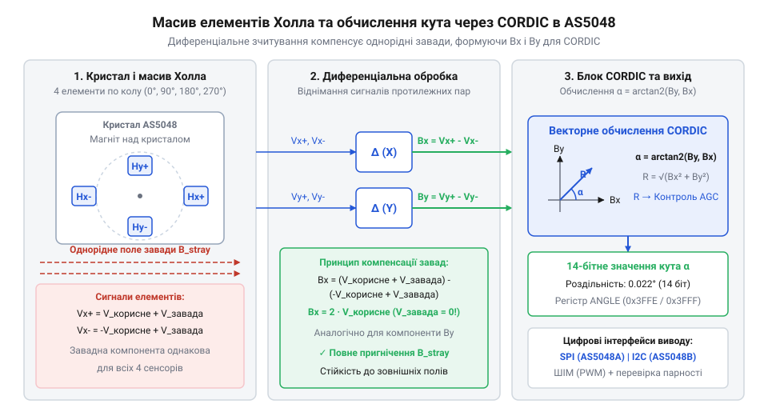
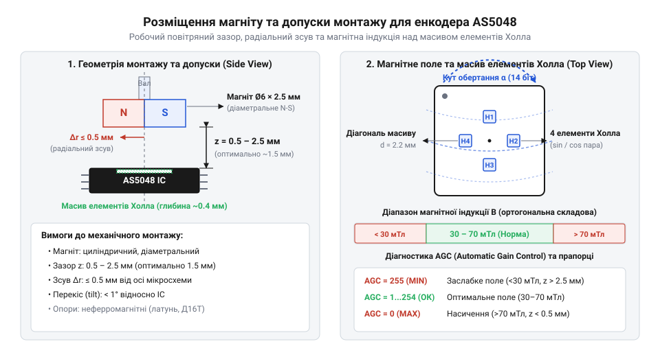

# Магнітний енкодер кута AS5048

<preknowlist>
- [Енкодери кутового та лінійного переміщення](root:cat-hw-sensors/optical-and-magnetic-encoders) — розрізнення інкрементальних та абсолютних відліків кута, поняття роздільної здатності у бітах та принципи формування індексних сигналів.
- [Датчики кутового положення сервоприводів: потенціометри та магнітні енкодери](root:cat-hw-sensors/servo-feedback-potentiometers-and-magnetic-encoders) — вимоги до безперервного зворотного зв'язку за позицією ротора в робототехнічних сервоприводах.
</preknowlist>

## Проблема втрати нуля в силових приводах

У безколекторних двигунах постійного струму (@@en|BLDC@@, @@en|Brushless Direct Current@@) із векторним керуванням (@@en|FOC@@, @@en|Field-Oriented Control@@, орієнтоване за полем керування) інвертор підтримує ортогональність магнітних полів статора та ротора. Хибні дані про механічний кут ротора відхиляють вектор струму від оптимального напрямку. Навіть похибка в кілька електричних градусів спричиняє падіння обертового моменту та перегрів обмоток. Докладніше про принципи формування струму статора та оптимізацію обертового моменту читайте у статті про [векторне керування BLDC-двигунами (FOC)](root:hw-motion/foc-control).

Традиційні [датчики кутового положення](root:cat-hw-sensors/servo-feedback-potentiometers-and-magnetic-encoders) мають критичні вади під навантаженням. Контактні @@en|potentiometer@@ зношуються через тертя струмознімача й шум контакту. [Інкрементальні оптичні енкодери](root:cat-hw-sensors/optical-and-magnetic-encoders) втрачають відлікову точку при вимкненні живлення, а процедура пошуку індексу (@@en|homing@@) неприпустима для навантажених механізмів. Крім того, диски оптичних сенсорів чутливі до пилу й бруду.

Магнітний енкодер @@en|AS5048@@ усуває ці обмеження завдяки безконтактному принципу. Давач зчитує абсолютне положення магніту одразу після подачі живлення без обертання ротора. Відсутність тертьових елементів виключає знос, а корпус захищає вимірювальний тракт від пилу та забруднень.

## Векторне обчислення кута блоком CORDIC

У кристалі @@en|AS5048@@ матриця з чотирьох елементів Холла (@@en|Hall sensor@@) вимірює ортогональні компоненти магнітного поля: індукцію `Bₓ` уздовж однієї осі та `Bᵧ` уздовж перпендикулярної.

Диференціальне віднімання сигналів із протилежних давачів пригнічує спільну заваду від силових струмів двигуна. Далі система обчислює тригонометричне відношення компонентів:

```
tan(θ) = Bᵧ / Bₓ
```

Частка від ділення робить обчислення кута `θ` інваріантним до коливань живлення чи температурного дрейфу індукції, адже зміна амплітуди векторів однаково масштабує чисельник і знаменник.

Вбудований конвеєрний обчислювач @@en|CORDIC@@ за 14 ітерацій побітових зсувів перетворює вектор у 14-бітний цифровий код кута з дискретністю 0.022° (16384 відліки на оборот). Детальніше про математичний апарат ітераційних зсувів та оптимізацію тригонометричних обчислень у сенсорах читайте у статті про [апаратний обчислювач CORDIC у сенсорах](root:hw-arch/cordic-algorithm-hardware-and-software-implementation).


*Матриця елементів Холла вимірює ортогональні компоненти індукції, а векторний обчислювач CORDIC перетворює їх у 14-бітний код кута.*

## Вимоги до магніту та механічного монтажу

Для роботи @@en|AS5048@@ потрібен неодимовий магніт (@@en|neodymium magnet@@) із діаметральною намагніченістю (@@en|diametric magnetization@@). Аксіальні магніти не створюють змінної індукції в площині кристала. Магніт монтують на торці немагнітного вала, щоб уникнути шунтування поля.

Повітряний зазор (@@en|air gap@@) 0.5–2.5 мм забезпечує робочу індукцію 30–130 мТл. Радіальне зміщення (@@en|radial misalignment@@) понад 0.25 мм порушує ортогональність компонентів `Bₓ` та `Bᵧ`, спричиняючи нелінійну похибку кута.


*Дотримання зазору та радіальної співвісності гарантує перебування магнітної індукції у допустимому вікні аналогового тракту.*

Відхилення індукції контролюють апаратні прапорці: при її зростанні понад 130 мТл аналоговий тракт насичується й виставляється @@en|COMPH@@ (@@en|Compare High@@), а при падінні нижче 30 мТл активується @@en|COMPL@@ (@@en|Compare Low@@).

## Цифрові інтерфейси, діагностика та програмування нуля

Енкодер має дві модифікації: @@en|AS5048A@@ із 16-бітним @@en|SPI@@ (бітом парності @@en|parity bit@@ та затримкою в один кадр) і @@en|AS5048B@@ із шиною @@en|I2C@@ та вибором адреси. Обидві мають резервний вихід @@en|PWM@@.

Регістр підсилення @@en|AGC@@ (0–255) утримує амплітуду сигналів для @@en|CORDIC@@ і дає змогу вести предиктивну діагностику. Його циклічне коливання вказує на осьовий люфт підшипників або биття вала (@@en|runout@@), а зростання до максимуму — на зсув вала до спрацювання прапорця @@en|COMPL@@.

Електричний нуль ротора узгоджують програмно (зсув у мікроконтролері) або апаратно — одноразовим записом положення вала у внутрішню @@en|OTP@@-пам'ять енкодера.