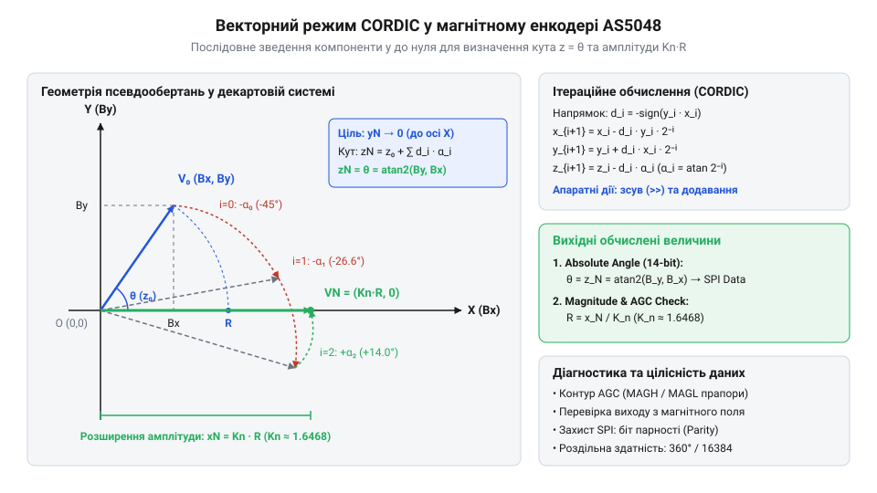

# Математичні основи CORDIC та геометрія магнітного поля

<preknowlist>
- [Енкодери кутового та лінійного переміщення](root:cat-hw-sensors/optical-and-magnetic-encoders) — принцип дискретизації кутового положення та розрізнення абсолютних і інкрементальних вимірювачів
- [Датчики кутового положення сервоприводів: потенціометри та магнітні енкодери](root:cat-hw-sensors/servo-feedback-potentiometers-and-magnetic-encoders) — фізичні засади знімання ортогональних компонентів магнітного поля елементами Голла
</preknowlist>

## Неможливість обчислення арктангенса в реальному часі

У системах керування безколекторними двигунами чи сервоприводами первинна обробка сигналів кутового положення відбувається із високою частотою дискретизації. Для визначення кута повороту вала використовуються [магнітні енкодери](root:cat-hw-sensors/servo-feedback-potentiometers-and-magnetic-encoders), у яких первинний сенсорний вузол складається з двох ортогональних елементів Голла (від англ. @@en|Hall element@@). На виході сенсорного підсилювача формуються два квадратурні сигнали `B_x` та `B_y`, що відповідають проєкціям вектора магнітної індукції на осі X та Y.

З математичного погляду, абсолютний кут повороту `θ` зв'язаний із виміряними проєкціями тригонометричною залежністю та обчислюється через обернену тригонометричну функцію:

tan(θ) = B_y / B_x
θ = arctan(B_y / B_x)            [визначення кута через арктангенс]

Пряме обчислення цього виразу у цифрових пристроях реального часу зустрічає дві фундаментальні математичні та апаратні перешкоди. Першою перешкодою є операція ділення `B_y / B_x`. В апаратній двійковій логіці мікросхем (від англ. @@en|ASIC@@) або програмованих вентильних матриць (від англ. @@en|FPGA@@) ділення є послідовною багатокроковою операцією, що потребує значної площі кристала та багатьох тактів процесора. Крім того, коли вектор проходить поблизу кутів 90° та 270°, значення `B_x` прямує до нуля, що спричиняє ділення на нуль і чисельну нестабільність.

Другою, більш критичною перешкодою є обчислення трансцендентної функції арктангенса. Класичний чисельний аналіз для обчислення тригонометричних функцій застосовує розклад у ряд Тейлора (від англ. @@en|Taylor series@@):

arctan(z)
= z - z³/3 + z⁵/5 - z⁷/7 + ...      [знакопочерговий ряд Тейлора поблизу нуля]

Щоб забезпечити роздільну здатність 14 біт (що відповідає 16 384 дискретним позиціям на оберт і допустимій кутовій похибці менше 0.0003 радіана), ряд Тейлора вимагає обчислення 15–20 членів полінома при значеннях `z ≈ 1`. Це означає необхідність виконання десятків операцій множення з плаваючою або фіксованою точкою високої розрядності на кожен відлік часу. Створення математичного блоку з плаваючою точкою збільшує енергоспоживання та обчислювальний затримковий квант (затримку відгуку), що робить контур зворотного зв'язку нестабільним.

Спроба замінити обчислення таблицею пошуку (від англ. @@en|look-up table@@, LUT) також спирається на обмеження пам'яті. Двовимірна таблиця для двох 14-бітних вхідних компонентів `B_x` та `B_y` вимагала б збереження `16384 × 16384` значень (понад 500 мегабайт ROM), що неможливо розмістити у компактному інтегрованому датчику. Навіть попереднє ділення `z = B_y / B_x` з подальшою одновимірною таблицею не розв'язує проблему безконечної області значень `z` при `B_x → 0`. Постає потреба в ітераційному алгоритмі, який замінює ділення, множення та трансцендентні обчислення виключно простими двійковими зсувами та додаваннями.

## Ортогональна геометрія та нелінійності магнітного поля

Перш ніж подавати ортогональні компоненти на алгоритм ітераційного обчислення кута, необхідно врахувати, що реальні фізичні сигнали зсунуті відносно ідеальної математичної моделі. В ідеальному випадку вимірювачі створюють чисто квадратурні сигнали `B_x(θ) = B_0 · cos(θ)` та `B_y(θ) = B_0 · sin(θ)`, годограф яких у декартовій системі координат утворює ідеальне коло радіуса `B_0`.

У реальних датчиках годограф вектора деформується під впливом трьох геометричних та фізичних нелінійностей:
1. Постійне зміщення нуля (від англ. @@en|DC offset@@), викликане технологічним розкидом напівпровідникових елементів та залишковою механічною напругою кристала. 2. Амплітудний небаланс (від англ. @@en|amplitude imbalance@@), зумовлений різницею коефіцієнтів підсилення вимірювальних каналів `A_x ≠ A_y`. 3. Фазовий зсув або відхилення від ортогональності (від англ. @@en|phase mismatch@@), коли фізичні елементи Голла розташовані під кутом `90° + φ` замість точних 90°.

У результаті сумісної дії цих чинників траєкторія кінця вектора `(B_x, B_y)` перетворюється з кола на зміщений та повернутий еліпс. Обчислення кута з непоправлених сигналів призводить до появі циклічної похибки (циклічної нелінійності). Для відновлення чистої колової геометрії застосовують послідовну математичну корекцію.

Спочатку виконують віднімання постійних зміщень `B_x0` та `B_y0`:

B_x1 = B_x' - B_x0              [компенсація зміщення осі X]
B_y1 = B_y' - B_y0              [компенсація зміщення осі Y]

На другому кроці усувають амплітудну асиметрію шляхом нормування компоненти `B_y1` до масштабного коефіцієнта осі X:

B_y2 = B_y1 · (A_x / A_y)       [масштабування амплітуди по осі Y]

На третьому кроці компенсують фазовий зсув `φ`. Якщо реальний сигнал `B_y2` містить фазову домішку осі X через відхилення кута `90° + φ`, його тригонометричний розклад має вигляд:

B_y2
= A_x · sin(θ + φ)
= A_x · sin(θ)cos(φ) + A_x · cos(θ)sin(φ)   [розклад синуса суми кутів]
= B_y_corr · cos(φ) + B_x1 · sin(φ)        [підстановка нормованих компонент]

Звідси ізолюють ортогональну компоненту `B_y_corr = A_x · sin(θ)`:

B_y_corr
= (B_y2 - B_x1 · sin(φ)) / cos(φ)           [визначення скоригованої компоненти Y]

Отримані ортогональні величини `B_x1` та `B_y_corr` формують нормований коловий годограф однакової амплітуди `A_x` з точним фазовим зсувом 90°, що є необхідною передумовою для обчислення абсолютного кута.

## Ітераційне обертання вектора алгоритмом CORDIC

Для обчислення кута з підготовлених компонентів `B_x` та `B_y` використовують алгоритм CORDIC (від англ. @@en|Coordinate Rotation Digital Computer@@ — цифровий обчислювач обертання координат). У векторному режимі (від англ. @@en|vectoring mode@@) CORDIC послідовно обертає вхідний вектор `(B_x, B_y)` у декартовій площині на серію фіксованих кутів `α_i` у напрямку осі X доти, доки ордината `y` не наблизиться до нуля. Сума всіх кутів обертання дорівнює шуканому куту `θ`.

Точне точкове обертання вектора `(x_i, y_i)` на кут `α_i` описується матрицею повороту:

x_{i+1} = x_i · cos(α_i) - y_i · sin(α_i)
y_{i+1} = y_i · cos(α_i) + x_i · sin(α_i)

Виносячи косинус кута `cos(α_i)` за дужки, отримуємо вираз псевдообертання:

x_{i+1} = cos(α_i) · [x_i - y_i · tan(α_i)]   [винесення косинуса за дужки]
y_{i+1} = cos(α_i) · [y_i + x_i · tan(α_i)]   [винесення косинуса за дужки]

Математичне сяйво CORDIC полягає у виборі таких кутів `α_i`, для яких тангенс є ступенем двійки:

tan(α_i) = 2⁻ⁱ

За такої умови множення на `tan(α_i)` замінюється арифметичним двійковим зсувом вправо на `i` бітів (`>> i`). Якщо на кожній ітерації тимчасово знехтувати множником `cos(α_i)` (що змінює лише довжину вектора, але не його кут), рекурентні формули псевдообертання (від англ. @@en|pseudo-rotation@@) набувають вигляду:

x_{i+1} = x_i - d_i · (y_i >> i)              [псевдообертання координати X]
y_{i+1} = y_i + d_i · (x_i >> i)              [псевдообертання координати Y]
z_{i+1} = z_i - d_i · α_i                     [накопичення кута в акумуляторі]

Тут `d_i` — напрямок обертання, який визначається знаком поточного значення `y_i`: якщо `y_i ≥ 0`, то `d_i = -1` (обертання за годинниковою стрілкою); якщо `y_i < 0`, то `d_i = +1`. Значення кутів `α_i = arctan(2⁻ⁱ)` зберігаються у невеликій константній таблиці (наприклад, 14 значень для 14-бітної точності).

*Геометрія псевдообертань CORDIC у векторному режимі, де послідовні зсуви зменшують ординату By до нуля, накопичуючи повний кут у змінній z.*

На кожному кроці `i` кутовий акумулятор `z` змінюється на величину `α_i`. Починаючи з `i = 0` (`α_0 = 45°`), `i = 1` (`α_1 ≈ 26.565°`), `i = 2` (`α_2 ≈ 14.036°`) і так далі, після `N` ітерацій координата `y_N` зводиться до нуля, а акумулятор `z_N` містить повну величину початкового кута вектора. Докладніше про формат Q-чисел, вибір розрядності двоїчних даних та функціонування апаратних зсувачів для мінімізації помилок округлення читайте у статті про [фіксовану точку та апаратну реалізацію CORDIC](root:sf-devices/fixed-point-arithmetic-and-cordic-implementation).

## Нормалізація амплітуди та діагностика AGC

Оскільки під час ітерацій CORDIC коефіцієнт `cos(α_i)` виносився за дужки і не враховувався при додаванні та зсувах, довжина вектора на кожному кроці збільшувалася в `1 / cos(α_i) = √(1 + tan²(α_i)) = √(1 + 2⁻²ⁱ)` разів. Після виконання `n` ітерацій результуюча координата `x_n` виявляється масштабованою на накопичений масштабний коефіцієнт (від англ. @@en|scaling factor@@) `K_n`:

K_n
= ∏_{i=0}^{n-1} √(1 + 2⁻²ⁱ)                   [добуток елементарних розширень]

Для `n ≥ 14` значення `K_n` стрімко збігається до константи:

K_n ≈ 1.646760258

Обернена величина `A_n = 1 / K_n ≈ 0.607252935` використовується для відновлення справжньої фізичної амплітуди вектора `R = √(B_x² + B_y²)`. Оскільки на останній ітерації CORDIC `y_n → 0`, кінцеве значення `x_n` дорівнює `K_n · R`. Звідси абсолютна індукція магнітного поля обчислюється множенням на константу `A_n`:

R = x_n · A_n                                [обчислення справжньої амплітуди вектора]

Обчислена значення амплітуди `R` є основним параметром для діагностики контуру автоматичного регулювання підсилення (від англ. @@en|Automatic Gain Control@@, AGC) та контролю механічного зазору магніту:

1. Завеликий робочий зазор або відсутність магніту: якщо `R < R_min`, індукція магнітного поля на поверхні кристала недостатня. Відношення сигнал/шум (від англ. @@en|Signal-to-Noise Ratio@@, SNR) падає, що призводить до кутового флуктуючого шуму. Контур AGC збільшує підсилення внутрішніх підсилювачів до максимуму. 2. Замалий зазор або надто сильний магніт: якщо `R > R_max`, виникає ризик насичення напівпровідникових елементів Голла та аналогових трактів. AGC зменшує коефіцієнт підсилення до мінімуму.

Якщо контур AGC виходить за межі регулювання (досягає мінімального або максимального значення підсилення), виставляються діагностичні прапорці помилки магнітного поля (`MAG_TOO_WEAK` або `MAG_TOO_STRONG`), що дозволяє зупинити привід до виникнення аварійної ситуації.

## Масштабування 14-бітного значення та контроль парності

Результатом роботи алгоритму CORDIC є 14-бітне двоїчне число у форматі двоїчної кутової міри (від англ. @@en|Binary Angular Measure@@, BAM). 14-бітний код `D_14` набуває цілих значень від `0` до `2¹⁴ - 1 = 16383`, де значення 16384 відповідає повному оберту на 360° (або `2π` радіан).

Математичне масштабування вихідного двоїчного коду у фізичні одиниці вимірювання кута здійснюється за формулами:

θ_deg = D_14 · (360.0 / 16384.0)               [переведення коду в градуси]
θ_rad = D_14 · (2 · π / 16384.0) = D_14 · (π / 8192.0)  [переведення коду в радіани]

Роздільна здатність одного найменшого значущого розряду (від англ. @@en|Least Significant Bit@@, LSB) становить:

1 LSB = 360° / 16384 ≈ 0.02197265625°

Під час передачі обчисленого кута через цифрові інтерфейси (такі як SPI) дані упаковуються у 16-бітний кадр, який включає біт прапорця помилки `EF` (від англ. @@en|error flag@@) та біт контролю парності (від англ. @@en|parity bit@@, або @@en|parity check@@).

За правилом парної парності (від англ. @@en|even parity@@) біт парності `P` обирається так, щоб загальна кількість одиничних бітів у 16-бітному кадрі була парною:

P = b₁₄ ⊕ b₁₃ ⊕ ... ⊕ b₀                       [обчислення біта парності через XOR]

Приймач виконує операцію побітового виключального «АБО» (XOR) над усіма 16 бітами. Якщо результат дорівнює `1`, це свідчить про спотворення даних під час передачі по лінії зв'язку.

:::tabs
== C
:::code math-cordic-magnetic-angle-calculation/c/check-as5048-parity.c

== C++
:::code math-cordic-magnetic-angle-calculation/cpp/angleencoderdecoder.cpp
:::

Використання апаратного алгоритму CORDIC та математичного контролю парності забезпечує точне визначення кута з мінімальною затримкою обробки та гарантованою цілісністю даних у промислових системах керування рухом.