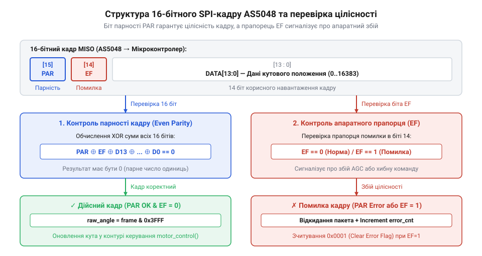
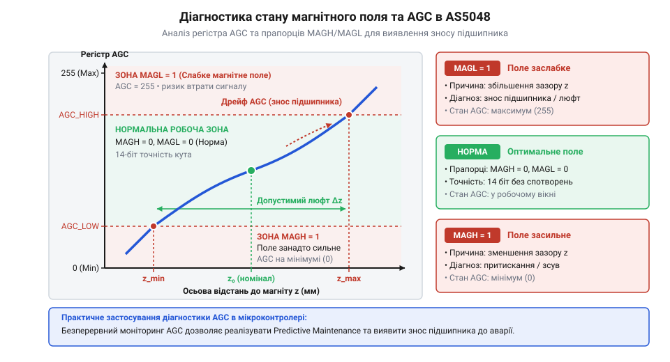

# Практичний драйвер AS5048 з моніторингом AGC та автокалібруванням

<preknowlist>
- [Енкодери кутового та лінійного переміщення](root:cat-hw-sensors/optical-and-magnetic-encoders) — Фізичні принципи магнітного зчитування кута та принципи квадратурного або цифрового кодування положення.
- [Датчики кутового положення сервоприводів: потенціометри та магнітні енкодери](root:cat-hw-sensors/servo-feedback-potentiometers-and-magnetic-encoders) — Конструкція вузлів зворотного зв'язку сервоприводів та вимоги до точності й затримок вимірювання кута.
</preknowlist>

У сучасних робототехнічних системах, сервоприводах та системах точного позиціювання надійність кутового зворотного зв'язку є критичним фактором. Будь-який збій або похибка в кутових даних може призвести до зриву кроків крокового двигуна, нестабільності контуру регулювання або аварійного зупинення механізму. Магнітний енкодер AS5048 (або його повнофункціональний варіант AS5048A) виробництва ams OSRAM є популярним вибором завдяки 14-бітній роздільній здатності (16384 відліки на оберт), інтерфейсам SPI та I2C, а також вбудованій системі компенсації та діагностики магнітного поля. У цьому проєкті ми розробимо надійний, відмовостійкий драйвер для мікроконтролера ESP32 (під управлінням ESP-IDF як на C, так і на C++), який реалізує конвеєрне опитування через SPI, апаратну перевірку біта парності, моніторинг рівня автоматичного регулювання підсилення (AGC) для виявлення механічних люфтів і зміщень, а також гнучке програмне калібрування нульової позиції з персистентним збереженням.

## Аварії контуру керування через недовірені дані

У високопродуктивних системах керування рухом (наприклад, безщіткових сервоприводах або робототехнічних суглобах) контур регулювання положення та швидкості працює на частотах від кількох сотень герц до кількох кілогерц. У таких умовах контролер покладається на безперервний і достовірний потік даних від датчиків кута. Проте реальні промислові чи лабораторні умови є джерелом електромагнітних завад (EMI), які можуть спотворювати цифрові пакети під час передачі високошвидкісними шинами, такими як SPI.

Якщо мікроконтролер приймає «сліпі» дані від енкодера без перевірки цілісності, будь-який одиночний імпульс завади на лінії MISO або SCLK може перетворити коректне значення кута на випадкове число. Для алгоритму ПІД-регулятора це виглядає як миттєвий скачок положення на сотні градусів. Регулятор намагається відпрацювати цю «помилку», подаючи максимальну напругу на обмотки двигуна, що призводить до жорсткого удару, зриву синхронізації або вигоряння силових ключових транзисторів.

Окрім електричних завад, небезпеку становлять механічні фактори. З часом під дією вібрацій, теплового розширення або зносу підшипників вала можливе осьове чи радіальне зміщення магніту відносно чутливої поверхні мікросхеми AS5048. Якщо система не контролює стан магнітного поля та рівень внутрішнього підсилення (AGC), давач може продовжувати видавати хибні або неточні дані внаслідок виходу магнітної індукції за межі робочого діапазону.

Для запобігання подібним аваріям відмовостійкий драйвер повинен вирішувати три ключові завдання:
1. Гарантувати достовірність кожного кадру за допомогою апаратної перевірки біта парності (Even Parity).
2. Оперативно виявляти та скидати внутрішні прапорці помилок протоколу через регістр `ERRFL` (`0x0001`).
3. Постійно моніторити стан магнітної системи за допомогою регістра діагностики та AGC (`0x3FFE`) для виявлення деградації механіки ще до виникнення аварії.

## Перевірка цілісності кадру та обробка парності

Мікросхема AS5048 взаємодіє з хост-контролером (наприклад, ESP32) за допомогою 16-бітних кадрів через інтерфейс SPI. Особливістю протоколу AS5048 є те, що старший біт кадру (біт 15) використовується для забезпечення парності (Even Parity). Це означає, що кількість одиничних бітів у 16-бітному слові (враховуючи біт парності) завжди має бути парною.



Коли ESP32 надсилає команду запиту (наприклад, читання регістра `ANGLE` `0x3FFF`), він зобов'язаний заздалегідь обчислити біт парності для молодших 15 бітів команди та встановити біт 15 у відповідний стан. У свою чергу, у відповіді від AS5048 біт 15 також містить розраховану давачем парність отриманого кадру, а біт 14 виконує роль прапорця помилки кадру (`EF` — Error Flag). Якщо біт `EF` встановлено в одиницю, це свідчить про те, що попередній кадр команди був інтерпретований мікросхемою як помилковий (наприклад, через невірну парність або неправильну кількість тактів SCLK).

Для реалізації цього на рівні програмного забезпечення ESP-IDF ми створюємо функцію обчислення парності та захищений механізм передачі:

```c
uint16_t as5048_calculate_parity(uint16_t value)
{
    uint16_t v = value & 0x7FFF;
    v ^= v >> 8;
    v ^= v >> 4;
    v ^= v >> 2;
    v ^= v >> 1;
    return (v & 1) ? AS5048_FRAME_PARITY_BIT : 0x0000;
}
```

Як видно з драйвера `as5048.c`, швидке бітове згортання дозволяє визначити непарність одиниць без повільних циклів. Під час здійснення SPI-транзакції драйвер формує кадр із розрахованим бітом парності, передає його, а після прийому відповіді повторно перевіряє парність молодших 15 бітів (`rx_raw & 0x7FFF`). Якщо виявлено невідповідність, транзакція відхиляється з кодом помилки `ESP_ERR_INVALID_CRC`, що захищає контур керування від спотворених даних.

Окрім цього, через конвеєрну архітектуру SPI в AS5048, для читання будь-якого регістру (наприклад, визначеного в `as5048.h`) потрібно виконати два послідовні кадри: перший кадр надсилає команду запиту, а другий кадр (часто з фіктивною командою `NOP` `0x0000`) витягує результат виконання попередньої команди. Наш драйвер повністю автоматизує цей процес, приховуючи складність конвеєра від прикладного рівня.

## Діагностика магнітного поля через регістр AGC

Надійність магнітного енкодера залежить від стабільності індукції магнітного поля, створеного діаметральним магнітом на валу двигуна. Мікросхема AS5048 містить вбудований апаратний регулятор підсилення (AGC — Automatic Gain Control), який автоматично адаптується до відстані між магнітом і датчиком, а також компенсує температурні коливання сили поля.

Регістр діагностики та AGC розташований за адресою `0x3FFE`. Він містить 8-бітне значення підсилення AGC (від 0 до 255), а також важливі прапорці стану:
- `OCF` (Offset Compensation Finished) — сигналізує, що внутрішня калькуляція CORDIC завершена і дані кута стабільні.
- `COF` (CORDIC Overflow) — вказує на переповнення обчислювача.
- `MAGL` (Magnet Low) — магнітне поле занадто слабке (магніт розташований занадто далеко від датчика).
- `MAGH` (Magnet High) — магнітне поле занадто сильне (магніт розташований надто близько або використовується занадто потужний магніт).



Оптимальне значення AGC для AS5048 становить приблизно 128. Якщо значення AGC наближається до 0, це означає, що магнітне поле занадто інтенсивне (`MAGH = 1`), що може призвести до насичення магніточутливих елементів Холла. Якщо AGC наближається до 255, поле стає занадто слабким (`MAGL = 1`), збільшуючи рівень шуму вимірювань і ризик втрати синхронізації при вібраціях.

Моніторинг цих параметрів у реальному часі за допомогою функції `as5048_get_diagnostics()` дозволяє реалізувати предиктивну діагностику механічних вузлів. Наприклад, поступове зростання значення AGC під час тривалої експлуатації механізму свідчить про поступове ослаблення неодимового магніту через перегрів або про знос підшипників, що викликає збільшення осьового зазору. Система може заздалегідь попередити оператора про необхідність технічного обслуговування до того, як виникне аварійний зупин.

## Програмне автокалібрування та компенсація нульового положення

Під час механічного монтажу магнітного енкодера AS5048 на вал двигуна практично неможливо досягти ідеального збігу нульової позначки датчика з механічним нулем виконавчого механізма чи робота. Зазвичай лишається деяке кутове зміщення (похибка монтажу), яке доводиться компенсувати. Апаратна специфікація AS5048 передбачає можливість фіксації нульового положення шляхом незворотного пропалювання спеціальних комірок одноразової пам'яті (OTP — One-Time Programmable). Проте такий підхід несе суттєві ризики: будь-яка помилка під час калібрування на виробництві або зміщення магніту внаслідок вібрацій робить дорогий датчик непридатним до подальшого точного налаштування.

Для уникнення цих ризиків у сучасних вбудованих системах застосовують програмне автокалібрування та електронну компенсацію нульової позиції. Замість фізичного випалу одноразової пам'яті, драйвер мікроконтролера зчитує сире значення кута `raw_angle` і віднімає від нього збережене в енергонезалежній пам'яті зміщення `zero_offset`. Розрахунок виконується за виразом:

```
corrected_angle = (raw_angle - zero_offset + 16384) % 16384
```

де операція додавання 16384 та взяття за модулем 16384 забезпечує безшовний циклічний простір кута від 0.0° до 360.0° без розривів та втрати точності навіть при переході через нуль.

У наведеному нижче коді реалізовано функцію програмного калібрування нуля `as5048_calibrate_zero`, яка зчитує поточний необроблений кут і призначає його новим опорним зміщенням:

:::code proj-as5048-esp32-driver-diag/c/as5048-calibrate-zero.c

Для персистентного збереження калібрувальних даних між перезапусками мікроконтролера ESP32 використовується сховище NVS (Non-Volatile Storage). В об'єктно-орієнтованій C++ реалізації цей процес інкапсульовано у методи `calibrate_zero_position()` та `load_zero_offset_from_nvs()`. Під час ініціалізації (`begin()`) драйвер автоматично звертається до NVS-розділу, витягує збережений калібрувальний нуль та застосовує його до поточних вимірювань, звільняючи прикладний шар від ручної рутини.

## Інтеграція драйвера в неблокуючий контур ESP32

Будь-який сучасний привід або робототехнічний вузол вимагає детермінованого циклу опитування датчиків зворотного зв'язку. Якщо читання кута блокує виконання основного потоку керування на час SPI-транзакцій, це неминуче призводить до джиттеру (тремтіння) контуру регулювання та деградації якості регулювання швидкості чи положення.

Для розв'язання цієї проблеми драйвер AS5048 побудований на принципах неблокуючої архітектури та підтримки операційної системи реального часу FreeRTOS. У середовищі ESP-IDF взаємодія з периферійною шиною SPI здійснюється через механізм DMA (Direct Memory Access) та черги завдань драйвера `spi_master`.

У С++ версії реалізовано конвеєрне зчитування кута (`read_angle_pipelined`). Особливість інтерфейсу SPI мікросхеми AS5048 полягає в тому, що датчик завжди повертає у відповідь на поточну команду дані, які запитувалися під час *попередньої* транзакції. Тому для отримання актуального кута використовується двотактний конвеєр або передача команди `NOP` (`0x0000`), яка витягує результат попереднього запиту регістру `0x3FFF` без затримок очікування внутрішніх станів обчислювача CORDIC.

Усі критичні збої — такі як порушення парності кадру (Even Parity), спрацьовування прапорця апаратної помилки `EF` чи вихід амплітуди магнітного поля за допустимі межі (`MAGH` / `MAGL`) — перехоплюються на рівні драйвера. Замість аварійної зупинки програми, драйвер автоматично звертається до регістра помилок `ERRFL` (адреса `0x0001`), скидає прапорці та повертає статус помилки у вищий шар FreeRTOS-задачі. Це дозволяє системі керування вчасно зупинити силові ключі або перейти в безпечний режим (Fail-Safe), запобігаючи пошкодженню обладнання.

## Повний вихідний код реалізації

Нижче наведено робочі приклади конфігурації та опитування датчика AS5048 мовами C та C++ для середовища ESP-IDF.

:::tabs
@tab C (ESP-IDF)
:::code proj-as5048-esp32-driver-diag/c/main/main.c
@tab C++ (ООП / FreeRTOS)
:::code proj-as5048-esp32-driver-diag/cpp/main.cpp
:::

## Висновки

Розроблений відмовостійкий драйвер AS5048 для ESP32 забезпечує високу надійність кутового зворотного зв'язку в робототехнічних приводах. Завдяки апаратній перевірці парності SPI-кадрів, обробці помилок протоколу та постійному моніторингу регістра AGC і прапорців магнітного поля, система здатна ефективно протистояти електромагнітним завадам і механічним деградаціям. Програмне калібрування нульової позиції спрощує складання механізмів без потреби у складній апаратній юстуванні магніту.