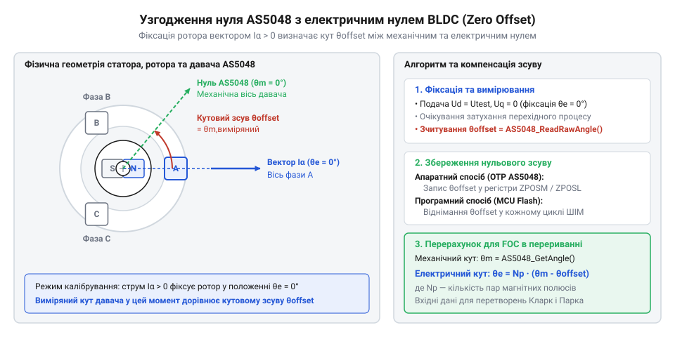
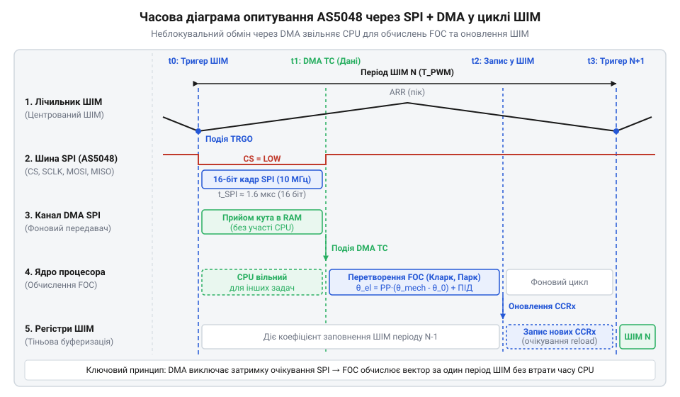

# Налаштування зворотного зв'язку за кутом для BLDC двигуна

<preknowlist>
- [Енкодери кутового та лінійного переміщення](root:cat-hw-sensors/optical-and-magnetic-encoders) — Фізичні принципи роботи магнітних енкодерів абсолютного кута та структуру 14-бітового кадру SPI.
- [Датчики кутового положення сервоприводів: потенціометри та магнітні енкодери](root:cat-hw-sensors/servo-feedback-potentiometers-and-magnetic-encoders) — Організацію контуру зворотного зв'язку за кутом у прецизійних сервоприводах.
</preknowlist>

## Розсинхронізація вектора поля нищить момент

Коли у безщітковому двигуні постійного струму ротор обертається під дією магнітного поля статора, статорні обмотки створюють загальний магнітний вектор, який повинен випереджати ротор на кут дев'яносто електричних градусів для досягнення максимальної ефективності. Якщо система керування втрачає інформацію про справжнє положення ротора або оперує хибними даними, вектор статора починає відставати або випереджати оптимальне положення під довільним кутом. Це призводить до того, що сила взаємодії між постійними магнітами ротора та електромагнітами статора спрямовується не по касаційній траєкторії для створення крутного моменту, а радіально, спричиняючи різке падіння тяги, появу надлишкових вібрацій та неконтрольоване зростання споживаного струму.

Уявіть собі ситуацію, коли магнітне поле статора створюється під кутом, що відхиляється від ідеальних дев'яносто електричних градусів. Якщо кут похибки становить `θ_err`, то ефективний крутний момент двигуна пропорційний косинусу або синусу цієї похибки залежно від її природи, що призводить до негайного зниження створеного моменту пропорційно `cos(θ_err)`. Наприклад, навіть помірна кутова похибка у шістдесят електричних градусів зменшує корисний момент на половину, змушуючи систему подавати вдвічі більший струм для збереження тяги, що створює колосальне тепловиділення в обмотках. У гіршому випадку, коли кутова розсинхронізація наближається до ста вісімдесяти електричних градусів, момент стає гальмівним, а струм через обмотки перевищує номінальні значення в кілька разів, що неминуче випалює силові транзистори інвертора та обмотки статора.

Для уникнення цього аварійного режиму векторне керування покладається на безперервне вимірювання механічного кута через абсолютний магнітний енкодер @@en|AS5048@@, який забезпечує незмінність та високу точність відліку навіть після зняття живлення. Точний облік положення ротора дозволяє перетворювати виміряний механічний кут на електричний з урахуванням кількості пар полюсів, забезпечуючи бездоганну синхронізацію статорного поля з роторним потоком у реальному часі.

## Масштабування механічного кута в електричний

Щоб перетворити сирі дані з магнітного датчика на значення, придатне для трифазних синусоїдальних перетворень Кларк і Парка, необхідно врахувати конструктивну різницю між механічним та електричним обертанням вала двигуна. Магнітний енкодер вимірює абсолютне положення вала в межах одного повного механічного обертання на триста шістдесят градусів, видаючи 14-бітовий цифровий код у діапазоні від нуля до шістнадцяти тисяч чотирьохсот п'ятдесяти чотирьох. Проте магнітна система двигуна має кілька пар полюсів, де кожна пара створює повний цикл синусоїдальної зміни магнітного поля на електричному колі. Тому один механічний оберт вала містить стільки повних електричних періодів, скільки пар полюсів має ротор двигуна. Для обчислення електричного кута необхідно помножити виміряний 14-бітовий механічний кут на кількість пар полюсів, після чого виконати нормалізацію результату в межах одного електричного періоду.

Визначення електричного кута ротора базується на кількості пар полюсів та сирому значенні енкодера:

    θ_e = (θ_m × P) mod 2π
    = ((RAW_ENC / 16384.0) × 2π × P) mod 2π   [масштабування 14-бітового коду в радіани та множення на кількість пар полюсів]

де `θ_e` — миттєвий електричний кут, `θ_m` — механічний кут ротора, `P` — кількість пар полюсів двигуна, `RAW_ENC` — сире 14-бітове значення від енкодера AS5048. Цей перерахунок дозволяє синхронізувати координатну систему контролера з реальною просторовою орієнтацією магнітного поля ротора, забезпечуючи коректну роботу таких базових механізмів, як [датчики кутового положення сервоприводів: потенціометри та магнітні енкодери](root:cat-hw-sensors/servo-feedback-potentiometers-and-magnetic-encoders). Зважаючи на високу швидкість обертання сучасних приводів, це перетворення виконується апаратно або оптимізовано в перериваннях контролера, де важливу роль відіграє швидкий доступ до послідовних інтерфейсів, таких як [цифрові послідовні інтерфейси енкодерів SSI та BiSS-C](root:cat-hw-sensors/ssi-bissc-digital-interfaces).

Нормалізація отриманого значення в межах одного електричного періоду вимагає приведення розрахованого кута до діапазону від нуля до двох пі, щоб матриці перетворень отримували коректні аргументи без переповнення фази. Оскільки сире значення енкодера є лінійним відліком від нуля до шістнадцяти тисяч чотирьохсот п'ятдесяти чотирьох, операція ділення на максимальну розрядність та множення на два пі переводить його в радіанну міру механічного кута. Подальше множення на кількість пар полюсів розгортає цей діапазон на всі електричні періоди, які проходять за один механічний оберт ротора. Операція взяття за модулем двох пі відтинає зайві повні оберти, залишаючи лише миттєву фазу електричного поля, яка безпосередньо керує амплітудою та спрямованістю струмів у обмотках статора. Без такого перерахунку та нормалізації контролер оперуватиме невідповідними фазними кутами, що призведе до розвороту вектора намагнічування, різкого падіння крутного моменту та зриву синхронізації двигуна.

## Визначення зсуву нуля та калібрування

Навіть після коректного масштабування 14-бітового коду в електричний кут, нульова відмітка магнітного енкодера рідко збігається з фізичним магнітним нулем обмоток статора через механічні допуски під час монтажу платформи. Якщо цей початковий кутовий зсув залишається некомпенсованим, усі подальші вектори струму подаватимуться зі сталим зсувом фази, що знижує ефективність двигуна. Для вимірювання цього зсуву застосовують процедуру фазової фіксації ротора, подаючи постійний тестовий струм у певну фазу статора, наприклад, створюючи вектор у напрямку осі першої фази. Ротор під дією цього штучного магнітного поля повертається та жорстко фіксується в положенні, що відповідає електричному нулю статора. У цей момент зчитується поточне значення магнітного енкодера, яке стає абсолютним зсувом нуля для всіх подальших обчислень.

Фіксація ротора постійним струмом дозволяє виміряти кутовий зсув між нулем датчика та магнітною віссю фази статора.

Отримане значення зсуву може бути записане безпосередньо в енергонезалежну пам'ять датчика, використовуючи [програмування та випалювання OTP-пам'яті в енкодерах AS504x](root:cat-hw-sensors/as5048-otp-programming-guide), або компенсуватися програмно в коді мікроконтролера шляхом віднімання константи зсуву перед обчисленням тригонометричних функцій для перетворень Кларк і Парка. Вибір між цими підходами залежить від апаратної конфігурації: програмна компенсація гнучкіша при прототипуванні, тоді як апаратне збереження в OTP гарантує однакову поведінку датчика при заміні керуючої плати. Для забезпечення високої швидкодії в критичних циклах керування оновлення кута організовують через апаратний DMA, що виключає затримки на очікування відповіді по шині SPI.

Асинхронне фонове опитування датчика через SPI за допомогою DMA усуває затримки в критичному за часом перериванні ШІМ-генератора.

## Неблокувальне зчитування давача у перериванні

Для того щоб обчислювальний контур векторного керування працював стабільно, ШІМ-контролер має оновлювати заповнення силових ключів чітко за розкладом, що виключає будь-які зупинки процесора під час очікування відповіді від периферійних пристроїв. Коли центральний процесор звертається до магнітного енкодера через послідовний периферичний інтерфейс @@en|SPI@@, стандартне синхронне очікування завершення передачі даних призводить до критичної затримки у кілька мікросекунд, зриваючи генерацію синусоїдальних хвиль. Щоб запобігти цьому, обмін даними перекладається на апаратний контролер прякреєстрового доступу або організовується через асинхронне фонове опитування, де кожне переривання ШІМ лише забирає вже підготовлений регістром буфер із попереднього такту. Детальніше про те, як налаштувати [асинхронне читання AS5048 через SPI у перериваннях](root:cat-hw-sensors/as5048-spi-interrupt) для організації неблокувального обміну даними, можна дізнатися у відповідному посібнику.

Апаратна шина читає 14-бітовий кадр положення ротора паралельно з роботою таймерів, а переривання таймера читає фіксований результат за один мікросекундний такт, уникаючи блокування потоку. Окремою вимогою безпеки стає обов'язкова перевірка біта парності та статусних прапорців діагностики магнітного поля, які сигналізують про зсув або відрив магніту від осі вала. Якщо пристрій фіксує помилку зв'язку чи слабкість поля, система негайно переходить у безпечний режим гальмування, запобігаючи неконтрольованому ривку двигуна.

## Інтеграція кута в контур керування

Отриманий і перевірений кут ротора стає базовим аргументом для математичних перетворень, які переводять стаціонарні фазні струми у синхронно обертову систему координат моменту та потоку. Якщо подати значення кута з мінімальною похибкою чи затримкою, вектор намагнічування статора почне коливатися відносно ротора, спричиняючи пульсації крутного моменту, гудіння обмоток та втрату ефективності перетворювача. Для виключення цих спотворень обчислений кут проходить через стадію програмної компенсації зсуву та надходить у прямі тригонометричні функції перетворення Кларк і Парка.

Динамічна верифікація кутового зворотного зв'язку полягає у подачі тестового фіксованого струму на одну з осей та перевірці відповідності реакції вала заданому положенню, що дозволяє автоматично виявити реверс фаз або неправильне підключення силових ключів. У разі виявлення розсинхронізації програмний шар коригує напрямок обертання або додає постійне коригувальне зміщення, забезпечення максимальної жорсткості та стабільності моменту при змінному навантаженні на валу двигуна.