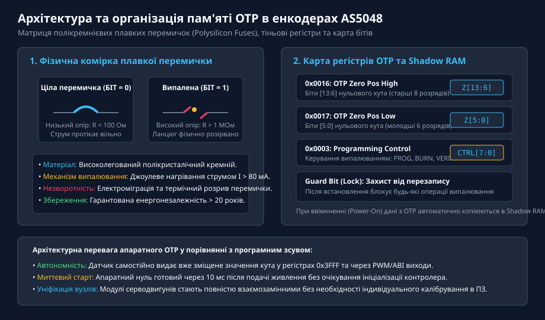
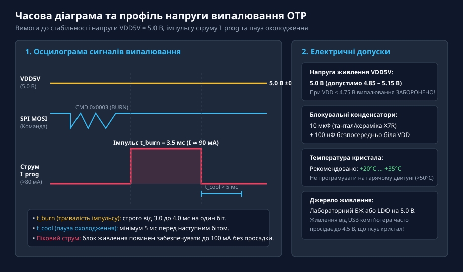
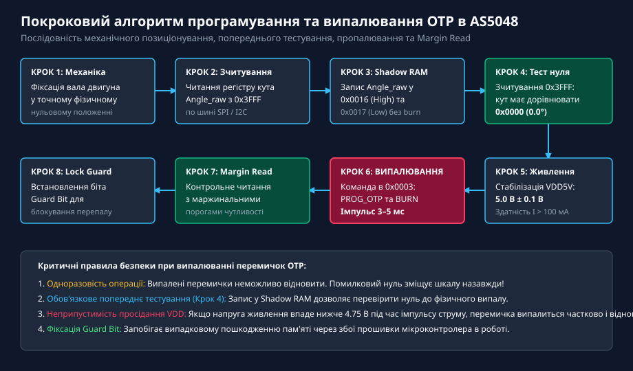
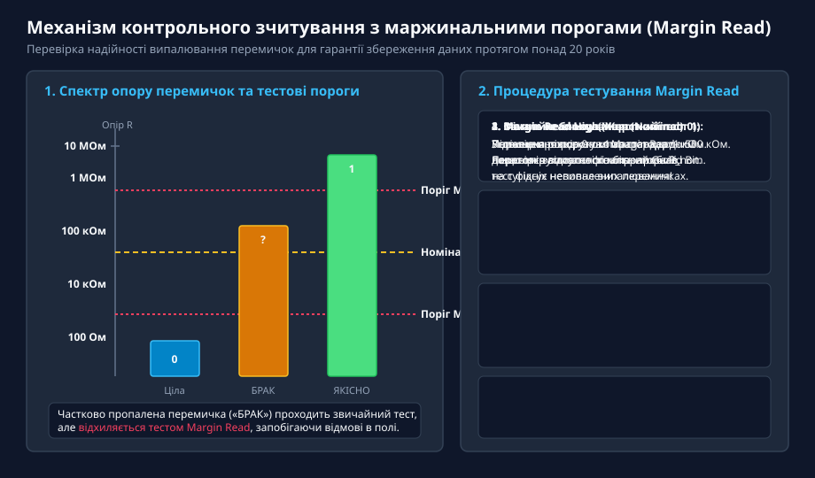
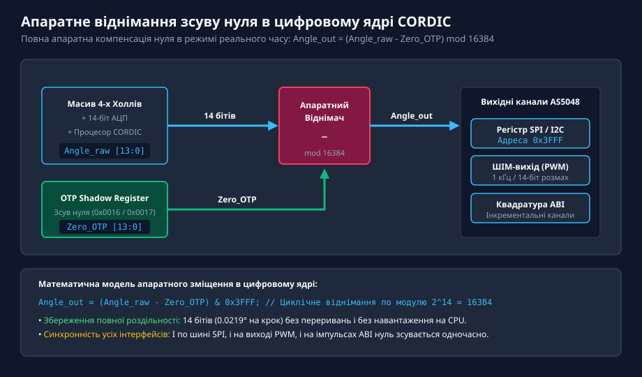

# Програмування та випалювання OTP-пам'яті в енкодерах AS504x

<preknowlist>
- [Магнітний енкодер кута AS5048](root:cat-hw-sensors/as5048-magnetic-encoder) — апаратна будова, інтерфейси SPI/I2C та базова карта регістрів магнітного датчика AS5048
- [Енкодери кутового та лінійного переміщення](root:cat-hw-sensors/optical-and-magnetic-encoders) — принципи дискретизації абсолютного кута та поняття нульової точки позиціонування
</preknowlist>

## Призначення та архітектура пам'яті OTP в енкодерах AS504x

У прецизійних сервоприводах, робототехнічних суглобах та автомобільних системах керування положенням безконтактні магнітні енкодери серії AS504x (зокрема популярні моделі AS5048A зі швидкісним інтерфейсом SPI та AS5048B із шиною I2C) забезпечують 14-бітне вимірювання абсолютного кута вала. Проте під час механічного збирання роторного вузла фізичний нульовий кут поворотного механізму практично ніколи не збігається з нульовим відліком кристала енкодера `0x0000`. Механічне юстування положення корпусу мікросхеми або доворот постійного магніту на валу є трудомісткою операцією, яка погіршує надійність вузла і не гарантує високої повторюваності.

Для розв'язання цієї проблеми в архітектуру енкодерів AS504x інтегровано енергонезалежну одноразово програмовану пам'ять — @@en|OTP@@ (від англ. *One-Time Programmable* — одноразово програмована пам'ять). Пам'ять OTP дозволяє зафіксувати апаратний зсув нуля (Zero Position), змінити напрямок відліку кута (біт DIR), налаштувати параметри вихідного ШІМ-сигналу (PWM) та заблокувати конфігурацію від випадкового перезапису за допомогою захисного біта Guard.

Фізична основа комірок OTP в інтегральних мікросхемах ams OSRAM побудована на матриці полікремнієвих плавких перемичок (англ. @@en|polysilicon fuses@@).


*Архітектура пам'яті OTP в енкодерах AS5048: фізична зміна опору полікремнієвої перемички від R < 100 Ом до R > 1 МОм та відображення бітів зсуву нуля в тіньові регістри.*

У початковому заводському стані кожна полікремнієва перемичка є цілим низькоомним провідником з електричним опором менше ніж 100 Ом, що відповідає логічному рівню нуля (`0`). Під час процедури програмування крізь обрану перемичку пропускають калібрований імпульс струму високої густини (до 80–100 мА). Внаслідок концентрованого джоулевого нагрівання температура в центрі мікроперемички перевищує точку плавлення кремнію (+1414 °C). Виникає локальний термічний розрив і електроміграція матеріалу, в результаті чого утворюється фізичний розрив із опором понад 1 МОм, що фіксує стабільний логічний стан одиниці (`1`).

Внутрішня архітектура AS5048 містить дворівневу систему регістрів:
1. **Масив енергонезалежних перемичок OTP (Non-volatile Fuse Matrix):** Фізичні плавкі перемички, стан яких зберігається нескінченно довго навіть при повному відключенні живлення пристрою (термін збереження даних перевищує 20 років при температурі до +125 °C).
2. **Тіньові регістри в оперативній пам'яті (Shadow RAM):** Швидкодіючі тригери статичної пам'яті, які мають ті самі адресні простори, що й комірки OTP.

Під час кожної подачі напруги живлення на датчик (процедура Power-On Reset, POR) вбудований автомат керування протягом перших 10 мікросекунд зчитує стан усіх фізичних перемичок OTP і копіює їхній вміст у регістри Shadow RAM. Усі подальші робочі операції обчислювального ядра енкодера та вихідних інтерфейсів звертаються виключно до регістрів Shadow RAM. Ця архітектура надає розробнику важливу інженерну перевагу: можливість багаторазового попереднього тестування нульового положення через запис у Shadow RAM без виконання незворотного фізичного випалювання перемичок.

## Карта регістрів та призначення комірок OTP

Програмування та конфігурування пам'яті OTP в енкодері AS5048 здійснюється через стандартні транзакції інтерфейсу SPI (для AS5048A) або I2C (для AS5048B). Адресний простір, пов'язаний із керуванням нульовою точкою та пам'яттю OTP, охоплює такі ключові регістри:

| Адреса регістру (Hex) | Назва регістру | Біти | Опис призначення |
| :--- | :--- | :--- | :--- |
| `0x0016` | **OTP Zero Position High** | `[7:0]` | Старші 8 бітів (`Z[13:6]`) 14-бітного значення нульового кута. |
| `0x0017` | **OTP Zero Position Low** | `[5:0]` | Молодші 6 бітів (`Z[5:0]`) 14-бітного значення нульового кута. |
| `0x0003` | **Programming Control** | `[7:0]` | Регістр керування автоматом програмування (команди PROG, BURN, VERIFY). |
| `0x3FFF` | **Angle Output** | `[13:0]` | Регістр зчитування вихідного кута (з урахуванням вирахуваного зсуву). |

Крім зсуву нуля, комірки OTP AS5048 містять біти загальної системної конфігурації:
- **Біт DIR (Direction):** Визначає полярність наростання кута при обертанні вала. За замовчуванням (`DIR = 0`) значення кута зростає при обертанні за годинниковою стрілкою (CW). Якщо випалити біт `DIR = 1`, напрямок відліку інвертується на протилежний (CCW).
- **Біти конфігурації виходу (PWM / ABI):** Дозволяють налаштувати режим роботи допоміжного виводу (частоту ШІМ 1 кГц або 2 кГц, або вивід квадратурних інкрементальних імпульсів ABI).
- **Захисний біт Guard (Lock Bit):** Спеціальний розряд OTP, після пропалювання якого внутрішній ключ подачі напруги програмування блокується апаратно. Після встановлення Guard Bit будь-які подальші команди випалювання ігноруються, що гарантує захист від випадкового пошкодження калібрування в польових умовах.

Наведемо приклад функцій на мовах C та C++ для запису зсуву нуля у тіньові регістри Shadow RAM по шині SPI:

:::tabs
```c
// Запис зсуву нуля в Shadow RAM енкодера AS5048A (C)
#include <stdint.h>
#include <stdbool.h>

#define AS5048_REG_OTP_ZERO_HIGH  0x0016
#define AS5048_REG_OTP_ZERO_LOW   0x0017

// Зовнішня функція надсилання 16-бітного кадру SPI з обчисленням біта парності
extern uint16_t as5048_spi_transfer(uint16_t tx_frame);

void as5048_write_zero_shadow(uint16_t zero_angle_14bit) {
    uint8_t zero_high = (uint8_t)((zero_angle_14bit >> 6) & 0xFF);
    uint8_t zero_low  = (uint8_t)(zero_angle_14bit & 0x3F);

    // Запис старших 8 бітів у регістр 0x0016 (біт 14 = 0: Write)
    uint16_t frame_high = (0 << 14) | (AS5048_REG_OTP_ZERO_HIGH & 0x3FFF);
    as5048_spi_transfer(frame_high);
    as5048_spi_transfer(zero_high);

    // Запис молодших 6 бітів у регістр 0x0017
    uint16_t frame_low = (0 << 14) | (AS5048_REG_OTP_ZERO_LOW & 0x3FFF);
    as5048_spi_transfer(frame_low);
    as5048_spi_transfer(zero_low);
}
```
```cpp
// Запис зсуву нуля в Shadow RAM енкодера AS5048A (C++)
#include <cstdint>

class AS5048Encoder {
public:
    static constexpr uint16_t REG_OTP_ZERO_HIGH = 0x0016;
    static constexpr uint16_t REG_OTP_ZERO_LOW  = 0x0017;

    virtual uint16_t spiTransfer(uint16_t frame) = 0;

    void setZeroPositionShadow(uint16_t zeroAngle14Bit) noexcept {
        const uint8_t highByte = static_cast<uint8_t>((zeroAngle14Bit >> 6) & 0xFF);
        const uint8_t lowByte  = static_cast<uint8_t>(zeroAngle14Bit & 0x3F);

        // Передача адресного кадру запису та байта даних
        spiTransfer(REG_OTP_ZERO_HIGH);
        spiTransfer(highByte);

        spiTransfer(REG_OTP_ZERO_LOW);
        spiTransfer(lowByte);
    }
};
```
:::

Запис значень у регістри `0x0016` та `0x0017` негайно змінює вихідне значення кута в регістрі `0x3FFF`, що дає змогу оператору переконатися у правильності обраної константи ще до виконання теплового пропалювання перемичок.

## Електричні вимоги та часові параметри випалювання

Процес руйнування полікремнієвої перемички є критичним електротермічним процесом. Якщо енергія імпульсу струму буде недостатньою, перемичка не випалиться повністю, що призведе до нестабільного проміжного опору (стан «маржинального браку»). З часом, під дією температури та залишкових механічних напружень у кристалі, кремній може рекристалізуватися, викликавши раптове скидання налаштованого нуля в процесі експлуатації серводвигуна. З іншого боку, надлишкова енергія або перенапруга може спричинити мікропробій сусідніх ізоляційних шарів діоксиду кремнію (SiO2).

Для гарантування 100% якості випалювання перемичок виробник нормує суворі електричні та часові допуски:

1. **Напруга живлення VDD5V:** Під час виконання циклу запису напруга на виводі `VDD5V` повинна перебувати в строгому діапазоні `5.0 В ± 0.1 В` (допустимий граничний коридор `4.85 В ... 5.15 В`). Якщо енкодер живиться від напруги 3.3 В (конфігурація з об'єднаними виводами VDD5V та VDD3V3), для процедури пропалювання необхідно тимчасово подати зовнішнє стабілізоване живлення 5.0 В відповідно до рекомендацій виробника. Живлення схеми від стандартного USB-порту комп'ютера або програматора є неприпустимим, оскільки під час комутації імпульсу струму напруга USB може просідати до 4.5 В, що гарантовано призведе до браку випалювання.
2. **Навантажувальна здатність джерела живлення:** Джерело живлення 5.0 В повинно забезпечувати струм не менше ніж `100 мА` з мінімальним внутрішнім опором. Безпосередньо біля виводу `VDD5V` мікросхеми (на відстані не більше 3–5 мм) обов'язково встановлюють блокувальний керамічний конденсатор ємністю `10 мкФ` (діелектрик X7R) паралельно з високочастотним конденсатором `100 нФ`. Вони беруть на себе піковий імпульс струму випалювання тривалістю кілька мілісекунд.
3. **Температурний режим кристала:** Програмування дозволяється виконувати лише при кімнатній температурі навколишнього середовища (від `+20 °C` до `+35 °C`). Категорично забороняється запускати випалювання на щойно зупиненому розігрітому електродвигуні з температурою корпусу понад +50 °C, оскільки це спотворює опір кремнію та тепловий баланс зони випалу.

Часові параметри імпульсу випалювання строго регламентовані внутрішньою логікою енкодера та вимагають дотримання таких затримок:


*Часова діаграма випалювання OTP: підтримання стабільної напруги 5.0 В, подача команди BURN по SPI та формування імпульсу струму I_prog = 90 мА тривалістю 3.5 мс із паузою охолодження.*

- **Тривалість імпульсу струму t_burn:** Становить від `3.0 мс` до `4.0 мс` (типове апаратне значення `3.5 мс`). Цього часу достатньо для повного розриву кремнієвого містка та термофіксації країв.
- **Пауза охолодження t_cool:** Між послідовними операціями випалювання окремих бітів мікроконтролер повинен витримувати паузу тривалістю не менше ніж `5 мс`. Це запобігає локальному перегріву кремнієвої підкладки та деградації сусідніх аналогових блоків перетворювача Холла.

## Покроковий алгоритм програмування та верифікації

Процес остаточної фіксації нульового положення в енкодерах AS504x є незворотним. Будь-яка помилка у розрахунку бітів або передчасне надсилання команди випалювання призведе до постійного спотворення шкали кута, що вимагатиме заміни мікросхеми. Тому на виробництві та при серійному налаштуванні приводів застосовують суворий 8-кроковий алгоритм.


*Блок-схема технологічного процесу програмування OTP: покрокова послідовність від механічного позиціонування вала до фінального блокування Guard bit.*

Розглянемо докладний зміст кожного етапу:

1. **Крок 1: Механічна фіксація вала:** Механізм або ротор серводвигуна переміщують у вихідне положення (механічний нуль) та жорстко стопорять гальмом або технологічним затискачем.
2. **Крок 2: Зчитування поточного кута Angle_raw:** Керуючий контролер опитує регістр `0x3FFF` через шину SPI або I2C і отримує поточне 14-бітне значення положення (наприклад, `Angle_raw = 0x2A15`).
3. **Крок 3: Запис у тіньові регістри:** Отримане значення розкладається на старший байт `Z[13:6]` та молодший байт `Z[5:0]` і записується у регістри Shadow RAM `0x0016` та `0x0017`.
4. **Крок 4: Програмна верифікація нуля:** Контролер повторно опитує регістр вихідного кута `0x3FFF`. Оскільки внутрішній віднімач енкодера вже використовує значення з Shadow RAM, прочитане значення повинно стати рівним `0x0000` (допустиме тремтіння молодшого розряду ±1 LSB внаслідок шумів). Якщо значення відрізняється від нуля, процедура зупиняється без пошкодження перемичок.
5. **Крок 5: Перевірка готовності живлення:** За допомогою АЦП або зовнішнього супервізора напруги підтверджується стабільність напруги `VDD5V = 5.0 В ± 0.1 В`.
6. **Крок 6: Відправка команди випалювання:** Контролер записує спеціальну кодову комбінацію в регістр `0x0003` (Programming Control). Внутрішній автомат енкодера підключає шину програмування до джерела струму і формує теплові імпульси тривалістю 3.5 мс для кожної перемички, яка містить `1`.
7. **Крок 7: Контрольна перевірка Margin Read:** Після випалювання виконують верифікацію опору перемичок за допомогою режимів маржинального зчитування.
8. **Крок 8: Фіксація захисного біта Guard:** Після успішного проходження маржинального тесту випалюють біт Guard, що назавжди блокує тракт програмування енкодера.

Критично важливим елементом інженерного контролю якості є процедура маржинального зчитування — @@en|Margin Read@@ (від англ. *margin* — запас надійності, поле допуску). Звичайне зчитування регістру після програмування перевіряє стан перемички за номінальним порогом компаратора струму (близько 50 кОм). Якщо перемичка випалилася неякісно і має проміжний опір 100 кОм, звичайний тест вважатиме її одиницею, але з часом такий контакт деградує.


*Контрольне зчитування Margin Read: перевірка опору випаленої перемички за підвищеним порогом 500 кОм гарантує відсутність ефекту рекристалізації кремнію на весь термін служби приладу.*

В енкодерах AS5048 реалізовано два маржинальні тести:
- **Margin Read High (жорсткий тест випаленої перемички):** Внутрішній поріг зчитування штучно підвищується до `500 кОм`. Якщо опір випаленої перемички не досяг цієї величини, тест фіксує брак програмування.
- **Margin Read Low (тест невипалених перемичок):** Поріг зчитування знижується до `1 кОм`, що підтверджує відсутність мікропробоїв на сусідніх нульових перемичках.

## Апаратна фіксація нуля та надійність у польових умовах

Після завершення процедури випалювання OTP енкодер AS5048 перетворюється на повністю автономний апаратний вузол вимірювання абсолютного кута. Всі обчислення зсуву нуля переносяться безпосередньо у внутрішнє цифрове ядро датчика.


*Апаратне віднімання зсуву нуля в ядрі CORDIC: паралельне віднімання значення Zero_OTP з поточного кута Angle_raw на апаратній швидкості оновлення до 100 кГц.*

Математична обробка положення всередині кристала реалізується апаратним віднімачем за модулем `16384` (`2¹⁴` дискретних відліків):

```
Angle_out = (Angle_raw - Zero_OTP) mod 16384
```

Якщо в результаті віднімання виникає від'ємне число, цифровий автомат додає модуль повної шкали `16384`, що забезпечує безперервний циклічний перехід через нульову відмітку без розривів траєкторії.

Переваги апаратного збереження нуля в OTP порівняно з програмною компенсацією на боці мікроконтролера:
1. **Нульове навантаження на мікроконтролер:** Процесор керування сервоприводом звільняється від необхідності виконання додаткових операцій віднімання та перевірки переповнення при кожному опитуванні кута.
2. **Миттєва готовність при включенні:** Датчик видає валідне абсолютне значення вже через 10 мс після подачі напруги живлення, що критично для систем динамічної стабілізації та підвісів камер.
3. **Синхронність усіх інтерфейсів:** Зсув нуля автоматично застосовується не лише до цифрових шин SPI та I2C, а й до аналогового ШІМ-виходу (PWM) та апаратних квадратурних імпульсів ABI, що неможливо реалізувати суто програмними методами на мікроконтролері.
4. **Виробнича взаємозамінність сервомодулів:** Кожен електродвигун із встановленим та прошитим енкодером має уніфікований апаратний нуль. При заміні приводу в промисловому верстаті технічному персоналу не потрібно повторно калібрувати програмне забезпечення контролера шафи керування.
