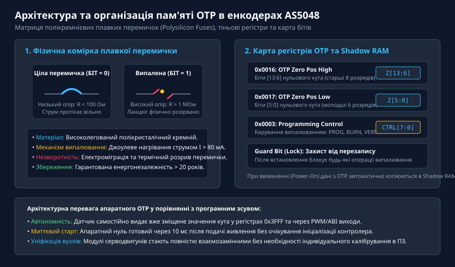
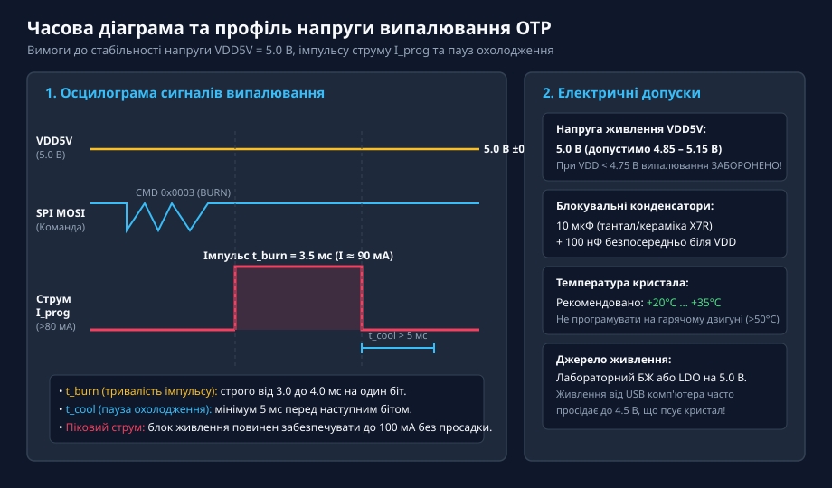
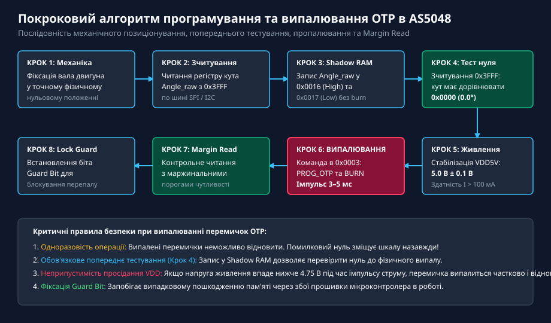
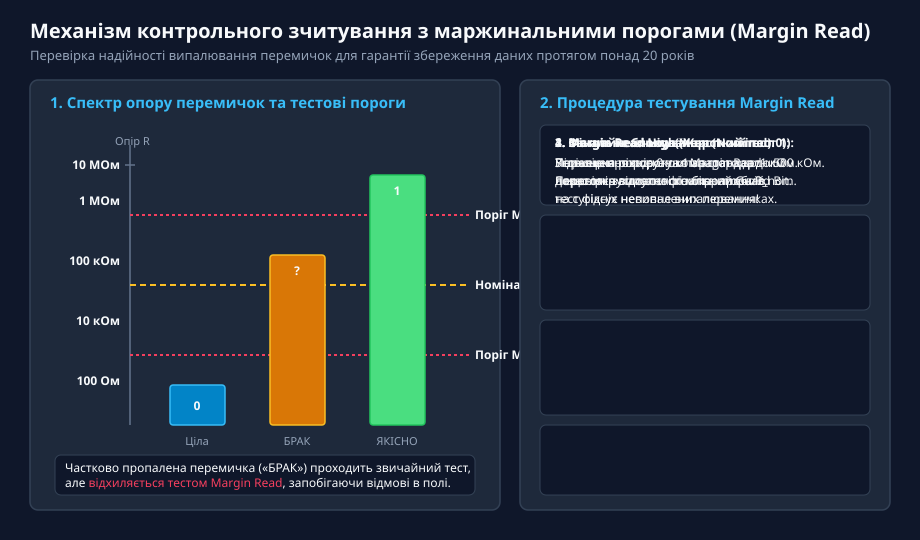
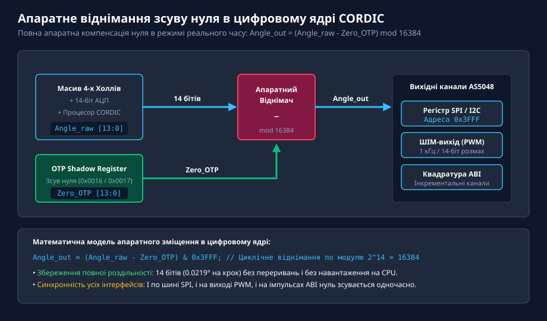

# Програмування та випалювання OTP-пам'яті в енкодерах AS504x

<preknowlist>
- [Магнітний енкодер кута AS5048](root:cat-hw-sensors/as5048-magnetic-encoder) — базова архітектура магнітного енкодера, карта регістрів та інтерфейси зв'язку
- [Енкодери кутового та лінійного переміщення](root:cat-hw-sensors/optical-and-magnetic-encoders) — принципи визначення абсолютного положення та формування точки нульового відліку
</preknowlist>

## Призначення та архітектура пам'яті OTP в енкодерах AS504x

При встановленні безконтактного магнітного енкодера AS5048 на вал електродвигуна або в поворотний механізм маніпулятора початкове взаємне орієнтування магніту та мікросхеми майже ніколи не збігається з потрібною механічною точкою нуля. Традиційне механічне юстування (поворот друкованої плати або магніту) є трудомістким і не забезпечує високої точності.

Для спрощення монтажу мікросхеми серії AS504x оснащені внутрішньою енергонезалежною одноразово програмованою пам'яттю — @@en|OTP@@ (від англ. *One-Time Programmable*). Вона дозволяє апаратно зафіксувати нульове положення ротора, інвертувати напрямок відліку кута (біт DIR) та налаштувати параметри вихідних сигналів PWM/ABI.

Фізично пам'ять OTP виконана на базі матриці полікремнієвих плавких перемичок (англ. @@en|polysilicon fuses@@).


*Архітектура пам'яті OTP: перехід полікремнієвої перемички зі стану низького опору R < 100 Ом у розрив R > 1 МОм та автоматичне завантаження в регістри Shadow RAM при старті.*

У цілому стані перемичка має низький опір (до 100 Ом), що відповідає біту 0. Під дією струмового імпульсу 80–100 мА кремній плавиться і випаровується, утворюючи фізичний розрив з опором понад 1 МОм (біт 1). Оскільки перемички випалюються одноразово, дані в них зберігаються понад 20 років навіть при повному знеструмленні. При кожному включенні живлення дані з масиву OTP автоматично завантажуються в тіньові регістри Shadow RAM, з якими безпосередньо працює цифрове обчислювальне ядро енкодера.

## Карта регістрів та призначення комірок OTP

Налаштування нульової точки здійснюється через регістри карти пам'яті AS5048 по інтерфейсу SPI або I2C:

- **Регістр 0x0016 (OTP Zero Position High):** Містить старші 8 бітів `Z[13:6]` 14-бітного значення нуля.
- **Регістр 0x0017 (OTP Zero Position Low):** Містить молодші 6 бітів `Z[5:0]` 14-бітного значення нуля.
- **Регістр 0x0003 (Programming Control):** Керує автоматом запису та випалювання перемичок (команди PROG, BURN, VERIFY).
- **Біт Guard (Lock):** Захисний розряд, випалювання якого апаратно блокує шину програмування і захищає датчик від повторного або випадкового перезапису в процесі експлуатації.

Запис значення у Shadow RAM через адреси `0x0016` та `0x0017` дозволяє перевірити правильність зсуву нуля в робочому режимі ще до незворотного фізичного випалювання перемичок.

## Електричні вимоги та часові параметри випалювання

Випалювання полікремнієвих перемичок вимагає суворого дотримання електричного та температурного режимів. Якщо струм або напруга будуть недостатніми, перемичка випалиться не повністю, що створить прихований дефект (стан нестійкого проміжного опору з ризиком подальшої рекристалізації кремнію).

Основні вимоги до живлення під час випалювання OTP:
1. **Напруга живлення VDD5V:** Суворо 5.0 В ± 0.1 В (допустимо 4.85–5.15 В). Якщо живлення просяде нижче 4.75 В, випалювання переривається, а кристал бракується. Живити схему від стандартного USB-порту без стабілізатора заборонено.
2. **Фільтрація та навантаження:** Блок живлення повинен забезпечувати імпульсний струм до 100 мА. Безпосередньо біля виводу VDD5V обов'язково встановлюють керамічний конденсатор ємністю 10 мкФ та високочастотний 100 нФ.
3. **Температурний режим:** Процедура виконується при кімнатній температурі (+20 °C ... +35 °C). Заборонено випалювати OTP на гарячому двигуні.


*Часова діаграма випалювання OTP: стабільне живлення 5.0 В, подача команди BURN по SPI та імпульс струму 90 мА тривалістю 3.5 мс із паузою охолодження кристала.*

Тривалість імпульсу випалювання t_burn становить близько 3.5 мс, а між послідовними бітами витримується пауза охолодження t_cool не менше 5 мс.

## Покроковий алгоритм програмування та верифікації

Щоб уникнути помилок і браку під час серійного налаштування приводів, застосовують покроковий алгоритм:

1. **Механічна фіксація:** Вал приводу виставляють у механічний нуль і жорстко фіксують.
2. **Зчитування кута:** Контролер зчитує поточний кут Angle_raw з регістру `0x3FFF`.
3. **Запис у Shadow RAM:** Отримане значення записується в регістри `0x0016` та `0x0017` без команди BURN.
4. **Попередня верифікація:** Контролер повторно читає `0x3FFF` — вихідний кут повинен стати рівним `0x0000` (0.0°).
5. **Контроль живлення:** Перевіряється наявність стабільних 5.0 В на виводі VDD5V.
6. **Випалювання (BURN):** Відправляється команда запуску імпульсів випалювання в регістр `0x0003`.
7. **Тестування Margin Read:** Виконується контрольне зчитування з підвищеним порогом чутливості.
8. **Встановлення Guard Bit:** Пропалюється захисний біт для блокування пам'яті.


*Послідовність програмування OTP: покроковий шлях від виставлення вала до перевірки Shadow RAM, пропалювання перемичок та блокування Guard bit.*

Для гарантування надійності випалювання на весь термін експлуатації застосовують процедуру маржинального читання (англ. @@en|Margin Read@@).


*Контрольне зчитування Margin Read: перевірка опору випаленої перемички за жорстким порогом 500 кОм виключає ризик рекристалізації кремнію.*

Режим Margin Read High штучно підвищує поріг чутливості компаратора до 500 кОм. Якщо випалена перемичка має опір нижче цього рівня, вона відсіюється як брак ще на стадії виробництва.

## Апаратна фіксація нуля та надійність у польових умовах

Після випалювання перемичок OTP енкодер AS5048 виконує операцію віднімання нуля апаратно у власному цифровому ядрі CORDIC за формулою:

```
Angle_out = (Angle_raw - Zero_OTP) mod 16384
```


*Апаратне віднімання зсуву нуля в CORDIC: паралельне обчислення Angle_out без навантаження на мікроконтролер.*

Переваги апаратного зберігання нуля в OTP:
- **Розвантаження процесора:** Мікроконтролер отримує готовий кут без додаткових обчислень.
- **Швидкий запуск:** Датчик видає точний скоригований кут вже через 10 мс після подачі живлення.
- **Синхронність виходів:** Нуль автоматично зміщується на всіх інтерфейсах одночасно: SPI, I2C, PWM та ABI.
- **Взаємозамінність вузлів:** Серводвигуни з прошитими енкодерами повністю взаємозамінні без потреби перекалібрування прошивки шафи керування.
