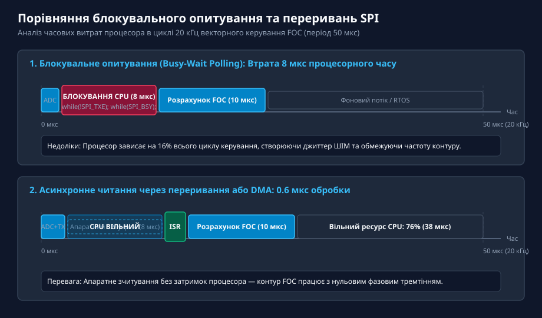
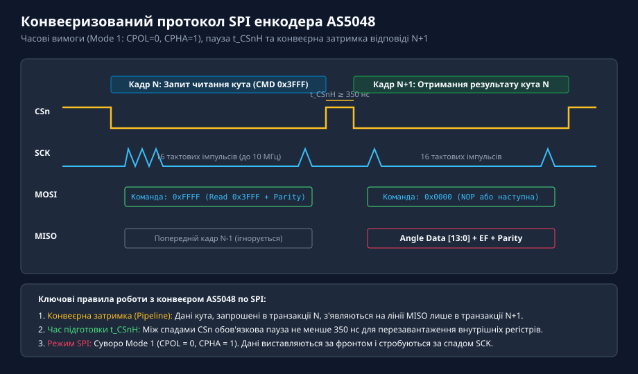
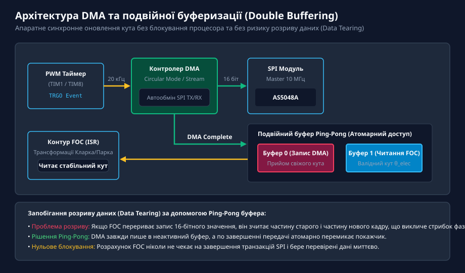
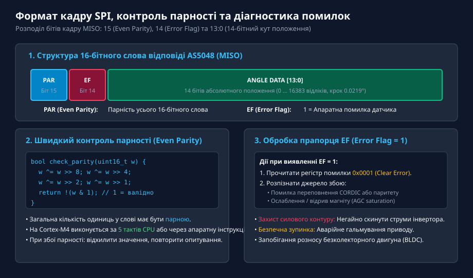
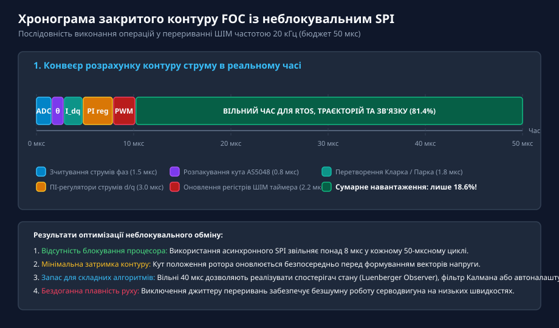

# Асинхронне читання AS5048 через SPI у перериваннях

<preknowlist>
- [Магнітний енкодер кута AS5048](root:cat-hw-sensors/as5048-magnetic-encoder) — апаратна будова, конвеєрний протокол SPI та 14-бітна карта регістрів датчика AS5048
- [Енкодери кутового та лінійного переміщення](root:cat-hw-sensors/optical-and-magnetic-encoders) — принципи дискретизації абсолютного положення та вимоги до швидкості зворотного зв'язку в сервоприводах
</preknowlist>

## Проблема блокувального опитування в контурах FOC та сервоприводах

У високодинамічних системах векторного керування (англ. @@en|Field-Oriented Control@@, FOC) безколекторними синхронними двигунами (BLDC / PMSM) частота виконання контуру регулювання фазних струмів зазвичай становить від 10 до 20 кГц. При частоті 20 кГц тривалість повного періоду керування складає рівно 50 мікросекунд. Протягом цього короткого часового вікна центральний процесор або цифровий сигнальний контролер (DSC) повинен виконати синхронне зчитування струмів фаз через АЦП, отримати поточний абсолютний кут положення ротора від енкодера, обчислити прямі перетворення Кларка та Парка, розрахувати два паралельні ПІ-регулятори струму (по осях ddd та dqd), виконати зворотне перетворення Парка та оновити регістри коефіцієнтів заповнення просторово-векторного ШІМ (SVPWM).

Будь-яка затримка у вимірювальному контурі кута безпосередньо транслюється у фазове відставання розрахованого вектора напруги статора відносно реального положення магнітного поля ротора. Це викликає паразитні пульсації крутного моменту, підвищений акустичний шум двигуна та значне падіння ККД приводу на високих швидкостях обертання.

Традиційний підхід до зчитування абсолютного магнітного енкодера AS5048 через послідовний інтерфейс SPI полягає у використанні блокувального опитування прапорців апаратного модуля (англ. @@en|busy-wait polling@@):

```c
// Типовий блокувальний підхід (втрата процесорного часу!)
SPI_CS_LOW();
while (!(SPI1->SR & SPI_SR_TXE)); // Очікування готовності передавача
SPI1->DR = 0xFFFF;                // Відправка команди читання кута
while (!(SPI1->SR & SPI_SR_RXNE));// Очікування прийому 16 бітів
uint16_t dummy = SPI1->DR;
SPI_CS_HIGH();
```

При тактовій частоті шини SPI 10 МГц передача 16-бітного слова триває 1.6 мікросекунди. Проте з урахуванням апаратних пауз підготовки ліній вибору кристала (CSn) та конвеєрної структури AS5048 (де для отримання даних потрібно послідовно надіслати два кадри), сумарний час очікування складає від 5 до 8 мікросекунд.


*Порівняння блокувального та асинхронного читання SPI: блокування процесора забирає до 16% усього періоду керування (8 мкс), тоді як обробка переривання займає менше 0.8 мкс.*

Зависання ядра процесора у порожніх циклах очікування прапорців `TXE` та `RXNE` на 8 мкс блокує виконання інших критичних підсистем, створює джиттер переривань таймерів і унеможливлює роботу операційних систем реального часу (RTOS). Єдиним інженерно грамотним рішенням для прецизійних сервосистем є перехід до повністю неблокувального асинхронного зчитування через апаратні переривання SPI або контролер прямого доступу до пам'яті (DMA).

## Апаратний протокол SPI енкодера AS5048 та конвеєризація

Інтегральний магнітний кутомір AS5048A підтримує високошвидкісний 4-провідний інтерфейс SPI зі швидкістю тактування до 10 МГц. Проте для надійного сполучення з апаратним модулем мікроконтролера необхідно строго дотримуватися трьох специфічних вимог стандарту:

1. **Режим полярності та фази тактування (SPI Mode 1):** Інтерфейс функціонує в режимі `CPOL = 0` (лінія SCK у пасивному стані перебуває в низькому логічному рівні LOW) та `CPHA = 1` (виставляння біта на лініях MOSI/MISO виконується за наростаючим фронтом SCK, а стробування та зчитування біта приймачем — за спадним фронтом SCK).
2. **Конвеєрна затримка транзакцій (Pipelined Protocol):** Внутрішній регістровий автомат AS5048 працює за принципом конвеєра: команда, передана мікроконтролером у кадрі з номером dNd, декодується датчиком під час поточної транзакції, а запитані дані повертаються по лінії MISO лише в наступному кадрі dN+1d.
3. **Часові обмеження сигналу вибору кристала CSn:**
   - Час підготовки перед першим тактовим імпульсом: dt_{\text{CSn}} \ge 350\text{ нс}d.
   - Міжкадрова пауза між транзакціями: лінія CSn повинна повернутися у високий рівень HIGH на час dt_{\text{CSnH}} \ge 350\text{ нс}d для скидання внутрішнього лічильника бітів енкодера.


*Конвеєрна часова діаграма SPI AS5048: команда читання регістру кута 0x3FFF у кадрі N і повернення 14-бітного значення кута з контролем парності у кадрі N+1.*

У безперервному контурі керування FOC мікроконтролер надсилає команду читання кута `0xFFFF` (читання адреси `0x3FFF` з урахуванням біта парності) у кожному циклі ШІМ. Оскільки опитування виконується регулярно з фіксованим періодом dT_s = 50\text{ мкс}d, у поточному циклі dNd процесор просто забирає виміряний кут попереднього кроку dN-1d, що відповідає постійній і передбачуваній затримці на один такт, яка легко враховується у цифровому спостерігачі швидкості (Luenberger Observer або фільтрі Калмана).

## Архітектура неблокувального обміну: переривання та DMA

Для повної ліквідації простоїв процесора організовують тригерну апаратну взаємодію між таймером ШІМ, модулем SPI та контролером DMA або автоматом переривань.

Архітектура неблокувального обміну будується за такою схемою:
1. **Апаратний запуск за подією таймера ШІМ (Timer TRGO):** У момент досягнення лічильником таймера верхньої або нижньої точки рахунку (подія оновлення або порівняння каналу) генерується апаратний сигнал запуску `TRGO`.
2. **Апаратний старт SPI через DMA:** Сигнал `TRGO` запускає потік DMA, який автоматично опускає лінію CSn і пересилає 16-бітне слово запиту з RAM у регістр передавача `SPI_DR`.
3. **Фоновий прийом даних:** Поки апаратний модуль SPI зсуває біти по виводах SCK/MOSI/MISO, центральне процесорне ядро займається розрахунком інших завдань (наприклад, обслуговуванням протоколів зв'язку CAN/Ethernet або фільтрацією сигналів).
4. **Обробка завершення у перериванні:** Коли всі 16 бітів прийнято, контролер DMA або сам модуль SPI генерує переривання завершення передачі (Transfer Complete Interrupt, TCIF). Підпрограма обробки переривання (ISR) піднімає лінію CSn, виконує миттєву перевірку цілісності даних і зберігає кут.


*Архітектура подвійної буферизації Ping-Pong: апаратний запуск SPI від таймера ШІМ через DMA та атомарне оновлення кута без блокування контуру FOC.*

Критичною проблемою в асинхронних системах із перериваннями є ризик розриву даних (англ. @@en|data tearing@@). Оскільки 14-бітне значення кута та прапорці діагностики читаються паралельно з роботою основного контуру FOC, зчитування змінної кута в момент, коли переривання оновило лише частину байтів, призведе до катастрофічного стрибка фази регулятора (наприклад, зчитування значення `0x00FF` замість `0x0100`).

Для запобігання цій проблемі застосовують метод подвійної буферизації (англ. @@en|Ping-Pong buffering@@). Пам'ять містить два незалежні буфери `Buffer[0]` та `Buffer[1]`. DMA або ISR завжди записує щойно прийнятий кадр у неактивний буфер, після чого атомарно (за одну машинну інструкцію) оновлює покажчик активного буфера. Контур FOC читає дані виключно зі стабільного активного буфера, що гарантує 100% цілісність даних без необхідності блокування глобальних переривань.

## Апаратна валідація кадру: парність та прапорці діагностики

Кадр відповіді, який енкодер AS5048 передає по лінії MISO, має фіксовану довжину 16 бітів:
- **Біт 15 (PAR — Parity Bit):** Біт парного контролю (Even Parity). Доповнює загальну кількість одиниць у всіх 16 бітах кадру до парного числа.
- **Біт 14 (EF — Error Flag):** Апаратний прапорець несправності. Рівень `1` сигналізує про критичну помилку на боці енкодера.
- **Біти 13...0 (Data / Angle):** 14 бітів абсолютного кута положення (діапазон від `0` до `16383`, що відповідає кутовій роздільній здатності d0.0219^\circd).


*Формат кадру відповіді AS5048: апаратний контроль парності (Even Parity) та обробка прапорця EF для захисту інвертора від аварійних ситуацій.*

Перевірка парності повинна виконуватися безпосередньо всередині підпрограми переривання. Застосування довгих циклів для підрахунку бітів є неприпустимим. Для процесорів з архітектурою ARM Cortex-M4/M7 перевірка парності реалізується за допомогою швидкого безгалузевого алгоритму на операціях XOR:

```c
// Швидка безгалузева перевірка парного контролю (Even Parity)
static inline bool as5048_verify_parity(uint16_t frame) {
    frame ^= frame >> 8;
    frame ^= frame >> 4;
    frame ^= frame >> 2;
    frame ^= frame >> 1;
    return (frame & 1) == 0; // Повертає true, якщо сумарна кількість одиниць парна
}
```

Якщо перевірка парності зазнає невдачі (в лінії передачі виник імпульсний шум або спалах напруги від силових ключів інвертора), прийнятий кадр негайно відхиляється. Контур керування використовує екстрапольоване значення кута з попереднього кроку, збільшуючи внутрішній лічильник помилок зв'язку.

Якщо в отриманому слові встановлено прапорець помилки `EF = 1`, мікроконтролер повинен розпізнати причину несправності:
1. Записати команду читання регістру `0x0001` (Clear Error Flag) для скидання прапорця та отримання розширеного коду помилки.
2. Проаналізувати прапорці стану:
   - `CORDIC Overflow:` математичне переповнення векторного ядра при надвисоких швидкостях обертання.
   - `Comp Low / Comp High:` ослаблення або надмірне посилення магнітного поля, що свідчить про зміщення, розтріскування або відрив магніту від вала.
3. При підтвердженні апаратної відмови магнітної системи негайно перевести ШІМ-інвертор у режим аварійного гальмування (знеструмлення всіх фаз або закорочування нижніх ключів для динамічного гальмування), запобігаючи аварійному розносу електроприводу.

## Практична реалізація та оптимізація часу виконання

Розглянемо практичну реалізацію драйвера неблокувального читання AS5048A на мовах C та C++ з використанням переривань SPI для мікроконтролерів сімейства STM32 або аналогічних високопродуктивних контролерів керування двигунами:

:::tabs
```c
// Драйвер неблокувального зчитування AS5048A через переривання SPI (C)
#include <stdint.h>
#include <stdbool.h>

typedef struct {
    volatile uint16_t raw_angle;
    volatile uint16_t angle_deg_x10;
    volatile uint32_t parity_error_count;
    volatile uint32_t hardware_error_count;
    volatile bool new_data_ready;
} AS5048_State_t;

static AS5048_State_t g_encoder_state;

// Безгалузева перевірка парності (Even Parity)
static inline bool check_even_parity(uint16_t word) {
    word ^= word >> 8;
    word ^= word >> 4;
    word ^= word >> 2;
    word ^= word >> 1;
    return !(word & 1);
}

// Запуск асинхронного читання кута (викликається за розкладом ШІМ таймера)
void AS5048_Trigger_Read_IT(void) {
    // Опускаємо CSn (активний низький рівень)
    GPIOB->BSRR = (1 << (12 + 16)); // CSn = 0 (GPIOB Pin 12)

    // Запис команди читання кута 0xFFFF (регістр 0x3FFF + Even Parity)
    // Запис у регістр DR автоматично генерує тактові імпульси SPI
    SPI1->DR = 0xFFFF;
}

// Обробник переривання завершення прийому байта SPI (RXNE / SPI ISR)
void SPI1_IRQHandler(void) {
    if (SPI1->SR & SPI_SR_RXNE) {
        uint16_t rx_data = SPI1->DR;

        // Піднімаємо лінію CSn (завершення транзакції)
        GPIOB->BSRR = (1 << 12); // CSn = 1

        // Валідація кадру
        if (!check_even_parity(rx_data)) {
            g_encoder_state.parity_error_count++;
            return;
        }

        if (rx_data & (1 << 14)) { // Перевірка Error Flag (біт 14)
            g_encoder_state.hardware_error_count++;
            return;
        }

        // Виділення 14 бітів корисних даних кута
        uint16_t angle = rx_data & 0x3FFF;
        g_encoder_state.raw_angle = angle;
        // Масштабування у десяті частки градуса: (angle * 3600) / 16384
        g_encoder_state.angle_deg_x10 = (uint16_t)(((uint32_t)angle * 3600) >> 14);
        g_encoder_state.new_data_ready = true;
    }
}
```
```cpp
// Об'єктно-орієнтований драйвер неблокувального AS5048A (C++)
#include <cstdint>

class AS5048AsyncDriver {
public:
    struct Diagnostics {
        uint32_t parityErrors{0};
        uint32_t hardwareErrors{0};
        uint32_t totalFrames{0};
    };

    explicit AS5048AsyncDriver() = default;

    void triggerRead() noexcept {
        setCsLow();
        sendWord(0xFFFF); // Команда читання кута з парністю
    }

    void handleSpiInterrupt(uint16_t rxFrame) noexcept {
        setCsHigh();
        diag_.totalFrames++;

        if (!verifyEvenParity(rxFrame)) {
            diag_.parityErrors++;
            return;
        }

        if (rxFrame & (1 << 14)) {
            diag_.hardwareErrors++;
            return;
        }

        rawAngle_ = rxFrame & 0x3FFF;
        isReady_ = true;
    }

    [[nodiscard]] uint16_t getRawAngle() const noexcept { return rawAngle_; }
    [[nodiscard]] bool isDataReady() const noexcept { return isReady_; }
    [[nodiscard]] const Diagnostics& getDiagnostics() const noexcept { return diag_; }

private:
    volatile uint16_t rawAngle_{0};
    volatile bool isReady_{false};
    Diagnostics diag_{};

    static inline bool verifyEvenParity(uint16_t word) noexcept {
        word ^= word >> 8;
        word ^= word >> 4;
        word ^= word >> 2;
        word ^= word >> 1;
        return !(word & 1);
    }

    virtual void setCsLow() noexcept = 0;
    virtual void setCsHigh() noexcept = 0;
    virtual void sendWord(uint16_t word) noexcept = 0;
};
```
:::

Хронограма повного закритого циклу векторного керування демонструє високу ефективність розпаралелювання:


*Хронограма контуру FOC 20 кГц із неблокувальним SPI: виконання всіх розрахунків займає лише 9.3 мкс (18.6% навантаження CPU), залишаючи понад 40 мкс для алгоритмів планування траєкторій.*

Завдяки перенесенню передачі SPI у фоновий режим роботи периферії сумарне завантаження процесора розрахунками контуру струму не перевищує 19%. Це залишає понад 40 мкс у кожному такті для розрахунку контурів швидкості й положення, виконання алгоритмів компенсації мертвого часу інвертора та взаємодії по промислових польових шинах EtherCAT або CANopen.
