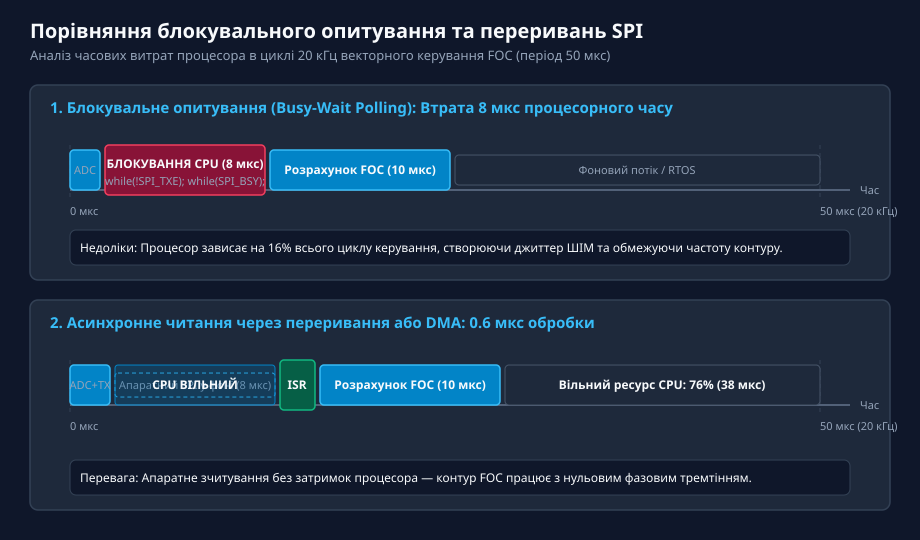
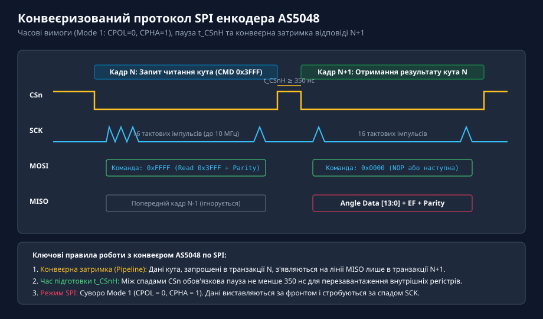
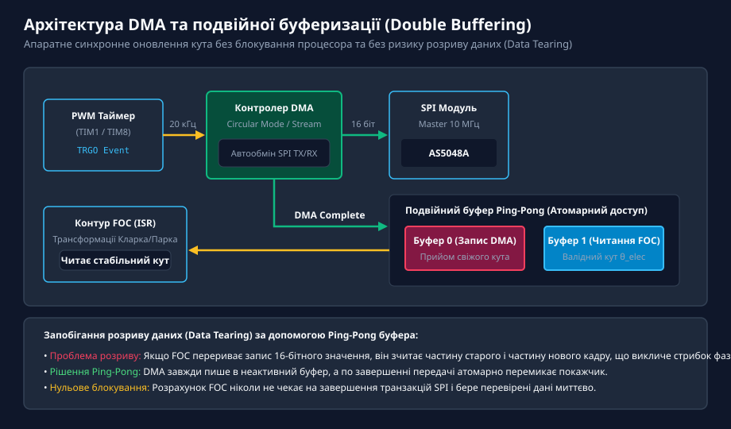
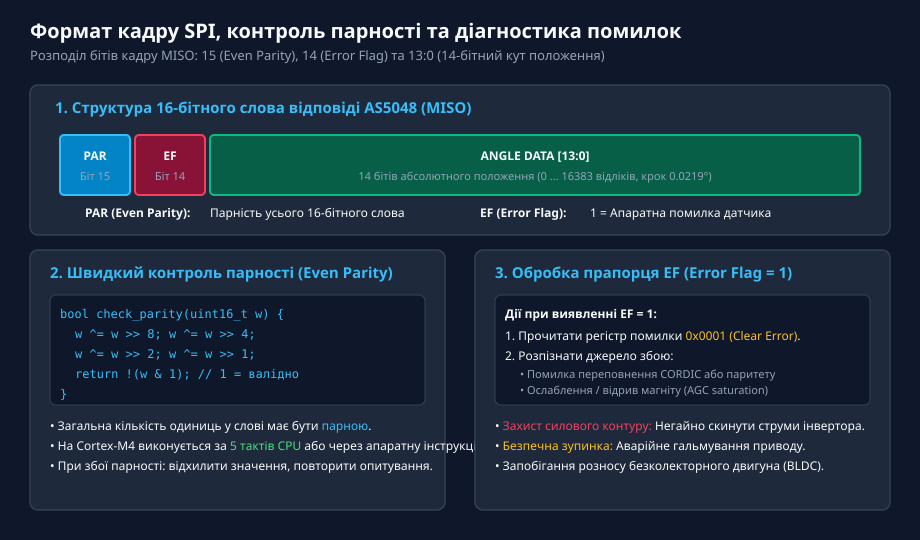
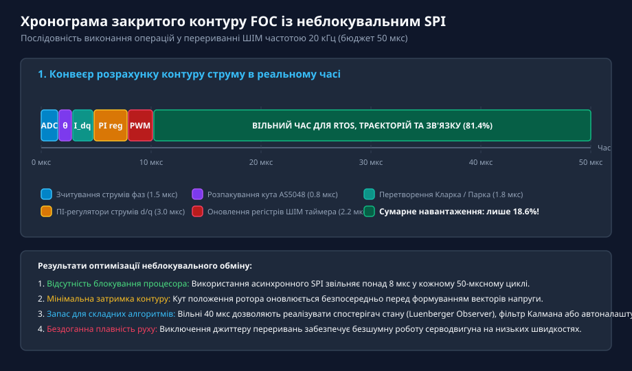

# Асинхронне читання AS5048 через SPI у перериваннях

<preknowlist>
- [Магнітний енкодер кута AS5048](root:cat-hw-sensors/as5048-magnetic-encoder) — базова схемотехніка, 14-бітна карта регістрів та підключення по шині SPI
- [Енкодери кутового та лінійного переміщення](root:cat-hw-sensors/optical-and-magnetic-encoders) — вимоги до частоти опитування та затримок зворотного зв'язку в сервоприводах
</preknowlist>

## Проблема блокувального опитування в контурах FOC та сервоприводах

У системах векторного керування (FOC) сучасними безколекторними двигунами контур регулювання струмів фаз працює з високою частотою 10–20 кГц (період 50–100 мкс). Протягом кожного циклу керуючий контролер повинен встигнути зняти показники струмів через АЦП, отримати актуальний кут положення ротора, обчислити прямі та зворотні перетворення Парка і Кларка, прорахувати ПІ-регулятори та виставити нові значення коефіцієнтів заповнення ШІМ.

Традиційне синхронне опитування енкодера через цикли очікування прапорців готовності SPI блокує центральний процесор на 5–8 мікросекунд у кожному циклі. Це забирає до 16% усього бюджету часу, викликає затримку оновлення напруги, фазове тремтіння (джиттер) та неприємний акустичний писк двигуна.

*Часове порівняння опитування SPI: блокування ядра процесора на 8 мкс при синхронному очікуванні проти 0.8 мкс при роботі через апаратні переривання.*

Перенесення обміну даними на апаратні переривання SPI або канали прямого доступу до пам'яті (DMA) вивільняє ядро процесора, дозволяючи йому виконувати розрахунки паралельно з фізичним пересиланням бітів по дротах.

## Апаратний протокол SPI енкодера AS5048 та конвеєризація

Інтерфейс SPI магнітного датчика AS5048 функціонує в режимі Mode 1 (полярність CPOL = 0, фаза CPHA = 1) з тактовою частотою SCK до 10 МГц. Протокол має дві специфічні апаратні особливості:

1. **Конвеєрна затримка (Pipelined Execution):** Команда читання регістру кута (адреса 0x3FFF), передана в кадрі N, повертається на лінію MISO лише в наступному кадрі N+1.
2. **Пауза вибору кристала t_CSnH:** Між спадами сигналу CSn обов'язково витримується пауза не менше 350 нс для скидання внутрішнього автомата датчика.

*Конвеєр транзакцій SPI: відправка команди читання 0x3FFF у кадрі N і повернення 14-бітного кута положення у кадрі N+1.*

У регулярному контурі сервоприводу мікроконтролер запитує новий кут у кожному такті ШІМ і одночасно отримує результат попереднього запиту з фіксованою конвеєрною затримкою рівно в один такт.

## Архітектура неблокувального обміну: переривання та DMA

Для організації повністю автономного зчитування використовують тригерну взаємодію периферійних модулів мікроконтролера:

- Таймер ШІМ (наприклад, TIM1 у STM32) за подією оновлення лічильника генерує апаратний тригер TRGO.
- Сигнал TRGO запускає передачу кадру SPI через контролер DMA без участі процесора.
- Після завершення прийому 16 бітів контролер DMA формує переривання, підпрограма якого перевіряє цілісність даних і складає кут у буфер.

*Подвійна буферизація Ping-Pong: апаратний запуск SPI через DMA та атомарне перемикання буферів для безпечного читання контуром FOC.*

Щоб контур FOC не прочитав частково оновлені байти кута (проблема розриву даних — data tearing), застосовують подвійну буферизацію (Ping-Pong buffer). DMA завжди записує свіжі дані в тіньовий буфер, а після завершення передачі атомарно перемикає покажчик активного буфера для основного контуру керування.

## Апаратна валідація кадру: парність та прапорці діагностики

Кожне 16-бітне слово відповіді AS5048 містить сервісні розряди захисту:

- **Біт 15 (PAR):** Біт парності (Even Parity). Загальна кількість одиниць у всьому 16-бітному слові повинна бути парною.
- **Біт 14 (EF):** Прапорець помилки (Error Flag). Одиниця свідчить про внутрішній збій енкодера.
- **Біти 13:0:** 14 розрядів виміряного положення (0–16383 відліків).

*Структура кадру AS5048: швидкий контроль парності Even Parity та діагностика стану магнітної системи за прапорцем EF.*

Підпрограма обробки переривання виконує швидку перевірку парності за кілька машинних тактів за допомогою операцій виключального АБО (XOR). Якщо парність порушена (наведення імпульсної завади від силових транзисторів), кадр відкидається. Якщо активний прапорець EF = 1, система розпізнає аварійний стан (наприклад, відрив магніту від вала) і негайно вимикає інвертор для захисту приводу від аварійного розгону.

## Практична реалізація та оптимізація часу виконання

Використання асинхронного читання кардинально змінює розподіл процесорного часу всередині 50-мікросекундного вікна:

*Хронограма закритого циклу FOC: сумарний час розрахунків становить лише 9.3 мкс, що залишає понад 40 мкс вільного ресурсу CPU.*

Ключові переваги неблокувального драйвера:
- **Зниження навантаження:** Час роботи переривання SPI становить менше 0.8 мкс порівняно з 8 мкс при блокуванні.
- **Відсутність джиттеру:** Момент запуску ШІМ синхронізований строго з апаратними таймерами.
- **Резерв обчислювальної потужності:** Понад 80% тактової частоти контролера залишається вільним для задач цифрової фільтрації, планування траєкторій та зв'язку по шинах CAN / EtherCAT.
