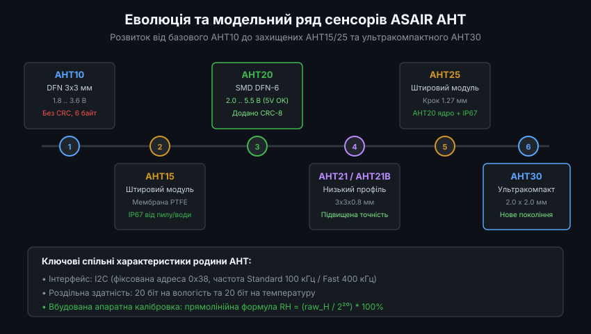
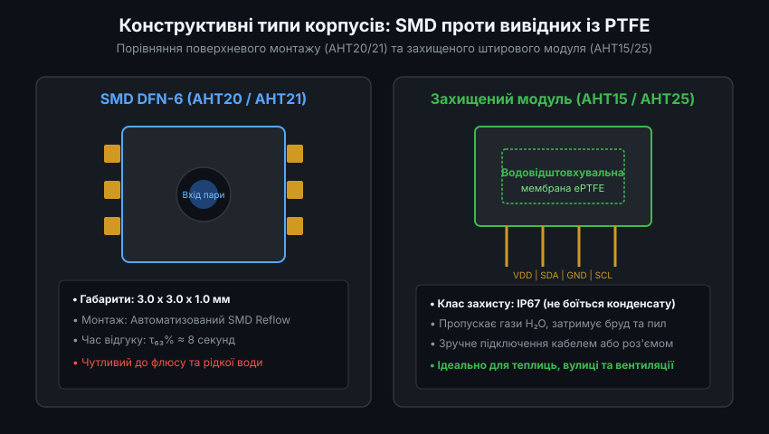
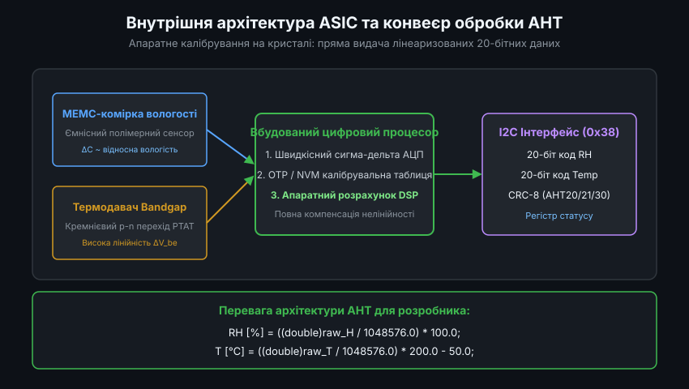
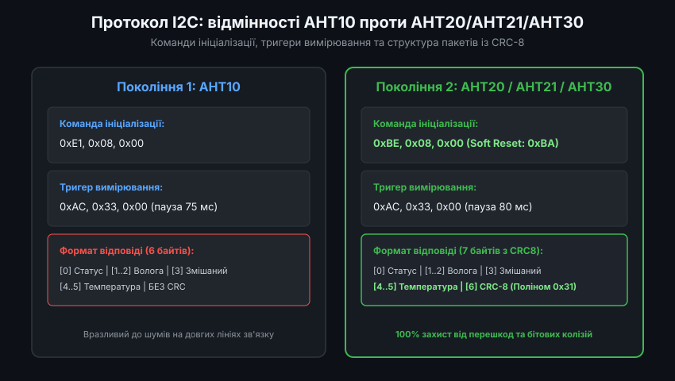
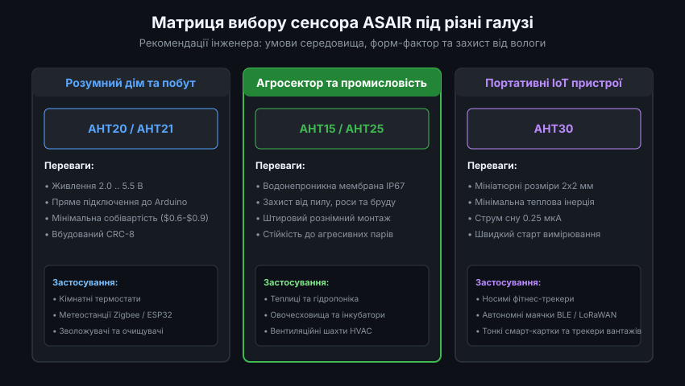

# Родина цифрових давачів вологості та температури ASAIR AHT: Архітектура, схемотехніка та порівняльний аналіз

Цифрові сенсори родини ASAIR AHT виробництва компанії Guangzhou Aosong Electronic Co., Ltd. є сучасними високоінтегрованими МЕМС-перетворювачами температури та відносної вологості. Завдяки інтеграції на одному напівпровідниковому кристалі ємнісного полімерного чутливого елемента вологості, кремнієвого сенсора температури та спеціалізованого ASIC із вбудованою калібрувальною пам'яттю й апаратним обчислювальним процесором, сімейство AHT забезпечує промислову точність при мінімальних витратах обчислювальних ресурсів мікроконтролера.

---

### 1. Генезис та технічна еволюція модельного ряду AHT

Еволюція лінійки ASAIR відбувалася у відповідь на вимоги ринку мікроелектроніки щодо сумісності за рівнями логіки, підвищення завадостійкості зв'язку та захисту від агресивних умов навколишнього середовища.



#### Порівняльна технічна таблиця сімейства ASAIR AHT:

| Модель | Форм-фактор / Корпус | Напруга живлення VDD | Струм сну | Діапазон RH / T | Точність RH / T | Захист CRC | Особливості |
| :--- | :--- | :--- | :--- | :--- | :--- | :--- | :--- |
| **AHT10** | SMD DFN-6 (3.0x3.0x1.0 мм) | 1.8 .. 3.6 В | 0.25 мкА | 0..100% / -40..+85°C | ±2% RH / ±0.3°C | Ні (6 байт) | Базова модель 1-го покоління |
| **AHT15** | Модуль SIP-4 з мембраною | 1.8 .. 3.6 В | 0.25 мкА | 0..100% / -40..+85°C | ±2% RH / ±0.3°C | Ні (6 байт) | ePTFE мембрана (IP67) |
| **AHT20** | SMD DFN-6 (3.0x3.0x1.0 мм) | **2.0 .. 5.5 В** | 0.25 мкА | 0..100% / -40..+85°C | ±2% RH / ±0.3°C | **Так (CRC-8)** | Сумісний з 5V логікою, оновлений ASIC |
| **AHT21** | SMD DFN-6 (3.0x3.0x0.8 мм) | 2.0 .. 5.5 В | 0.25 мкА | 0..100% / -40..+120°C| ±2% RH / ±0.3°C | **Так (CRC-8)** | Тонкий профіль, менший тепловий опір |
| **AHT25** | Модуль SIP-4 (крок 1.27 мм) | **2.0 .. 5.5 В** | 0.25 мкА | 0..100% / -40..+85°C | ±2% RH / ±0.3°C | **Так (CRC-8)** | Ядро AHT20 + мембрана ePTFE IP67 |
| **AHT30** | Ультракомпактний DFN (2.0x2.0x0.8 мм) | 2.2 .. 5.5 В | **0.25 мкА** | 0..100% / -40..+120°C| ±2% RH / ±0.3°C | **Так (CRC-8)** | Для портативних пристроїв та носимої електроніки |

Ключовим досягненням при переході від AHT10 до AHT20 стало розширення допустимої напруги живлення до 5.5 В. Це дозволило безпосередньо інтегрувати сенсори в класичні 5-вольтові системи (Arduino Uno, промислові контролери на базі AVR/PIC/STM8) без використання двонаправлених конвертерів рівнів I2C (Level Shifters).

---

### 2. Конструкція корпусів, мембрани ePTFE та вимоги монтажу

Фізичний захист сенсорного кристала визначає його довговічність та стабільність показань в реальних кліматичних умовах.



#### 2.1. Відкриті SMD корпуси (AHT20 / AHT21 / AHT30)
- Сенсори випускаються у безвивідних пластикових корпусах DFN із центральним отвором у верхній кришці для доступу повітря.
- **Вимоги до паяння Reflow**: сенсори витримують стандартний профіль паяння оплавленням припою (JEDEC J-STD-020) з піковою температурою до +260 °C (не більше 30 секунд). Перед монтажем на отвір наклеюється термостійка плівка (Kapton tape), яка знімається лише після завершення монтажу та відмивання друкованої плати.
- **Вразливість до летючих сполук**: категорично забороняється контакт із флюсами на основі каніфолі, розчинниками або силіконовими герметиками кімнатної вулканізації (RTV), пари яких осідають на полімері та викликають необоротний дрейф калібрування до +5..+10% RH.

#### 2.2. Захищені модулі з ePTFE мембраною (AHT15 / AHT25)
- Корпус виконано у вигляді прямокутного картриджа з 4 жорсткими штировими виводами.
- Верхня апертура затягнута мікропористою мембраною з експандованого політетрафторетилену (ePTFE). Розмір пор мембрани становить близько 0.1-0.2 мкм, що в сотні разів більше за розмір молекули води (0.0003 мкм), але значно менше за розмір найдрібніших крапель водяного туману (від 5 до 50 мкм) та пилу.
- **Клас захисту**: IP67 за стандартом IEC 60529. Модуль витримує короткочасне занурення у воду, потрапляння струменів дощу та високу концентрацію пилу в повітрі без пошкодження сенсорного елемента.

---

### 3. Архітектура ASIC: внутрішнє цифрове калібрування та спрощена математика

На відміну від сенсорів, що передають сирі дані АЦП (Raw ADC) та вимагають виконання багаточленних обчислень на стороні мікроконтролера хоста, кристали родини AHT оснащені повнофункціональним внутрішнім процесором цифрової обробки сигналів.



Внутрішній конвеєр чипа містить:
1. **Аналоговий мультиплексор та 20-бітний сигма-дельта АЦП**: по черзі вимірює ємність МЕМС-комірки вологості та різницю потенціалів термочутливого кремнієвого вузла Bandgap (PTAT).
2. **OTP ROM (One-Time Programmable Memory)**: зберігає заводські калібрувальні коефіцієнти, записані під час калібрування партії на заводі ASAIR.
3. **Апаратний блок лінеаризації**: здійснює поліноміальну компенсацію нелінійності полімерного діелектрика та перехресної залежності від температури безпосередньо в кремнії ASIC.
4. **Вихідні 20-бітні регістри**: зберігають нормалізовані значення, де повна шкала перетворення відповідає 2^20 (1 048 576 відліків).

#### Формули кінцевого перетворення:
Для мікроконтролера розрахунок фізичних величин є строго лінійним:

`RH [%] = ((double)raw_H / 1048576.0) * 100.0`
`T [°C] = ((double)raw_T / 1048576.0) * 200.0 - 50.0`

Діапазон вимірювання температури охоплює від -50.0 °C (при `raw_T = 0`) до +150.0 °C (при `raw_T = 1048576`), що повністю покриває робочий діапазон сенсора від -40 °C до +85 °C (до +120 °C для AHT21/30).

---

### 4. Протокол I2C, розпакування ніблів та верифікація CRC-8

Усі сенсори родини AHT мають фіксовану 7-бітну I2C адресу `0x38` (байт запису `0x70`, байт читання `0x71`).



#### 4.1. Команди ініціалізації та регістр статусу
Після увімкнення живлення статусний регістр повинен мати встановлений біт калібрування (біт 3 = 1):
- Якщо біт 3 дорівнює 0:
  - Для **AHT10/AHT15** відправляється: `{0xE1, 0x08, 0x00}`.
  - Для **AHT20/AHT21/AHT25/AHT30** відправляється: `{0xBE, 0x08, 0x00}`.
- Програмне скидання (Soft Reset) доступне для AHT20/21/25/30 командою `0xBA` (час виконання 20 мс).

#### 4.2. Запуск вимірювання та структура пакета
Для запуску вимірювання мікроконтролер записує 3 байти: `{0xAC, 0x33, 0x00}`. Сенсор переходить у стан вимірювання (біт 7 `Busy = 1`). Через 80 мс хост виконує операцію читання:
- **AHT10 / AHT15**: зчитується 6 байтів.
- **AHT20 / AHT21 / AHT25 / AHT30**: зчитується 7 байтів (останній байт — CRC-8).

Структура 6/7 байтового буфера `rx[7]`:
- `rx[0]`: Статус (біт 7 = Busy, біт 3 = Calibrated).
- `rx[1]`: Старші 8 біт коду вологості `raw_H[19:12]`.
- `rx[2]`: Середні 8 біт коду вологості `raw_H[11:4]`.
- `rx[3]`: Старший нібл `rx[3][7:4]` — молодші 4 біти вологості `raw_H[3:0]`. Молодший нібл `rx[3][3:0]` — старші 4 біти температури `raw_T[19:16]`.
- `rx[4]`: Середні 8 біт температури `raw_T[15:8]`.
- `rx[5]`: Молодші 8 біт температури `raw_T[7:0]`.
- `rx[6]`: Контрольна сума CRC-8 по байтах `rx[0]..rx[5]` (тільки для AHT20+).

#### 4.3. Реалізація розпакування та обчислення CRC-8 мовою C:

```c
#include <stdint.h>
#include <stdbool.h>

// Розрахунок CRC-8 (поліном 0x31: x^8 + x^5 + x^4 + 1, init 0xFF)
uint8_t aht_calculate_crc(const uint8_t *data, uint8_t len)
{
    uint8_t crc = 0xFF;
    for (uint8_t i = 0; i < len; i++) {
        crc ^= data[i];
        for (uint8_t bit = 8; bit > 0; --bit) {
            if (crc & 0x80) {
                crc = (crc << 1) ^ 0x31;
            } else {
                crc = (crc << 1);
            }
        }
    }
    return crc;
}

bool aht_parse_data(const uint8_t *rx, bool has_crc, float *humidity, float *temperature)
{
    // Перевірка готовності: біт 7 (Busy) повинен бути скинутий
    if (rx[0] & 0x80) {
        return false; // Сенсор ще зайнятий вимірюванням
    }

    // Перевірка CRC-8, якщо підтримується моделлю
    if (has_crc) {
        if (aht_calculate_crc(rx, 6) != rx[6]) {
            return false; // Помилка цілісності пакету
        }
    }

    // Розпакування 20-бітного коду вологості
    uint32_t raw_hum = ((uint32_t)rx[1] << 12) |
                       ((uint32_t)rx[2] << 4)  |
                       ((uint32_t)rx[3] >> 4);

    // Розпакування 20-бітного коду температури
    uint32_t raw_temp = (((uint32_t)rx[3] & 0x0F) << 16) |
                        ((uint32_t)rx[4] << 8)            |
                        ((uint32_t)rx[5]);

    // Лінійне масштабування
    *humidity = ((float)raw_hum / 1048576.0f) * 100.0f;
    *temperature = ((float)raw_temp / 1048576.0f) * 200.0f - 50.0f;

    return true;
}
```

---

### 5. Інженерні рекомендації щодо схемотехніки та вибору моделі

При розробці друкованої плати необхідно дотримуватися правил трасування шини I2C:

1. **Фільтрація живлення**: безпосередньо біля виводів VDD і GND сенсора встановлюється керамічний блокувальний конденсатор ємністю 100 нФ (X7R) паралельно з танталовим або електролітичним конденсатором на 4.7-10 мкФ для придушення просідання напруги під час переходу з режиму сну в активний режим вимірювання.
2. **Підтягуючі резистори шини I2C**: оскільки сенсори AHT не мають внутрішніх підтяжок, на лініях SDA та SCL обов'язково встановлюються резистори номіналом 4.7 кОм (для напруги 3.3 В) або 10 кОм (для напруги 5.0 В).
3. **Термоізоляція сенсора на друкованій платі**: щоб тепловиділення мікроконтролера, імпульсних стабілізаторів DC-DC або радіомодулів (Wi-Fi, Bluetooth) не спотворювало вимірювання клімату, сенсор розміщують на краю плати, оточуючи його тепловими фрезерованими прорізами (термобар'єрами).



Сенсори родини ASAIR AHT представляють собою надійне, сучасне та економічно доцільне рішення для широкого спектра завдань кліматичного моніторингу в побутовій, комерційній та промисловій автоматиці.
