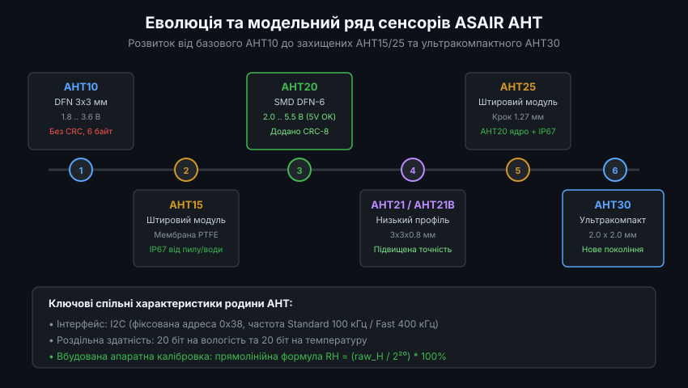
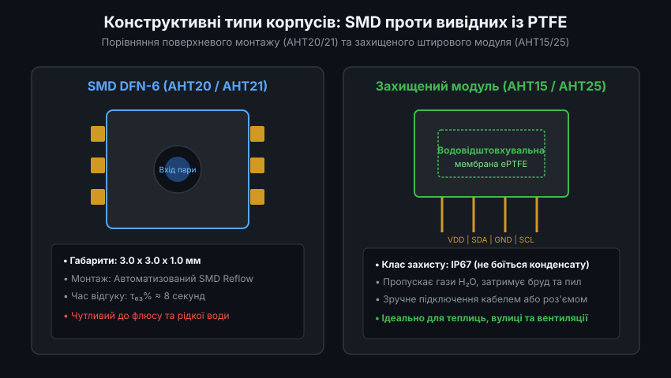
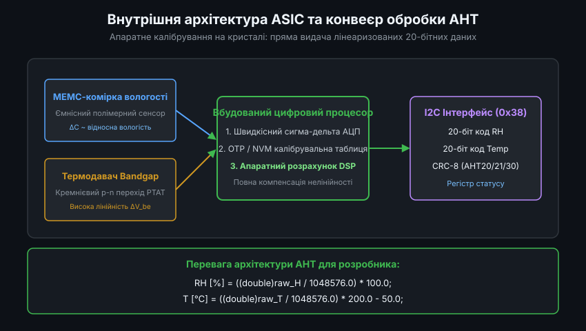
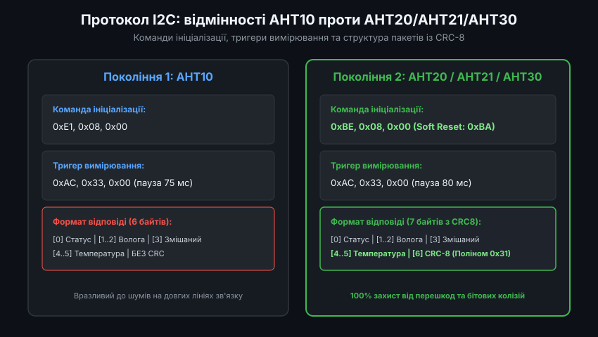
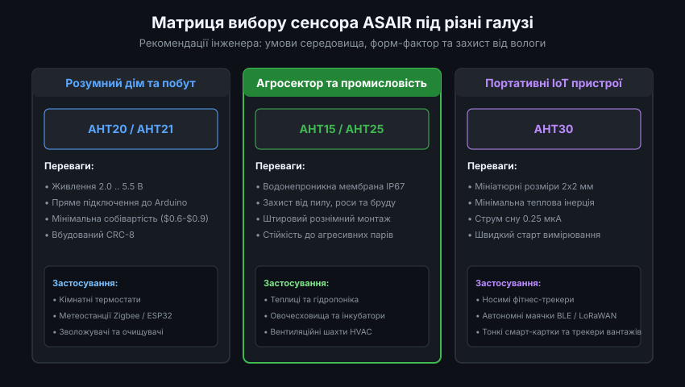

# Родина цифрових давачів вологості та температури ASAIR AHT

Інтегровані цифрові сенсори відносної вологості та температури лінійки ASAIR AHT (розробка компанії Guangzhou Aosong Electronics / Aosong Automation) здобули величезну популярність у сучасній вбудованій електроніці та Інтернеті речей (IoT). Завдяки агресивній ціновій політиці, високій точності вимірювань, підтримці широкого діапазону напруг живлення та простоті математичної обробки, сімейство AHT стало повноцінною доступною альтернативою дорожчим рішенням від Sensirion (серія SHT) та Bosch (серія BME).

---

### 1. Еволюція модельного ряду ASAIR: від AHT10 до AHT30

Розвиток родини датчиків AHT відбувався шляхом послідовного вдосконалення МЕМС-структур, розширення діапазону напруг живлення та покращення надійності передачі даних по шині I2C.

Хронологія та ключові віхи розвитку сенсорів ASAIR:
- **AHT10**: перше базове покоління. Мініатюрний SMD-корпус DFN-6 розміром 3.0 x 3.0 мм. Працює лише від низької напруги (1.8-3.6 В). Формат вихідних даних складав 6 байтів без контрольної суми CRC, що робило його чутливим до завад на довгих шлейфах.
- **AHT15**: модифікація AHT10 у захищеному вивідному форм-факторі (SIP-4 з кроком 1.27 мм) з інтегрованою водонепроникною мембраною з політетрафторетилену (ePTFE). Захищає кристал від крапельної вологи та пилу (клас захисту IP67).
- **AHT20**: значний якісний стрибок у лінійці. Отримав розширений діапазон живлення від 2.0 до 5.5 В (що дозволяє безпечно живити його безпосередньо від 5 В шин Arduino або промислових контролерів без перетворювачів рівнів), нові команди ініціалізації та обов'язковий 8-бітний контроль цілісності CRC-8.
- **AHT21 / AHT21B**: тонкопрофільна версія AHT20 у корпусі DFN завтовшки всього 0.8 мм з покращеною довготривалою стабільністю та меншим тепловим опором підкладки.
- **AHT25**: захищений вивідний модуль на базі ядра AHT20. Поєднує мембранний захист IP67 від конденсату та розширене живлення до 5.5 В із перевіркою CRC-8.
- **AHT30**: флагман нового покоління в ультракомпактному корпусі 2.0 x 2.0 x 0.8 мм зі струмом сну лише 0.25 мкА, розроблений для носимих гаджетів, фітнес-браслетів та мініатюрних Bluetooth-маячків.

---

### 2. Конструктивні типи корпусів: SMD монтаж проти вивідних рішень з PTFE

Умови експлуатації кліматичних сенсорів кардинально різняться: від сухого простору всередині домашнього корпусу до агресивного вологого середовища промислових теплиць та повітроводів вентиляції.

Виробник ASAIR розділив сімейство на два функціональних конструктивних типи:

1. **Корпуси поверхневого монтажу (SMD DFN-6)**: застосовуються в моделях AHT10, AHT20, AHT21 та AHT30.
   - Мають відкриту щілину апертури безпосередньо над кристалом для максимально швидкої дифузії водяної пари.
   - Забезпечують рекордно малий час відгуку: постійна часу `tau_63%` становить близько 8 секунд.
   - Вимагають захисту під час автоматизованого паяння (наклеювання термостійкої каптонової стрічки Kapton) для запобігання потраплянню випарів флюсу у вологочутливий полімер.
2. **Вивідні модулі з мембраною ePTFE**: моделі AHT15 та AHT25.
   - Чутливий елемент герметизовано під пористою мембраною з експандованого політетрафторетилену (аналог Gore-Tex).
   - Мембрана вільно пропускає окремі молекули пари H2O, але блокує краплі рідкої води, частки пилу, бруду та аерозолі добрив (клас захисту IP67).
   - Час відгуку дещо збільшується (до 15-25 секунд) через дифузійний опір мембрани, проте сенсор отримує здатність працювати в умовах 100% вологості з регулярним випаданням роси.

---

### 3. Архітектура ASIC: внутрішнє калібрування проти складних зовнішніх формул

Головна технічна перевага сенсорів ASAIR над конкурентами типу Bosch BME280 — це наявність потужного вбудованого апаратного процесора обробки сигналів (DSP ASIC).

У більшості сенсорів попередніх поколінь мікроконтролер хоста змушений був вичитувати десятки байтів заводських коефіцієнтів і виконувати громіздкі поліноміальні обчислення. В архітектурі AHT вся нелінійна компенсація виконується повністю всередині самого сенсора:
- Сигнал ємнісного МЕМС-сенсора вологості та напруга кремнієвого термодатчика Bandgap оцифровуються високошвидкісним сигма-дельта АЦП.
- Внутрішній обчислювальний блок зашиває фабричні поліноми з пам'яті OTP і генерує фінальні 20-бітні коди `raw_H` та `raw_T`.
- Отримані дані вже лінеаризовані та нормалізовані до фіксованої шкали 2^20 (1 048 576 відліків).

Програмна обробка в прошивці мікроконтролера зводиться до двох елементарних лінійних операцій:
`RH = (raw_H / 1048576.0) * 100.0`
`T = (raw_T / 1048576.0) * 200.0 - 50.0`

Це звільняє оперативну пам'ять і такти центрального процесора мікроконтролера для виконання прикладних завдань.

---

### 4. Протокол шини I2C та відмінності команд між поколіннями

Усі сенсори родини ASAIR AHT працюють по інтерфейсу I2C зі стандартною 7-бітною адресою `0x38`. Проте між першим (AHT10/AHT15) та другим поколінням (AHT20/21/25/30) існують важливі протокольні відмінності.

Особливості програмної взаємодії:

- **Ініціалізація та біт калібрування**: після подачі живлення мікроконтролер перевіряє регістр статусу (байт `0x71`). Якщо біт 3 (`0x08`) скинутий у 0, це означає, що сенсор не ініціалізований.
  - Для AHT10 надсилається команда: `0xE1, 0x08, 0x00`.
  - Для AHT20/AHT21/AHT30 надсилається команда: `0xBE, 0x08, 0x00`.
- **Запуск вимірювання**: надсилається тригерна команда `0xAC, 0x33, 0x00`. Сенсор розпочинає цикл вимірювання, встановлюючи біт зайнятості `Busy (0x80)`. Час очікування результату становить близько 75-80 мс.
- **Структура пакету**: після завершення вимірювання зчитується потік байтів:
  - Перший байт — статус (біт 7 має бути 0, що свідчить про готовність).
  - Наступні 5 байтів містять 20 біт вологості та 20 біт температури, причому байт 3 розділений навпіл між вологістю (старший нібл) та температурою (молодший нібл).
  - Сьомий байт (для AHT20/21/25/30) містить апаратну контрольну суму CRC-8, обчислену за стандартом Sensirion/ASAIR (поліном `0x31`, початкове значення `0xFF`).

---

### 5. Критерії вибору сенсора ASAIR під прикладні завдання

Правильний підбір конкретної моделі з родини AHT дозволяє оптимізувати вартість та надійність кінцевого виробу.

Інженерні рекомендації щодо вибору моделі:

1. **Побутові бездротові термостати, метеостанції та кліматичні хаби**: оптимальним є **AHT20** або **AHT21**. Можливість живлення безпосередньо від 5 В або 3.3 В, наявність CRC8 та доступна ціна (менше $1) роблять їх безальтернативними лідерами для масового серійного виробництва.
2. **Агромоніторинг, теплиці, овочесховища та зовнішні погодні модулі**: слід обирати виключно **AHT15** або **AHT25**. Інтегрована мембрана ePTFE гарантує захист від конденсованої роси, бризок води при поливі та пилу, запобігаючи незворотному забрудненню полімеру.
3. **Носимі електронні пристрої, трекери здоров'я та автономні логери**: найкращим вибором є **AHT30**. Площа посадкового місця 2x2 мм, мінімальний струм сну (0.25 мкА) та низька теплова інерція забезпечують швидкий відгук на зміни температури тіла або середовища без додаткового нагріву корпусу.
