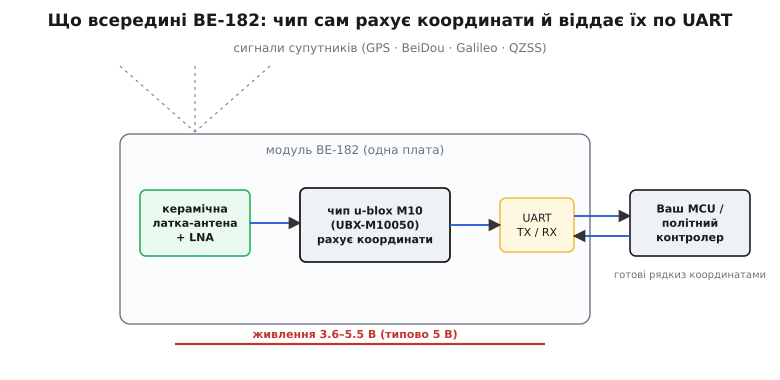
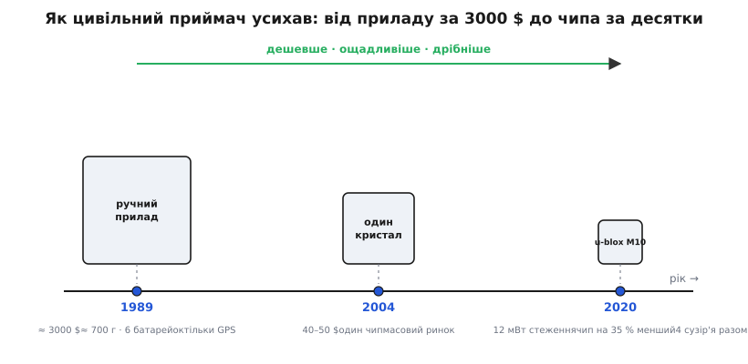
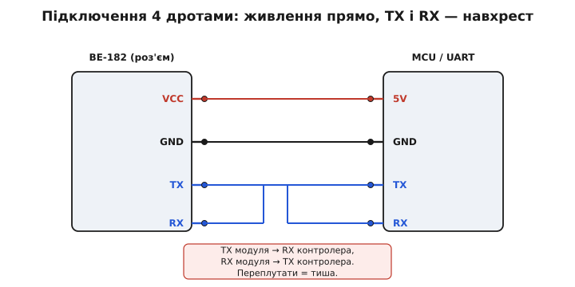
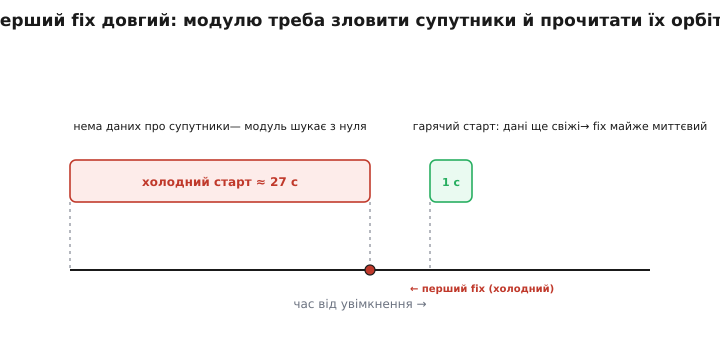

# Beitian BE-182 — GNSS/GPS-модуль

Модуль Beitian BE-182 — це мініатюрний та високоефективний навігаційний приймач глобальних супутникових систем (GNSS — Global Navigation Satellite System), побудований на сучасному кремнієвому ядрі u-blox десятого покоління (M10). Модуль призначений для безпілотних літальних апаратів (FPV-дронів), автономних мобільних роботів, логерів телеметрії та систем точного геопозиціонування, забезпечуючи одночасний прийом сигналів чотирьох основних супутникових угруповань.

## 1. Багатосистемний прийом GNSS та переваги чипа M10

Старіші модулі супутникової навігації (на базі поколінь u-blox 6 або 7) працювали виключно з американською системою GPS і часто втрачали сигнал у міській забудові або густому лісі. Модуль BE-182 використовує новітню мікросхему u-blox M10, яка одночасно відстежує 4 супутникові системи:
- **GPS (США):** глобальна навігаційна система (частотний діапазон L1C/A).
- **GLONASS (орбітальна система):** діапазон L1OF.
- **Galileo (Європейський Союз):** високоточна цивільна система (E1-B/C).
- **BeiDou (BDS, Китай):** навігаційна система (діапазон B1C/B1I).

Завдяки паралельному прийому до 32+ супутників одночасно модуль гарантує швидке обчислення координат навіть в умовах затінення горизонту, а горизонтальна похибка визначення координат на відкритій місцевості становить менше 1.5–2.0 метрів.

## 2. Апаратна начинка та конструкція модуля

Плата BE-182 вирізняється компактними габаритами (18 × 18 × 6 мм) та низьким енергоспоживанням (всього близько 15 мА у робочому режимі), що робить її ідеальною для легких гоночних дронів:

- **Вбудована керамічна патч-антена:** розміром 18x18 мм із правою круговою поляризацією (RHCP). Вона узгоджена безпосередньо з вхідним малошумним підсилювачем (LNA) та поверхневим акустичним фільтром (SAW), що відсікає завади від бортових відеопередавачів та радіомодемів.
- **Флеш-пам'ять та резервна батарея RTC (Supercapacitor / Coin battery):** живить годинник реального часу та SRAM приймача під час відключення основного акумулятора. Це зберігає свіжі ефемериди та альманах супутників, забезпечуючи «гарячий старт» за 1 секунду.
- **Вбудований імпульсний стабілізатор:** дозволяє живити модуль напругою від 3.3 В до 5.0 В.

## 3. Схема підключення по UART та індикація статусу

Підключення модуля до польотного контролера або мікроконтролера здійснюється за допомогою стандартного асинхронного послідовного інтерфейсу UART:

Розпіновка контактів:
- **VCC:** вхід живлення (3.3–5 В).
- **GND:** спільна земля.
- **TX:** вихід передачі даних модуля (підключається до входу RX мікроконтролера). Сигнал має рівень логіки 3.3 В.
- **RX:** вхід прийому команд модуля (підключається до виходу TX мікроконтролера).
- **Світлодіодні індикатори на платі:**
  - *Червоний (Power):* світиться постійно при наявності напруги живлення.
  - *Синій (PPS / Fix):* починає блимати з частотою 1 Гц, щойно приймач захопив необхідну кількість супутників і сформував валідне 3D-рішення координат (3D-Fix).

Швидкість порту UART за замовчуванням становить 38400 бод (у деяких заводських прошивках 9600 або 115200 бод), формат кадру: 8 біт даних, без парності, 1 стоп-біт (8N1).

## 4. Протоколи обміну: текстовий NMEA проти бінарного UBX

Модуль підтримує два незалежні формати видачі навігаційних даних:
1. **Текстовий стандарт NMEA 0183:** загальноприйнятий стандартний протокол, де кожне повідомлення є ASCII-рядком із символом `$` на початку та контрольною сумою після зірочки `*`:
   - `$GNGGA`: координати (широта, довгота), висота над рівнем моря, кількість супутників та якість фіксації.
   - `$GNRMC`: рекомендований мінімальний навігаційний пакет, що включає точний час UTC, координати, швидкість руху над ґрунтом (Ground Speed) та курс.
2. **Фірмовий бінарний протокол u-blox UBX:** високоефективний компактний бінарний протокол, що починається байтами синхронізації `0xB5 0x62`. Протокол UBX використовує значно меншу пропускну здатність шини порівняно з текстовим NMEA і дозволяє підняти частоту оновлення навігаційних рішень до 10 Гц (повідомлення `UBX-NAV-PVT`).

## 5. Фази запуску приймача (TTFF) та типові проблеми монтажу

Час до першого визначення координат (TTFF — Time To First Fix) суттєво залежить від наявності супутникових даних у внутрішній пам'яті:

- **Холодний старт (Cold Start, 25–30 с):** відбувається при першому включенні або перевезенні модуля у вимкненому стані на сотні кілометрів. Модуль заново завантажує повний альманах орбіт усіх супутників (швидкість завантаження через радіоканал — лише 50 біт/с).
- **Теплий старт (Warm Start, 2–5 с):** альманах дійсний, але ефемериди застаріли.
- **Гарячий старт (Hot Start, 1 с):** завдяки резервному акумулятору приймач точно знає поточний час і положення супутників, миттєво фіксуючи координати.

**Правила розміщення модуля на дроні:**
Модуль обов'язково монтується керамічною антеною суворо вгору. Його слід виносити на окрему високу стійку якомога далі від карбонової рами (карбон екранує радіохвилі), акумуляторних батарей та імпульсних силових регуляторів ESC, що створюють потужний високочастотний шум у діапазоні 1.5 ГГц.
