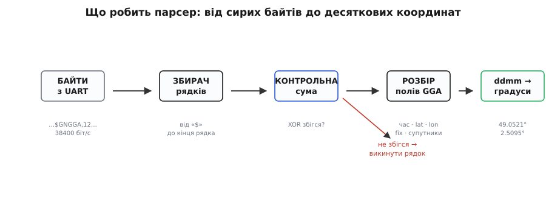

# ⚙️ Прочитати координати з BE-182 у коді

<preknowlist>
- [Кадр UART](root:com-devices/uart-frame) — модуль віддає координати байтами по одному дроту (TX); щоб їх прочитати, треба відкрити послідовний порт і читати з нього.
- [Швидкість baud](root:com-devices/baud-rate) — «38400 біт/с» мусить збігтися на обох кінцях, інакше замість тексту прийде сміття; це перше число в кожному прикладі нижче.
</preknowlist>

Задача звучить просто: «дай мені широту й довготу числами, з якими можна працювати». А на дроті TX модуль сипле не числа, а нескінченний потік текстових рядків, у яких координати заховані в чужому форматі, поруч із десятком інших полів, і кожен рядок ще й підписаний контрольною сумою. Між «модуль щось шле» і «у мене є `lat = 49.052` в програмі» лежить п'ять окремих кроків, і кожен має свою пастку. Розберемо їх по черзі — спершу як думати, потім робочий код під мікроконтролер і під комп'ютер. А коли схочете не лише слухати модуль, а й наказати йому слати частіше чи на іншій швидкості — формат командних кадрів винесено в [довідник форматів NMEA і UBX](root:cat-hw-sensors/beitian-be182/api-nmea-ubx.md).

Одразу межа, щоб не гнатися за примарою. Уся навігаційна математика — ловля супутників, вимірювання затримок, розв'язання положення — уже зроблена всередині чипа. Ви **не пишете** жодного рядка навігації. Ваша робота — суто текстова: прийняти рядки, відсіяти биті, витягти з правильного рядка потрібні поля й перевести координати з формату GPS у звичні десяткові градуси. Це парсинг тексту, не геодезія.

## Що взагалі треба зробити: п'ять ланок конвеєра

Перш ніж торкатися коду, корисно побачити весь шлях байта — від дроту до чистого числа. Це конвеєр із п'яти ланок, де кожна бере результат попередньої й додає свою частину.

*Шлях від дроту до числа. Байти з UART збираються в рядок (від «$» до кінця рядка), рядок звіряється за контрольною сумою — зіпсутий викидається, — далі розбирається на поля, і поле координати переводиться з «градуси+хвилини» у десяткові градуси. Кожну ланку зробимо окремо.*

**Перша ланка — прийом байтів.** Модуль шле безперервний потік, байт за байтом, на швидкості 38400 біт/с. Ваша програма читає цей потік із послідовного порту. Тут ще немає жодного «рядка» — лише ріка символів, серед яких є і `$`, і коми, і цифри, і символи кінця рядка.

**Друга ланка — збирання рядків.** Із ріки байтів треба вирізати окремі повідомлення. Кожне повідомлення NMEA починається зі знака `$` і закінчується парою символів «повернення каретки + переведення рядка» (`\r\n`). Тобто накопичуєте байти в буфер, доки не побачите кінець рядка, — і маєте один цілий рядок на розбір. Пропустите цей крок, спробуєте розбирати «на льоту» — і рано чи пізно вхопите піврядка, склеєного з половиною наступного.

**Третя ланка — перевірка контрольної суми.** Рядок міг прийти зіпсутим: одна бита на дроті перевернулась через завади, збіглася швидкість не точно, буфер переповнився. NMEA дає захист: у кінці кожного рядка після зірочки `*` стоять дві шістнадцяткові цифри — контрольна сума. Ви рахуєте суму самі й звіряєте; не збіглося — рядок у смітник, не довіряйте його координатам. Цю ланку початківці найчастіше **пропускають** — і потім дивуються поодиноким «стрибкам» точки на карті на випадкові кілометри.

**Четверта ланка — розбір полів.** Цілий, перевірений рядок ділите по комах на поля й дивитеся, що це за рядок (перші літери після `$`) і що в його полях. Для координат нас цікавить рядок `GGA` або `RMC`.

**П'ята ланка — переведення координат.** Поле широти виглядає як `4903.1234`, і це **не** десяткові градуси. Це формат «градуси й хвилини разом», і його треба перерахувати, інакше точка полетить за сотні кілометрів. Ця ланка найпідступніша, бо помилка тиха: код працює, число є, воно просто неправильне.

Точний устрій рядка `GGA`/`RMC`, алгоритм контрольної суми й правило переведення поля `ddmm.mmmm` у десяткові градуси зведено в [довіднику форматів NMEA і UBX](root:cat-hw-sensors/beitian-be182/api-nmea-ubx.md) — далі ми цими формами користуємось у коді, не виводячи їх заново. Пройдімо кожну ланку до робочого коду.

## Робочий парсер вручну: контрольна сума й розбір

Почнімо з самого «серця» — двох функцій, що не залежать від платформи: перевірка контрольної суми й переведення поля координати. Логіка тут однакова хоч на мікроконтролері, хоч на комп'ютері, тож дам її обома мовами вкладками. На мікроконтролері природна мова — C (працюємо з байтами й буфером напряму); на хості зручний Python (кілька рядків, і готово).

Контрольна сума NMEA — це XOR усіх байтів рядка між `$` і `*`, звірений із двома шістнадцятковими цифрами після зірки; переведення поля `ddmm.mmmm` у градуси — це «градуси плюс хвилини поділені на шістдесят». Обидва правила з прикладами лежать у [довіднику](root:cat-hw-sensors/beitian-be182/api-nmea-ubx.md); нижче — код, що їх реалізує:

:::tabs
:::code proj-nmea-read/c/nmea_core.c
:::code proj-nmea-read/py/nmea_core.py
:::

Зверніть увагу на один трюк, спільний обом версіям: щоб відділити градуси від хвилин, не треба рахувати цифри рядка. Досить поділити число на 100 націло — цілу частину дасть градуси (`4807.038 / 100 = 48`), а залишок — хвилини (`4807.038 − 4800 = 7.038`). Це працює і для широти, і для довготи автоматично, бо хвилини за визначенням завжди займають два розряди перед крапкою. Тому параметр `deg_digits` у коді насправді й не потрібен для обчислення — він лишений як підказка читачеві, скільки розрядів у градусах очікувати.

Тепер зберемо повний розбір рядка `GGA`: поділ по комах, перевірка fix, виклик переведення. Знову двома мовами.

:::tabs
:::code proj-nmea-read/c/robochyi-parser-vruchnu.c
:::code proj-nmea-read/py/robochyi-parser-vruchnu.py
:::

Одна пастка саме в C-версії варта попередження: `strtok` **руйнує** рядок, вставляючи нулі замість ком. Тому передавайте йому **копію** буфера, а не той самий масив, куди приймаєте байти з UART, — інакше зіпсуєте наступний рядок ще до того, як його прийняли. У Python `split` повертає новий список, тож ця проблема відпадає сама.

> 🔧 **Навіщо це.** Половина «модуль показує нулі» — це не поломка, а чесне fix = 0: модуль ще не впіймав небо. Якщо код бере координати **не дивлячись** на поле fix, він видасть нулі як справжню точку — і апарат «опиниться» біля берегів Гвінейської затоки, у точці 0°,0°, куди програмісти телепортуються найчастіше. Тому обидві версії `parse_gga` повертають «нема даних», щойно бачать fix = 0: одна перевірка відсіює цілий клас примарних багів.

## На мікроконтролері: приймаємо UART і збираємо рядки

Тепер найнижча ланка — прийом байтів на мікроконтролері. Тут код доменно-замкнений на C/C++: працюємо з послідовним портом і буфером напряму, бо це залізо й швидкодія. Дам два шляхи: спершу «руками», щоб було видно механіку, потім готовою бібліотекою, щоб не винаходити велосипед.

**Шлях руками.** Ідея проста: у циклі читаємо доступні байти, накопичуємо їх у буфер, а коли трапляється кінець рядка — віддаємо зібраний рядок у наш `parse_gga`. Приклад на Arduino (модуль на апаратному `Serial1`, консоль — на `Serial`):

:::code proj-nmea-read/cpp/na-mikrokontroleri.cpp

Дві дрібниці тут рятують від годин відлагодження. Перша — `Serial1.begin(38400)`: якщо поставити звичне для Arduino `9600`, модуль слатиме на 38400, а плата слухатиме на 9600, і в консоль поллється абракадабра з випадкових символів. Друга — перевірка `len < sizeof(buf) - 1`: без неї надто довгий чи бита рядок переповнить буфер і зіпсує пам'ять поряд. І ще: `char copy[...]` перед `parse_gga` — бо, як згадано вище, розбір псує рядок нулями від `strtok`.

**Шлях бібліотекою.** Писати збирач рядків і парсер щоразу руками не обов'язково — для Arduino є усталена бібліотека **TinyGPS++** (автор Mikal Hart), яка робить усі п'ять ланок сама: приймає байти, збирає рядки, звіряє контрольну суму, розбирає поля й **уже віддає десяткові градуси** — переведення з хвилин теж на ній. Ви лише «згодовуєте» їй байти й питаєте готовий результат:

:::code proj-nmea-read/cpp/na-mikrokontroleri-2.cpp

Різниця в зусиллі очевидна: `gps.location.lat()` одразу дає `48.117300`, без жодної арифметики з хвилинами й без ручної звірки суми — усе всередині бібліотеки (перевірено за офіційними прикладами TinyGPS++). Метод `isValid()` — це і є та сама перевірка «fix є», яку вручну ми робили полем 6. Тому для реального проєкту на Arduino беріть TinyGPS++; ручний парсер варто розуміти, щоб знати, що саме бібліотека робить за вас, і щоб мати запасний варіант на платформі, де її немає.

> 🔧 **Навіщо це.** Ручний і бібліотечний шляхи — не суперники, а два рівні. Бібліотека економить час у бойовому коді; ручний розбір показує механіку й рятує, коли TinyGPS++ під рукою немає (інший мікроконтролер, свій формат, обрізана пам'ять). Знаючи обидва, ви не будете ані винаходити велосипед там, де є готовий, ані безпорадно застрягати там, де готового нема.

## На комп'ютері: pyserial + pynmea2

Часто модуль спершу хочеться просто послухати з ноутбука — переконатися, що він живий і ловить небо, перш ніж вбудовувати в проєкт. Тут природний вибір — Python: пара бібліотек, і за десяток рядків ви бачите координати. Нагадаю, що напряму в USB модуль не встромити — між ним і комп'ютером потрібен перехідник USB↔UART, і працюєте ви з тим COM-портом (Windows) чи `/dev/ttyUSB0` (Linux), який перехідник створює.

Дві бібліотеки роблять усю роботу: **pyserial** читає байти з порту, **pynmea2** розбирає рядок NMEA (звіряє суму, ділить поля й **сам віддає десяткові градуси** через властивості `latitude`/`longitude`). Це усталені, широковживані бібліотеки (перевірено за їхньою документацією).

:::code proj-nmea-read/py/read_gps.py

Ключове полегшення — `msg.latitude` і `msg.longitude`: pynmea2 уже повертає **десяткові градуси зі знаком**, тобто і переведення з хвилин, і врахування півкулі (`S`/`W` → мінус) зроблені за вас. Сирі поля теж доступні — `msg.lat` дасть текст `"4807.038"`, `msg.lat_dir` — літеру `"N"`, — якщо раптом захочете рахувати самі. Але перевірку `gps_qual == 0` **обов'язково лишіть своєю**: pynmea2 чесно віддасть вам і нульові координати при fix = 0, якщо ви їх не відсіете. Це рівно та сама пастка «нулі як справжня точка», тільки на хості.

Якщо треба ще й дата зі швидкістю — ловіть замість `GGA` рядок `RMC`: `isinstance(msg, pynmea2.RMC)`, і тоді доступні `msg.datestamp`, `msg.spd_over_grnd` (швидкість у вузлах), `msg.status` (літера `A`/`V` замість числа fix).

## Складність і пастки: зведення

Код вище приймає рядки й дістає з них координати — це все, що потрібно, щоб читати положення. Лишається зібрати в одне місце пастки, бо саме на них іде левова частка часу, і майже всі вони — **тихі**: ніякого повідомлення про помилку, лише тиша, сміття або неправильне число.

**Тиша на дроті** — майже завжди одне з двох. Або **переплутані TX/RX**: лінії даних мусять іти навхрест (TX модуля на RX плати), а з'єднані «однаково» дають повну тишу без жодної помилки. Або **не збігається швидкість**: модуль на 38400, програма слухає на іншій — і замість тексту сиплеться абракадабра з випадкових символів. Обидві ловляться першими: перевірте перехрестя й виставте 38400 на обох кінцях.

**Координати нульові чи порожні** — це найчастіше **fix = 0**, і найчастіша його причина — **приміщення**. Сигнал супутника крізь бетон не проходить; модуль чесно шле рядки, але положення в них нема. Виносьте під відкрите небо або хоча б до вікна й дайте час на перший fix. Якщо ж код бере координати не перевіряючи поле fix, він видасть ті нулі як точку — і ви «опинитесь» у точці 0°,0° біля Африки. Перевірка fix першим рядком відсіює це геть.

**Точка на карті за сотні кілометрів від правди** — це **забуте переведення хвилин**. Поле `4807.038` прочитане як десяткові градуси замість «48 градусів 07.038 хвилини» дає зсув рівно на різницю між хвилинами й десятковим хвостом. Лік — рядок `градуси + хвилини/60`; забутий знак для `S`/`W` дає дзеркалення через екватор чи меридіан.

**Мертвий вхід RX або спалений чип** — це **5 В на 3.3-вольтовий вхід**. Чип M10 усередині 3.3-вольтовий; якщо 5-вольтовий контролер (класичні Arduino на ATmega) жене «одиницю» рівнем 5 В прямо у вхід RX модуля, ви перевищуєте його межу. Часто сходить із рук, але надійно — знизити рівень подільником чи перетворювачем на лінії **в** модуль. Найпростіше для простого читання: RX модуля взагалі не під'єднувати — координати йдуть із TX, а команди в модуль без RX і не потрібні.

За складністю задача виходить оманливо нерівною. Прийняти байти й зібрати рядки — тривіально. Перевести координати — один рядок арифметики, який усі спершу забувають. Звірити контрольну суму — легко, але спокуса пропустити. А найбільше часу з'їдає не код, а **фізика й дроти**: перехрестя TX/RX, збіг швидкості, чисте небо, рівні напруги. Тому порядок дій у житті зворотний до порядку коду: спершу переконайтеся, що в порт узагалі щось приходить і це читомий текст, — і лише потім шліфуйте розбір. Коли на екрані з'явилися перші живі рядки `$GNGGA` з ненульовим fix, найважче вже позаду: далі — суто текст, а текст не бреше.
