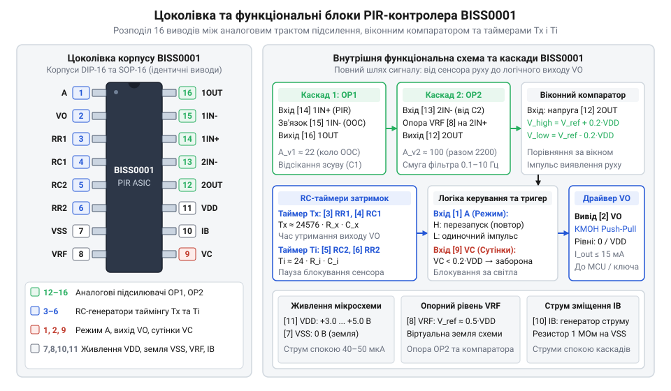
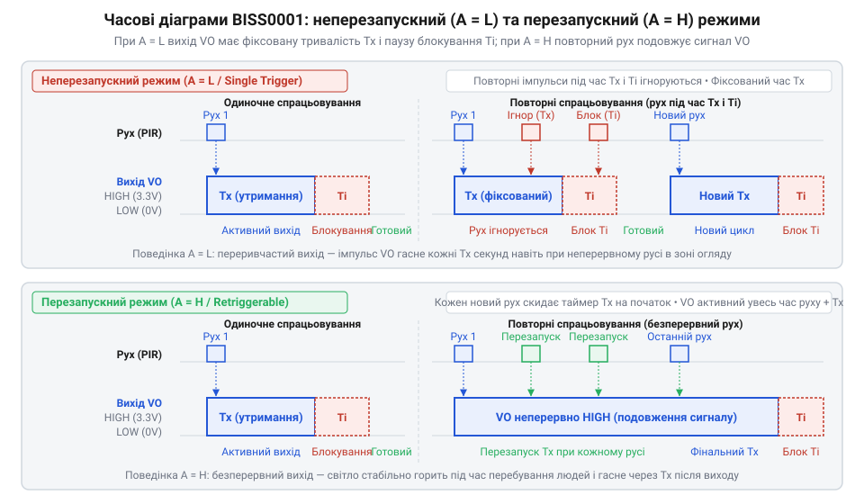

# Апаратний інтерфейс та цокольовка мікросхеми BISS0001

<preknowlist>
- [HC-SR501 — PIR-давач руху](root:cat-hw-sensors/hc-sr501) — фізичні принципи детекції інфрачервоного випромінювання піроелектричним елементом та призначення фокусувальної лінзи Френеля
</preknowlist>

## Нестабільність сирого піросигналу та потреба BISS0001

Пряме підключення виходу сирого піроелектричного сенсора до аналогово-цифрового перетворювача мікроконтролера унеможливлює надійну фіксацію руху людини. Фізика піроелектричного кристала полягає в генерації електричного заряду лише у відповідь на динамічну зміну теплового потоку. За нерухомого об'єкта або стабільної температури поверхневий заряд стікає крізь внутрішній опір витоку. Коли людина перетинає сектор огляду, теплове випромінювання наводить на затворі вбудованого польового транзистора амплітуду в частки мікровольта. На виході витокового повторювача формується змінний сигнал розмахом 0.5–5 мВ, накладений на нестабільну постійну напругу робочої точки величиною 0.7–1.5 В.

Головною перешкодою стає повільний температурний дрейф (англ. @@en|thermal drift@@, від англ. *thermal* — тепловий, та *drift* — знесення, повільне зміщення). Коливання температури повітря в кімнаті чи прогрівання корпусу зміщують постійну складову на сотні мілівольтів. Якщо спрямувати цей сигнал на АЦП мікроконтролера з опорою 3.3 В, ціна молодшого розряду становитиме 0.8–3.2 мВ. Корисний піросигнал тоне в шумі квантування (англ. @@en|quantization noise@@, від лат. *quantum* — скільки) та теплових флуктуаціях. До того ж неперервне опитування входу блокує сплячий режим процесора, виснажуючи батарею автономного пристрою.

На відміну від активних систем, де [оптичний переривач KY-010](root:cat-hw-sensors/ky-010-interrupter) чи [відбивальний давач TCRT5000](root:cat-hw-sensors/tcrt5000) самі випромінюють світло й дають потужний фотострум, пасивний інфрачервоний сенсор (англ. @@en|PIR sensor@@, від англ. *passive infrared* — пасивний інфрачервоний) лише вловлює фонові теплові збурення. Навіть прості [інфрачервоні давачі перешкод](root:cat-hw-sensors/ir-obstacle) обходяться звичайним компаратором через потужне відбиття від активного діода. Для @@en|PIR sensor@@ необхідне просторове фокусування масивом [мультифокальних лінз Френеля](root:cat-hw-sensors/fresnel-lens-pir-optics) та виділення низькочастотних коливань [дводілянкових піроелектричних елементів](root:cat-hw-sensors/pyroelectric-sensor-d203s-frontend).

Дискретний аналоговий тракт на універсальних операційних підсилювачах перевантажує схему габаритними смуговими RC-фільтрами (0.1–10 Гц), віконним компаратором (англ. @@en|window comparator@@, від англ. *window* — вікно, інтервал, та лат. *comparator* — порівнювач) і таймерами затримки, споживаючи міліампери струму. Проблему розв'язує спеціалізована інтегральна мікросхема (англ. @@en|ASIC@@, від англ. *application-specific integrated circuit* — інтегральна схема під конкретне застосування) BISS0001. Вона об'єднує малошумний аналоговий фронтенд, опорне джерело, @@en|window comparator@@ та цифровий автомат таймінгу зі струмом споживання близько 50 мкА. Саме вона перетворює зашумлений @@en|thermal drift@@ на цифровий імпульс у [PIR-давачі руху HC-SR501](root:cat-hw-sensors/hc-sr501).

## Цоколівка корпусів та допустимі електричні режими

Мікросхема BISS0001 виготовляється у двох шістнадцятививідних корпусах: вивідному DIP (англ. @@en|DIP@@, від англ. *dual in-line package* — корпус із двома рядами виводів) із кроком 2.54 мм та поверхневому SOP (англ. @@en|SOP@@, від англ. *small outline package* — малогабаритний плоский корпус) із кроком 1.27 мм. Обидва корпуси мають ідентичну цоколівку.


*Розташування шістнадцяти виводів BISS0001 відображає розподіл чипа на аналогову зону підсилення піросигналу та цифрову зону таймінгу й вихідної логіки.*

Живлення підключають до контактів `VDD` (вивід 11, шина живлення) та `VSS` (вивід 7, земля). Номінальний діапазон напруги становить від 3.0 В до 5.0 В із граничною межею 5.5 В. Подача напруги понад 5.5 В від нестабілізованого джерела спричиняє тиристорне замикання (англ. @@en|latch-up@@, від англ. *latch* — засувка, фіксація) у КМОН-підкладці з миттєвим руйнуванням кристала. У черговому режимі чип споживає струм спокою (англ. @@en|quiescent current@@, від лат. *quiescens* — нерухомий, спокійний) лише 40–50 мкА при 3.3 В, забезпечуючи роки автономної роботи.

Керувальні входи `A` (вивід 1) та `VRF` (вивід 8) розраховані на стандартні логічні рівні КМОН: поріг одиниці `V_IH ≥ 0.7 · VDD`, а нуля — `V_IL ≤ 0.3 · VDD`. Світлочутливий вхід блокування `VC` (вивід 9) має власний поріг `0.2 · VDD`. Цифровий вихід `VO` (вивід 2) виконано за двотактною схемою (англ. @@en|push-pull@@) з рівнями `V_OH ≥ VDD - 0.1 В` та `V_OL ≤ 0.1 В`. Допустимий вихідний струм обмежено межею 10–15 мА, тому пряме підключення котушок реле без транзисторного ключа неприпустиме: перевантаження просаджує внутрішнє живлення та скидає цифровий автомат.

Виводи чипа групуються за функціями: живлення та зміщення (`VDD` — 11, `VSS` — 7, `VRF` — 8, `IB` — 10); тракт підсилення (`1IN+` — 14, `1IN-` — 15, `1OUT` — 16, `2IN-` — 13, `2OUT` — 12); RC-генератори (`RR1`, `RC1` — 3, 4; `RC2`, `RR2` — 5, 6); керування (`A` — 1, `VO` — 2, `VC` — 9).

## Аналоговий фронтенд та формування порогів детекції

Аналоговий тракт BISS0001 приймає сирий піросигнал на вивід `1IN+` (вивід 14) — неінвертувальний вхід першого операційного підсилювача (англ. @@en|op-amp@@, від англ. *operational amplifier* — підсилювач математичних операцій) `OP1`. Завдяки вхідному каскаду на польових транзисторах його опір перевищує 10¹⁰ Ом, усуваючи навантаження на вбудований витоковий повторювач @@en|PIR sensor@@. Перший ступінь охоплено зворотним зв'язком між виходом `1OUT` (вивід 16) та інвертувальним входом `1IN-` (вивід 15). Щоб уникнути підсилення постійного потенціалу сенсора, у ланцюг зворотного зв'язку послідовно вмикають розв'язувальний конденсатор, який зводить коефіцієнт підсилення постійного струму до одиниці, а змінний сигнал підсилює у співвідношенні `A_v1 = 1 + R_f1 / R_in1`.

Вихід `1OUT` через міжкаскадний конденсатор з'єднується з інвертувальним входом `2IN-` (вивід 13) підсилювача `OP2`, що відсікає залишковий постійний дрейф. Другий ступінь утворює активний смуговий фільтр (англ. @@en|band-pass filter@@, від англ. *band* — смуга частот, та *pass* — пропускати) із підсиленням `A_v2 = R_f2 / R_in2`. Смуга пропускання тракту обмежена діапазоном 0.1–10 Гц: частоти нижче 0.1 Гц відсікаються диференціювальними ланцюгами для придушення кліматичного дрейфу, а частоти вище 10 Гц шунтуються ємністю в колі зворотного зв'язку для фільтрації мережевих 50/60 Гц та радіонаводок. Струми зміщення підсилювачів (англ. @@en|bias current@@, від давньофр. *biais* — скіс, нахил) задає резистор номіналом 1 МОм між виводом `IB` (вивід 10) та `VSS`, а вивід `VRF` (вивід 8) фіксує віртуальну землю `V_ref ≈ 0.5 · VDD`.

Посилений сигнал із виводу `2OUT` (вивід 12) надходить на внутрішній @@en|window comparator@@ із симетричними порогами `V_TH_high = V_ref + ΔV` та `V_TH_low = V_ref - ΔV`, де зона нечутливості `ΔV` становить 0.2 · VDD. У спокої напруга `2OUT` лежить усередині мертвої зони. Перетин зон огляду людиною породжує знакозмінну хвилю: щойно напруга перетинає будь-який із порогів, компаратор видає логічний імпульс спрацьовування.

Підсилення та частотні межі розраховують за номіналами компонентів `R_f1 = 1 МОм`, `R_in1 = 47 кОм`, `R_f2 = 1 МОм`, `R_in2 = 10 кОм`, `C_in2 = 47 мкФ` та `C_f2 = 22 пФ`.

**Розрахунок сумарного підсилення та частотних меж аналогового тракту:**
```
A_v_total
= (1 + R_f1 / R_in1) · (R_f2 / R_in2)    [добуток коефіцієнтів підсилення обох каскадів]
= (1 + 1000000 Ом / 47000 Ом) · (1000000 Ом / 10000 Ом) [підстановка номіналів резисторів]
= 22.28 · 100.0                          [перемноження каскадних коефіцієнтів]
= 2228                                   [загальне підсилення тракту, близько 67 дБ]

f_L
= 1 / (2 · π · R_in2 · C_in2)            [нижня межа смуги пропускання фільтра]
= 1 / (2 · 3.1416 · 10000 Ом · 4.7 × 10⁻⁵ Ф) [підстановка R_in2 = 10 кОм та C_in2 = 47 мкФ]
= 0.34 Гц                                [відсікання повільного температурного дрейфу]

f_H
= 1 / (2 · π · R_f2 · C_f2)              [верхня межа смуги пропускання фільтра]
= 1 / (2 · 3.1416 · 1000000 Ом · 2.2 × 10⁻¹¹ Ф) [підстановка R_f2 = 1 МОм та C_f2 = 22 пФ]
= 7.23 Гц                                [придушення мережевих шумів і радіозавад]
```

Отриманий діапазон 0.34–7.23 Гц надійно виділяє рух людини та відсікає сторонні шуми.

## Налаштування таймінгу та режими виводу A

Імпульс від компаратора надходить до цифрового блоку, який формує тривалість вихідного сигналу (англ. @@en|pulse width@@, від лат. *pulsus* — удар, поштовх, та англ. *width* — ширина, тривалість) `Tx` та період блокування (англ. @@en|inhibit time@@, від лат. *inhibere* — стримувати, гальмувати) `Ti`. Зовнішній резистор `R_x` і конденсатор `C_x` приєднують до виводів `RR1` (вивід 3) та `RC1` (вивід 4), а ланцюг блокування `R_i` і `C_i` — до виводів `RR2` (вивід 6) та `RC2` (вивід 5). Тактовий генератор живить два дільники: канал `Tx` рахує 24576 циклів тактової частоти, а канал `Ti` — 24 цикли. Це дозволяє формувати затримки в десятки секунд компактними керамічними конденсаторами без габаритного електроліту.


*У неперезапускному режимі імпульс має жорстку тривалість із наступним блокуванням, а в перезапускному тривалий рух неперервно утримує активний рівень.*

Логічний рівень виводу `A` (вивід 1) визначає поведінку схеми при повторному русі:
1. Неперезапускний режим (англ. @@en|non-retriggerable mode@@, `A = L` / `VSS`). Вихід `VO` активується на час `Tx`. Будь-який рух під час цього інтервалу ігнорується. Після спаду `VO` запускається таймер `Ti`, протягом якого вхід заблоковано. Повний цикл становить `Tx + Ti`. Пауза `Ti` запобігає автоколиванням: охолодження вимкненої лампи створює тепловий сплеск, що без блокування спричинив би хибне повторне увімкнення. 2. Перезапускний режим (англ. @@en|retriggerable mode@@, `A = H` / `VDD`). Кожен новий імпульс від компаратора під час активного стану `VO` скидає лічильник `Tx` у нуль і запускає відлік спочатку. Вихід лишається високим, доки в зоні триває рух. Після його припинення відраховується інтервал `Tx`, вихід спадає в нуль і вмикається захисна пауза `Ti`.

На відміну від [мініатюрного давача HC-SR505](root:cat-hw-sensors/hc-sr505) із фіксованим таймінгом, BISS0001 дозволяє плавно регулювати інтервали підлаштовними резисторами.

**Розрахунок часових інтервалів затримки Tx та блокування Ti:**
```
Tx
= 24576 · R_x · C_x                      [тривалість вихідного імпульсу утримання VO]
= 24576 · 100000 Ом · 1.0 × 10⁻⁸ Ф       [підстановка R_x = 100 кОм та C_x = 10 нФ]
= 24.58 с                                [розрахунковий час активного рівня VO]

Ti
= 24 · R_i · C_i                         [період блокування повторних спрацьовувань]
= 24 · 470000 Ом · 1.0 × 10⁻⁷ Ф          [підстановка R_i = 470 кОм та C_i = 100 нФ]
= 1.13 с                                 [захисний інтервал релаксації датчика]
```

Підстроюванням `R_x` час `Tx` змінюють від 2.5 с до кількох хвилин під конкретні вимоги автоматики.

## Фотоблокування, вихідний інтерфейс та придушення завад

Для вимкнення вдень BISS0001 використовує аналоговий вхід `VC` (вивід 9). Компаратор порівнює напругу виводу з фіксованим порогом: при `VC > 0.2 · VDD` детекція дозволена, а при `VC < 0.2 · VDD` — заблокована (`VO` утримується в нулі). До виводу підключають дільник із підтягувального резистора `R_pull` (100 кОм) до `VDD` та фоторезистора (англ. @@en|photoresistor@@, від грец. *phōs* — світло, та лат. *resistere* — чинити опір) `R_photo` на землю. На світлі опір `R_photo` падає до 1–5 кОм, напруга знижується нижче 0.2 VDD, вимикаючи сенсор. У темряві опір зростає, напруга перевищує поріг, і детекція вмикається. Якщо функція непотрібна, вивід `VC` з'єднують із `VDD`.

**Розрахунок порогу світлочутливого блокування:**
```
VC
= VDD · R_photo / (R_pull + R_photo)     [напруга дільника на вході блокування VC]
< 0.2 · VDD                              [гранична умова заборони вихідного сигналу]
```

Вихід `VO` формує сигнал амплітудою до `VDD`. При живленні чипа від 5.0 В пряме підключення до мікроконтролерів із логікою 3.3 В (ESP32 чи STM32) неприпустиме через ризик пошкодження вхідних каскадів: сигнал знижують резистивним дільником (10 кОм і 20 кОм) або транзисторним узгоджувачем. При живленні від 3.3 В вихід підключають до GPIO безпосередньо. Для керування реле чи світлодіодними стрічками вихідного струму 10–15 мА недостатньо. Комутацію виконують зовнішнім n-канальним КМОН-транзистором (2N7002, AO3400) або біполярним NPN-транзистором із базовим резистором 1–4.7 кОм. Для захисту від імпульсів самоіндукції паралельно до індуктивного навантаження встановлюють захисний діод.

Через високе підсилення (до 80 дБ) живлення мікросхеми вимагає ретельної фільтрації. Імпульсні шуми перетворювачів DC-DC на шині живлення спричиняють масові хибні спрацьовування. Живлення BISS0001 подають через окремий малошумний лінійний стабілізатор LDO (HT7333 або XC6206). Безпосередньо біля виводів `VDD` (11) та `VSS` (7) монтують керамічний розв'язувальний конденсатор (англ. @@en|decoupling capacitor@@, від лат. *copula* — зв'язок, та франц. *des-* — роз'єднання) на 0.1 мкФ паралельно з електролітичним на 10–47 мкФ.

Під час подання живлення міжкаскадні ємності заряджаються повільно. Протягом часу виходу на режим (англ. @@en|warm-up time@@, від англ. *warm-up* — прогрівання, підготовка) тривалістю 30–60 секунд вихід `VO` видає хаотичні імпульси. Програма мікроконтролера повинна витримувати стартову паузу 60 секунд, ігноруючи стан виходу до повної стабілізації сенсора.