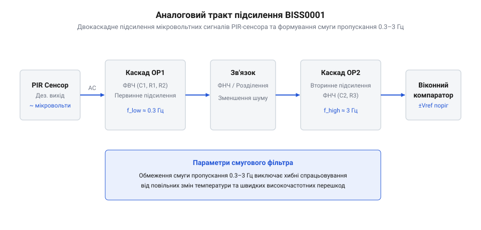
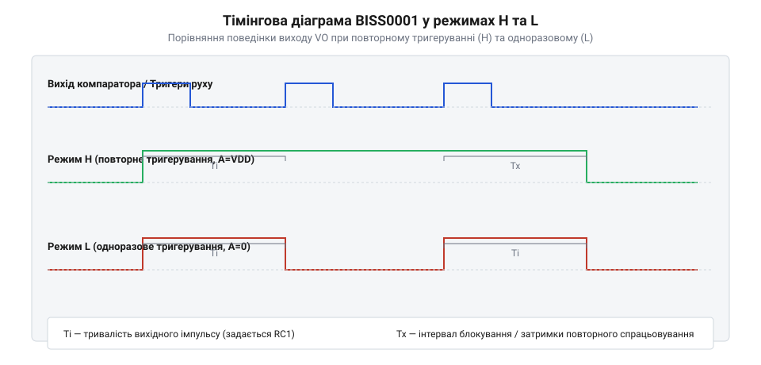
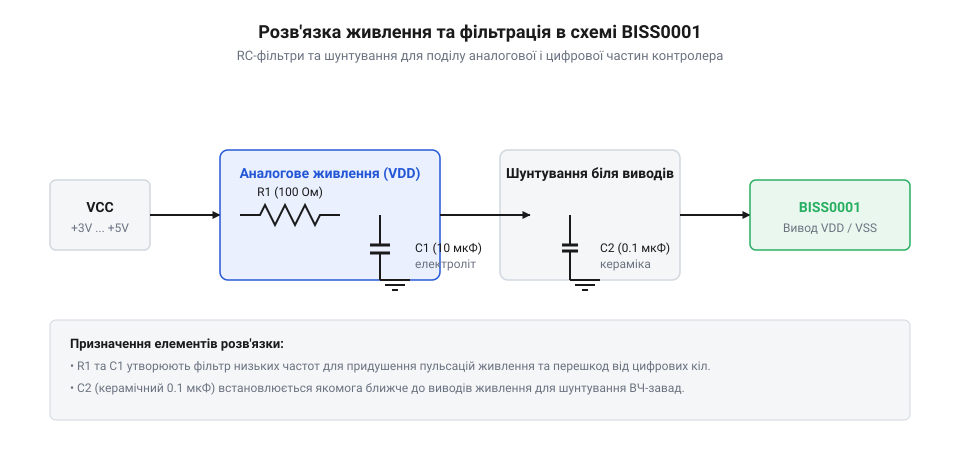

# Спеціалізований PIR-контролер BISS0001

<preknowlist>
- [Огляд та порівняльний аналіз пасивних інфрачервоних давачів руху](root:cat-hw-sensors/pir-motion-sensors-overview) — принцип виникнення піроелектричного сигналу та дифференційних спалахів напруги при русі об'єкта
- [Оптичні лінзи Френеля для інфрачервоних сенсорів](root:cat-hw-sensors/fresnel-lens-pir-optics) — оптичне фокусування випромінювання та просторова модуляція теплового потоку
</preknowlist>

## Проблема виділення слабкого інфрачервоного сигналу

Пряме зняття вихідного електричного сигналу з піроелектричного давача (від грец. @@el|pyr@@ — вогонь та @@el|elektron@@ — янтар, @@en|PIR sensor@@) ставить перед розробником електронних схем надзвичайно складне завдання. Коли людина або будь-який об'єкт з температурою, вищою за абсолютний нуль, перетинає зону огляду сенсора через сегменти [оптичних лінз Френеля](root:cat-hw-sensors/fresnel-lens-pir-optics), внутрішній піроелектричний кристал генерує не постійну напругу, а лише мікроскопічні перепади електричного заряду.

Вбудований у корпус давача польовий транзистор перетворює надвисокий вихідний опір кристала у вихідну аналогову напругу. Проте робоча точка цього транзистора створює значний постійний зсув (постійну складову) на вихідному виводі — зазвичай від 0.4 V до 2.5 V залежно від екземпляра сенсора та температури корпусу. На тлі цієї високої постійної напруги корисний сигнал від руху людини являє собою надзвичайно слабку змінну складову з амплітудою всього від 10 мкВ до 500 мкВ (мікровольт) та вкрай низькою частотою від 0.1 Гц до 10 Гц.

При спробі підключити такий вихід напряму до аналого-цифрового перетворювача (від лат. @@la|analogus@@ — відповідний та @@la|digitum@@ — палець, @@en|ADC@@) мікроконтролера розробник неминуче зіштовхується з жорстким обмеженням роздільної здатності. Розглянемо розрахунок квантування на конкретному прикладі.

**Параметри вимірювального тракту:** опорна напруга АЦП `V_REF = 5.0 V`, розрядність АЦП `N = 10 bit` (1024 дискретних рівні).

```
LSB = V_REF / (2ⁿ)           [формула ціни молодшого розряду]
    = 5.0 / 1024             [підстановка параметрів АЦП]
    ≈ 0.00488 V              [результат у вольтах]
    = 4.88 mV                [переведення в мілівольти]
```

Отримана ціна молодшого розряду (@@en|LSB@@) становить 4.88 мВ (4880 мкВ). Оскільки типовий амплітудний спалах напруги від руху становить близько 100 мкВ, він виявляється майже в 50 разів меншим за один крок квантування 10-бітного АЦП. Сигнал повністю губиться в молодших розрядах і сприймається мікроконтролером як стаціонарний цифровий шум. Навіть використання 12-бітного АЦП із ціною розряду 1.22 мВ (1220 мкВ) не вирішує проблеми, оскільки корисний імпульс залишається набагато нижчим за поріг надійного розрізнення.

Окрім малого рівня корисного сигналу, вихід піроелектричного елемента спотворений потужним низькочастотним шумом типу `1/f` (флікер-шум), повільним температурним дрейфом (@@en|zero drift@@) навколишнього середовища, конвекційними потоками повітря та електромагнітними завадами від мережі живлення 50/60 Гц. Якщо температурне тло приміщення плавно змінюється, постійний зсув напруги сенсора пливе, що при прямому вимірюванні викликає хибні спрацьовування.

Спроба побудувати аналоговий тракт підсилення на дискретних операційних підсилювачах чи транзисторах вимагає великої кількості прецизійних пасивних компонентів, збільшує площу друкованої плати, підвищує власне струмоспоживання та створює проблему температурної нестабільності аналогового нуля. Найменший зсув напруги дискретного підсилювача призводить до насичення каскадів або неконтрольованого спрацьовування порівняльних схем.

Саме для розв'язання цієї проблеми було створено спеціалізовану аналогово-цифрову мікросхему (від англ. @@en|Application-Specific Integrated Circuit@@, @@en|ASIC@@) @@en|BISS0001@@. Вона об'єднує в єдиному напівпровідниковому кристалі два високопрецизійні операційні підсилювачі з гнучким зовнішнім обв'язуванням, двопороговий віконний компаратор для придушення дрейфу та цифрову логіку керування затримками. Переваги використання такої архітектури яскраво демонструються при побудові автономних пристроїв, таких як показано в [проекті детектора руху](root:cat-hw-sensors/biss0001-asic/proj-pir-sensor-module-design.md) та аналогічних вимірювальних систем на базі [пасивних інфрачервоних сенсорів](root:cat-hw-sensors/pir-motion-sensors-overview).

## Двокаскадна аналогова обробка та підсилення

Для виділення та підсилення слабкого сигналу руху в мікросхемі @@en|BISS0001@@ передбачено двокаскадний аналоговий тракт, побудований на двох внутрішніх операційних підсилювачах (від лат. @@la|operatio@@ — дія, @@en|operational amplifier@@), які позначаються як `OP1` та `OP2`. Головна мета цього тракту — підсилити амплітуду змінної складової вхідного сигналу в 5000–10000 разів, одночасно повністю відфільтрувавши постійну складову зсуву та високочастотні завади.


*Внутрішня структурна схема аналогового тракту BISS0001 із послідовно ввімкненими операційними підсилювачами OP1 і OP2 та зовнішніми RC-фільтрами.*

Перший каскад підсилення побудовано на операційному підсилювачі `OP1`. Його неінвертуючий вхід `1IN+` (вивід 16) підключається безпосередньо до виходу піроелектричного сенсора. Інвертуючий вхід `1IN-` (вивід 15) та вихід `1OUT` (вивід 14) виведені на зовнішні ніжки корпусу, що дозволяє сформувати активний смуговий фільтр (@@en|band-pass filter@@) за допомогою зовнішнього RC-ланцюга.

Постійна складова напруги сенсора відсікається послідовним розділювальним конденсатором `C1` у колі зворотного зв'язку. Через наявність ємності `C1` коефіцієнт підсилення `OP1` по постійному струму дорівнює одиниці:

```
A_DC1 = 1                      [коефіцієнт підсилення OP1 по постійному струму]
```

Завдяки цьому постійна напруга зсуву сенсора (0.4–2.5 V) проходить через перший каскад без підсилення і не викликає насичення підсилювача. Для змінної складової в робочій смузі частот руху (0.1–10 Гц) конденсатор `C1` чинить низький опір, і коефіцієнт підсилення по напрузі першого каскаду `A_v1` визначається співвідношенням зовнішніх резисторів `R_f1` та `R_1`:

```
A_v1 = 1 + R_f1 / R_1          [коефіцієнт підсилення OP1 по змінному струму]
     = 1 + 1000000 / 47000     [підстановка типових номіналів 1 МОм та 47 кОм]
     ≈ 22.3                    [підсилення першого каскаду]
```

Нижня зрізна частота фільтрації `f_L1` та верхня зрізна частота `f_H1` першого каскаду задаються значеннями ємностей і опорів зовнішньої обв'язки. Конденсатор `C_f1`, увімкнений паралельно резистору зворотного зв'язку `R_f1`, шунтує високочастотні завади та наводки від радіоефіру.

Сигнал із виходу першого каскаду `1OUT` подається на вхід другого каскаду `OP2` через міжкаскадний розділювальний конденсатор `C2` та послідовний резистор `R_2`. Конденсатор `C2` остаточно відсікає будь-які можливі залишки постійної напруги після першого каскаду.

Другий підсилювач `OP2` включено за схемою інвертуючого підсилювача. Його неінвертуючий вхід `2IN+` усередині мікросхеми підключено до джерела внутрішньої опорної напруги `V_REF` (значення `VM`, яке становить близько 2.0 V або `0.5 × V_DD`). Ця опорна напруга визначає симетричну середню лінію (базовий рівень спокою) для вихідного аналогового сигналу `2OUT` (вивід 12).

Коефіцієнт підсилення другого каскаду `A_v2` розраховується за формулою інвертуючого підсилювача:

```
A_v2 = R_f2 / R_2              [коефіцієнт підсилення OP2 по змінному струму]
     = 1000000 / 10000         [підстановка типових номіналів 1 МОм та 10 кОм]
     = 100                     [підсилення другого каскаду]
```

Загальний коефіцієнт підсилення аналогового тракту `A_total` становить добуток коефіцієнтів двох каскадів:

```
A_total = A_v1 × A_v2          [загальний коефіцієнт підсилення аналогового тракту]
        = 22.3 × 100           [добуток підсилень першого та другого каскадів]
        = 2230                 [підсумкове підсилення тракту в разах]
```

Розглянемо перетворення вхідного сигналу на конкретному прикладі. Якщо кристал піроелектричного сенсора під дією теплового потоку генерує сплеск напруги амплітудою `V_IN = 100 мкВ` (0.0001 V), на виході `2OUT` цей сигнал перетворюється на симетричне коливання напруги відносно базового рівня `V_REF`:

```
ΔV_OUT = V_IN × A_total        [амплітуда вихідного коливання напруги]
       = 0.0001 × 2230         [обчислення вихідного відхилення]
       = 0.223 V               [амплітуда відхилення від базового рівня]
```

При опорній напрузі `V_REF = 2.0 V` вихідна напруга `2OUT` під час руху відхилятиметься від 1.777 V до 2.223 V, що є цілком достатнім рівнем для надійної цифрової порогової обробки.

Детальний математичний апарат із формулами обчислення зрізних частот для обох каскадів наведено у [математичному описі тракту](root:cat-hw-sensors/biss0001-asic/math-biss0001-path-and-timing.md). Точну конфігурацію виводів та призначення всіх ніжок мікросхеми можна переглянути в [довіднику апаратного інтерфейсу](root:cat-hw-sensors/biss0001-asic/api-biss0001-hardware-interface.md).

## Порогова дискретизація та режими тригерування

Підсилений та відфільтрований аналоговий сигнал із виходу другого операційного підсилювача `2OUT` надходить на вхід двопорогового віконного компаратора (від лат. @@la|comparare@@ — порівнювати, @@en|window comparator@@). Основне призначення компаратора — перетворити плавну аналогову хвилю на чіткий логічний імпульс, усунувши вплив дрейфу нуля та дрібних шумових завад.


*Тімінгова діаграма напруг на виході компаратора та виході VO у режимах H (повторне тригерування) та L (одноразове тригерування).*

Віконний компаратор складається з двох внутрішніх аналогових компараторів, які порівнюють напругу `2OUT` з двома опорними порогами: верхнім `V_TH_HIGH` та нижнім `V_TH_LOW`. Опорні пороги сформовані внутрішнім дільником напруги симетрично відносно базового рівня `V_REF`:

```
V_TH_HIGH = V_REF + V_TH       [верхній поріг спрацьовування компаратора]
V_TH_LOW  = V_REF - V_TH       [нижній поріг спрацьовування компаратора]
```

Діапазон напруг між `V_TH_LOW` та `V_TH_HIGH` утворює так звану «зону нечутливості» (неактивне вікно). У стані спокою, коли в зоні детектування немає руху, напруга `2OUT` дорівнює `V_REF` і перебуває всередині вікна. Обидва компаратори видають логічний нуль.

Як тільки в зоні огляду з'являється об'єкт, підсилена напруга `2OUT` починає коливатися. Якщо амплітуда хвилі перевищує верхній поріг (`2OUT > V_TH_HIGH`) або опускається нижче нижнього порогу (`2OUT < V_TH_LOW`), компаратор миттєво спрацьовує і генерує внутрішній пусковий імпульс високого рівня. Така двопорогова схема забезпечує однакове виявлення об'єкта незалежно від того, у якому напрямку рухається людина відносно зон лінзи (сплеск напруги вільний в обидва боки).

Сигнал з компаратора надходить до цифрового блоку керування затримками, який активує зовнішній вихід `VO` (вивід 2), встановлюючи на ньому високий логічний рівень (`HIGH`, напруга живлення `V_DD`). Тривалість вихідного сигналу та поведінка системи регулюються двома внутрішніми таймерами, параметри яких задаються зовнішніми RC-компонентами:

1. **Таймер затримки утримання виходу `Tx`**: визначає тривалість часу, протягом якого вихід `VO` залишається у стані `HIGH` після виявлення руху. Час задається резистором `R_x1` та конденсатором `C_x1`, підключеними до виводів `RR1` (вивід 3) та `RC1` (вивід 4). Розрахунок здійснюється за формулою:
   ```
   Tx ≈ 24576 × R_x1 × C_x1    [обчислення часу затримки виходу VO у секундах]
   ```
2. **Таймер блокування повторного спрацьовування `Ti`**: визначає час «сліпоти» давача одразу після завершення вихідного імпульсу `Tx`. Протягом цього інтервалу будь-які нові коливання сигналу ігноруються, що необхідно для стабілізації піроелектричного кристала. Задається резистором `R_x2` та конденсатором `C_x2` на виводах `RC2` (вивід 5) та `RR2` (вивід 6):
   ```
   Ti ≈ 24 × R_x2 × C_x2       [обчислення часу блокування у секундах]
   ```

Режим обробки повторних спрацьовувань визначається логічним рівнем на вході `A` (вивід 1, @@en|re-triggering@@ mode selection):

* **Режим L (Single Trigger / Одноразове тригерування, вхід `A` підключено до `GND`)**:
  При появі руху компаратор запускає таймер `Tx`, і вихід `VO` переходить у стан `HIGH`. Якщо під час відліку інтервалу `Tx` об'єкт продовжує рухатися в зоні огляду і компаратор генерує нові імпульси, цифрова логіка їх **повністю ігнорує**. Після закінчення рівно часу `Tx` вихід `VO` скидається в стан `LOW`, і починається відлік часу блокування `Ti`. Тільки після завершення `Ti` давач знову готовий реагувати на новий рух.

* **Режим H (Re-triggerable / Повторне тригерування, вхід `A` підключено до `V_DD`)**:
  При першому спрацьовуванні вихід `VO` переходить у стан `HIGH` і починається відлік `Tx`. Проте, якщо під час відліку `Tx` у зоні детектування відбувається повторний рух і компаратор видає новий імпульс, таймер `Tx` **перезапускається з нуля**. Вихід `VO` залишається у стані `HIGH` неперервно доти, доки об'єкт рухається в зоні огляду. Лише після того, як останній рух припинився, мікросхема відраховує час `Tx`, опускає вихід `VO` в `LOW` і переходить до фази блокування `Ti`.

Окрім режиму тригерування, мікросхема @@en|BISS0001@@ містить вхід сутінкового блокування `VC` (вивід 9). Якщо напруга на вході `VC` падає нижче порогового значення `V_TH_VC ≈ 0.7 V` (або `0.2 × V_DD`), внутрішній логічний вентиль блокує вихід компаратора. У цьому стані вихід `VO` примусово утримується в рівні `LOW` незалежно від будь-якої аналогової активності на входах.

Підключення фоторезистора (від грец. @@el|phos@@ — світло, @@en|photoresistor@@) у дільник напруги між `V_DD`, `GND` та входом `VC` (вивід 9) дозволяє легко реалізувати автоматичне вимкнення давача вдень та активацію лише з настанням темряви.

Обчислення номіналів RC-ланцюгів затримок та детальний приклад розрахунку наведено у [математичному описі затримок](root:cat-hw-sensors/biss0001-asic/math-biss0001-path-and-timing.md). Опис практичної збірки модуля детектора руху з перемикачем режимів H/L міститься в [проекті детектора руху](root:cat-hw-sensors/biss0001-asic/proj-pir-sensor-module-design.md), а порівняння BISS0001 з іншими рішеннями можна знайти в [огляді PIR-сенсорів](root:cat-hw-sensors/pir-motion-sensors-overview) та розділі про [мініатюрні датчики HC-SR505](root:cat-hw-sensors/hc-sr505).

## Часові інтервали затримки та сутінкове блокування

Автоматичне керування освітленням чи сигналізацією вимагає не просто виявлення інфрачервоного випромінювання, а й чіткого регулювання тривалості активного стану та захисту від хибного повторного спрацьовування. Якщо @@en|PIR-давач@@ (англ. Passive Infrared sensor, від passive — пасивний, infra — нижче, red — червоний) зафіксував рух об'єкта, навантаження має залишатися ввімкненим визначений час. Після вимкнення пристрою аналоговий тракт підсилення та сам піроелектричний кристал потребують паузи для стабілізації теплового стану й електричних переходів, інакше спад напруги на виході викликає негайний хибний повторний @@en|тригер@@ (англ. trigger, від trigger — спусковий гачок). Для вирішення цих завдань @@en|ASIC@@ (англ. Application-Specific Integrated Circuit) BISS0001 містить два внутрішніх цифрових @@en|таймери@@ (англ. timer, від time — час): таймер затримки активного виходу `Tx` та таймер блокування повторного аналізу `Ti`.

Робота таймера утримання виходу `Tx` починається в момент, коли внутрішній @@en|віконний компаратор@@ (англ. window comparator, від window — вікно та compare — порівнювати) фіксує вихід сигналу за встановлені межі чутливості. Вихідний вивід `VO` переходить у високий логічний рівень, і внутрішній лічильник починає відлік імпульсів вбудованого генератора. Тривалість цього стану визначається зовнішнім @@en|RC-ланцюгом@@ (англ. RC circuit, від Resistor-Capacitor — резистор-конденсатор), який підключається до виводів `RR1` та `RC1` мікросхеми (детальний опис усіх виводів наведено у [довіднику апаратного інтерфейсу](root:cat-hw-sensors/biss0001-asic/api-biss0001-hardware-interface.md)). Формула для розрахунку інтервалу `Tx` має вигляд:

```
Tx = 24576 · R_Tx · C_Tx
```

У цій формулі `Tx` позначає час утримання високого рівня на виході у секундах, `24576` є коефіцієнтом внутрішнього дільника частоти генератора BISS0001, `R_Tx` — опір зовнішнього резистора в омах, а `C_Tx` — ємність зовнішнього конденсатора у фарадах.

Поведінка таймера `Tx` суттєво залежить від встановленого режиму тригерування на виводі `A` (або `H/L`). У режимі одноразового тригерування (`L`-режим, вивід підключено до `GND`) будь-які повторні спалахи випромінювання під час відліку часу ігноруються: таймер `Tx` дораховує до кінця, вихід `VO` скидається в нуль, після чого витримується пауза `Ti`. У режимі повторного тригерування (`H`-режим, вивід підключено до `VDD`) кожен новий імпульс від компаратора скидає внутрішній лічильник `Tx` у початковий стан. Завдяки цьому вихід `VO` залишається у високому стані безперервно протягом усього часу, поки об'єкт рухається у зоні чутливості, і починає зворотний відлік `Tx` лише після повного припинення руху.

**Обчислення інтервалу утримання виходу**
Якщо для налаштування часової затримки обрано резистор з опором `R_Tx = 10 kΩ` (10000 Ом) та керамічний конденсатор ємністю `C_Tx = 0.01 µF` (0.00000001 Фарад), розрахунок тривалості `Tx` виконується покроково:

```
Tx = 24576 · 10000 · 0.00000001
   = 24576 · 0.0001               [перемноження опору та ємності]
   = 2.4576 s                     [множення на коефіцієнт дільника]
```

Таким чином, вихід `VO` залишатиметься у високому стані приблизно 2.46 секунди після останнього зафіксованого імпульсу руху. У готових конструкціях, таких як у [популярному модулі HC-SR501](root:cat-hw-sensors/hc-sr501), замість постійного резистора встановлюють підлаштовувальний @@en|потенціометр@@ (від лат. potentia — сила та грец. metron — міра), що дозволяє плавно змінювати затримку від кількох секунд до кількох хвилин.

Після закінчення інтервалу `Tx` сигнал `VO` падає до низького рівня, і мікросхема негайно запускає другий таймер — інтервал блокування `Ti`. Протягом часу `Ti` внутрішній компаратор повністю відключається від логіки формування вихідного сигналу, і будь-які коливання напруги на виході підсилювача ігноруються. Це критично необхідно для того, щоб перехідні процеси у комутованій мережі або згасаючі теплові коливання піроелемента не викликали так званого «дзвону» чи серії хибних спрацьовувань. Тривалість паузи блокування задається окремим RC-ланцюгом на виводах `RR2` та `RC2` і розраховується за формулою:

```
Ti = 24 · R_Ti · C_Ti
```

Де `Ti` — час блокування у секундах, `24` — коефіцієнт внутрішнього таймера блокування, `R_Ti` — опір резистора в омах, а `C_Ti` — ємність конденсатора у фарадах. Якщо обрати `R_Ti = 100 kΩ` та `C_Ti = 0.01 µF`, блокування триватиме близько 0.024 секунди; для створення паузи у 2.4 секунди ємність збільшують до `1 µF`. Більш детальний аналіз математичного апарату та граничних значень номіналів міститься у [математичному описі затримок](root:cat-hw-sensors/biss0001-asic/math-biss0001-path-and-timing.md).

Окрім часових таймерів, BISS0001 має вхід сутінкового блокування `VC` (Voltage Control), який дозволяє керувати дозволом на роботу вихідного тригера залежно від рівня зовнішньої освітленості. Вхід `VC` порівнює прикладену напругу з внутрішнім пороговим значенням, яке становить приблизно `0.2 · VDD` (де `VDD` — напруга живлення мікросхеми). Якщо напруга на виводі `VC` перевищує `0.2 · VDD`, схема працює у штатному режимі. Якщо ж напруга падає нижче `0.2 · VDD`, вихід `VO` примусово блокується у низькому стані незалежно від дій на вході підсилювача.

Для реалізації сутінкового детектора між шиною живлення `VDD` та землею `GND` створюють дільник напруги, у нижнє плече якого вмикають @@en|фоторезистор@@ (від грец. photos — світло та англ. resistor — опір) `R_LDR`, а у верхнє — постійний резистор `R_fixed`. Напруга на вході `VC` обчислюється за правилом дільника:

```
V_VC = VDD · R_LDR ÷ (R_fixed + R_LDR)
```

При яскравому денному світлі опір фоторезистора `R_LDR` знижується до кількох сотень ом. Оскільки `R_LDR` стає значно меншим за `R_fixed`, напруга `V_VC` падає нижче порогу `0.2 · VDD`, і мікросхема блокує роботу виходу. З настанням темряви опір фоторезистора зростає до сотень кілоом чи мегаом, напруга на `VC` перевищує поріг, і @@en|детектор@@ (від лат. detector — відкривач) повертається до активного моніторингу руху. Повне практичне керівництво з налаштування сутінкового порогу описано у [проекті модуля детектора](root:cat-hw-sensors/biss0001-asic/proj-pir-sensor-module-design.md).

## Стійкість живлення та усунення хибних спрацьовувань

Чутливий аналоговий тракт мікросхеми BISS0001 призначений для підсилення вхідних сигналів амплітудою всього від `10` до `500` мікровольт з загальним коефіцієнтом підсилення від `5000` до `10000` разів (що відповідає `74–80 dB`). Така висока чутливість створює фундаментальну проблему: будь-які пульсації напруги живлення, високочастотні завади чи дрейф внутрішнього опорного рівня `V_REF` сприймаються першим каскадом підсилення як корисний сигнал від руху людини. Якщо амплітуда пульсації на шині живлення становить лише `100 мкВ`, після двох каскадів підсилення вона перетвориться на зміну напруги амплітудою до `1 В`, що негайно викличе хибне спрацьовування внутрішнього компаратора.

Найбільш критичним моментом у роботі PIR-детектора є процес початкового ввімкнення живлення. У момент подачі напруги розділові та фільтруючі конденсатори аналогового тракту починають заряджатися, а внутрішнє джерело опорної напруги `V_REF` (яке становить приблизно `0.5 · VDD`) виходить на робочий режим із деяким запізненням. Через різницю у швидкості наростання потенціалів на входах операційних підсилювачів OP1 та OP2 виникає потужний постійний зсув, який заганяє підсилювач у насичення. Щоб запобігти хаотичним вихідним імпульсам під час подачі живлення, BISS0001 використовує вбудовану схему скидання при ввімкненні, яка утримує вихід `VO` у низькому стані або примусово запускає початковий цикл блокування `Ti` тривалістю від 10 до 60 секунд.

Для забезпечення стабільної роботи в автономних пристроях та пристроях з мережевим живленням застосовують суворе розділення та фільтрацію кіл живлення аналогово-цифрової мікросхеми та чутливого піроелемента від силових навантажень.


*Схема організації розв'язки живлення та шунтування для аналогової та цифрової частин BISS0001.*

Для мінімізації впливу пульсацій джерело живлення схеми розділяють на два кола за допомогою пасивного RC-фільтра або окремого лінійного регулятора напруги. Аналогова частина мікросхеми BISS0001 та сам @@en|PIR-сенсор@@ живляться через фільтруючий резистор опором `100 Ом` та зашунтований електролітичний конденсатор ємністю `10–47 мкФ`, паралельно якому встановлюють керамічний @@en|байпасний конденсатор@@ (англ. bypass capacitor, від bypass — обхід та capacitor — конденсатор) ємністю `100 нФ`. Керамічний конденсатор забезпечує низький @@en|імпеданс@@ (від лат. impedio — перешкоджаю) на високих частотах і має розташовуватися якнайближче до виводів живлення `VDD` та `GND` BISS0001.

Важливу роль відіграє також температурна стабільність компонентів обв'язки. Використання дешевих керамічних конденсаторів з діелектриком типу Y5V у часових RC-ланцюгах або в кола фільтрації призводить до вираженого плавання ємності при зміні температури довкілля. Для усунення температурного дрейфу затримок та хибних спрацьовувань у критичних вузлах слід застосовувати керамічні конденсатори з діелектриком X7R або C0G (NPO), які мають високу стабільність параметрів.

Окрім пульсацій джерела живлення, серйозну загрозу становлять радіочастотні завади від модулів Wi-Fi, GSM або високочастотних імпульсних перетворювачів. Довгі друковані провідники між піроелементом та вхідними виводами мікросхеми працюють як антени, наводячи високочастотну напругу. Для усунення цих наводок паралельно вхідним резисторам та у кола зворотного зв'язку підсилювачів впаюють шунтуючі керамічні конденсатори ємністю від `10` до `100 пФ`.

Особливу увагу при проектуванні друкованих плат приділяють топології заземлення. Земляні провідники аналогового тракту (піроелемент, RC-обв'язка OP1 і OP2) та цифрові земляні лінії (вивід `VO`, перемикач `H/L`) мають з'єднуватися лише в одній точці за схемою «зірка» біля фільтруючого конденсатора живлення. Це унеможливлює протікання імпульсних струмів цифрового навантаження через аналогову землю. Такий підхід реалізовано у багатьох серійних датчиках, включаючи [компактному датчику HC-SR505](root:cat-hw-sensors/hc-sr505).

У разі виникнення систематичних хибних спрацьовувань при практичній експлуатації рекомендовано дотримуватися наступного алгоритму діагностики та усунення завад:

```
[Крок 1: Перевірка живлення] ──> Пульсації > 10 мВ ──> Встановити low-noise LDO або RC-фільтр
             │
             ▼ (Пульсації в нормі)
[Крок 2: Перевірка наводок]  ──> Наявність RF-полів ──> Екранувати корпус та додати C = 10-100 пФ
             │
             ▼ (Завади відсутні)
[Крок 3: Перевірка RC-кіл]   ──> Дрейф компонентів  ──> Замінити кераміку X7R/C0G замість Y5V
```

Ретельне дотримання правил фільтрації живлення та трасування плати дозволяє повністю усунути самозбудження схеми і досягти максимальної чутливості виявлення об'єктів без хибних тригерів, як детально розписано в загальному [огляді PIR-давачів](root:cat-hw-sensors/pir-motion-sensors-overview) та матеріалах про [оптиці лінз Френеля](root:cat-hw-sensors/fresnel-lens-pir-optics).