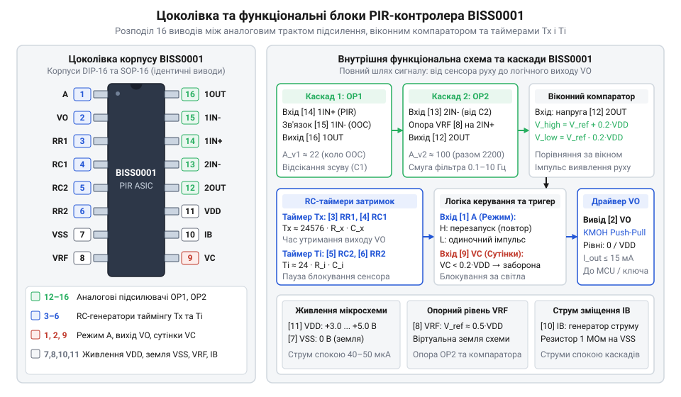
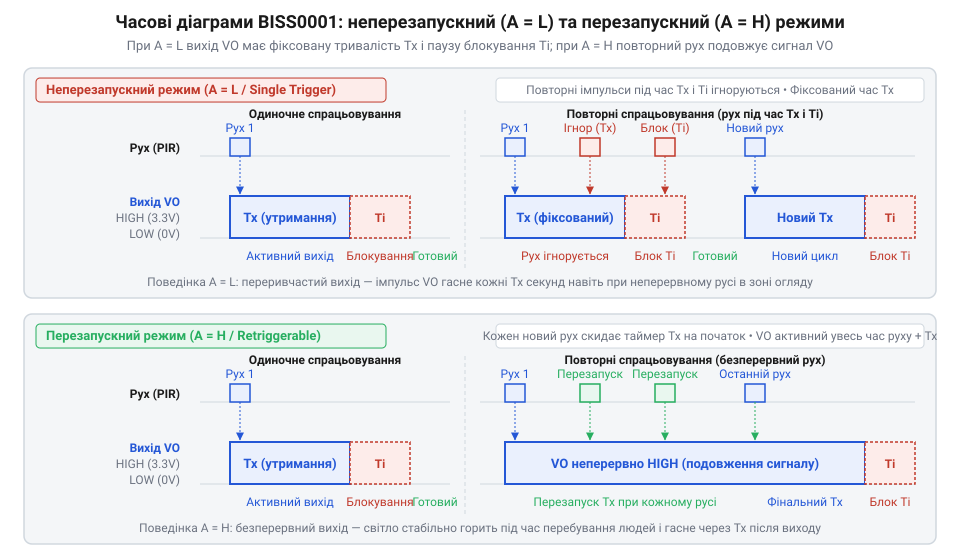

# Спеціалізований PIR-контролер BISS0001

<preknowlist>
- [HC-SR501 — PIR-давач руху](root:cat-hw-sensors/hc-sr501) — фізичні принципи детекції інфрачервоного випромінювання піроелектричним елементом та призначення фокусувальної лінзи Френеля.
- [Огляд та порівняльний аналіз пасивних інфрачервоних давачів руху](root:cat-hw-sensors/pir-motion-sensors-overview) — порівняння аналогових та цифрових сенсорів руху людини.
</preknowlist>

## Призначення та роль ASIC BISS0001

У системах виявлення присутності та руху людини на основі пасивного інфрачервоного випромінювання первинний піроелектричний елемент генерує надзвичайно слабкий електричний сигнал. Під час перетинання людиною променів лінзи Френеля на виході вбудованого польового транзистора сенсора амплітуда змінного сигналу становить лише від 0.5 до 5 мВ. Цей корисний сигнал накладено на значну та нестабільну постійну напругу робочої точки транзистора (від 0.5 до 1.5 В), яка повільно дрейфує під дією температури повітря та нагрівання корпусу.

Пряме підключення такого сигналу до входу АЦП звичайного мікроконтролера виявляється неефективним: роздільна здатність стандартного 10-бітного АЦП за опорної напруги 3.3 В або 5 В становить кілька мілівольтів на квант, через що слабкий піросигнал тоне в шумах квантування. Крім того, мікроконтролер був би змушений неперервно працювати на високій тактовій частоті для програмної фільтрації, що унеможливлює створення батарейних датчиків із роками автономної роботи.

Спеціалізована інтегральна схема BISS0001 (від англ. *Application-Specific Integrated Circuit*, ASIC) розроблена спеціально для виділення, підсилення та цифрової селекції низькочастотних піроелектричних сигналів. Вона містить у монолітному КМОН-кристалі весь необхідний аналоговий тракт, віконний компаратор та автомат формування затримок, споживаючи в черговому режимі струм спокою лише 40–50 мкА. Саме BISS0001 стала світовим промисловим стандартом у популярних модулях детекції руху, таких як HC-SR501.

## Архітектура та внутрішні функціональні вузли

Внутрішня схемотехніка мікросхеми BISS0001 розділена на дві взаємопов'язані частини: високочутливий аналоговий тракт підсилення і фільтрації та цифрову логіку керування таймінгом.


*Цоколівка BISS0001 у корпусах DIP-16 і SOP-16 та ключові функціональні вузли чипа.*

До складу мікросхеми входять такі базові функціональні блоки:

1. **Перший операційний підсилювач (OP1):** високоомний вхідний каскад із неінвертуючим входом на виводі 14. Працює як попередній підсилювач змінного сигналу. Розділювальний конденсатор у ланцюзі зворотного зв'язку встановлює коефіцієнт підсилення постійного струму рівним одиниці, запобігаючи насиченню від постійної напруги піроелемента.
2. **Другий операційний підсилювач (OP2):** утворює активний смуговий фільтр із центральною смугою пропускання 0.1–10 Гц. Він відсікає високочастотні мережеві завади 50/60 Гц і низькочастотний кліматичний дрейф, доводячи сумарний коефіцієнт підсилення тракту до 5000–10000 разів.
3. **Двопороговий віконний компаратор:** порівнює вихідний сигнал другого каскаду з двома симетричними внутрішніми порогами щодо віртуальної середньої точки 0.5 VDD. Якщо амплітуда хвилі перевищує верхній поріг або падає нижче нижнього порогу, формується логічний імпульс спрацьовування.
4. **Вхід блокування освітленості (VC):** аналоговий компаратор із внутрішнім порогом 0.2 VDD, що дозволяє вимикати детекцію руху вдень за допомогою фоторезистора, підключеного до виводу 9.
5. **Таймери витримок Tx та Ti:** мультивібратори на основі зовнішніх RC-ланцюгів, що формують тривалість вихідного активного рівня та час блокування повторного спрацьовування.

## Режими повторного та неповторного запуску (H та L)

Логіка роботи вихідного каскаду BISS0001 визначається логічним рівнем на керувальному виводі А (вивід 1), який у готових платах зазвичай комутується джампером або перемикачем.


*Порівняння часових діаграм вихідного імпульсу BISS0001 у неповторному (L) та повторному (H) режимах тригерування.*

1. **Неповторний режим (Non-retriggerable, режим L):**
   Вивід A підключено до низького рівня (земля VSS). Коли людина потрапляє в зону огляду, на виході VO з'являється високий рівень на час витримки Tx. Будь-які подальші рухи об'єкта під час дії Tx повністю ігноруються внутрішнім лічильником. Після закінчення часу Tx вихід переходить у низький рівень, і запускається фіксований час блокування Ti (зазвичай 2.5–3 секунди). У період дії Ti сенсор не реагує на жодні збурення, що запобігає хибним повторним спрацьовуванням від затухаючих коливань піроелемента.

2. **Повторний режим (Retriggerable, режим H):**
   Вивід A підключено до високого рівня (шина живлення VDD). Під час фіксації руху вихід VO переходить у високий стан. Якщо людина продовжує рухатися в зоні дії сенсора, кожен новий перетин променя скидає таймер Tx і запускає його відлік наново. У результаті вихід VO утримується у високому стані безперервно протягом усього часу активності об'єкта плюс час Tx після останнього зафіксованого руху. Цей режим є основним для освітлення та систем охорони.

## Розрахунок затримок часу та компонентів обв'язки

Тривалість імпульсу вихідного сигналу Tx та час блокування Ti задаються зовнішніми резисторами й конденсаторами, підключеними до спеціалізованих виводів чипа:

```
Tx ≈ 24576 × R10 × C6      [тривалість вихідного активного імпульсу, секунди]
Ti ≈ 24 × R9 × C7          [час блокування повторного запуску, секунди]
```

У наведених формулах:
- `R10` — опір резистора між виводами RR1 (3) та RC1 (4), Ом.
- `C6` — ємність конденсатора між виводом RC1 (4) та землею, Фарад.
- `R9` — опір резистора між виводами RR2 (6) та RC2 (5), Ом.
- `C7` — ємність конденсатора між виводом RC2 (5) та землею, Фарад.

**Приклад розрахунку для типового модуля датчика:**

Якщо в схемі встановлено підлаштовний резистор `R10` опором 200 кОм (200000 Ом) та конденсатор `C6` ємністю 0.01 мкФ (10 нФ або 10⁻⁸ Ф):

```
Tx ≈ 24576 × 200000 × 0.00000001
   ≈ 24576 × 0.002
   ≈ 49.15 секунд
```

Для кола блокування Ti з опором `R9 = 100 кОм` (100000 Ом) та ємністю `C7 = 0.1 мкФ` (10⁻⁷ Ф):

```
Ti ≈ 24 × 100000 × 0.0000001
   ≈ 24 × 0.01
   ≈ 2.4 секунди
```

Мікросхема стабільно працює в діапазоні напруг живлення від 3.0 В до 5.5 В. Для надійної роботи чутливого підсилювача напруга живлення PIR-елемента та мікросхеми BISS0001 зазвичай стабілізується окремим лінійним регулятором з низьким падінням напруги (LDO на 3.3 В), захищеним танталовими та керамічними блокувальними конденсаторами.

## Підсумки та сфери застосування

Мікросхема BISS0001 залишається найпоширенішим у світі спеціалізованим контролером для аналогових піроелектричних датчиків. Поєднання двох прецизійних підсилювачів, активної смугової фільтрації, віконного компаратора з регульованими таймерами та вкрай малим струмом спокою (менше 50 мкА) забезпечує автономну роботу пристроїв детекції руху роками від одного комплекту батарей.

Головні переваги мікросхеми:
- Мінімальне енергоспоживання, ідеальне для батарейних охоронних систем.
- Апаратна фільтрація теплового та оптичного фонового шуму без залучення ресурсів мікроконтролера.
- Гнучке налаштування чутливості, витримок часу та режимів спрацьовування за допомогою пасивних елементів.
- Простий цифровий вихід логічного рівня, сумісний з будь-якими мікроконтролерами (AVR, STM32, ESP32) та виконавчими реле.
