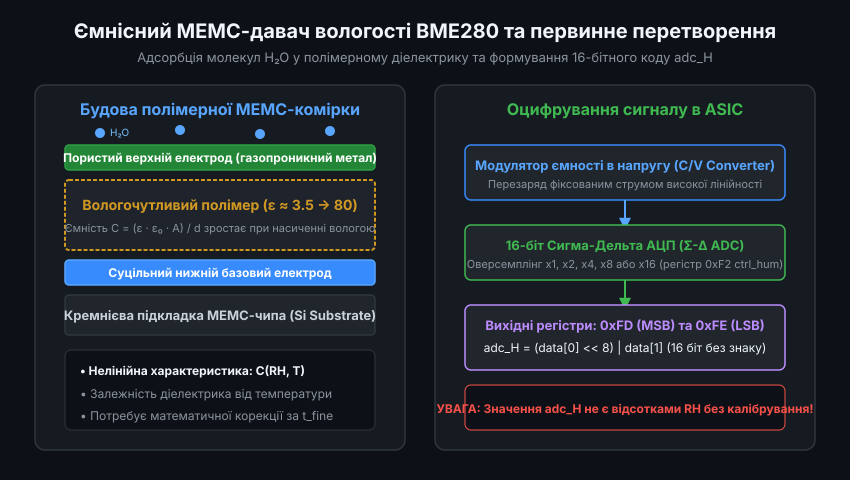
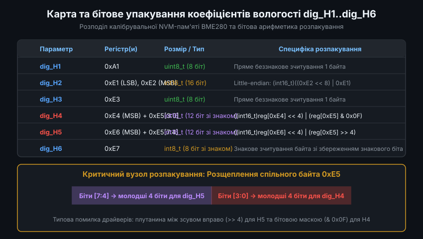
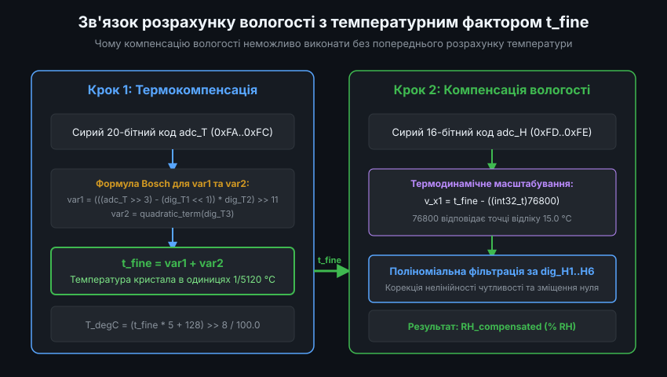
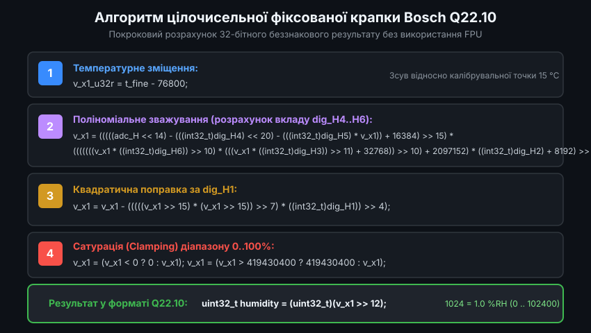
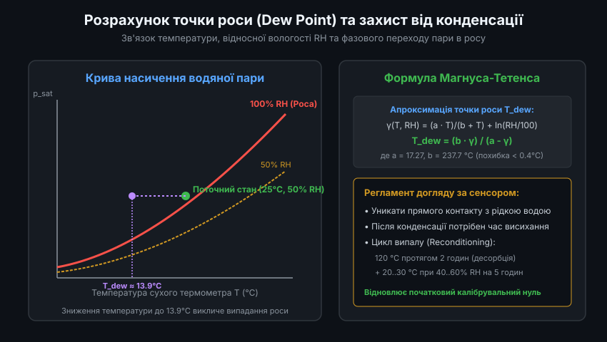

# Математична компенсація відносної вологості в давачах BME280: Інженерна реалізація

Інтегрований кліматичний давач BME280 виробництва Bosch Sensortec об'єднує в єдиному корпусі LGA розміром 2.5 x 2.5 x 0.93 мм три незалежних сенсорних канали: абсолютного тиску, температури та відносної вологості. Канал вимірювання вологості вирізняється надшвидким часом відгуку (близько 1 секунди для досягнення 63% кінцевого значення) та низьким струмом споживання (близько 1.8 мкА при частоті опитування 1 Гц). Проте отримання метрологічно достовірних результатів вимагає ретельної програмної реалізації заводського алгоритму нелінійної корекції, який компенсує температурний дрейф, зміщення нуля та нелінійність передатної характеристики МЕМС-комірки.

---

### 1. Архітектура ємнісного МЕМС-сенсора вологості та формат сирих даних АЦП

Чутливий елемент відносної вологості кристала BME280 є планарним мікроконденсатором, сформованим безпосередньо на кремнієвій підкладці сенсорного чипа.



Фізичний механізм функціонування сенсора базується на модуляції діелектричної проникності тонкої плівки вологочутливого полімеру:
- Діелектрична проникність сухого органічного полімеру становить від 3.0 до 3.8 залежно від хімічного складу матриці.
- Вільні молекули води володіють вираженим дипольним моментом і мають статичну діелектричну проникність порядку 78-80 при кімнатній температурі.
- При дифузії вологи крізь мікропористий верхній шар металізації молекули H2O адсорбуються полімерними ланцюгами, збільшуючи загальну діелектричну проникність діелектрика `eps_r`. Відповідно, електрична ємність комірки `C = (eps_0 * eps_r * A) / d` монотонно зростає зі збільшенням парціального тиску вологи в навколишньому газі.

Аналоговий інтерфейс ASIC перетворює ємність у періодичний сигнал заряду/розряду з наступним оцифруванням за допомогою сигма-дельта модулятора. Керування режимом збору даних вологості виконується через регістр `ctrl_hum` (`0xF2`):

```
Байт керування 0xF2 (ctrl_hum):
+-------------------+-----------------------------------+
| Біти [7:3]        | Біти [2:0] osrs_h[2:0]            |
| Зарезервовано (0) | Конфігурація оверсемплінгу RH     |
+-------------------+-----------------------------------+
  000: Вимкнено (вихідні дані фіксуються як 0x8000)
  001: Оверсемплінг x1  (16 біт роздільної здатності)
  010: Оверсемплінг x2
  011: Оверсемплінг x4
  100: Оверсемплінг x8
  101 або вище: Оверсемплінг x16
```

Зміна конфігурації в регістрі `0xF2` набуває чинності лише після наступного запису в регістр `ctrl_meas` (`0xF4`). Сирі вихідні коди вичитуються з регістрів даних за адресами `0xFD` (старший байт `hum_msb`) та `0xFE` (молодший байт `hum_lsb`). Об'єднане значення є 16-бітним числом без знаку:

```c
uint16_t raw_hum = ((uint16_t)rx_buffer[0] << 8) | (uint16_t)rx_buffer[1];
```

Якщо оверсемплінг вимкнено (`osrs_h == 0`), сенсор повертає значення `0x8000`, що сигналізує про відсутність вимірювання.

---

### 2. Карта регістрів NVM та побітове розпакування параметрів dig_H1..dig_H6

Під час вихідного заводського тестування кожен екземпляр BME280 калібрується в реперних точках вологості та температури. Розраховані коефіцієнти полінома індивідуально прошиваються в енергонезалежну одноразово програмовану пам'ять (OTP / NVM). Для каналу вологості призначено 6 параметрів калібрування.



На відміну від параметрів тиску та температури, які розташовані єдиним суцільним блоком від `0x88` до `0xA0`, параметри вологості фрагментовані на дві адресові зони:

1. **Коефіцієнт `dig_H1`**: розташований окремо за адресою `0xA1`. Має довжину 1 байт і інтерпретується як беззнаковий `uint8_t`.
2. **Коефіцієнти `dig_H2` .. `dig_H6`**: згруповані в блоці регістрів `0xE1` .. `0xE7`:
   - `0xE1`: молодший байт `dig_H2` (`lsb`).
   - `0xE2`: старший байт `dig_H2` (`msb`). Об'єднується як `int16_t` у форматі Little-Endian.
   - `0xE3`: беззнаковий коефіцієнт `dig_H3` (`uint8_t`).
   - `0xE4`: старші 8 біт коефіцієнта `dig_H4`.
   - `0xE5`: спільний байт ніблів, що містить молодші 4 біти для `dig_H4` та молодші 4 біти для `dig_H5`.
   - `0xE6`: старші 8 біт коефіцієнта `dig_H5`.
   - `0xE7`: знаковий коефіцієнт `dig_H6` (`int8_t`).

Особливу увагу слід звернути на побітову декомпозицію регістру `0xE5`:
- Нижній нібл `0xE5[3:0]` формує молодші 4 розряди для `dig_H4`. Разом із байтом `0xE4` утворюється 12-бітне ціле число зі знаком.
- Верхній нібл `0xE5[7:4]` формує молодші 4 розряди для `dig_H5`. Разом із байтом `0xE6` утворюється друге 12-бітне ціле число зі знаком.

Коректна реалізація розпакування мовою C виглядає наступним чином:

```c
#include <stdint.h>

typedef struct {
    uint8_t  dig_H1;
    int16_t  dig_H2;
    uint8_t  dig_H3;
    int16_t  dig_H4;
    int16_t  dig_H5;
    int8_t   dig_H6;
} bme280_calib_hum_t;

void bme280_unpack_humidity_calibration(const uint8_t *reg_e1_e7, uint8_t reg_a1, bme280_calib_hum_t *calib)
{
    // reg_a1 зчитано з адреси 0xA1
    calib->dig_H1 = reg_a1;

    // reg_e1_e7 містить байти з 0xE1 по 0xE7 (масив із 7 елементів: індекси 0..6)
    calib->dig_H2 = (int16_t)(((uint16_t)reg_e1_e7[1] << 8) | (uint16_t)reg_e1_e7[0]);
    calib->dig_H3 = reg_e1_e7[2]; // 0xE3

    // Розпакування 12-бітного знакового dig_H4:
    // Старші 8 біт з 0xE4 зміщуються вліво на 4, молодші 4 біти беруться з (0xE5 & 0x0F)
    calib->dig_H4 = (int16_t)(((int16_t)reg_e1_e7[3] << 4) | (int16_t)(reg_e1_e7[4] & 0x0F));

    // Розпакування 12-бітного знакового dig_H5:
    // Старші 8 біт з 0xE6 зміщуються вліво на 4, молодші 4 біти беруться зі зсуву (0xE5 >> 4)
    calib->dig_H5 = (int16_t)(((int16_t)reg_e1_e7[5] << 4) | (int16_t)(reg_e1_e7[4] >> 4));

    // Знаковий байт 0xE7
    calib->dig_H6 = (int8_t)reg_e1_e7[6];
}
```

Недотримання знакових розширень або неправильна бітова маска (наприклад, застосування `reg_e1_e7[4] >> 4` до `H4`) призводить до викривлення коефіцієнтів та помилок обчислення вологості до 30-50% RH.

---

### 3. Термодинамічна компенсація та залежність від фактора t_fine

Фізична природа відносної вологості повітря нерозривно пов'язана з температурою:
- Відносна вологість RH визначається відношенням поточного парціального тиску водяної пари `p_v` до максимального тиску насиченої пари `p_sat(T)` при даній температурі газу: `RH = (p_v / p_sat(T)) * 100%`.
- Тиск насиченої пари вологи `p_sat(T)` підпорядковується рівнянню Клапейрона-Клаузіуса і зростає практично експоненційно зі зростанням температури.
- При сталій абсолютній кількості вологи в повітрі підвищення температури сенсора всього на 1.0 °C призводить до падіння виміряної відносної вологості приблизно на 3% RH у діапазоні кімнатних температур.



Більше того, робота внутрішнього генератора стабільного струму, підсилювача та перетворювача АЦП в кремнієвій підкладці сенсора викликає локальний самонагрів чипа відносно навколишнього середовища. Тому математична модель давача BME280 використовує глобальну опорну температурну величину `t_fine`.

Змінна `t_fine` генерується на першому кроці загального циклу зчитування під час розрахунку скомпенсованої температури:

```c
// t_fine розраховується в функції компенсації температури:
int32_t bme280_compensate_temperature_int32(int32_t adc_T, bme280_calib_temp_t *calib, int32_t *t_fine)
{
    int32_t var1, var2, T;

    var1 = ((((adc_T >> 3) - ((int32_t)calib->dig_T1 << 1))) * ((int32_t)calib->dig_T2)) >> 11;
    var2 = (((((adc_T >> 4) - ((int32_t)calib->dig_T1)) * ((adc_T >> 4) - ((int32_t)calib->dig_T1))) >> 12) *
            ((int32_t)calib->dig_T3)) >> 14;

    *t_fine = var1 + var2;
    T = (*t_fine * 5 + 128) >> 8;
    return T; // Температура в сотих долях градуса Цельсія (2543 = 25.43 °C)
}
```

Величина `t_fine` має розмірність градусів Цельсія, помножених на 5120. Тобто значення `t_fine = 128000` відповідає температурі `128000 / 5120 = 25.0 °C`. 

У формулі вологості зміщення розраховується відносно реперної точки:
```c
int32_t v_x1_u32r = t_fine - ((int32_t)76800);
```
Величина `76800` відповідає точці відліку: `76800 / 5120 = 15.0 °C`. Отже, `v_x1_u32r` відображає відхилення фактичної температури кристала від базової калібрувальної температури 15 °C.

---

### 4. Алгоритми компенсації: 32-бітний Q22.10 проти обчислень із рухомою комою

Виробник Bosch Sensortec надав дві еталонні реалізації алгоритму компенсації: цілочисельний алгоритм із фіксованою комою 32 біти (для енергоефективних МК без апаратного FPU) та алгоритм подвійної точності `double` (для 32-бітних процесорів із FPU або систем вищого рівня).



#### 4.1. Еталонний 32-бітний цілочисельний алгоритм Q22.10

Алгоритм використовує проміжне масштабування для збереження точності розрахунку в межах 32-розрядного цілого зі знаком без ризику арифметичного переповнення:

```c
// Повертає значення вологості у форматі Q22.10 (беззнакове 32-бітне число)
// Значення 47123 відповідає 47123 / 1024 = 46.018 % RH
uint32_t bme280_compensate_humidity_int32(int32_t adc_H, const bme280_calib_hum_t *calib, int32_t t_fine)
{
    int32_t v_x1_u32r;

    // Крок 1: Обчислення температурного відхилення від 15 °C
    v_x1_u32r = (t_fine - ((int32_t)76800));

    // Крок 2: Багаточленне зважування за коефіцієнтами dig_H4, dig_H5, dig_H6, dig_H3, dig_H2
    v_x1_u32r = (((((adc_H << 14) - (((int32_t)calib->dig_H4) << 20) - (((int32_t)calib->dig_H5) * v_x1_u32r)) +
                   ((int32_t)16384)) >> 15) *
                 (((((((v_x1_u32r * ((int32_t)calib->dig_H6)) >> 10) *
                      (((v_x1_u32r * ((int32_t)calib->dig_H3)) >> 11) + ((int32_t)32768))) >> 10) +
                    ((int32_t)2097152)) * ((int32_t)calib->dig_H2) + 8192) >> 14));

    // Крок 3: Квадратична поправка за dig_H1
    v_x1_u32r = (v_x1_u32r - (((((v_x1_u32r >> 15) * (v_x1_u32r >> 15)) >> 7) *
                               ((int32_t)calib->dig_H1)) >> 4));

    // Крок 4: Сатурація (обмеження фізичного діапазону 0..100% RH)
    v_x1_u32r = (v_x1_u32r < 0 ? 0 : v_x1_u32r);
    v_x1_u32r = (v_x1_u32r > 419430400 ? 419430400 : v_x1_u32r);

    // Крок 5: Зсув на 12 бітів для приведення до формату Q22.10
    return (uint32_t)(v_x1_u32r >> 12);
}
```

Константа `419430400` перед кінцевим зсувом `>> 12` дорівнює `102400 << 12`. Після зсуву максимальне значення становить `102400`, що відповідає `100.0% * 1024`.

#### 4.2. Алгоритм з плаваючою комою подвійної точності (double)

Якщо мікроконтролер має апаратний блок FPU (наприклад, ARM Cortex-M4F, Cortex-M7, ESP32) або розрахунок ведеться на комп'ютері, зручніше використовувати формулу з рухомою комою, яка безпосередньо повертає значення у відсотках (0.0 .. 100.0%):

```c
double bme280_compensate_humidity_double(int32_t adc_H, const bme280_calib_hum_t *calib, int32_t t_fine)
{
    double var_H;

    var_H = (((double)t_fine) - 76800.0);
    var_H = (adc_H - (((double)calib->dig_H4) * 64.0 + ((double)calib->dig_H5) / 16384.0 * var_H)) *
            (((double)calib->dig_H2) / 65536.0 * (1.0 + ((double)calib->dig_H6) / 67108864.0 * var_H *
            (1.0 + ((double)calib->dig_H3) / 67108864.0 * var_H)));
    var_H = var_H * (1.0 - ((double)calib->dig_H1) * var_H / 524288.0);

    if (var_H > 100.0) {
        var_H = 100.0;
    } else if (var_H < 0.0) {
        var_H = 0.0;
    }

    return var_H; // Відносна вологість у % RH
}
```

Обидва варіанти алгоритму дають узгоджені значення з розбіжністю менше 0.02% RH, що значно нижче апаратної похибки сенсора (номінально ±3% RH).

---

### 5. Практичний розрахунок точки роси та запобігання деградації полімеру

Наявність високоточних узгоджених даних температури та відносної вологості дозволяє обчислювати додаткові метеорологічні показники, насамперед температуру точки роси (`T_dew`).



Точка роси визначає температуру, до якої необхідно охолодити повітря за незмінного барометричного тиску, щоб водяна пара досягла стану насичення (100% RH). Для діапазону температур від 0 до +60 °C застосовується формула Магнуса:

```c
#include <math.h>

float bme280_calculate_dew_point(float temp_celsius, float humidity_rh)
{
    const float a = 17.27f;
    const float b = 237.7f;

    if (humidity_rh <= 0.0f) {
        humidity_rh = 0.01f;
    }

    float alpha = ((a * temp_celsius) / (b + temp_celsius)) + logf(humidity_rh / 100.0f);
    float dew_point = (b * alpha) / (a - alpha);

    return dew_point; // Точка роси в градусах Цельсія
}
```

#### Захист від конденсації та відновлення чутливого елемента

Органічний полімерний діелектрик МЕМС-сенсора схильний до негативних впливів при несприятливих умовах експлуатації:

1. **Конденсація крапельної рідини**: при охолодженні корпусу нижче точки роси на пористому електроді конденсується рідка вода. Це блокує дифузію пари, і давач фіксує 100% RH протягом тривалого часу після усунення конденсату (до повного висихання).
2. **Хімічне отруєння летючими органічними сполуками (VOC)**: пари розчинників, етанолу, клеїв або силіконових герметиків адсорбуються полімером і викликають незворотне зміщення калібрувального нуля (дрейф до +5..+10% RH).
3. **Регламент регенерації (Bake-out & Rehydration)**:
   - Якщо датчик зазнав впливу високої вологості (>90% RH протягом понад 100 годин) або хімічних парів, рекомендовано провести відпал: нагрівання чипа при температурі +120 °C протягом 2 годин (десорбція домішок).
   - Після відпалу проводиться кондиціонування: витримка сенсора при температурі від +20 до +30 °C та вологості від 40 до 60% RH протягом не менше 5 годин для відновлення гідратації полімерної матриці.

Дотримання цих правил гарантує збереження заводської калібрувальної точності BME280 протягом багатьох років безперервної експлуатації.
