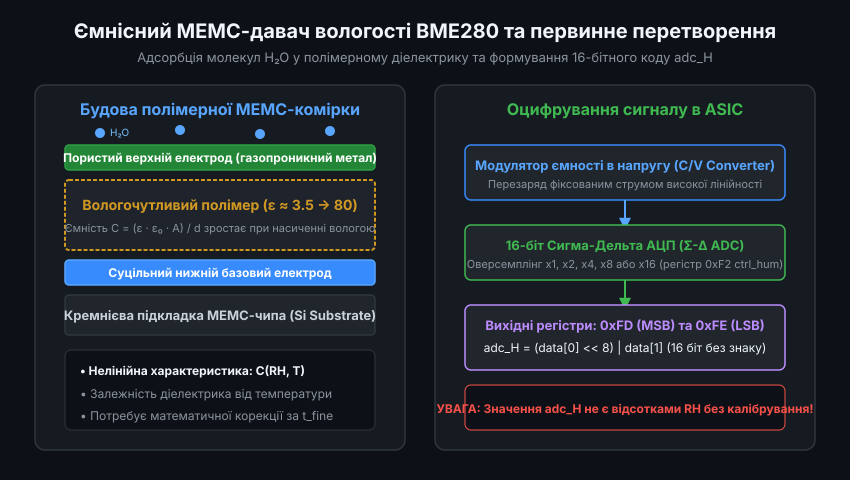
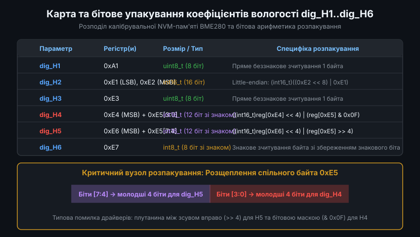
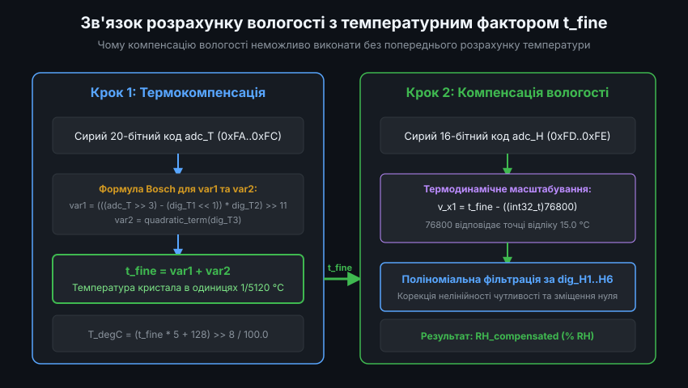
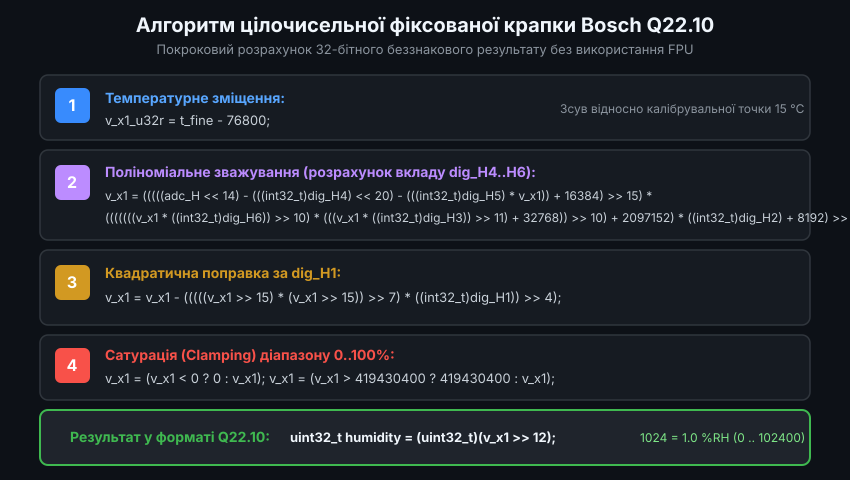
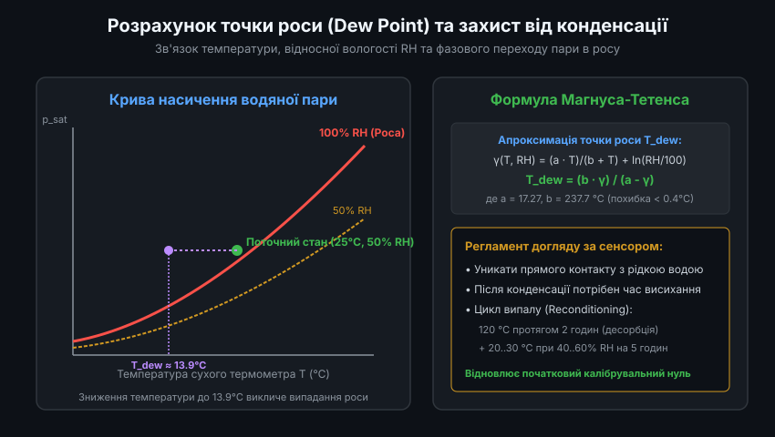

# Математична компенсація відносної вологості в давачах BME280

Цифровий датчик BME280 від компанії Bosch Sensortec є промисловим стандартом для вимірювання температури, атмосферного тиску та відносної вологості повітря. Проте, на відміну від найпростіших аналогових сенсорів, значення, що зчитуються з внутрішніх регістрів BME280 по шині I2C або SPI, не є безпосередніми фізичними величинами. Для отримання справжнього значення відносної вологості (у відсотках % RH) вихідний 16-бітний код АЦП потребує нелінійної математичної обробки з використанням індивідуальних заводських коефіцієнтів та поточної температури кристала.

---

### 1. Фізичний принцип ємнісного вимірювання вологості та сирі дані АЦП

Чутливий елемент вологості в BME280 побудований за технологією мікроелектромеханічних систем (МЕМС) на основі плоскопаралельного конденсатора. Його верхній електрод виконаний з мікропористого металу, проникного для молекул водяної пари, а діелектриком виступає спеціальний гігроскопічний полімер.

Коли вологість навколишнього середовища змінюється, молекули води адсорбуються полімером. Оскільки відносна діелектрична проникність рідкої води або адсорбованих полярних молекул H2O (близько 80) на порядки вища за проникність сухого полімеру (близько 3-4), сумарна ємність чутливої комірки суттєво зростає при підвищенні вологості. Вбудована мікросхема ASIC перетворює зміну ємності на напругу та оцифровує її за допомогою 16-бітного сигма-дельта АЦП:

- Сирі дані вологості зберігаються у двох регістрах: `0xFD` (старший байт `msb`) та `0xFE` (молодший байт `lsb`).
- Об'єднане значення формує 16-бітне беззнакове ціле число: `adc_H = (reg[0xFD] << 8) | reg[0xFE]`.
- Режим оверсемплінгу для каналу вологості налаштовується в регістрі `ctrl_hum` (`0xF2`) зі значеннями від x1 до x16.
- Сире значення `adc_H` не пропорційне напряму відносній вологості, оскільки полімер володіє внутрішньою нелінійністю та суттєвим температурним коефіцієнтом розширення і поляризації.

---

### 2. Заводські калібрувальні коефіцієнти NVM та бітова упаковка регістру 0xE5

Кожен екземпляр кристала BME280 проходить індивідуальне калібрування в кліматичних камерах заводу-виробника Bosch. Обчислені коефіцієнти апроксимаційної кривої зашиваються в незалежну пам'ять (OTP/NVM) чипа. Для каналу вологості виділено шість параметрів: `dig_H1` ... `dig_H6`.

Розподіл та типи калібрувальних коефіцієнтів мають специфічні особливості упаковки, які необхідно суворо враховувати при розробці драйвера:

- `dig_H1` (адреса `0xA1`): 8-бітне беззнакове число (`uint8_t`), винесене в окремий адресний блок окремо від інших коефіцієнтів.
- `dig_H2` (адреси `0xE1` / `0xE2`): 16-бітне знакове ціле число (`int16_t`), розташоване у форматі Little-Endian (`lsb` за адресою `0xE1`, `msb` за адресою `0xE2`).
- `dig_H3` (адреса `0xE3`): 8-бітне беззнакове число (`uint8_t`).
- `dig_H4` (адреси `0xE4` та `0xE5[3:0]`): 12-бітне знакове ціле число. Старші 8 біт зчитуються з `0xE4`, а молодші 4 біти беруться з нижнього нібла регістра `0xE5`.
- `dig_H5` (адреси `0xE6` та `0xE5[7:4]`): 12-бітне знакове ціле число. Старші 8 біт беруться з `0xE6`, а молодші 4 біти зчитуються з верхнього нібла спільного регістра `0xE5`.
- `dig_H6` (адреса `0xE7`): 8-бітне знакове ціле число (`int8_t`).

Некоректне розщеплення спільного байта `0xE5` є найпоширенішою помилкою в аматорських бібліотеках: якщо переплутати нібли між `dig_H4` та `dig_H5`, компенсація вологості видаватиме занижені або взагалі від'ємні некоректні значення.

---

### 3. Термодинамічний зв'язок вологості з температурним фактором t_fine

Відносна вологість за фізичним визначенням є відношенням поточного парціального тиску водяної пари до тиску насиченої пари за даної температури. Оскільки тиск насиченої пари експоненційно зростає з підвищенням температури, вимірювання відносної вологості принципово неможливе у відриві від температури самого сенсора.

Для вирішення цієї проблеми алгоритм Bosch тісно пов'язує канали температури та вологості:

1. Спочатку обов'язково викликається процедура температурної компенсації, що опрацьовує сирі дані `adc_T` та коефіцієнти `dig_T1`..`dig_T3`.
2. У процесі розрахунку температури обчислюється глобальна проміжна змінна `t_fine`. Вона зберігає точну температуру кристала з високою роздільною здатністю (в масштабі 1/5120 градуса Цельсія).
3. Змінна `t_fine` передається як обов'язковий вхідний аргумент у формулу компенсації вологості.
4. Базова точка відліку у формулі вологості відповідає величині `t_fine - 76800`, що відповідає калібрувальній температурі +15.0 °C.

Будь-яка спроба розрахувати вологість без попереднього актуального оновлення `t_fine` призводить до фатальних помилок, оскільки навіть самонагрів чипа на 0.5 °C змінює розрахункову відносну вологість на кілька відсотків.

---

### 4. Цілочисельний алгоритм компенсації Bosch Q22.10

Для ефективного виконання на мікроконтролерах без апаратного модуля плаваючої крапки (FPU), таких як ARM Cortex-M0/M0+ або класичні AVR/PIC, інженери Bosch розробили спеціальний 32-бітний цілочисельний алгоритм із фіксованою крапкою формату Q22.10.

Математичний конвеєр містить кілька послідовних операцій зсуву та масштабування:

- **Лінійна поправка температури**: сире значення `adc_H` масштабується вліво на 14 бітів, після чого з нього віднімається внесок `dig_H4` та температурне зміщення з коефіцієнтом `dig_H5`.
- **Поліноміальне зважування**: проміжний результат множиться на коефіцієнти чутливості `dig_H2`, `dig_H3` та `dig_H6`, які компенсують температурний коефіцієнт полімеру.
- **Квадратична корекція нелінійності**: враховує квадратичний відгук ємності діелектрика через коефіцієнт `dig_H1`.
- **Обмеження меж (Clamping)**: результат примусово обмежується в діапазоні від 0 до 419430400, що запобігає виходу за межі фізичного діапазону 0..100% RH через шуми або перехідні процеси.
- **Фінальний вихід**: зсув вправо на 12 бітів (`>> 12`) дає кінцеве значення у форматі 1024 кроки на 1% RH. Значення 48128 відповідає вологості 47.0% RH (`48128 / 1024 = 47.0`).

---

### 5. Точка роси, психрометрія та правила експлуатації сенсора

Отримавши точні скомпенсовані значення температури та відносної вологості, мікроконтролер може визначити точку роси (Dew Point) — критичну температуру, за якої повітря більше не здатне утримувати вологу у вигляді пари, і починається її конденсація у воду.

Для обчислення точки роси на практиці використовується апроксимація Магнуса-Тетенса:

- Коефіцієнти: `a = 17.27`, `b = 237.7 °C`.
- Проміжний параметр: `gamma(T, RH) = (a * T) / (b + T) + ln(RH / 100.0)`.
- Точка роси: `T_dew = (b * gamma) / (a - gamma)`.

Знання точки роси має вирішальне значення для запобігання аварійним ситуаціям у системах вентиляції, клімат-контролю та зовнішніх метеостанціях. Попадання крапельної вологи на сенсор викликає тимчасове "залипання" показників на рівні 100% RH, а розчинені у конденсаті солі та хімічні леткі сполуки спричиняють дрейф нуля. Якщо сенсор зазнав тривалого впливу високої вологості, виробник рекомендує процедуру термічного відновлення (bake-out): прогрів чипа при температурі +120 °C протягом 2 годин з наступною стабілізацією в нормальних умовах.
