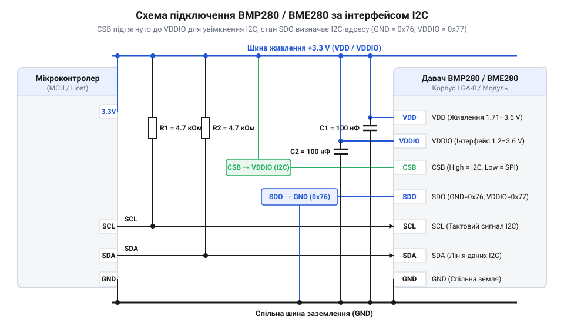
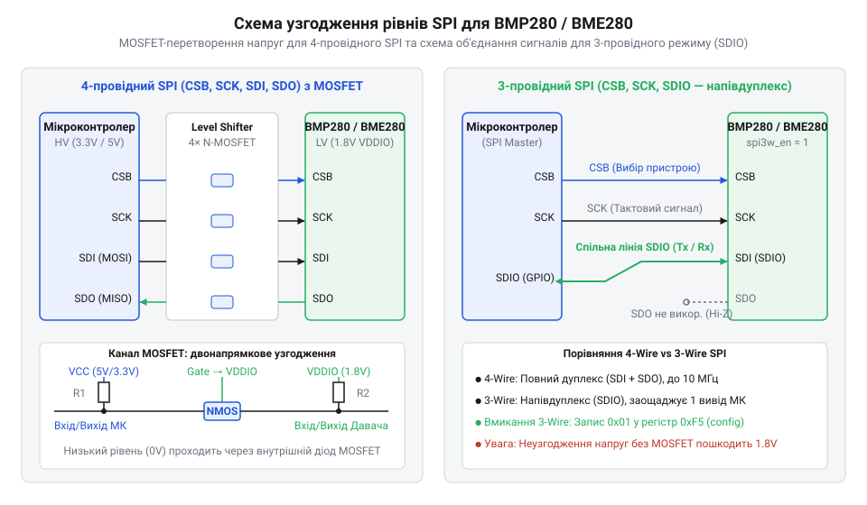

# Апаратний інтерфейс, схемотехніка та електричне підключення BMP280/BME280

<preknowlist>
- [GY-BMP280](root:cat-hw-sensors/gy-bmp280) — Призначення та загальні можливості барометричного модуля BMP280 на платах розширення
</preknowlist>

## Наслідки помилок електричного підключення давача

Пряме підключення високоточних мікроелектромеханічних давачів до електричних кіл мікроконтролера здається найпростішим кроком, проте саме тут криється більшість апаратних відмов. Давачі @@en|BMP280@@ та @@en|BME280@@ побудовані за низьковольтною технологією напівпровідникових кремнієвих структур, що вимагає суворого дотримання граничних електричних параметрів. Коли розробник з'єднує чип із п'ятивольтовою логікою класичних мікроконтролерів без кіл узгодження, пристрій зазнає зворотного електричного пробою.

Електричні специфікації виготовлення визначають два діапазони напруги: робочий та гранично допустимий. Робоча напруга аналогового ядра `VDD` лежить у межах від `1.71 В` до `3.6 В`, а сигнальних ліній `VDDIO` — від `1.2 В` до `3.6 В`. Абсолютний максимум напруги для будь-якої шпильки становить `4.25 В`. Подача потенціалу `5 В` на лінії живлення чи цифрових даних спричиняє руйнування діелектричних шарів внутрішніх транзисторів та викличе тепловий пробій p-n переходу. Готові плати розширення, такі як [модуль GY-BMP280](root:cat-hw-sensors/gy-bmp280), вже містять лінійний регулятор та стабілізатор, проте при монтажі голого чипа на власну друковану плату помилка подачі живлення миттєво виводить компонент із ладу.

Іншою прихованою загрозою є явище паразитного живлення через захисні діоди від статичної електрики (англ. *Electrostatic Discharge*, @@en|ESD@@). Усі виводи цифрового інтерфейсу @@en|SDA@@, @@en|SCL@@, @@en|CSB@@ та @@en|SDO@@ зашунтовані внутрішніми діодами на шину `VDDIO`. Якщо лінія живлення чипа знеструмлена або має потенціал `0 В`, а мікроконтролер продовжує утримувати високий логічний рівень `3.3 В` або `5 В` на лініях даних, струм протікає через @@en|ESD@@-діод у шину `VDDIO`. Це призводить до часткового невизначеного заживлення кристала, хаотичних перезавантажень та прискореної деградації напівпровідника.

Нестабільність напруги живлення виникає також при відсутності фільтрації. Перехідні процеси у цифрових колах та імпульсні перешкоди спричиняють короткочасні просідання `VDD` нижче порогу `1.63 В`. У цей момент спрацьовує внутрішній блок скидання початкового живлення (англ. *Power-on Reset*, @@en|POR@@). Давач спонтанно скидає конфігураційні регістри, повертається до режиму сну та обриває поточний транзакційний обмін по шині. У результаті програма мікроконтролера отримує нульові значення тиску та температури або зависає в очікуванні відповіді пристрою.

Фізична вимірювальна комірка виготовлена за технологією @@en|MEMS@@ (англ. *Micro-Electro-Mechanical Systems*, мікроелектромеханічні системи). Її функціонування детально розбирається в матеріалі про [п'єзорезистивний вимірювальний елемент](root:hw-sensing/mems-piezoresistive-sensing-element). Будь-які електричні перевантаження викличуть незворотній зсув калібрувальних коефіцієнтів аналогово-цифрового перетворювача, роблячи вимірювання тиску та вологості недовірливими навіть за збереження працездатності цифрової шини.

## Призначення виводів LGA та роздільне живлення

Мікросхеми @@en|BMP280@@ та @@en|BME280@@ випускаються у надкомпактному 8-вивідному корпусі @@en|LGA@@ (англ. *Land Grid Array*, сітка пласких майданчиків) з металевою кришкою розміром `2.0 мм × 2.5 мм × 0.95 мм`. Нижня площина містить контактні майданчики, розміщені за прямокутною сіткою. Точне розуміння функцій кожного контактного майданчика є необхідною умовою розробки надійного апаратного інтерфейсу.

Призначення шпильок корпусу @@en|LGA-8@@ розподілено таким чином:
1. `GND` — спільна земля аналогової та цифрової частин. 2. `CSB` (англ. *Chip Select Bar*, вибір чипа) — вибір пристрою для шини @@en|SPI@@ (активний низький рівень) або апаратний селектор режиму @@en|I2C@@. 3. `SDI` / `SDA` (англ. *Serial Data Input / Serial Data*) — вхід даних @@en|SPI@@ або двонапрямна лінія даних @@en|I2C@@. 4. `SCK` / `SCL` (англ. *Serial Clock*) — лінія тактового сигналу шини @@en|SPI@@ або @@en|I2C@@. 5. `SDO` (англ. *Serial Data Output*) — вихід даних @@en|SPI@@ у 4-провідному режимі або молодший біт адреси в режимі @@en|I2C@@. 6. `VDDIO` — напруга живлення цифрового буфера вводу-виводу. 7. `GND` — додатковий майданчик спільного заземлення для зниження індуктивності розводки. 8. `VDD` — основна напруга живлення аналогових кіл та сенсорної комірки @@en|MEMS@@.

Розділення заживлення на незалежні шини `VDD` та `VDDIO` розв'язує фундаментальну проблему узгодження низьковольтних обчислювальних ядер із периферією. Напруга `VDD` живить аналоговий фронтенд (англ. *Analog Front-End*, @@en|AFE@@), внутрішній розрядний генератор та прецизійний аналогово-цифровий перетворювач (англ. *Analog-to-Digital Converter*, @@en|ADC@@). Шпилька `VDDIO` задає високовольтну амплітуду вихідних логічних рівнів на лініях даних. Це дає змогу заживити ядро `VDD` від стабільного джерела `3.3 В` для забезпечення максимального відношення сигнал/шум, тоді як `VDDIO` підключити безпосередньо до логіки системного процесора з напругою `1.8 В`.

Для пригнічення високочастотних завад та компенсації імпульсних кидків струму під час вимірювальних циклів необхідне встановлення розв'язувальних керамічних конденсаторів у безпосередній близькості до корпусу @@en|LGA@@. Безпосередньо біля виводу 8 (`VDD`) розміщують керамічний конденсатор `C1 = 100 нФ` з диелектриком типу `X7R` або `X5R`, паралельно якому допускається встановлення ємності `4.7 мкФ`. Біля виводу 6 (`VDDIO`) монтують керамічний конденсатор `C2 = 100 нФ`.

Розрахуємо реактивний опір розв'язувального керамічного конденсатора `C = 100 нФ` на високій частоті цифрових завад `f_n = 10 МГц`, щоб оцінити ефективність фільтрації живлення `VDD`:

```
Z_C = 1 ÷ (2 × π × f_n × C)
= 1 ÷ (2 × 3.14159 × 10⁷ × 100 × 10⁻⁹)    [підстановка f_n = 10 МГц, C = 100 нФ]
= 1 ÷ (6.28318 × 10⁻¹)                   [обчислення знаменника]
≈ 0.159 Ом                               [розрахунок реактивного опору]
```

Отримане значення реактивного опору `0.159 Ом` показує, що високочастотні шуми перемикання цифрових ліній замикаються на землю через конденсатор, не створюючи пульсацій напруги на внутрішніх аналогових референсах ядра `VDD`. Відстань від виводів мікросхеми до контактів конденсаторів не повинна перевищувати `2 мм` для мінімізації паразитної індуктивності друкованих провідників.

## Конфігурація інтерфейсу I2C та вибір адреси

Давачі @@en|BMP280@@ та @@en|BME280@@ підтримують автоматичний вибір вимірювального протоколу обміну під час подачі живлення. Вирішальну роль у визначенні активного інтерфейсу відіграє стан шпильки `CSB`. Якщо під час ініціалізації на виводі `CSB` присутній високий логічний рівень (підтяжка до `VDDIO`), мікросхема активує режим шини @@en|I2C@@. Якщо шпильку `CSB` з'єднано з землею `GND`, чип перемикається в режим @@en|SPI@@.

У режимі @@en|I2C@@ давач працює як ведений пристрій. Для адресації на шині використовується 7-бітне значення, причому 6 старших бітів зафіксовані на заводському рівні `0b111011`. Наймолодший біт (англ. *Least Significant Bit*, @@en|LSB@@) визначається фізичним потенціалом на шпильці `SDO`. З'єднання `SDO` з землею `GND` формує логічний `0`, що відповідає підсумковій 7-бітній адресі `0x76` (`0b1110110`). Подача на `SDO` високого рівня `VDDIO` задає логічну `1`, змінюючи адресу на `0x77` (`0b1110111`). Завдяки цьому на єдину двопровідну шину можна паралельно увімкнути два однакових пристрої без ризику апаратних колізій. На відміну від старіших компонентів, де адреси жорстко прив'язані, як-от у [барометра GY-68](root:cat-hw-sensors/gy-bmp180), або прецизійних чипів на кшталт [модуля GY-63](root:cat-hw-sensors/gy-63), родина @@en|BMP280@@ / @@en|BME280@@ дає гнучкість при побудові розгалужених мереж давачів.


*Схема підключення давача до шини I2C з розв'язкою живлення VDD/VDDIO та вибором адреси 0x76 або 0x77.*

Лінії @@en|SDA@@ та @@en|SCL@@ мають топологію з відкритим стоком (англ. *Open-Drain*), тому потребують зовнішніх підтягувальних резисторів `R_pullup` до шини `VDDIO`. Значення опору визначається компромісом між швидкістю наростання фронту сигналу та енергоспоживанням. Мінімальний опис `R_min` обмежений максимальним струмом виходу `I_OL = 3 мА` при напрузі `V_OL = 0.4 В`. Максимальний опис `R_max` залежить від сумарної ємності лінії `C_bus` та вимог специфікації @@en|I2C@@ до часу наростання імпульсу `t_r` (`300 нс` для режиму @@en|Fast Mode@@ `400 кГц`).

Розрахуємо граничний опис `R_max` для шини з ємністю `C_bus = 50 пФ` при напрузі `VDDIO = 3.3 В` та граничному часі наростання `t_r = 300 нс`:

```
R_max = t_r ÷ (0.8473 × C_bus)
= (300 × 10⁻⁹) ÷ (0.8473 × 50 × 10⁻¹²)    [підстановка t_r = 300 нс, C_bus = 50 пФ]
= (300 × 10⁻⁹) ÷ (4.2365 × 10⁻¹¹)        [обчислення знаменника]
≈ 7081 Ом                                 [граничне значення підтяжки]
```

Значення `R_max ≈ 7.08 кОм` задає верхню межу. З іншого боку, мінімальний опис обмежений величиною `R_min = (3.3 В - 0.4 В) ÷ 3 мА ≈ 967 Ом`. На практиці оптимальним вибором для стандартних швидкостей `100 кГц` та `400 кГц` є резистори номіналом `2.2 кОм` або `4.7 кОм`, які забезпечують круті фронти сигналів без перевищення допустимого струму розряду.

## Схеми підключення SPI та узгодження рівнів

Інтерфейс @@en|SPI@@ (англ. *Serial Peripheral Interface*, послідовний периферійний інтерфейс) забезпечує вищу швидкість обміну (до `10 МГц`) порівняно з @@en|I2C@@ і є оптимальним для систем із жорсткими вимогами до часу опитування. Давачі @@en|BMP280@@ та @@en|BME280@@ підтримують як класичний 4-провідний, так і 3-провідний режими @@en|SPI@@.

У 4-провідному режимі використовуються всі чотири сигнальні лінії: `CSB` (вибір чипа, активний логічний нуль), `SCK` (тактування), `SDI` (вхід даних, аналог @@en|MOSI@@) та `SDO` (вихід даних, аналог @@en|MISO@@). Передача даних підтримує методи @@en|SPI@@ mode 00 (`CPOL = 0, CPHA = 0`) та mode 11 (`CPOL = 1, CPHA = 1`). Коли рівень на `CSB` високий, вихід `SDO` переходить у стан високого імпедансу (Hi-Z), дозволяючи іншим периферійним пристроям використовувати спільну лінію @@en|MISO@@.

Для економії виводів мікроконтролера розробник може перевести давач у 3-провідний режим. У цьому випадку лінія `SDI` стає двонапрямною шиною даних @@en|SDIO@@, а вивід `SDO` відключений і може бути заземлений. Перемикання здійснюється програмно шляхом запису одиниці в біт `spi3w_en` конфігураційного регістру `0xF5`.


*Схема 3- та 4-провідного інтерфейсу SPI з двонапрямним перетворенням логічних рівнів для надійної передачі даних.*

При підключенні давача з живленням `VDDIO = 1.8 В` до мікроконтролера з логікою `3.3 В` або `5 В` необхідне застосування активних перетворювачів рівнів. Пряме з'єднання призведе до протікання деструктивних струмів через внутрішні діоди виводів. Для двонапрямних ліній (@@en|SDA@@ або 3-провідний @@en|SDI@@) застосовують схеми на польових транзисторах типу @@en|MOSFET@@ (наприклад, @@en|BSS138@@).

Класична комірка узгодження складається з N-канального @@en|MOSFET@@ транзистора та двох підтягувальних резисторів. Затвор транзистора підключається до низьковольтного джерела `V_LV` (`1.8 В`), витік — до лінії давача `LV`, а сток — до лінії мікроконтролера `HV` (`3.3 В`). Робота кола описується трьома станами:
1. **Низький рівень на стороні LV**: Спад напруги витік-затвор перевищує порогове значення транзистора `V_GS(th)`. Транзистор відкривається і притягує лінію `HV` до нуля. 2. **Низький рівень на стороні HV**: Внутрішній паразитичний діод транзистора починає проводити струм від витоку до стоку, знижуючи напругу на витоку `LV`. Як тільки `V_GS` перевищить поріг, транзистор повністю відкривається. 3. **Високий рівень з обох сторін**: Напруга `V_GS` нижча за порогову, транзистор закритий, лінії `LV` та `HV` підтягнуті відповідно до `V_LV` та `V_HV` через свої резистори.

Для високошвидкісних ліній тактування `SCK` та вибору чипа `CSB` у режимі @@en|SPI@@ рекомендовано використовувати однонапрямні буферні мікросхеми (наприклад, `74LVC1T45`), оскільки паразитна ємність @@en|MOSFET@@-перетворювачів обмежує максимальну частоту сигналів на рівні `2–3 МГц`.

## Методика діагностики апаратних збоїв шини

При запуску плати з давачами @@en|BMP280@@ або @@en|BME280@@ нерідко виникають помилки зчитування ID пристрою, завісання шини або нестабільні значення тиску. Покроковий алгоритм діагностики дозволяє систематично виявити та усунути причину апаратного збою за допомогою мультиметра та осцилографа.

Крок 1: **Перевірка постійних напруг живлення**. За допомогою мультиметра вимірюють потенціали безпосередньо на контактних майданчиках `VDD` (вивід 8) та `VDDIO` (вивід 6) відносно `GND`. Напруга повинна перебувати в межах `1.71 В – 3.6 В` без просідань. Під час вимірювальних сплесків струму (до `11 мА` в активному режимі) напруга не повинна просідати нижче `1.63 В`. Якщо спостерігаються короткочасні просідання, слід збільшити ємність фільтраційного конденсатора `C1` або перевірити якість пайка заземлення.

Крок 2: **Контроль стаціонарних станів керуючих виводів**. Непідключені («висячі в повітрі») шпильки є поширеним джерелом спонтанних збоїв:
- У режимі @@en|I2C@@ шпилька `CSB` повинна бути жорстко з'єднана з `VDDIO`. Якщо `CSB` залишається плавати, наведені завади хаотично перемикають чип у режим @@en|SPI@@, через що давач припиняє відповідати на шині @@en|I2C@@. - Вивід `SDO` повинен мати чіткий потенціал `GND` або `VDDIO`. Якщо `SDO` висить у повітрі, молодший біт адреси хаотично змінюється між `0` та `1`, викликуючи відсутність підтвердження (англ. *No Acknowledge*, @@en|NACK@@) від мікроконтролера.

Крок 3: **Діагностика паразитного живлення**. Вимкніть основне джерело `VDD` та виміряйте напругу на шпильці 8. Якщо мультиметр показує потенціал `1.2 В – 2.0 В`, наявне паразите живлення кристала через виводи даних @@en|SDA@@/@@en|SCL@@. Це свідчить про відсутність узгодження логічних рівнів або подачу сигналів від мікроконтролера при знеструмленому давачі. Рішенням є програмування виводів мікроконтролера в стан високого імпедансу до подачі напруги живлення.

Крок 4: **Аналіз осцилограм та цілісності сигналів**. Підключають осцилограф до ліній @@en|SDA@@ та @@en|SCL@@ (або @@en|SCK@@/@@en|SDI@@ у режимі @@en|SPI@@). Діагностика аналізує такі відхилення:
- **Занадто тривалий час наростання фронту `t_r`**: Закруглені верхні кути прямокутних імпульсів вказують на надмірно високий опір підтяжки `R_pullup` або високу паразиту ємність кабелю. Необхідно зменшити опір підтяжки з `10 кОм` до `2.2 кОм`. - **Передзвін та викиди напруги**: З'являються при довжині ліній @@en|SPI@@ понад `15 см`. Для усунення зворотних відбитків хвилі в розрив ліній `SCK` та `SDI` послідовно впаюють демпфуючі резистори номіналом `22 Ом – 47 Ом`. - **Перехресні наводки**: Перехідні завади з лінії `SCL` на лінію @@en|SDA@@ можуть викликати помилкові умови START/STOP на шині @@en|I2C@@. Подібні аномалії придушують правильним розведенням плати з використанням захисних земляних треків.

Діагностична методика виявлення шинних завад має спільні принципи з налагодженням чутливої цифрової периферії, такої як [давачі блискавок](root:cat-hw-sensors/as3935-lightning), де електричний шум шини блокує обробку аналогових сигналів. Виконання зазначених кроків гарантує стабільний та безпомилковий обмін даними між давачем та процесором.