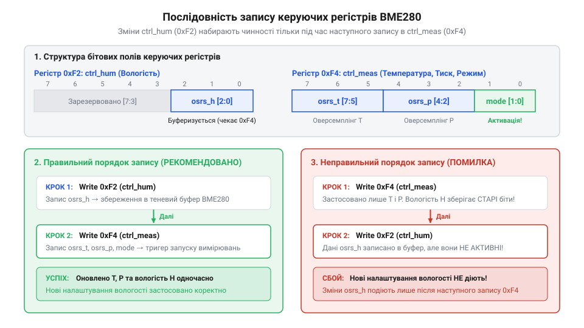
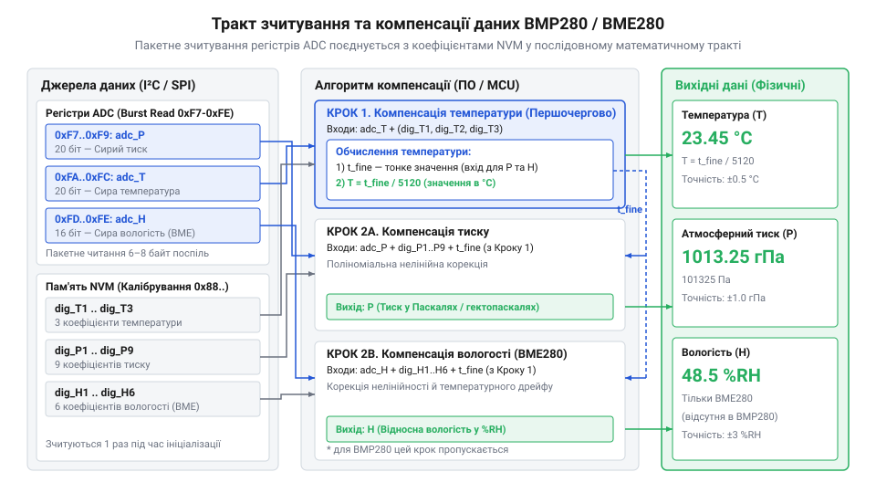

# Карта регістрів, протокол обміну та налаштування цифрового тракту BMP280/BME280

<preknowlist>
- [GY-BMP280 — барометр/висотомір (BMP280)](root:cat-hw-sensors/gy-bmp280) — принципи підключення модуля GY-BMP280 до шин I2C/SPI та вибір напруги живлення
</preknowlist>

## Помилки прямого читання незахищеного давача

Спроба зчитати показники температури чи тиску одразу після подачі живлення на давачі BMP280 чи BME280 майстер-контролером через шину @@en|I2C@@ або @@en|SPI@@ майже завжди завершується отриманням нульових значень або постійного числа `524288` (`0x80000`). Початківець очікує, що цифровий давач після подачі напруги негайно почне оновлювати регістри результатів, проте внутрішній цифровий тракт пристрою перебуває в принципово іншому стані.

Після подачі живлення апаратний контролер давача автоматично переходить у режим занулення енергоспоживання — @@en|Sleep mode@@ (англ. *sleep* — сон). У цьому стані аналого-цифровий перетворювач (@@en|ADC@@, англ. *Analog-to-Digital Converter* — аналого-цифровий перетворювач) повністю знеструмлений, вимірювальні цикли не виконуються, а в регістрах даних 0xF7–0xFC зберігаються вихідні заповнювачі. Якщо спробувати записати значення оверсемплінгу без попереднього виведення пристрою зі стану сну, внутрішня логіка не розпочне циклу перетворення.

Друга типова пастка полягає у розриві цілісності даних при побайтовому зчитуванні. Сирі показники аналого-цифрового перетворювача для температури й тиску мають розрядність 20 біт і розподілені між трьома послідовними регістрами: старшим байтом (`msb`), молодшим байтом (`lsb`) та розширенням (`xlsb`). Якщо зчитувати ці регістри окремими транзакціями шини, між зчитуванням `msb` та `lsb` може відбутися завершення нового вимірювального циклу. В результаті старший байт буде взято з попереднього вимірювання, а молодший — з наступного. Такий розрив створює аномальні викиди значень («голки» на графіках), які неможливо прибрати програмною фільтрацією.

Третя масштабна помилка — спроба використати сирі значення ADC безпосередньо як фізичні величини. Число, зчитане з регістрів 0xF7–0xFC, є відносним відліком внутрішнього ADC. Щоб перетворити його в паскалі чи градуси Цельсія, необхідно застосувати складний математичний тракт компенсації. Цей тракт спирається на унікальні калібрувальні коефіцієнти, записані на заводі в неенергозалежну пам'ять чипа — @@en|NVM@@ (англ. *Non-Volatile Memory* — неенергозалежна пам'ять, *non-* + *volatile* + *memory*). Спроба прочитати ці коефіцієнти в момент, коли внутрішня схема пристрою ще виконує їх копіювання в тіньові регістри — @@en|shadow registers@@ (англ. *shadow* — тінь, дзеркальна копія), повертає спотворені константи, роблячи будь-які подальші розрахунки хибними.

Для побудови надійного драйвера при роботі з [модулями GY-BMP280](root:cat-hw-sensors/gy-bmp280) необхідно дотримуватися чіткого життєвого циклу ініціалізації. Він вимагає обов'язкової перевірки підключення чипа, програмного скидання, очікування готовності пам'яті, суворого порядку конфігурації цифрового тракту та застосування пакетного читання — @@en|burst read@@ (англ. *burst* — пакетний спалах + *read* — зчитування).

## Ідентифікація чипа та програмне скидання

Будь-який сеанс взаємодії з давачем серії BMP280/BME280 слід починати з апаратної перевірки присутності пристрою на шині та відновлення його вихідного стану. Якщо лінії SDA/SCL мають надмірну ємність або адреса на шині вибрана неправильно, мікроконтролер може зчитувати `0x00` або `0xFF`. Щоб однозначно підтвердити працездатність шини та визначити конкретну модель давача, використовується регістр ідентифікації `0xD0` (`id`).

При зверненні до регістру `0xD0` давач повертає апаратний код чипа — @@en|chip ID@@ (англ. *chip* — мікросхема + *identifier* — ідентифікатор). Давач BMP280 завжди повертає байт `0x58`, тоді як давач BME280 повертає значення `0x60`. Це розрізнення є критичним, оскільки BME280 містить додатковий канал вимірювання вологості та має іншу структуру регістрів конфігурації. Якщо зчитане значення не відповідає жодному з цих двох чисел, подальша робота з пристроєм зупиняється через помилку апаратного рівня.

Після верифікації @@en|chip ID@@ необхідно виконати програмне скидання давача. Це гарантує, що пристрій скине можливі завислі стани внутрішнього автомата після збоїв живлення чи перезавантаження керуючого контролера. Для цього в регістр `0xE0` (`reset`) записується спеціальний командний байт `0xB6`. Надсилання будь-якого іншого значення ігнорується апаратурою давача.

Запис значення `0xB6` ініціює повну процедуру скидання при увімкненні — @@en|power-on reset@@ (англ. *power-on* — увімкнення живлення + *reset* — скидання). Під час цієї процедури внутрішня логіка давача перезавантажує заводські калібрувальні коефіцієнти з масиву NVM у тіньові регістри, доступні для читання через шину.

Під час перезавантаження NVM давач тимчасово блокує доступ до внутрішніх даних. Стан цього процесу відображається в регістрі статусу `0xF3` (`status`). Біт 0 цього регістру (`im_update`) дорівнює `1`, поки триває копіювання калібрувальних даних. Програмувати регістри конфігурації чи зчитувати калібрувальні коефіцієнти можна лише після того, як біт `im_update` скинеться в `0`.

:::code api-bmp280-bme280-register-map/c/esp-idf/sensor-init-reset.c

:::code api-bmp280-bme280-register-map/cpp/arduino/initsensorreset.cpp

## Налаштування режимів та IIR-фільтрації

Після програмного скидання давач повертається в @@en|Sleep mode@@. Щоб пристрій розпочав вимірювання, його потрібно перевести у відповідний режим роботи та налаштувати цифровий тракт обробки даних. Конфігурація режимів визначається бітами [1:0] регістру `0xF4` (`ctrl_meas`).

Давачі BMP280/BME280 підтримують три режими енергоспоживання:

1. **@@en|Sleep mode@@ (`00`)**: Всі вимірювальні блоки вимкнені. Споживання струму мінімальне (близько 0.1 мкА). Регістри доступні для зчитування та запису, але вимірювання не проводяться. 2. **@@en|Forced mode@@ (`01` або `10`)**: Режим одноразового вимірювання (англ. *forced* — примусовий). Давач виконує один повний цикл вимірювання для всіх активованих каналів (температура, тиск, вологість), записує результати в регістри даних 0xF7–0xFC і автоматично повертається в @@en|Sleep mode@@. Цей режим є ідеальним для автономних пристроїв із батарейним живленням, де опитування відбувається рідко (наприклад, раз на хвилину). 3. **@@en|Normal mode@@ (`11`)**: Режим безперервного циклічного вимірювання. Давач автономно чергує активну фазу вимірювання із фазою відпочинку — @@en|standby time@@ (англ. *standby* — режим очікування, готовності).

Тривалість фази відпочинку в @@en|Normal mode@@ задається бітами [7:5] регістру `0xF5` (`config`) — поле `t_sb`. Для BMP280 цей час можна налаштовувати від 0.5 мс до 4000 мс, що дає змогу адаптувати частоту оновлення даних під вимоги системи (від швидкої динаміки польотних контролерів до повільних метеостанцій).

Окрім режиму роботи, регістр `0xF5` керує параметрами внутрішнього цифрового фільтра з безкінечною імпульсною характеристикою — @@en|IIR-фільтр@@ (англ. *Infinite Impulse Response* — безкінечна імпульсна характеристика). Біти [4:2] поля `filter` задають коефіцієнт згладжування (від вимкненого стану `000` до значення `100`, що відповідає коефіцієнту 16).

Апаратний @@en|IIR-фільтр@@ усуває високочастотні шумні коливання тиску, викликані вібраціями, рухом повітря в приміщенні або хлопанням дверей. Фільтр обробляє сирі дані ADC за формулою:

```
P_filtered = (P_filtered_prev × (N - 1) + P_ADC) / N
```

де `N` — коефіцієнт фільтрації. Застосування @@en|IIR-фільтр@@ дозволяє підвищити роздільну здатність вимірювання тиску до часток паскаля без залучення обчислювальних ресурсів основного мікроконтролера. Проте вищий коефіцієнт фільтрації збільшує час відгуку системи на реальну зміну атмосферного тиску.

## Керування оверсемплінгом та порядок запису

Для досягнення необхідного балансу між точністю, рівнем шуму та часом вимірювання використовується апаратне усереднення — @@en|oversampling@@ (англ. *over* — понад + *sampling* — вибірка). Внутрішній ADC давача здійснює кілька послідовних знімань аналогового сигналу за один вимірювальний цикл і обчислює їхнє середнє значення.

Параметри оверсемплінгу налаштовуються окремо для кожного вимірювального каналу:
- Біти `osrs_t` [7:5] регістру `0xF4` (`ctrl_meas`) задають коефіцієнт для температури (1×, 2×, 4×, 8×, 16× або вимкнено). - Біти `osrs_p` [4:2] регістру `0xF4` (`ctrl_meas`) задають коефіцієнт для тиску. - Біти `osrs_h` [2:0] регістру `0xF2` (`ctrl_hum`) задають коефіцієнт для вологості (лише в BME280).

Збільшення коефіцієнта оверсемплінгу знижує середньоквадратичний шум ADC, але пропорційно збільшує тривалість вимірювального циклу та споживання струму.

При програмуванні конфігураційних регістрів давача BME280 існує суворе апаратне обмеження щодо послідовності запису. Запис у регістр `0xF2` (`ctrl_hum`) **не приводить** до негайного оновлення конфігурації тракту вологості. Внутрішній тригер фіксації налаштувань вологості спрацьовує лише в момент запису в регістр `0xF4` (`ctrl_meas`).

Якщо записати регістр `0xF4` раніше за `0xF2`, зміни в регістрі `0xF2` будуть проігноровані апаратурою аж до наступного запису в `0xF4`. 


*Послідовність запису регістрів ctrl_hum та ctrl_meas із виділенням бітових полів оверсемплінгу та режимів роботи.*

Правильний порядок налаштування давача BME280 вимагає послідовного виконання трьох кроків:

1. Запис регістру `0xF5` (`config`): встановлення часу standby та коефіцієнта @@en|IIR-фільтр@@. 2. Запис регістру `0xF2` (`ctrl_hum`): налаштування оверсемплінгу вологості `osrs_h`. 3. Запис регістру `0xF4` (`ctrl_meas`): налаштування оверсемплінгу температури `osrs_t`, тиску `osrs_p` та вибір режиму `mode`. Цей крок засуває налаштування з обох регістрів (`ctrl_hum` і `ctrl_meas`) в робочі тригери пристрою.

:::code api-bmp280-bme280-register-map/c/esp-idf/sensor-configure.c

:::code api-bmp280-bme280-register-map/cpp/arduino/configuresensor.cpp

## Зчитування NVM, стан та компенсація

Після запуску вимірювань керуючий контролер повинен опитувати прапорець готовності перед зчитуванням даних. У регістрі `0xF3` (`status`) біт 3 (`measuring`) дорівнює `1` під час виконання перетворення ADC. Зчитування регістрів даних дозволено проводити лише тоді, коли біт `measuring` стає `0`.

Для запобігання разриву цілісності даних між окремими байтами зчитування виконується однією неперервною транзакцією — пакетним читанням @@en|burst read@@. Контролер надсилає початкову адресу `0xF7` і зчитує 6 послідовних байтів для BMP280 або 8 байтів для BME280. Внутрішній вказівник адреси давача автоматично інкрементується після кожного переданого байта.


*Схема пакетного зчитування даних ADC з регістрів 0xF7-0xFC та їх об'єднання з калібрувальними коефіцієнтами NVM у математичному тракті компенсації.*

Зчитані з буфера байти об'єднуються у 20-бітні сирі значення ADC за формулами:

```
p_raw = (buf[0] << 12) | (buf[1] << 4) | (buf[2] >> 4)
t_raw = (buf[3] << 12) | (buf[4] << 4) | (buf[5] >> 4)
h_raw = (buf[6] << 8)  | buf[7]
```

Для компенсації сирих значень перед початком роботи з давачем зчитується масив заводських коефіцієнтів з NVM. У BMP280 цей масив займає 24 байти за адресами `0x88`–`0x9F` і містить параметри `dig_T1`..`dig_T3` (для температури) та `dig_P1`..`dig_P9` (для тиску). У давачі BME280 додатково зчитуються коефіцієнти вологості `dig_H1`..`dig_H6` з регістрів `0xA1` та `0xE1`–`0xE7`.

Математичний тракт компенсації розроблено так, що обчислення температури є обов'язковим першим кроком. В процесі розрахунку температури обчислюється проміжна змінна fine-температури — `t_fine`. Ця змінна представляє точну температуру кристала і використовується як вхідний параметр у формулах компенсації тиску та вологості для коригування температурного дрейфу елементів. Для детального вивчення цілочисельного алгоритму обчислення відносної вологості на основі t_fine та коефіцієнтів dig_H1..H6 перегляньте статтю про [математичну компенсацію вологості BME280](root:cat-hw-sensors/bmp280-bme280-sensor-family/math-bmp280-bme280-compensation-math.md).

Послідовний алгоритм компенсації в цілочисельній арифметиці 32 біт реалізується згідно з офіційною специфікацією Bosch Sensortec:

:::code api-bmp280-bme280-register-map/c/esp-idf/compensate-temperature.c

У порівнянні з іншими барометричними давачами, такими як [старший барометр GY-68](root:cat-hw-sensors/gy-bmp180) або [прецизійний барометр GY-63](root:cat-hw-sensors/gy-63), родина BMP280/BME280 забезпечує значно вищу гнучкість налаштування цифрового тракту безпосередньо на кристалі чипа. Вибір оптимальних режимів оверсемплінгу та IIR-фільтрації дозволяє отримати стабільні показники тиску та висоти без потреби у складній зовнішній обробці на основному контролері.