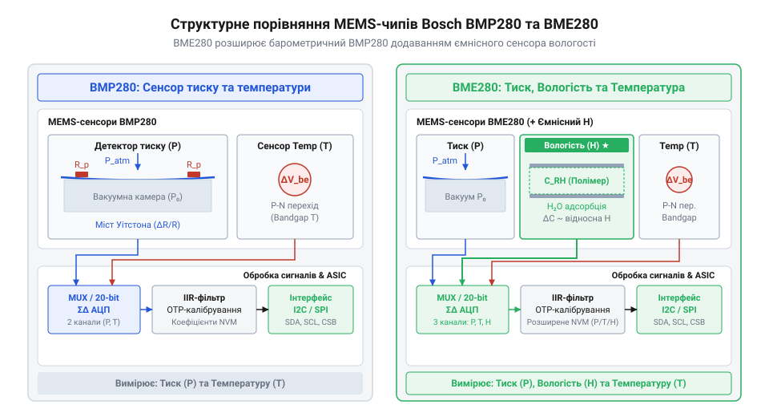
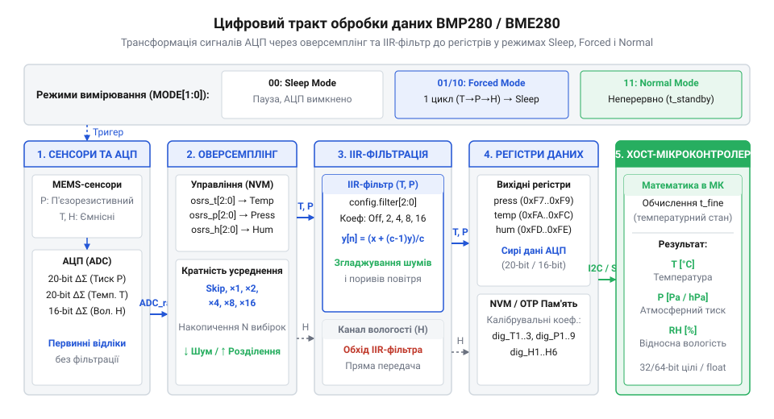
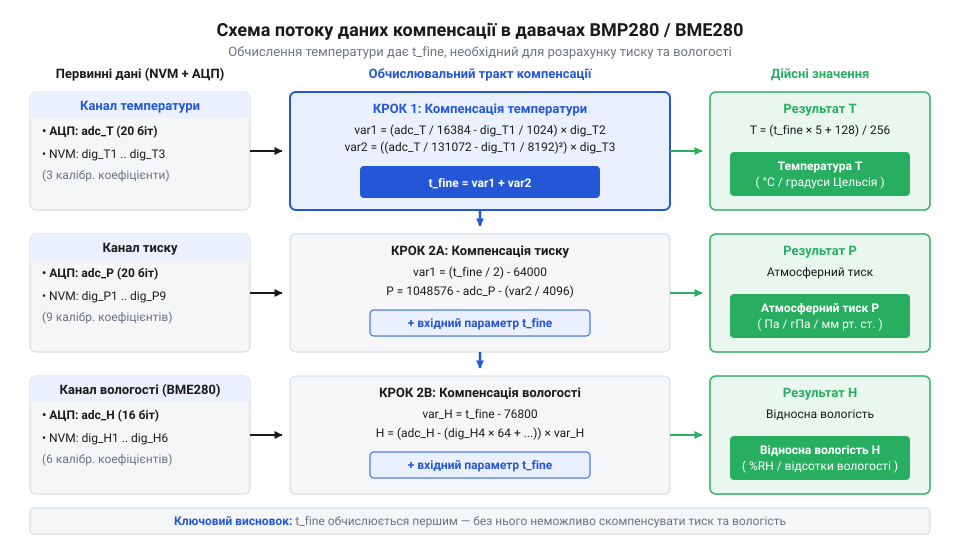
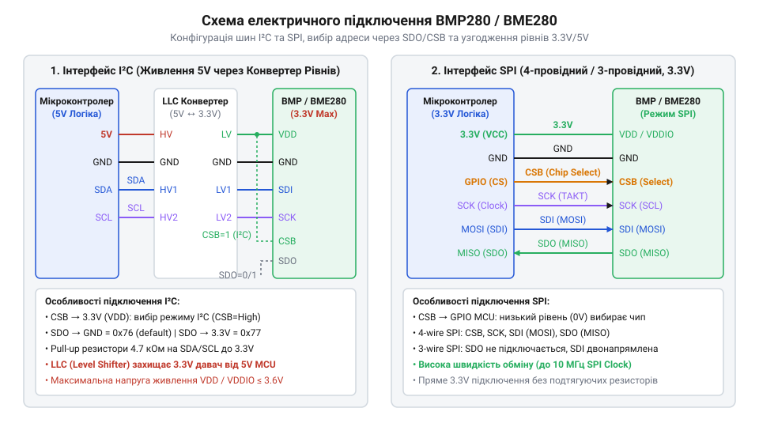
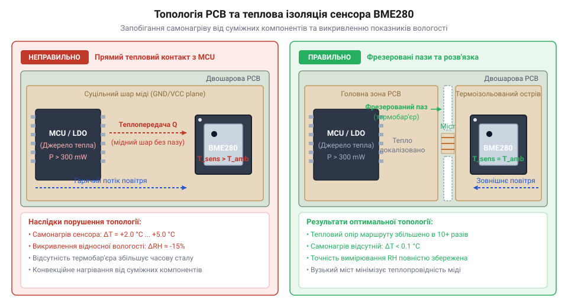

# Родина мікрокліматичних давачів Bosch BMP280 та BME280

<preknowlist>
- [GY-68 / BMP180 — барометр (тиск, висота)](root:cat-hw-sensors/gy-bmp180) — базові принципи вимірювання атмосферного тиску та висотометрії у цифрових MEMS-барометрах попередніх поколінь Bosch
- [GY-BMP280 — барометр/висотомір (BMP280)](root:cat-hw-sensors/gy-bmp280) — базову схемотехніку готових модулів BMP280 та первинні навички роботи з барометричними даними
</preknowlist>

## Чому метеостанція отримує викривлені покази

Уявіть типову ситуацію при розробці автономного метеовузла: ви зібрали макетний зразок, підключили новий мікрокліматичний сенсор до мікроконтролера та написали простий код для прямих вимірювань. Проте опівдні, коли сонце починає прогрівати корпус пристрою, обчислений атмосферний тиск раптово падає на величину, що відповідає стрибку висоти на 30 метрів, а покази відносної вологості починають хаотично коливатися. Навколишня погода при цьому лишається абсолютно незмінною.

Головна причина таких викривлень полягає в хибному припущенні, ніби цифровий давач одразу видає готові значення фізичних величин — паскалі, градуси Цельсія чи відсотки вологості. У дійсності первинні дані, які зчитуються з регістрів чипа через @@en|ADC@@ (аналого-цифровий перетворювач, англ. *analog-to-digital converter*, @@en|ADC@@), являють собою лише сирі цифрові коди. Ці коди відображають мікроскопічні механічні деформації та зміни електричної ємності всередині структури @@en|MEMS@@ (мікроелектромеханічні системи; грец. *μικρός* — малий + *ἤλεκτρον* — бурштин + *μηχανική* — мистецтво будувати машини, @@en|Microelectromechanical Systems@@).

Щоб зрозуміти джерело похибок, необхідно розібрати внутрішню фізичну будову кристала компанії @@de|Bosch Sensortec@@. Барометричні давачі серії BMP280 та BME280 спираються на п'єзорезистивний ефект (грец. *πιέζειν* — тиснути + лат. *resistere* — чинити опір, @@en|piezoresistive effect@@). Напівпровідникова мембрана з тонкого кремнію підвішена над герметичною евакуйованою порожниною, що слугує опорним вакуумом. У краї цієї мембрани імплантовано чотири п'єзорезистори, з'єднані за схемою вимірювального моста Уітстона. Коли зовнішній атмосферний тиск тисне на мембрану, вона прогинається, викликуючи механічні напруження у кристалічній ґратці кремнію. Це змінює питомий електричний опір п'єзорезисторів, створюючи пропорційну різницю потенціалів на діагоналі моста.

Основна фізична пастка п'єзорезистивного методу — екстремальна залежність механічних та електричних властивостей напівпровідників від температури. Модуль пружності кремнію та опір імплантованих п'єзорезисторів змінюються при кожному коливанні температури навколишнього середовища. Зміна температури на 10 °C викликає температурне розширення матеріалу та зміщення нульової точки моста, що без математичної корекції призводить до колосального дрейфу вихідного коду тиску.

У чипі BME280 розробники пішли далі та додали інтегрований ємнісний сенсор вологості (грец. *χωρητικότητα* — місткість, @@en|capacitive humidity sensor@@). Його осередок складається з нижнього суцільного електрода, пористого полімерного діелектрика та верхнього паропроникного металевого електрода. Молекули водяної пари з повітря вільно дифундують у пори полімерного шару шляхом сорбції (лат. *sorbere* — поглинати, @@en|sorption@@). Оскільки відносна діелектрична проникність (лат. *permittere* — дозволяти, @@en|dielectric permittivity@@) води досягає ≈ 80, а сухого полімеру становить лише 3–4, поглинання вологи пропорційно збільшує загальну ємність мікроконденсатора. Проте цей процес супроводжується суттєвим температурним зсувом: зі зростанням температури хаотичний тепловий рух перешкоджає орієнтації диполів води в електричному полі, що знижує ефективну проникність діелектрика, а зміщення термодинамічної рівноваги прискорює десорбцію вологи. Крім того, при тривалій експлуатації та циклічних коливаннях вологості полімерна матриця зазнає повторного механічного набухання й усадки. Це призводить до накопичення мікродеформацій у ланцюгах полімеру, через що виникає гістерезис (грец. *ὑστέρησις* — запізнення, @@en|hysteresis@@) показів залежно від напрямку зміни вологості, а деградація пористої структури спричиняє незворотний дрейф нульового рівня ємності. Детальніше про фізико-хімічні механізми сорбції та діелектричної поляризації пористих плівок читайте у матеріалі про [фізику ємнісних вимірювачів вологості в MEMS](root:hw-sensing/capacitive-humidity-sensor).


*Внутрішня MEMS-структура чипів BMP280 та BME280: п'єзорезистивна мембрана тиску на кремнієвій підкладці та ємнісний сенсор вологості з пористим полімерним діелектриком.*

Історично [еволюція барометричних давачів Bosch](root:cat-hw-sensors/bmp280-bme280-sensor-family/hist-bosch-mems-baro-evolution.md) пройшла шлях від великогабаритних керамічних модулів до надкомпактних чипів у корпусі LGA. Якщо у застарілих [модулях барометрів BMP180](root:cat-hw-sensors/gy-bmp180) розробники стикалися з високим рівнем власного шуму, то сучасні сімейства чипів, які застосовуються на [готових платах BMP280](root:cat-hw-sensors/gy-bmp280), оперують значно детальнішим цифровим трактом.

Кожен окремий кристал BMP280 та BME280 ще під час виготовлення на заводі проходить тестове калібрування в барокамерах при різних температурах. Індивідуальні математичні коефіцієнти компенсації відхилень випалюються у вбудованій енергонезалежній пам'яті @@en|NVM@@ (англ. *non-volatile memory*, @@en|NVM@@) або @@en|OTP@@ (англ. *one-time programmable*, @@en|OTP@@). Зчитувані 20-бітні коди АЦП температури `ut`, тиску `up` та вологості `uh` самі по собі не мають фізичного змісту. Лише після об'єднання цих кодів із заводськими коефіцієнтами пам'яті NVM за алгоритмами, описаними в [математичній компенсації первинних даних АЦП](root:cat-hw-sensors/bmp280-bme280-sensor-family/math-bmp280-bme280-compensation-math.md), розробник отримує дійсне значення тиску в паскалях та вологості у відсотках. Базовою ланкою цього розрахунку є обчислення температурного фактора `t_fine`, який компенсує дрейф п'єзорезистивної та ємнісної структур одночасно.

Загальні можливості цієї лінійки компонентів детальніше описані в [огляді мікрокліматичних давачів Bosch](root:cat-hw-sensors/bosch-sensortec-mems-family-overview).

## Налаштування цифрового тракту та режимів вимірювання

Після опанування первинного зчитування калібрувальних коефіцієнтів розробник стикається з наступним бар'єром: високим рівнем високочастотного шуму вимірювань тиску та надмірним енергоспоживанням. При безперервному зчитуванні первинних даних покази атмосферного тиску можуть флуктувати в межах ±15...20 Па. У висотометрії це створює помилкове «плавання» обчисленої висоти на ±1.5...2 метри навіть тоді, коли прилад лежить нерухомо на столі. Одночасно з цим постійно працюючий АЦП споживає струм сотні мікроампер, що робить пристрій непридатним для тривалої роботи від батареї.

Усунення цих двох проблем покладено на внутрішній цифровий тракт обробки даних, інтегрований у кристал давача. 

Першим етапом цифрового тракту є оверсемплінг (англ. *sample* — брати зразок, @@en|oversampling@@) — усереднення серії послідовних вибірок АЦП перед записом результату в вихідні регістри. Модуль АЦП давача дозволяє незалежно налаштовувати кратність оверсемплінгу `OSRS` для температури (`osrs_t`), тиску (`osrs_p`) та вологості (`osrs_h`) у межах від `×1` до `×16` (або вимикати вимірювання `×0`).

Закони математичної статистики визначають, що при усередненні `N` незалежних вимірювань із білим шумом середньоквадратичне відхилення (англ. *root mean square*, @@en|RMS noise@@) зменшується пропорційно квадратному кореню `√OSRS` з кількості вибірок.

Обчислимо коефіцієнт зниження середньоквадратичного шуму `K_noise` залежно від обраного кратності оверсемплінгу `OSRS` за допомогою квадратного кореня від кількості вибірок:

```
K_noise = 1 / √OSRS
        = 1 / √16                 [підстановка максимального оверсемплінгу OSRS = 16]
        = 1 / 4                   [обчислення кореня]
        = 0.25                    [остаточний коефіцієнт шуму]
```

Завдяки оверсемплінгу `×16` рівень власного шуму АЦП тиску знижується у 4 рази — з ~3.3 Па до ~0.8 Па RMS. Це дозволяє досягти чутливості висотоміра до 7 см, що цілком можна порівняти з показниками, які мають [прецизійні давачі MS5611](root:cat-hw-sensors/gy-63). Проте підвищення кратності оверсемплінгу збільшує тривалість активного вимірювального циклу та енергоспоживання.

Другим етапом обробки є вбудований рекурсивний IIR-фільтр (англ. *infinite impulse response* — нескінченна імпульсна відповідь, @@en|IIR filter@@). На відміну від оверсемплінгу, який працює всередині одного вимірювального такту АЦП, IIR-фільтр виконує згладжування послідовних вимірювань у часі за математичною формулою першого порядку:

```
data_filtered = (data_filtered_prev * (coef - 1) + data_raw) / coef
```

Коефіцієнт фільтрації задається значеннями `filter = OFF, 2, 4, 8, 16`. Внутрішній IIR-фільтр ефективно пригнічує різкі короткочасні сплески тиску, викликані протягами в приміщенні, відчиненням дверей чи поривами вітру, не навантажуючи обчислювальне ядро зовнішнього мікроконтролера. Більш детальний аналіз математичних властивостей цифрової фільтрації у вбудованих системах можна знайти в [рекурсивному IIR-фільтруванні в давачах](root:com-signal/iir-filter).

Третьою складовою керування цифровим трактом є вибір режиму роботи (@@en|operating modes@@). Давачі BMP280 та BME280 підтримують три основні режими (@@en|Sleep mode@@, @@en|Forced mode@@ та @@en|Normal mode@@), однак вибір режиму тісно пов'язаний із часом, який внутрішній АЦП витрачає на повне вимірювання всіх увімкнених каналів. Апаратний цикл опитування складається з ініціалізації чипа, вимірювання температури, тиску та вологості. Загальний максимальний час активної фази вимірювання `t_measure_max` у мілісекундах визначається сумою початкової затримки стабілізації 1.25 мс, тривалості обробки температури (2.3 мс на кожен крок оверсемплінгу `osrs_t`), а також часу вимірювання тиску та вологості. Для тиску й вологості кожен крок оверсемплінгу додає 2.3 мс, до яких приєднується фіксована затримка перемикання каналу 0.575 мс (якщо відповідний оверсемплінг `osrs_p` або `osrs_h` не дорівнює нулю; для барометра BMP280 складова вологості відсутня).

Обчислимо точний час активного вимірювального такту `t_measure_max` з обраних коефіцієнтів оверсемплінгу за формулою з документації Bosch:

**Розрахунок тривалості активного вимірювального такту BME280**
```
t_measure_max = 1.25 + 2.3 * osrs_t + (2.3 * osrs_p + 0.575) + (2.3 * osrs_h + 0.575)
              = 1.25 + 2.3 * 2 + (2.3 * 16 + 0.575) + (2.3 * 1 + 0.575)
              = 1.25 + 4.6 + (36.8 + 0.575) + (2.3 + 0.575) [підстановка коефіцієнтів оверсемплінгу]
              = 1.25 + 4.6 + 37.375 + 2.875                 [обчислення проміжних сум]
              = 46.1                                        [остаточний час у мілісекундах]
```

Отриманий час 46.1 мс показує ціну високої точності: оверсемплінг тиску `×16` займає понад 80% усього вимірювального такту. У режимі однократного вимірювання (@@en|Forced mode@@) мікроконтролер мусить витримати цю паузу перед зчитуванням регістрів даних, інакше він прочитає застарілі або неоновлені значення АЦП. У режимі безперервного опитування (@@en|Normal mode@@) тривалість `t_measure_max` визначає нижню фізичну межу періоду повторення кадрів, до якої додається вибрана затримка паузи (англ. *standby*, @@en|standby time@@) `t_standby`.

1. **Sleep mode (@@en|Sleep mode@@)**: Режим зниженого споживання, у якому давач перебуває одразу після подачі живлення. Схема вимірювань вимкнена, струм споживання не перевищує 0.1 мкА, але регістри I2C/SPI залишаються доступними для зчитування й запису конфігурації. 2. **Forced mode (@@en|Forced mode@@)**: Режим однократного вимірювання. Мікроконтролер відправляє команду початку вимірювання, чип виконує один послідовний цикл оверсемплінгу температури, тиску й вологості, зберігає результати в регістри даних і автоматично повертається в Sleep mode. Це ідеальний вибір для автономних пристроїв із низьким опитуванням. 3. **Normal mode (@@en|Normal mode@@)**: Режим безперервного циклічного опитування. Сенсор автоматично чергує активну фазу вимірювань із фазою очікування Standby (`t_standby` від 0.5 мс до 1000 мс). Цей режим застосовують у системах реального часу, таких як польотні контролери дронів чи навігатори.


*Цифровий тракт обробки даних BMP280/BME280: проходження первинних вимірювань через оверсемплінг та IIR-фільтрацію в режимах Sleep, Forced та Normal.*

Практичне конфігурування режимів та фільтрів здійснюється через відповідні біти, які описують [описові карти регістрів чипа](root:cat-hw-sensors/bmp280-bme280-sensor-family/api-bmp280-bme280-register-map.md) у регістрах `ctrl_meas` (`0xF4`), `config` (`0xF5`) та `ctrl_hum` (`0xF2`).

При [проектуванні автономного мікрокліматичного вузла](root:cat-hw-sensors/bmp280-bme280-sensor-family/proj-bme280-low-power-weather-node.md) оптимізація цифрового тракту шляхом вибору `Forced mode` із помірним оверсемплінгом дозволяє мінімізувати середній струм споживання до одиниць мікроампер.

Нижче наведено приклад програмної конфігурації цифрового тракту BME280 для режиму циклічного моніторингу довкілля (Standby = 1000 мс, Filter = x4, Oversampling T = x2, P = x16, H = x1).

:::tabs
:::code bmp280-bme280-sensor-family-d/cpp/arduino/setupbme280digitalpipeline.cpp

:::code bmp280-bme280-sensor-family-d/c/esp-idf/bme280-write-reg.c
:::

## Калібрувальні коефіцієнти та компенсація даних АЦП

Коли мікроконтролер вперше зчитує вихідні регістри давача BMP280 або BME280, розробник отримує 20-бітні цифрові значення `adc_T = 519888` та `adc_P = 415148`. Проте спроба перетворити ці числа на фізичні значення температури чи атмосферного тиску шляхом простого ділення на фіксований коефіцієнт одразу зазнає невдачі. Якщо взяти два сусідні чипи з однієї заводської пластини й помістити їх в однакові умови, їхні сирі коди @@en|ADC@@ (аналого-цифровий перетворювач, англ. *analog-to-digital converter*, @@en|ADC@@) суттєво відрізнятимуться.

Ця розбіжність виникає через технологічні допуски мікромеханічного виробництва: незначні варіації товщини кремнієвої мембрани, залишкове механічне напруження корпусу чипа, розкид опору моста Уітстона та температурну залежність напівпровідників. Оскільки кремнієві п'єзорезистори мають високий температурний коефіцієнт опору, зміна температури кристала на кілька градусів викликає зсув нульової точки тиску, що без корекції створює помилковий дрейф обчисленої висоти.

Для вирішення цієї проблеми компанія @@de|Bosch Sensortec@@ застосовує індивідуальне фабричне калібрування кожного екземпляра чипа. Під час виготовлення сенсор вміщують у калібрувальну камеру з точно відомими еталонними значеннями температури й тиску, вимірюють його реальний відгук та обчислюють математичні коефіцієнти компенсації нелінійності. Ці значення назавжди записуються у вбудовану енергонезалежну пам'ять @@en|NVM@@ або @@en|OTP@@.

Таблиця калібрувальних коефіцієнтів розміщується в регістровому просторі пам'яті й складається з констант різного типу та розрядності:

1. **Коефіцієнти температури**: `dig_T1` (беззнакове `uint16_t`, адреси `0x88..0x89`), `dig_T2` (знакове `int16_t`, адреси `0x8A..0x8B`), `dig_T3` (знакове `int16_t`, адреси `0x8C..0x8D`). 2. **Коефіцієнти тиску**: `dig_P1` (беззнакове `uint16_t`, адреси `0x8E..0x8F`), `dig_P2..dig_P9` (знакові `int16_t`, адреси `0x90..0x9F`). 3. **Коефіцієнти вологості (лише BME280)**: `dig_H1` (`uint8_t`, адреса `0xA1`), `dig_H2` (`int16_t`, адреси `0xE1..0xE2`), `dig_H3` (`uint8_t`, адреса `0xE3`), `dig_H4` та `dig_H5` (знакові `int16_t`, упаковка по 12 бітів у регістри `0xE4..0xE6`), `dig_H6` (знакове `int8_t`, адреса `0xE7`).

Головною архітектурною деталлю компенсаційного тракту є те, що вимірювання тиску й вологості неможливо виконати уривчасто, без попереднього обчислення температури. Оскільки п'єзорезистивний мостик тиску та ємнісний полімер вологості зазнають постійного температурного впливу, первинні дані `adc_P` та `adc_H` є функціями двох змінних — вимірюваної величини та температури кристала.

Математичний алгоритм спочатку обробляє сирий код `adc_T` та обчислює проміжну змінну високої роздільної здатності `t_fine`. Цей фактор являє собою компенсовану температуру кристала в сотих частках градуса Цельсія й слугує опорним параметром для подальшого зняття температурного дрейфу з каналів тиску та вологості.


*Схема потоку даних компенсації в давачах BMP280/BME280: послідовне обчислення температурного фактора t_fine з наступною корекцією тиску та відносної вологості.*

Для використання на мікроконтролерах без апаратної підтримки чисел із плаваючою крапкою (англ. *floating point unit*, @@en|FPU@@) розробники Bosch розробили цілочисельні алгоритми на базі побітових зсувів.

Спочатку визначимо вираз для обчислення температурного фактора `t_fine` та кінцевої температури `T` у сотих частках градуса Цельсія з 20-бітного коду `adc_T` та констант `dig_T1..T3`:

```
var1 = (((adc_T >> 3) - ((int32_t)dig_T1 << 1)) * (int32_t)dig_T2) >> 11
var2 = (((((adc_T >> 4) - (int32_t)dig_T1) * ((adc_T >> 4) - (int32_t)dig_T1)) >> 12) * (int32_t)dig_T3) >> 14
t_fine = var1 + var2
T = (t_fine * 5 + 128) >> 8
```

Після обчислення `t_fine` отримане значення підставляють у формули компенсації тиску разом із коефіцієнтами `dig_P1..P9`. Для запобігання переповненню під час множення intermediate-значень у формулах тиску застосовують 64-бітну арифметику `int64_t`.

Здійснимо покроковий розрахунок на конкретному математичному прикладі.

**Обчислення температурного компенсаційного фактора t_fine та фізичної температури T:**
Припустимо, що з регістрів чипа зчитано значення `adc_T = 519888`, а з NVM-пам'яті зчитано коефіцієнти `dig_T1 = 27504`, `dig_T2 = 26435` та `dig_T3 = -1000`:

```
adc_T_shift = adc_T >> 3
            = 519888 >> 3
            = 64986                          [зсув первинного коду АЦП на 3 біти]

dig_T1_shift = (int32_t)dig_T1 << 1
             = 27504 << 1
             = 55008                         [масштабування першого калібрувального коефіцієнта]

diff1 = adc_T_shift - dig_T1_shift
      = 64986 - 55008
      = 9978                                 [лінійна різниця первинного коду]

var1 = (diff1 * (int32_t)dig_T2) >> 11
     = (9978 * 26435) >> 11
     = 263768430 >> 11
     = 128793                                [обчислення лінійного члена var1]

term1 = (adc_T >> 4) - (int32_t)dig_T1
      = (519888 >> 4) - 27504
      = 32493 - 27504
      = 4989                                 [різниця для параболічної складової]

term2 = (term1 * term1) >> 12
      = (4989 * 4989) >> 12
      = 24890121 >> 12
      = 6076                                 [квадратична нормована складова]

var2 = (term2 * (int32_t)dig_T3) >> 14
     = (6076 * (-1000)) >> 14
     = -6076000 >> 14
     = -370                                  [обчислення нелінійного члена var2]

t_fine = var1 + var2
       = 128793 + (-370)
       = 128423                              [підсумковий температурний фактор t_fine]

T_centi = (t_fine * 5 + 128) >> 8
        = (128423 * 5 + 128) >> 8
        = 642243 >> 8
        = 2508                               [температура у сотих частках °C]
```

Отриманий результат `2508` відповідає дійсній температурі кристала `25.08 °C`. Обчислений фактор `t_fine = 128423` передається у вирази компенсації тиску та вологості, знімаючи температурну залежність первинних вимірювальних комірок.

Повний перелік 64-бітних цілочисельних та плаваючих виразів для тиску й вологості наведено у матеріалі про [математичну компенсацію первинних даних](root:cat-hw-sensors/bmp280-bme280-sensor-family/math-bmp280-bme280-compensation-math.md). Точні адреси регістрів пам'яті калібрування згруповано у [карті регістрів чипа](root:cat-hw-sensors/bmp280-bme280-sensor-family/api-bmp280-bme280-register-map.md).

Нижче наведено практичний код зчитування калібрувальних коефіцієнтів із пам'яті NVM та обчислення компенсованих значень температури й тиску.

:::tabs
:::code bmp280-bme280-sensor-family-d/cpp/arduino/bme280-calibdata.cpp

:::code bmp280-bme280-sensor-family-d/c/esp-idf/bme280-read-calib.c
:::

## Вибір шини обміну та електричне підключення

Під час спроби підключити сенсор BMP280 чи BME280 до плати мікроконтролера розробники часто стикаються з апаратними збоями: шина @@en|I2C@@ (англ. *Inter-Integrated Circuit* — міжмікросхемна шина, @@en|I2C@@) взагалі не відповідає на запити, адреса пристрою «зникає», дані по шині @@en|SPI@@ (англ. *Serial Peripheral Interface* — послідовний периферійний інтерфейс, @@en|SPI@@) зчитуються як суцільні одиниці, або сенсор виходить із ладу після прямого підключення до 5-вольтової платформи.

Для уникнення цих помилок необхідно чітко розуміти апаратну логіку обміну даними та вимоги до живлення чипа.

Давачі BMP280 та BME280 є двопротокольними пристроями й підтримують роботу через інтерфейси I2C та SPI. Перемикання між ними здійснюється апаратно за допомогою стану виводу `CSB` (англ. *Chip Select Bar*, @@en|CSB@@):

1. **Режим I2C**: Якщо при включенні живлення вивід `CSB` підтягнутий до шини живлення `VDDIO` (або залишений незадіяним із внутрішньою підтяжкою), чип автоматично активує інтерфейс I2C. У цьому режимі вивід `SDO` (англ. *Serial Data Out*, @@en|SDO@@) слугує для вибору 7-бітної адреси на шині. З'єднання `SDO` з `GND` задає адресу `0x76`, а з'єднання з `VDDIO` змінює її на `0x77`. Це дає змогу розміщувати два однакові чипи на одній шині I2C без конфліктів. 2. **Режим SPI**: Якщо мікроконтролер притискає вивід `CSB` до низького рівня `GND`, сенсор перемикається в режим SPI. Давач підтримує 4-провідний SPI (лінії `CSB`, `SCK`, `SDI`, `SDO`) та 3-провідний SPI (де лінія `SDI` працює як напівдуплексний канал). Протокол підтримує режими SPI `MODE 0,0` та `MODE 1,1` зі швидкістю тактування до 10 МГц. SPI є ідеальним вибором для високошвидкісних польотних контролерів, де затримка зчитування тиску критична для стабілізації.

Другим критичним фактором є узгодження електричних рівнів живлення та сигнальних ліній. Номінальна напруга живлення ядра чипа `VDD` становить від 1.71 В до 3.6 В, а напруга цифрових баферів `VDDIO` — від 1.2 В до 3.6 В. На типових платах розширення обидва виводи об'єднані та розраховані на 3.3 В.

Підключення чипа безпосередньо до 5-вольтових мікроконтролерів (наприклад, Arduino Uno чи Mega) створює смертельну загрозу для сенсора. Подача напруги 5 В на лінії `SDA`/`SCL` викличе протікання струму через внутрішні захисні @@en|ESD@@-діоди (англ. *electrostatic discharge*, @@en|ESD@@) чипа, викликаючи паразитно-тепловий нагрів кристала або його фізичний пробій.

Для безпечного узгодження 3.3 В та 5 В логіки застосовують двонапрямлені транзисторні конвертери рівнів (англ. *level shifter*, @@en|level shifter@@) на польових транзисторах. Лінії I2C також вимагають підтягуючих резисторів (англ. *pull-up resistor*, @@en|pull-up@@) номіналом 4.7 кОм до шини 3.3 В з боку сенсора та до 5 В з боку мікроконтролера. Для фільтрації високочастотних завад живлення безпосередньо біля виводу `VDD` встановлюють керамічний декуплюючий конденсатор ємністю 100 нФ.


*Принципова схема підключення BMP280/BME280: конфігурація виводів CSB та SDO для вибору режимів I2C/SPI, підтяжка ліній даних та узгодження 3.3 В і 5 В логіки.*

Детальний схемотехнічний розбір сигнальних ланцюгів та корпусування LGA наведено в матеріалі про [апаратний інтерфейс та схемотехніку](root:cat-hw-sensors/bmp280-bme280-sensor-family/api-bmp280-bme280-hardware-interface.md).

Завершальним етапом проектування пристрою є фізичний монтаж сенсора на друкованій платі @@en|PCB@@ (англ. *printed circuit board*, @@en|PCB@@). Багато розробників припускаються грубої помилки, розміщуючи чип BME280 поряд із лінійними стабілізаторами напруги (наприклад, AMS1117), силовими транзисторами чи гарячим мікроконтролером (ESP32 / STM32).

Тепло від суміжних компонентів передається через мідні провідники та матеріал плати @@en|FR-4@@ (англ. *Flame Retardant 4*, @@en|FR-4@@), викликаючи паразитно-тепловий самонагрів (англ. *self-heating*, @@en|self-heating@@) кристала на +2...5 °C вище температури навколишнього повітря. Це призводить до катастрофічного спотворення вимірювань відносної вологості: при нагріванні повітря всередині осередку сенсора його відносна вологість експоненційно падає, навіть якщо абсолютний вміст вологи в кімнаті не змінився.

Для запобігання тепловому дрейфу та спотворенню вимірювань дотримуються трьох правил топології PCB:

1. **Теплові ізоляційні вирізи**: Навколо корпусу сенсора виконують фрезеровані пази у склотекстоліті (англ. *milled slots*, @@en|milled slots@@), залишаючи лише вузький місток для сигнальних доріжок. Це розриває суцільні мідні полігони й зупиняє передачу тепла від гарячої зони плати. 2. **Просторова ізоляція**: Сенсор розміщують на крайній винесеній консолі або окремій дочірній платі, якнайдалі від джерел випромінювання тепла. 3. **Захист від прямого обдування**: Порт вимірювання тиску та вологості захищають від прямих повітряних потоків (протяги, вентилятори, гвинти квадрокоптера), які створюють динамічні стрибки тиску за законом Бернуллі. Для цього застосовують захисні мембрани з пористого @@en|PTFE@@ (політетрафторетилен, англ. *polytetrafluoroethylene*, @@en|PTFE@@).


*Топологія друкованої плати для BME280: мінімізація теплового самонагріву через фрезеровані ізоляційні вирізи та захист вимірювального порту від прямого обдування.*

Як реалізуються ці принципи при побудові реальних пристроїв, можна прочитати у матеріалі про [розробку автономного мікрокліматичного вузла](root:cat-hw-sensors/bmp280-bme280-sensor-family/proj-bme280-low-power-weather-node.md).

З принципами узгодження сигналів можна додатково ознайомитися у статті про [конвертер рівнів у шинах](root:hw-digital/mosfet-level-shifter), а схемотехніка популярних модулів представлена на [готових платах BMP280](root:cat-hw-sensors/gy-bmp280), що входить у загальний [огляд мікрокліматичних давачів Bosch](root:cat-hw-sensors/bosch-sensortec-mems-family-overview).

## Фізичне розміщення та запобігання системним похибкам

Розробник збирає вимірювальний прилад, завантажує перевірену прошивку й отримує первинні коди з кристала. Проте після монтування друкованої плати у герметичний або компактний корпус виявляється аномалія: зчитана температура завищується на 1.5–4.0 °C, а відносна вологість виявляється суттєво нижчою за реальну кімнатну. Навіть коли повністю виконано [математичну компенсацію даних](root:cat-hw-sensors/bmp280-bme280-sensor-family/math-bmp280-bme280-compensation-math.md) із використанням заводських коефіцієнтів, показання дрейфують. Причина полягає не у збої обчислень чи дефекті мікросхеми, а у недотриманні фізичних правил топологічного розведення та теплового ізолювання давачів @@en|BMP280@@ та @@en|BME280@@.

Головним джерелом температурних викривлень є паразитне передавання тепла від суміжних електронних компонентів та власне самонагрівання кристала. Мікроконтролери, бездротові модулі, лінійні стабілізатори напруги @@en|LDO@@ (від @@en|Low Dropout@@ — лінійний стабілізатор напруги з малим падінням) та силові транзистори під час роботи виділяють теплову потужність. Матеріал друкованої плати @@en|PCB@@ (від @@en|Printed Circuit Board@@ — друкована плата) на основі склотекстоліту @@en|FR-4@@ (від @@en|Flame Retardant 4@@ — композитний текстоліт) має низьку теплопровідність (близько 0.3 Вт/(м·К)), проте внутрішні мідні полігони та контактні доріжки володіють високою теплопровідністю (близько 385 Вт/(м·К)). Мідні провідники працюють як ефективні теплові мости, якими тепловий потік від гарячих елементів досягає виводів корпусу @@en|LGA@@ (від @@en|Land Grid Array@@ — масив пласких контактних майданчиків) давача.

Інтенсивність кондуктивної передачі тепла вздовж друкованої плати підпорядковується закону Фурьє:

```
Q = (λ × A / L) × (T_hot - T_sensor)
```

У цій формулі `Q` позначає потужність теплового потоку (Вт), що передається до давача; `λ` — коефіцієнт теплопровідності матеріалу (Вт/(м·К)); `A` — площа поперечного перерізу мідних доріжок та текстоліту (м²); `L` — довжина теплового шляху (м); `T_hot - T_sensor` — різниця температур між джерелом нагріву та корпусом сенсора (К). Якщо під корпусом @@en|LGA@@ залишено суцільний шар мідного полігону заземлення, параметр `A` стає великим, а тепловий опір шляху падає, що спричиняє швидкий нагрів кристала.

Окрім зовнішніх джерел тепла, існує внутрішній самонагрів обчислювальної схеми @@en|ASIC@@ (від @@en|Application-Specific Integrated Circuit@@ — спеціалізована інтегральна схема). У режимі @@en|Normal mode@@ за максимальної частоти повторення вимірювань і нульової затримки @@en|Standby time@@ середня споживана потужність мікросхеми досягає 2.5 мВт. Через високий внутрішній тепловий опір малогабаритного корпусу @@en|LGA@@ (понад 100 К/Вт) цей струм підвищує температуру кремнієвого кристала на 0.2–0.4 °C відносно довкілля.

Завищення температури кристала безпосередньо спотворює вимірювання відносної вологості в @@en|BME280@@. Відносна вологість виражає відношення поточного парціального тиску водяної пари до тиску насиченої пари за даної температури. Оскільки тиск насичення зростає експоненціально зі зростанням температури за рівнянням Магнуса, локальний нагрів сенсорного елемента навіть на 1 °C зменшує обчислену вологість на 3–4%.

```
e_s(T) = 6.112 × exp((17.67 × T) / (T + 243.5))
e_s(20.0) = 6.112 × exp(353.4 / 263.5)
          = 6.112 × exp(1.3412)
          = 23.38 hPa                       [насичена пружність за 20.0 °C]

RH_true = (e / e_s(20.0)) × 100%
        = (11.69 / 23.38) × 100%
        = 50.0%                            [дійсна відносна вологість]

e_s(22.0) = 6.112 × exp(388.74 / 265.5)
          = 6.112 × exp(1.4642)
          = 26.44 hPa                       [насичена пружність сенсора за 22.0 °C]

RH_measured = (e / e_s(22.0)) × 100%
            = (11.69 / 26.44) × 100%
            = 44.2%                        [спотворене значення вологості]
```

З наведеного обчислення видно, що штучний нагрів кристала на +2.0 °C при сталому вмісті вологи в повітрі занижує виміряну вологість із 50.0% до 44.2%. Додатковим чинником похибок є динамічні повітряні потоки. Пряме обдмухування давача вентилятором створює локальне падіння статичного тиску за законом Бернуллі, імітуючи зміну висоти. Для згладжування таких спотворень у цифровому тракті застосовують налаштування [рекурсивного IIR-фільтрування](root:com-signal/iir-filter), проте первинне усунення похибок вимагає топологічної ізоляції.

Щоб мінімізувати кондуктивний нагрів, кристал @@en|BMP280@@ або @@en|BME280@@ виносять на край друкованої плати, якомога далі від мікроконтролерів та елементів живлення. Суцільні мідні полігони земляних і живильних шарів повністю вирізають під корпусом давача на всіх внутрішніх та зовнішніх шарах @@en|PCB@@. Контактні площадки @@en|LGA@@ під'єднують тонкими сигнальними доріжками мінімально припустимої ширини, створюючи високий тепловий опір.


*Конструкція топологічного ізолювання LGA-корпусу із застосуванням фрезерованих пазів та звужених теплових містків для мінімізації кондуктивного самонагріву.*

Найефективнішим методом кондуктивної ізоляції є фрезеровані пази у текстоліті навколо зони монтажу мікросхеми. Повітря у відкритому пазу має коефіцієнт теплопровідності близько 0.026 Вт/(м·К), що у 10 разів нижче за склотекстоліт @@en|FR-4@@ і на чотири порядки нижче за мідь. Завдяки пазам давач розташовується на ізольованому «острівці», з'єднаному з основною платою лише вузьким перешийком. Опис електричного розведення сигналів та підключення [апаратного інтерфейсу та схемотехніки](root:cat-hw-sensors/bmp280-bme280-sensor-family/api-bmp280-bme280-hardware-interface.md) визначає правила побудови таких ізоляційних бар'єрів.

Не менш важливою є геометрія захисного корпусу пристрою. У закритому приладі нагріте електронікою повітря піднімається вгору за рахунок природної пасивної конвекції. З цієї причини давач завжди розміщують у найнижчій точці корпусу, під джерелами тепла. Всередині корпусу встановлюють глуху перегородку, яка фізично відокремлює відсік із вимірювальним чипом від відсіку з гарячим мікроконтролером та стабілізатором.

Зовнішній повітряобмін забезпечують через вентиляційні отвори у формі жалюзі на бічних та нижніх гранях корпусу. Вони формують природну вентиляційну тягу й одночасно блокують пряме інфрачервоне випромінювання та сонячне світло, яке при попаданні на металеву кришку @@en|LGA@@ викликає радіаційний нагрів silicon-кристала.

На програмному рівні під час розробки [автономного мікрокліматичного вузла](root:cat-hw-sensors/bmp280-bme280-sensor-family/proj-bme280-low-power-weather-node.md) власне самонагрівання усувають переведенням цифрового тракту з безперервного режиму @@en|Normal mode@@ у циклічний режим @@en|Forced mode@@. Зняття вимірювань один раз на 10–60 секунд з наступним переходом у стан глибокого сну знижує середню споживану потужність до мікроват. Для компактних систем або при використанні готових модулів [популярного сімейства GY-BMP280](root:cat-hw-sensors/gy-bmp280) дотримання цих конструктивних норм забезпечує граничну паспортну точність вимірювання температури, тиску та вологості. У розрізі загального [розвитку MEMS-давачів Bosch](root:cat-hw-sensors/bmp280-bme280-sensor-family/hist-bosch-mems-baro-evolution.md) саме поєднання досконалої сенсорної структури з правильним апаратним монтажем уможливлює прецизійну роботу мікрокліматичної автоматики.