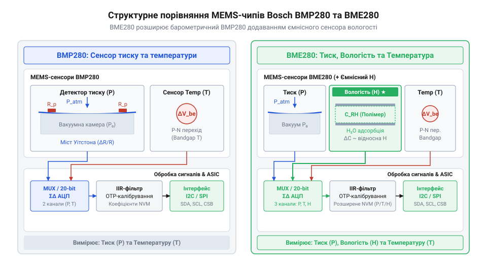
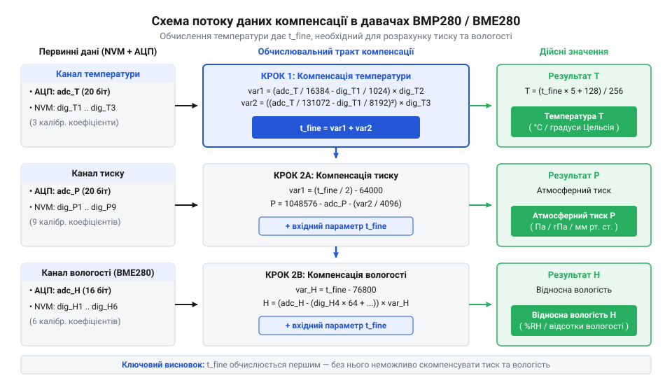
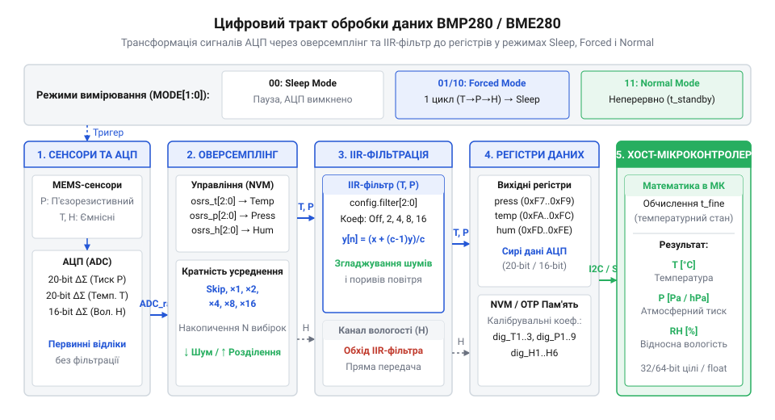
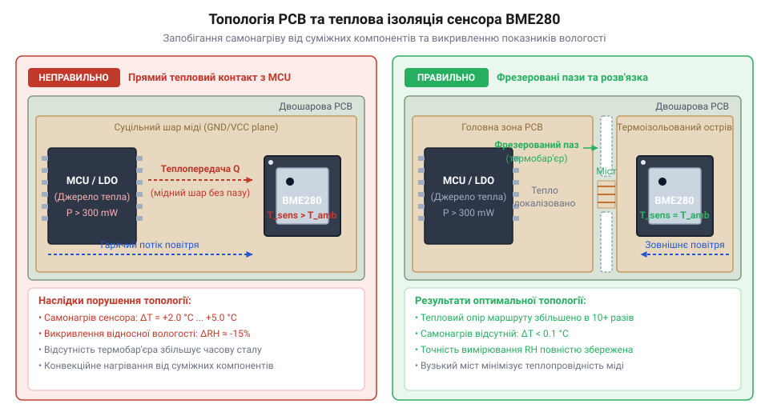

# Родина мікрокліматичних давачів Bosch BMP280 та BME280

<preknowlist>
- [GY-68 / BMP180 — барометр (тиск, висота)](root:cat-hw-sensors/gy-bmp180) — базові принципи вимірювання атмосферного тиску та висотометрії у цифрових MEMS-барометрах попередніх поколінь Bosch
- [GY-BMP280 — барометр/висотомір (BMP280)](root:cat-hw-sensors/gy-bmp280) — базову схемотехніку готових модулів BMP280 та первинні навички роботи з барометричними даними
</preknowlist>

## Чому метеостанція отримує викривлені покази

Запит до регістрів давача повертає не фізичні величини, а сирі 20-бітні коди @@en|ADC@@ (від англ. @@en|Analog-to-Digital Converter@@ — аналого-цифровий перетворювач). Пряма інтерпретація цих чисел хибна, бо мікроструктура чипа зазнає спотворень від довкілля.

Тиск у @@en|BMP280@@ та @@en|BME280@@ вимірюється п'єзорезистивно: атмосферний тиск деформує кремнієву мембрану над вакуумною камерою, змінюючи опір п'єзорезисторів. Однак теплове розширення кремнію змінює напруження мембрани незалежно від тиску, створюючи температурний дрейф нуля та чутливості.


*Структурне порівняння MEMS-конденсатора вологості та п'єзорезистивної мембрани тиску.*

Вологість у @@en|BME280@@ вимірює ємнісний @@en|MEMS-сенсор@@ (від англ. @@en|Micro-Electro-Mechanical Systems@@ — мікроелектромеханічні системи): водяна пара сорбується полімерним діелектриком між електродами, змінюючи ємність. Сорбції притаманний @@en|гістерезис@@ (від грец. @@el|ὑστέρησις@@ — запізнення) під час висихання, а проникність полімеру залежить від температури. Без термокомпенсації покази @@en|ADC@@ залишаються викривленими.

## Калібрувальні коефіцієнти та компенсація АЦП

Через технологічний розкид кожна @@en|MEMS@@-мембрана має унікальні механічні й електричні параметри. Виробник вимірює ці відхилення на заводі й записує калібрувальні коефіцієнти в енергонезалежну пам'ять @@en|NVM@@ (англ. @@en|Non-Volatile Memory@@). Для @@en|BMP280@@ це 24 байти (12 слів), а для @@en|BME280@@ — додаткові коефіцієнти вологості, що описують нелінійність сенсора.


*Схема потоку даних компенсації: обчислення t_fine для корекції тиску та вологості.*

Математична компенсація завжди починається з обчислення температурного фактора `t_fine`. Він розраховується першим із сирого коду температури `raw_t` та коефіцієнтів `dig_T1`...`dig_T3` і представляє точну температуру кристала:

```
var1 = (((raw_t >> 3) - (dig_T1 << 1)) * dig_T2) >> 11
var2 = (((((raw_t >> 4) - dig_T1) * ((raw_t >> 4) - dig_T1)) >> 12) * dig_T3) >> 14
t_fine = var1 + var2                                      [обчислення базового температурного фактора]
```

Значення `t_fine` входить у поліноми корекції тиску (`dig_P1`...`dig_P9`) та вологості (`dig_H1`...`dig_H6`) — без нього компенсація термодрейфу неможлива. Ці формули конвертують сирі коди `raw_p` та `raw_h` у Паскалі й відсотки вологості. Як і у випадку з [давачами BMP180](root:cat-hw-sensors/gy-bmp180), обчислення @@en|BMP280@@ виконано на цілочисельній арифметиці з фіксованою крапкою для ефективності на 8-бітних мікроконтролерах.

## Налаштування цифрового тракту й режимів

Для придушення теплового шуму АЦП застосовують @@en|оверсемплінг@@ (від англ. @@en|oversampling@@ — надлишкова дискретизація): чип робить від 1 до 16 послідовних замірів і усереднює результат. Це знижує RMS-шум тиску до 0.2 Па (різниця висот ~1.7 см), але подовжує вимірювальний такт і збільшує споживання.


*Послідовність фільтрації та оверсемплінгу в цифровому тракті давача.*

Далі рекурсивний @@en|IIR-фільтр@@ (від англ. @@en|Infinite Impulse Response@@ — нескінченна імпульсна характеристика) із коефіцієнтом від 2 до 16 відфільтровує короткочасні коливання тиску від подиху вітру чи дверей.

Чип підтримує три режими роботи:
* @@en|Sleep@@ — вимірювання зупинено (~0.1 мкА);
* @@en|Forced@@ — один замір за командою й повернення в @@en|Sleep@@ (для автономного опитування);
* @@en|Normal@@ — циклічні заміри з інтервалом паузи `t_standby`.

Тривалість такту залежить від оверсемплінгу. Щоб не зчитати застарілі або незавершені дані, перевіряють прапорець `measuring` у регістрі `0xF3` або витримують розраховану затримку.

## Фізичний монтаж та електричне підключення

Чипи @@en|BMP280@@ та @@en|BME280@@ підтримують @@en|I2C@@ (`0x76`/`0x77`) і @@en|SPI@@ при напрузі 1.71…3.6 В. Живлення 5 В вимагає перетворювачів рівнів для захисту @@en|VDDIO@@, якщо їх немає на платі ([модуль GY-BMP280](root:cat-hw-sensors/gy-bmp280)).

Кондуктивний самонагрів від плати на +1 °C занижує вологість на 3–5% @@en|RH@@. Для захисту роблять фрезеровані пази навколо @@en|MEMS@@-чипа та розміщують його внизу корпусу під вентиляційними отворами.


*Фрезеровані пази та розв'язка PCB для термоізоляції.*

У критичних задачах застосовують [прецизійний барометр MS5611](root:cat-hw-sensors/gy-63), але термоізоляція залишається обов'язковою.