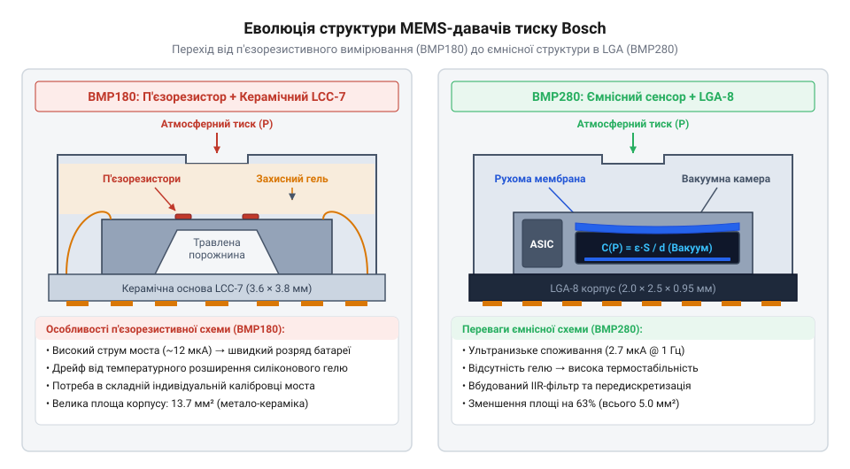
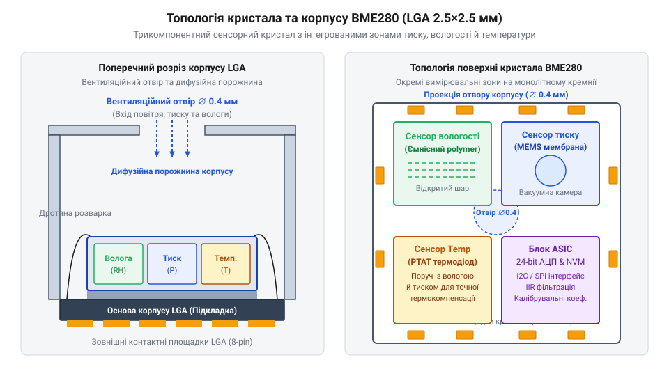

# Еволюція MEMS-давачів Bosch від BMP085 до BME280

<preknowlist>
- [GY-68 / BMP180 — барометр (тиск, висота)](root:cat-hw-sensors/gy-bmp180) — Базовий принцип вимірювання атмосферного тиску та використання модулів BMP180 на шині I2C.
- [GY-BMP280 — барометр/висотомір (BMP280)](root:cat-hw-sensors/gy-bmp280) — Практичні особливості підключення давачів серії BMP280 через I2C та SPI.
</preknowlist>

## Проблема дрейфу п'єзорезистивних барометрів першого покоління

Перші портативні GPS-навігатори, туристичні годинники та метеостанції початку 2000-х років зіштовхнулися з прикрою інженерною перепоною: вимірювання висоти над рівнем моря в режимі реального часу давало похибку у десятки метрів навіть тоді, коли прилад нерухомо лежав на столі. Причиною цього була недосконалість первинних аналогових датчиків тиску, побудованих на базі мікроелектромеханічних систем (@@en|MEMS@@, від англ. *microelectromechanical systems*).

В основі барометрів першого покоління лежав п'єзорезистивний (@@en|piezoresistive@@, від грец. *piezo* — тиснути та лат. *resisto* — опиратися) ефект. У кремнієвій мембрані формували чотири п'єзорезистори, з'єднані за схемою вимірювального мосту Вітстона (@@en|Wheatstone bridge@@). Під дією атмосферного тиску мембрана прогиналася, у силіцієвій ґратці виникали механічні напруження, що змінювали питомий опір матеріалу й розбалансовували міст.

Однак п'єзорезистивний принцип мав дві фундаментальні фізичні вади:
1. **Високий температурний коефіцієнт опору** (@@en|TCR@@). Кремній надзвичайно чутливий до коливань температури. Зміна температури корпуса всього на `1 °C` викликала зміну опору п'єзорезисторів, еквівалентну стрибку тиску на кілька гектопаскалів, що відповідало фальшивому «підйому» або «спуску» на `20–30 m`. 2. **Високий рівень власних шумів та високе енергоспоживання**. Безперервне живлення аналогового мосту струмом вимагало потужності у кілька міліватів, що швидко виснажувало батарею портативного пристрою. Крім того, вихідний сигнал мосту становив лише кілька мілівольтів.

Для зчитування цього сигналу на друковану плату доводилося ставити зовнішній високоточний операційний підсилювач та окремий аналогово-цифровий перетворювач (@@en|ADC@@, від англ. *Analog-to-Digital Converter*). Кожен екземпляр датчика вимагав індивідуального ручного калібрування на заводі за допомогою підстроювальних резисторів. Захистити аналогову лінію від наводок у компактному пристрої було майже неможливо.

Саме ці обмеження змусили інженерів компанії @@en|Bosch Sensortec@@ (заснованої у 2005 році) повністю переглянути концепцію портативної барометрії та об'єднати механічний кремнієвий кристал із цифровою обчисливальною схемою в єдиній кремнієвій безкорпусній збірці.

## Цифрова революція модулів BMP085 та BMP180

У 2009 році компанія @@en|Bosch Sensortec@@ випустила @@en|BMP085@@ — перший у світі масовий цифровий барометричний сенсор, який у 2013 році поступився місцем вдосконаленому @@en|BMP180@@. Головний інженерний прорив полягав у відмові від зовнішньої аналогової обв'язки. Розробники помістили в один корпус п'єзорезистивний кремнієвий сенсор, прецизійний температурний датчик, 16-бітний @@en|ADC@@ та енергонезалежну пам'ять @@en|EEPROM@@ (від англ. *Electrically Erasable Programmable Read-Only Memory*).

Замість аналогового сигналу сенсор видавав готові цифрові дані через стандартну двопровідну шину @@en|I2C@@. Під час виготовлення кожного чипа на заводі вимірювалися його індивідуальні параметри дрейфу й термокомпенсації, які записувалися у вигляді 11 калібрувальних коефіцієнтів у внутрішню @@en|EEPROM@@. Це дозволило масово використовувати барометри на [модулі GY-68](root:cat-hw-sensors/gy-bmp180) без жодного налагодження обв'язки.

Проте ця архітектура мала зворотний бік. Чипи @@en|BMP085@@ та @@en|BMP180@@ не вміли самостійно розраховувати підсумковий тиск. Вони лише відцифровували необроблені значення первинного тиску (`UP`) та температури (`UT`). Всі математичні обчислення компенсації покладалися на мікроконтролер хоста.

Для отримання компенсаваного значення тиску у паскалях мікроконтролер мусив зчитати 11 коефіцієнтів з @@en|EEPROM@@ і виконати складний послідовний алгоритм 32-бітних цілочисельних обчислень:

```
B5 = X1 + X2
B6 = B5 - 4000
X1 = (B2 * (B6 * B6 / 4096)) / 2048
X2 = AC2 * B6 / 2048
X3 = X1 + X2
B3 = (((AC1 * 4 + X3) << oversampling_setting) + 2) / 4
p  = B7 / B4 * 2
```

Такий обсяг математики вимагав десятків математичних операцій на кожне вимірювання, розходуючи такти та пам'ять 8-бітних мікроконтролерів (як-от ATmega328P).

Попри успіх, сенсор @@en|BMP180@@ мав виражені технологічні бар'єри:
1. **Конструкція корпуса**. Сенсор пакувався у метало-керамічний корпус @@en|LCC@@ (від англ. *Leadless Chip Carrier*) розміром `5.0 × 5.0 × 1.2 mm` з отвором для повітря. Корпус був відносно громіздким і чутливим до механічних напружень при розпаюванні на плату. 2. **Межі п'єзоефекту**. Струм споживання під час вимірювання сягав `650 µA`, а власна шумність сенсора без тривалого програмного усереднення не дозволяла надійно розрізняти зміни висоти менше ніж `0.5 m`. Для систем стабілізації коптерів або пішохідної навігації в будинках цього було недостатньо.

## Ємнісний прорив та апаратне фільтрування BMP280

Потреба ринку смартфонів і дрон-індустрії у субметровій точності та мікроамперній автономності змусила @@en|Bosch Sensortec@@ у 2014 році здійснити радикальний крок — вдосконалити п'єзорезистивну технологію. У сенсорі @@en|BMP280@@ було застосовано ємнісний (@@en|capacitive@@, від лат. *capacitas* — місткість) вимірювальний кристалик.

В ємнісному сенсорі атмосфера тисне на гнучку герметичну силіцієву мембрану, яка слугує однією з обкладок мікроконденсатора над вакуумною порожниною. Зміна тиску змінює відстань між обкладками й, відповідно, ємність конденсатора. Детальніший розрахунок фізики деформації кремнієвої мембрани та перетворення мікроємностей у вимірювальних комірках описано в матеріалі про [ємнісний принцип вимірювання тиску в MEMS-барометрах](root:cat-hw-sensors/mems-capacitive-sensing-principles/math-mems-capacitive-electro-mechanics.md).


*Конструктивна еволюція MEMS-кристалів Bosch Sensortec від п'єзорезистивного мосту до ємнісного елемента з деформованою мембраною.*

Ємнісна структура має три ключові переваги:
- **Нульове статичне споживання струму** крізь вимірювальний елемент (на відміну від п'єзорезистивного мосту, що постійно розсіював енергію). - **Втричі менший рівень власного термошуму**. - **Можливість зменшення розмірів**. Новий чип упакували у надкомпактний корпус @@en|LGA@@ (від англ. *Land Grid Array*) розміром всього `2.0 × 2.5 × 0.95 mm`.

Другою революційною зміною у @@en|BMP280@@ стало перенесення DSP-обробки всередину самого чипа. Сенсор отримав апаратний блок передискретизування (@@en|oversampling@@ до 16×) та вбудований цифровий фільтр з нескінченною імпульсною характеристикою (@@en|IIR@@, від англ. *Infinite Impulse Response*).

Фільтр @@en|IIR@@ придушує випадкові сплески тиску (наприклад, від зачинення дверей у кімнаті чи пориву вітру над пропелерами дрона) без участі процесора хоста. Середньоквадратичний шум вимірювання знизився до `0.2 Pa`, що відповідає роздільній здатності за висотою близько `1.7 cm`! При цьому струм споживання при частоті оновлення `1 Hz` впав до всього `2.7 µA`.

Крім шини @@en|I2C@@, чип отримав швидкісний інтерфейс @@en|SPI@@ (до `10 MHz`), що зробило його стандартом на [платах GY-BMP280](root:cat-hw-sensors/gy-bmp280) для польотних контролерів. На відміну від дорожчих альтернатив, як-от [прецизійний барометр MS5611](root:cat-hw-sensors/gy-63), чип @@en|BMP280@@ запропонував оптимальне співвідношення ціни та точності.

На цій же п'єзорезистивній базі у 2015 році Bosch випустила розширений мікрокліматичний сенсор @@en|BME280@@, який додав на той самий кристал ультрашвидкий модуль вологості.


*Внутрішня топологія кристала BME280 з рознесенням чутливих зон тиску, температури й вологості.*

Серед розробників поширений міф про те, що @@en|BMP280@@ є прямою регістровою заміною для @@en|BMP180@@. Це не так. Карта регістрів була повністю переписана:
- Адреса @@en|I2C@@ змінилася з `0x77` на `0x76` (або `0x77` залежно від виводу `SDO`). - Блок калібрувальних коефіцієнтів у пам'яті вирівняно в один суцільний масив з 24 байтів замість окремих регістрів @@en|EEPROM@@. - Регістр керування `0xF4` (`ctrl_meas`) та конфігурації `0xF5` (`config`) замінили старий одноразовий запуск вимірювання.

Старий драйвер від @@en|BMP180@@ не зможе ініціалізувати чи розпізнати чип @@en|BMP280@@, оскільки навіть ідентифікаційний регістр `0xD0` повертає `0x58` замість `0x55`.

## Об'єднання тиску, температури й вологості BME280

Створення портативних метеостанцій, інтелектуальних систем вентиляції та пристроїв інтернету речей довго впиралося у необхідність розміщувати на друкованій платі три окремі давачі: барометр, термометр та вимірювач вологості. Кожен чип вимагав власної розводки живильних ліній, окремих адрес на шині та додаткової площі друкованої плати. Більше того, фізичне рознесення сенсорів унеможливлювало точний розрахунок параметрів мікроклімату, адже відносна вологість (@@en|relative humidity@@, від лат. *relativus* — відносний) жорстко прив'язана до локальної температури повітря.

Зв'язок між температурою та вологістю визначається тиском насиченої водяної пари (@@en|saturation vapor pressure@@): зі зростанням температури здатність повітря утримувати воду зростає за експоненційним законом. Якщо вимірювати вологість в одній точці плати, а температуру в іншій, будь-який температурний градієнт між ними призводить до суттєвої похибки обчислень.

У 2015 році компанія @@en|Bosch Sensortec@@ розв'язала цю проблему, випустивши чип @@en|BME280@@. Інженери об'єднали чутливі елементи тиску, температури та вологості на єдиній кремнієвій підкладці розміром `2.5 × 2.5 × 0.93 mm` у корпусі @@en|LGA@@.


*Внутрішня топологія кристала BME280 з рознесенням чутливих зон тиску, температури й вологості.*

Головним технологічним проривом у @@en|BME280@@ став ультрашвидкий ємнісний елемент вологості. Він складається з плівкового діелектричного полімеру, розміщеного між двома мікроелектродами. Молекули водяної пари з повітря вільно проникають у пори полімеру. Оскільки водяна пара має високу діелектричну проникність (@@en|permittivity@@, від лат. *permittere* — пропускати), її абсорбція суттєво змінює ємність мікроконденсатора.

Така структура забезпечила власний час відгуку елемента `tau = 1 s`, тоді як традиційні резистивні та плівкові сенсори мали затримку у десятки секунд. Оскільки чутливий шар вологості виготовлено на тому самому кремнієвому кристалі за кілька мікрометрів від датчика температури, теплова затримка між ними практично відсутня.

Синхронне зчитування трьох величин з одного чипа дозволяє обчислювати комплексний стан атмосфери без залучення зовнішніх громіздких приладів:
- Точка роси (@@en|dew point@@) — температура, до якої треба охолодити повітря за сталого тиску, щоб відносна вологість досягла `100%` і почалася конденсація. - Абсолютна вологість (@@en|absolute humidity@@, від лат. *absolutus* — безумовний) — фактична маса водяної пари в одному кубічному метрі повітря.

Завдяки цьому єдиний кристал @@en|BME280@@ здатний замінити цілий комплекс приладів у портативних автономних системах, розширюючи можливості звичайних барометрів порівняно з [модулями GY-BMP280](root:cat-hw-sensors/gy-bmp280) або навіть комбінованими рішеннями з [окремим давачем AS3935](root:cat-hw-sensors/as3935-lightning). На відміну від дорожчих високоточних барометрів, як-от [сенсор MS5611](root:cat-hw-sensors/gy-63), чип @@en|BME280@@ дає повну метеорологічну картину в одному компактному корпусі. Детальний математичний апарат і практичний розрахунок за формулою Магнуса висвітлено у матеріалі про [математику обчислення точки роси й абсолютної вологості BME280](root:cat-hw-sensors/magnus-formula/proj-dew-point-microcontroller-calc.md).

## Розвінчання міфів про сумісність і дифузію

Серед розробників вбудованих систем побутує уявлення, що давачі сімейства Bosch є повністю взаємозамінними на рівні програмного коду, а виміряні ними значення можна сприймати без урахування теплового оточення. Це призводить до помилок при проектуванні драйверів та апаратури.

Перший міф стосується регістрової сумісності драйверів. Намагання спростити розробку й задіяти старий [драйвер для BMP180](root:cat-hw-sensors/gy-bmp180) при переході на новіші давачі закінчується невдачею з трьох причин:
1. **Зміна ідентифікаторів та карти регістрів**. Внутрішній регістр `0xD0` повертає значення `0x55` для @@en|BMP180@@, `0x58` для @@en|BMP280@@ та `0x60` для @@en|BME280@@. Будь-яка бібліотека перевіряє цей байт під час ініціалізації і зупиняє роботу при невідповідності. 2. **Перебудова калібрувальної пам'яті**. У @@en|BMP180@@ 11 калібрувальних коефіцієнтів зчитувалися з розрізнених адрес EEPROM. У нових давачах коефіцієнти розкладено в єдиний суцільний масив за адресами `0x88..0xA1` (та додатково `0xE1..0xE7` у @@en|BME280@@). 3. **Спільна математика компенсації**. Алгоритми обчислення тиску й вологості в @@en|BME280@@ прив'язані до проміжної змінної — температурного еквівалента (@@en|t_fine@@). Обчислення температури виконується першим, після чого отримане значення `t_fine` передається у формули розрахунку тиску та вологості. Крім того, у @@en|BME280@@ конфігураційний регістр вологості `0xF2` (`ctrl_hum`) обов'язково має записуватися **до** запису регістра вимірювань `0xF4` (`ctrl_meas`), інакше записані коефіцієнти передискретизування вологості просто не застосуються контролером чипа.

Другий міф полягає в переконанні, що @@en|BME280@@ миттєво й точнісінько показує вологість довкілля незалежно від умов на платі. Тут діють два фізичні обмеження:

Перше обмеження — тепловий самонагрів (@@en|self-heating@@). Якщо давач опитується занадто часто в безперервному режимі або розташований поруч із гарячим мікроконтролером чи лінійним стабілізатором напруги, тепло через мідні доріжки та корпус нагріває кремнієвий кристал. Оскільки відносна вологість є обернено пропорційною температурі, нагрів кристала всього на `1 °C` вище температури навколишнього повітря занижує виміряне значення відносної вологості приблизно на `5%` RH! Щоб уникнути цього, рекомендується використовувати режим на вимогу (@@en|forced mode@@, від англ. *forced mode*) з великими інтервалами сну, виконувати фрезерування теплоізоляційних пазів навколо корпусу @@en|LGA@@ та віддаляти мідні полігони живлення.

Друге обмеження — дифузія вологи (@@en|moisture diffusion@@, від лат. *diffusio* — поширення). Водяна пара потрапляє до внутрішньої камери корпусу через мікроскопічний отвір у металевій кришці. Попри те, що сам ємнісний елемент реагує за `1 s`, процес дифузії газу крізь вентиляційний отвір та захисну мембрану при різких змінах вологості довкілля створює фізичну затримку відгуку в кілька секунд.