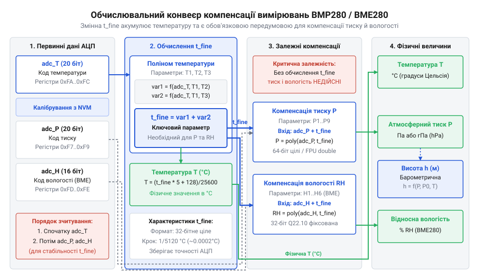
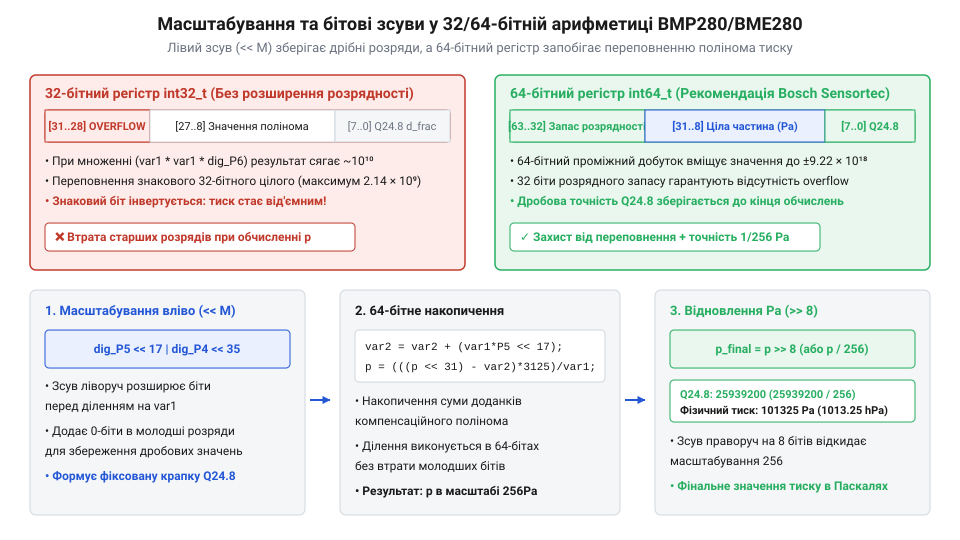

# Математична компенсація первинних даних АЦП у давачах BMP280 та BME280

<preknowlist>
- [GY-BMP280 — барометр/висотомір (BMP280)](root:cat-hw-sensors/gy-bmp280) — Апаратний устрій давача BMP280, розрядність АЦП, карта регістрів та базові режими вимірювання.
- [GY-68 / BMP180 — барометр (тиск, висота)](root:cat-hw-sensors/gy-bmp180) — Базовий принцип вимірювання атмосферного тиску та зв'язок тиску з висотою.
</preknowlist>

## Необроблені відліки АЦП та проблема нелінійності

Уявіть ситуацію: мікроконтролер зчитує з регістрів `0xF7`–`0xF9` давача @@en|BMP280@@ три байти первинних даних й отримує 20-бітове ціле число `519888`. Спроба помножити цей відлік на прямий лінійний коефіцієнт масштабування видає безглузде значення — від'ємний тиск або мільйони Паскалів. Те саме відбувається й з відліком температури з регістрів `0xFA`–`0xFC`: необроблене число `519888` при лінійному множенні дає температуру понад +300 °C. Спроба застосувати єдину формулу пропорційності ламається тому, що первинні коди аналого-цифрового перетворювача (від лат. @@la|analogus@@ — відповідний та @@la|digitus@@ — палець/число; далі @@en|АЦП@@) не є готовою фізичною величиною.

В основі вимірювального вузла давачів @@en|BMP280@@ та @@en|BME280@@ лежить кремнієва кристалічна мембрана @@en|MEMS@@ (від грец. @@el|micros@@ — малий, @@el|elektron@@ — бурштин, @@el|mechane@@ — машина; мікроелектромеханічні системи). Під дією атмосферного тиску мембрана прогинається, що змінює електричний опір вбудованих напівпровідникових елементів за рахунок п'єзорезистивного (від грец. @@el|piezo@@ — тиснути та лат. @@la|resisto@@ — чинити опір) ефекту. Проте напівпровідниковий опір кремнію та параметри мостової схеми вимірювання сильним чином залежать від температури навколишнього середовища. Зміна температури кристала викликає як зсув нульового рівня (англ. @@en|offset drift@@), так і зміну крутизни вимірювальної характеристики (англ. @@en|gain drift@@).

Окрім цього, під час літографічного виробництва напівпровідникових пластин кожен окремий екземпляр кристала отримує унікальні мікроскопічні відхилення товщини мембрани, легування кремнію та механічних напружень. Через цей технологічний розкид параметрів не існує двох давачів @@en|BMP280@@ із ідентичними характеристиками. На відміну від пристроїв, де первинне оброблення приховано всередині, як-от [попередні барометричні давачі](root:cat-hw-sensors/gy-bmp180), компанія @@en|Bosch Sensortec@@ надає прямому доступу 20-бітові неопрацьовані коди @@en|АЦП@@. 

Внутрішній дельта-сигма @@en|АЦП@@ зчитує напругу вимірювального моста з високою розрядністю, але отриманий код відображає лише кількість внутрішніх тактових відліків інтегратора. Фізичний тиск атмосфери та температура кристала жорстко пов'язані між собою: температурне розширення матеріалу створює механічний напружений стан у мембрані, що додається до дії атмосферного тиску. Перетворити такий відлік у справжні Паскалі чи градуси Цельсія без індивідуального скасування нелінійності й температурного дрейфу математично неможливо.

Щоб розв'язати цю проблему, кожен екземпляр давача проходить індивідуальне калібрування (від араб. @@ar|qalib@@ — форма для виливання) на автоматизованому заводському стенді розробника @@en|Bosch Sensortec@@. Виміряні за різних температур і тисків поправкові коефіцієнти записуються в енергонезалежну пам'ять кристала — @@en|NVM@@ (від англ. @@en|Non-Volatile Memory@@) або @@en|OTP@@ (від англ. @@en|One-Time Programmable@@). Єдиним шляхом отримання точних фізичних величин є зчитати ці коефіцієнти з пам'яті давача та пропустити необроблені коди @@en|АЦП@@ через багаторівневі компенсаційні поліноми (від грец. @@el|poly@@ — багато та лат. @@la|nomen@@ — член).

## Структура калібрувальних коефіцієнтів та зчитування NVM

Заводська пам'ять @@en|NVM@@ давачів @@en|BMP280@@ та @@en|BME280@@ містить таблицю констант, сформовану під час випробувань кристала. Для температури й тиску виділено 24 байти за адресами регістрів `0x88`–`0x9F`. Кожен коефіцієнт складається з двох 8-бітових регістрів, які об'єднуються у 16-бітові цілочисельні типи.

Порядок байтів у пам'яті давача — @@en|Little-Endian@@: молодший байт @@en|LSB@@ (від англ. @@en|Least Significant Byte@@) розташований за меншою адресою, а старший байт @@en|MSB@@ (від англ. @@en|Most Significant Byte@@) — за наступною адресою. При об'єднанні регістрів критично враховувати знаковість кожного коефіцієнта, оскільки некоректне інтерпретування знака спотворює обчислення компенсаційного полінома:

- `dig_T1` (`0x88` LSB, `0x89` MSB) — беззнакове 16-бітове ціле (`uint16_t`);
- `dig_T2`, `dig_T3` (`0x8A`–`0x8D`) — знакові 16-бітові цілі числа в доповняльному коді (`int16_t`);
- `dig_P1` (`0x8E` LSB, `0x8F` MSB) — беззнакове 16-бітове ціле (`uint16_t`);
- `dig_P2`–`dig_P9` (`0x90`–`0x9F`) — знакові 16-бітові цілі числа (`int16_t`).

У давачах @@en|BME280@@ додатково присутні коефіцієнти вологості `dig_H1`–`dig_H6` у регістрах `0xA1` та `0xE1`–`0xE7`, де коефіцієнти `dig_H4` та `dig_H5` мають упаковку по 12 бітів зі спільним регістром `0xE5`.

Первинні відліки @@en|АЦП@@ для температури й тиску займають по 3 байти (24 біти пам'яті регістрів, з яких використовуються 20 бітів): старший байт @@en|MSB@@, молодший байт @@en|LSB@@ та додатковий молодший байт @@en|XLSB@@ (від англ. @@en|eXtra Least Significant Byte@@). Для температури це регістри `0xFA` (`temp_msb`), `0xFB` (`temp_lsb`) та `0xFC` (`temp_xlsb`). Верхні 4 біти регістру @@en|XLSB@@ містить молодші біти 20-бітового коду, а нижні 4 біти є нульовими.

Формула побітового збирання 20-бітового відліку температури `adc_T` із регістрів має вигляд:

```
adc_T = (temp_msb << 12) | (temp_lsb << 4) | (temp_xlsb >> 4)
```

Аналогічно об'єднуються регістри тиску `0xF7` (`press_msb`), `0xF8` (`press_lsb`) та `0xF9` (`press_xlsb`):

```
adc_P = (press_msb << 12) | (press_lsb << 4) | (press_xlsb >> 4)
```

Результатом збирання є 20-бітове беззнакове ціле число, яке зберігається у 32-бітному контейнері `uint32_t` або `int32_t`.

Нижче наведено приклад зчитування та розпакування калібрувальних коефіцієнтів і відліків @@en|АЦП@@ мовами C та C++.

:::tabs
@tab C (ESP-IDF)
:::code math-bmp280-bme280-compensation-math/c/esp-idf/bmp280-parse-calib-params.c
@tab C++ (Arduino)
:::code math-bmp280-bme280-compensation-math/cpp/arduino/bmp280calibdata.cpp
:::

Якщо під час розпакування помилково привести беззнаковий байт `MSB` до знакового типу `int8_t` до виконання зсуву вліво, від'ємний знак старшого біта розшириться на всі 32 біти й повністю зіпсує обчислення.

## Компенсація температури та проміжна змінна t_fine

Температурна компенсація є найпершим і обов'язковим кроком у процесі оброблення вимірювань давачів @@en|BMP280@@ та @@en|BME280@@. Оскільки параметри мембрани й напівпровідникових елементів змінюються під дією тепла, як і в [сучасних барометричних давачах](root:cat-hw-sensors/gy-bmp280), розрахунок компенсації тиску та вологості безпосередньо залежить від поточної температури кристала.

Математична модель температурної компенсації @@en|Bosch Sensortec@@ апроксимує температурну характеристику поліномом другого порядку (параболою) відносно опорної точки +25 °C. У формулах використовують два проміжних доданки `var1` та `var2`, сума яких формує фундаментальну проміжну змінну `t_fine`.

Для обчислень у форматі з плаваючою крапкою (англ. @@en|floating-point@@) розрахунок доданків має вигляд:

```
var1 = (((double)adc_T) / 16384.0 - ((double)dig_T1) / 1024.0) × ((double)dig_T2)
var2 = ((((double)adc_T) / 131072.0 - ((double)dig_T1) / 8192.0) × (((double)adc_T) / 131072.0 - ((double)dig_T1) / 8192.0)) × ((double)dig_T3)
t_fine = (int32_t)(var1 + var2)
T = (var1 + var2) / 5120.0
```

Фізичний зміст змінної `t_fine` полягає в тому, що вона акумулює високоточне значення температури кристала, масштабоване в 5120 разів (1 °C відповідає 5120 дискретним одиницям `t_fine`). Змінна `t_fine` виступає єдиним температурним містком, який передається у поліноми компенсації тиску `bmp280_compensate_P()` та вологості `bme280_compensate_H()`.


*Послідовність перетворення первинного 20-бітового відліку АЦП у проміжну змінну t_fine та її подальше розгалуження для компенсації тиску й вологості.*

На ресурсообмежених мікроконтролерах без апаратного співпроцесора @@en|FPU@@ (від англ. @@en|Floating-Point Unit@@) виконання операцій із типом `double` або `float` викликає програмну емуляцію. Це збільшує розмір прошивки на кілька кілобайтів та сповільнює виконання математики в десятки разів. Щоб уникнути цього, алгоритм @@en|Bosch Sensortec@@ оптимізовано під 32-бітову цілочисельну арифметику з фіксованою крапкою (англ. @@en|fixed-point math@@), де ділення замінено бітовими зсувами вправо (`>>`):

```
var1 = ((((adc_T >> 3) - ((int32_t)dig_T1 << 1))) × ((int32_t)dig_T2)) >> 11
var2 = (((((adc_T >> 4) - ((int32_t)dig_T1)) × ((adc_T >> 4) - ((int32_t)dig_T1))) >> 12) × ((int32_t)dig_T3)) >> 14
t_fine = var1 + var2
T = (t_fine × 5 + 128) >> 8
```

У цілочисельному варіанті вихідне значення температури `T` обчислюється в сотих частках градуса Цельсія (наприклад, значення `2508` означає 25.08 °C). На відміну від [високоточних промислових давачів](root:cat-hw-sensors/gy-63), де ділення виконують над 64-бітними числами, 32-бітної цілочисельної арифметики цілком достатньо для збереження точності вимірювання температури з дискретністю 0.01 °C.

Нижче наведено практичну реалізацію обох варіантів компенсації температури мовами C та C++.

:::tabs
@tab C (ESP-IDF)
:::code math-bmp280-bme280-compensation-math/c/esp-idf/bmp280-compensate-temp-double.c
@tab C++ (Arduino)
:::code math-bmp280-bme280-compensation-math/cpp/arduino/bmp280tempcalib.cpp
:::

Розраховане значення `t_fine` зберігають для наступного виклику функцій обчислення тиску та відносної вологості.

## Розрахунок компенсації тиску й відносної вологості

Первинне 20-бітове значення АЦП тиску `adc_P` (або 16-бітове значення вологості `adc_H`) неможливо безпосередньо помножити на фізичний коефіцієнт, щоб отримати тиск у Паскалях (названий на честь французького фізика й математика Блеза Паскаля) `@@en|Pascal@@` чи вологість у відсотках. Кремнієва мембрана давача `@@en|BMP280@@` під дією зовнішнього тиску деформується нелінійно. Крім того, п'єзорезистори змінюють свій електричний опір не лише від механічного напруження, а й від коливань температури навколишнього середовища. 

Математичний алгоритм компанії `@@en|Bosch Sensortec@@` вирішує цю проблему через двоетапну корекцію. Спочатку виміряна температура кристаллу, сконцентрована у масштабованій змінній `t_fine`, використовується для усунення температурного дрейфу нуля (зсуву) та дрейфу чутливості (шкали). На другому етапі застосовується криволінійне поліноміальне корегування власної нелінійності мембрани.

Для компенсації тиску з NVM-пам'яті давача зчитуються дев'ять калібрувальних коефіцієнтів: беззнаковий `dig_P1` (`uint16_t`) та знакові `dig_P2`..`dig_P9` (`int16_t`). Коефіцієнт `dig_P1` задає базову чутливість давача, `dig_P2`..`dig_P6` визначають лінійну та квадратичну температурну компенсацію, а `dig_P7`..`dig_P9` відповідають за корекцію параболічної нелінійності деформації.

Обчислення починається з розрахунку температурних поправок `var1` та `var2`. Потім розраховується масштабований тиск `P`. Розглянемо покрокову математичну модель у форматі обчислення з плаваючою крапкою, де `adc_P` — 20-бітовий код АЦП тиску, `t_fine` — проміжна температурна змінна, а `P` — підсумковий тиск у Паскалях:

```
var1 = (t_fine / 2.0) - 64000.0
var2 = var1 × var1 × dig_P6 / 32768.0 + var1 × dig_P5 × 2.0      [лінійна й квадратична температурна поправка зсуву]
var2 = (var2 / 4.0) + (dig_P4 × 65536.0)                           [додавання базового калібрувального зсуву]
var1 = (dig_P3 × var1 × var1 / 524288.0 + dig_P2 × var1) / 524288.0 [температурна поправка чутливості]
var1 = (1.0 + var1 / 32768.0) × dig_P1                             [масштабування чутливості коефіцієнтом dig_P1]
P_raw = 1048576.0 - adc_P                                         [інверсія виміряного коду АЦП]
P = (P_raw - (var2 / 4096.0)) × 6250.0 / var1                     [первинний розрахунок тиску]
var1 = dig_P9 × P × P / 2147483648.0                              [квадратична корекція нелінійності мембрани]
var2 = P × dig_P8 / 32768.0                                       [лінійна корекція нелінійності мембрани]
P_final = P + (var1 + var2 + dig_P7) / 16.0                       [підсумковий компенсований тиск у Паскалях]
```

Якщо у процесі обчислення знаменник `var1` дорівнює нулю, це вказує на пошкодження калібрувальних таблиць NVM або апаратний збій; ділення на нуль блокується, і функція повертає нуль. Отримане значення `P_final` вимірюється в Паскалях (`@@en|Pa@@`), для переведення в гектопаскалі (грец. `@@en|hekaton@@` — сто) `@@en|hPa@@` результат ділять на `100.0`.

У давачі `@@en|BME280@@` додатково вимірюється відносна вологість (англ. `@@en|relative humidity@@`). Ємнісний полімерний давач вологості реагує на адсорбцію водяної пари, але його діелектрична проникність суттєво залежить від температури кристаллу. Для компенсації використовуються шість калібрувальних коефіцієнтів `dig_H1`..`dig_H6`.

Формула компенсації відносної вологості є квадратичним поліномом від залежності `adc_H` та `t_fine`. Через нелінійний характер корекції та можливі температурні транзієнти розраховане значення вологості може математично виходити за фізичні межі. Тому після обчислення обов'язково застосовують обмеження діапазону (англ. `@@en|clamping@@`) до інтервалу `[0.0, 100.0] %RH`. Детальніший розбір математичних формул та особливості розпакування 12-бітових регістрів dig_H4 і dig_H5 висвітлено у статті про [математичну компенсацію відносної вологості в BME280](root:cat-hw-sensors/bme280-humidity-math).

Нижче наведено практичну реалізацію розрахунку компенсації тиску й вологості мовами C та C++ при роботі з модулем [GY-BMP280 для вимірювання](root:cat-hw-sensors/gy-bmp280) атмосферних параметрів, на відміну від простіших пристроїв [GY-68 на базі BMP180](root:cat-hw-sensors/gy-bmp180).

:::tabs
@tab C (ESP-IDF)
:::code math-bmp280-bme280-compensation-math/c/esp-idf/bme280-compensate-pressure-float.c
@tab C++ (Arduino)
:::code math-bmp280-bme280-compensation-math/cpp/arduino/bme280calibdata.cpp
:::

## Цілочисельна арифметика з фіксованою крапкою

Обчислення поліноміальних формул із плаваючою крапкою вимагає значних обчислювальних ресурсів. Більшість мікроконтролерів для автономних давачів (як-от 8-бітові `AVR ATMega328P` або 32-бітові `ARM Cortex-M0+`) позбавлені апаратного блоку обчислень із плаваючою крапкою (англ. `@@en|floating-point unit@@`, `@@en|FPU@@`). Використання типів `float` або `double` у такому середовищі змушує компілятор лінкувати програмний емулятор `libgcc`. Це збільшує розмір виконуваного binary-коду на 4–8 Кбайт і сповільнює обчислення в 20–50 разів порівняно з цілочисельними операціями.

Альтернативою є цілочисельна арифметика з фіксованою крапкою (англ. `@@en|fixed-point arithmetic@@`). У цьому підході дробові числа зберігаються як цілі, помножені на масштабний коефіцієнт `2^Q` (формат `@@en|Q-format@@`). Завдяки двійковому масштабуванню операції ділення на `2^Q` замінюються швидкими бітовими зсувами праворуч `>> Q`, а множення — зсувами ліворуч `<< Q`. На RISC-процесорах бітовий зсув виконується за один такт машинного часу.


*Розподіл бітів у 64-бітному регістрі при множенні 32-бітних фіксованих чисел із подальшим зсувом праворуч для збереження точності без переповнення.*

Головна небезпека цілочисельної компенсації тиску полягає у ризику переповнення регістрів при множенні (англ. `@@en|integer overflow@@`). Первинний код АЦП тиску `adc_P` досягає 20 бітів ($10^6$). При множенні на масштабований коефіцієнт `dig_P3` або піднесенні до квадрата `p * p` результат проміжного обчислення легко перевищує максимальне значення 32-бітного знакового числа `int32_t` ($2^{31}-1 = 2\,147\,483\,647$).

Щоб уникнути переповнення без втрати точності, Bosch Sensortec застосовує 64-бітові цілі числа `int64_t` для intermediate-акумуляторів тиску. Порядок бітових зсувів має вирішальне значення: якщо виконати бітовий зсув праворуч *до* множення, молодші біти відкидаються, що призводить до системної похибки вимірювання тиску до $1\dots 2\text{ hPa}$. Якщо ж множити 32-бітові значення всередині 64-бітного регістру й виконувати зсув *після* множення, точність зберігається повністю.

Отриманий тиск обчислюється у форматі `Q24.8` (ціле число, де 1 Паскаль дорівнює 256 одиницям). Для отримання тиску в Паскалях результат ділять на 256, що еквівалентно зсуву `p >> 8`. На відміну від високоточних вимірювачів [GY-63 з давачем MS5611](root:cat-hw-sensors/gy-63), де використовується 24-бітовий АЦП, або імпульсних систем, таких як [сенсор блискавок AS3935](root:cat-hw-sensors/as3935-lightning), барометр `@@en|BMP280@@` у 64-бітному цілочисельному форматі забезпечує точність $0.01\text{ hPa}$ без жодної операції з плаваючою крапкою.

:::tabs
@tab C (ESP-IDF)
:::code math-bmp280-bme280-compensation-math/c/esp-idf/bme280-compensate-pressure-int64.c
@tab C++ (Arduino)
:::code math-bmp280-bme280-compensation-math/cpp/arduino/bme280fixedpoint.cpp
:::

## Барометрична формула та обчислення висоти

Після отримання точного значення компенсаційного атмосферного тиску основними застосуваннями давачів `@@en|BMP280@@` та `@@en|BME280@@` у квадрокоптерах, робототехніці й навігації є бароалтиметрія (грец. `@@en|baros@@` — вага, лат. `@@en|altus@@` — високий) `@@en|barometric altimetry@@`. Вона базується на фізичному факті: зі збільшенням висоти над рівнем моря маса повітряного стовпа зменшується, відповідно знижується й атмосферний тиск.

Математичним підґрунтям для розрахунку висоти є барометрична формула. Оскільки повітря є стисливим газом, зміна тиску з висотою описується диференціальним рівнянням гідростатичної рівноваги. Для стандартних умов земної атмосфери прийнято модель, яку називають [міжнародна стандартна атмосфера](root:ph-thermodynamics/standard-atmosphere) (англ. `@@en|International Standard Atmosphere@@`, `@@en|ISA@@`). Вона припускає, що на рівні моря тиск $P_0 = 1013.25\text{ hPa}$, температура $T_0 = 288.15\text{ K}$ ($15^\circ\text{C}$), а температура зменшується з висотою зі сталим градієнтом $L = 0.0065\text{ K/m}$ до межі тропосфери ($11000\text{ м}$).

Для перетворення виміряного тиску $P$ у абсолютну висоту $h$ застосовують [гіпсометричну формулу обчислення](root:ph-mechanics/barometric-hypsometric-formula) висоти:

```
exponent = R × L / (g × M)
= 8.31446 × 0.0065 / (9.80665 × 0.0289644)   [підстановка констант: газова стала R, градієнт L, прискорення g, молярна маса M]
≈ 0.19029495                                 [безрозмірний показник степеня]

scaling_factor = T0 / L
= 288.15 / 0.0065                            [підстановка T0 та L]
≈ 44330.77                                   [масштабувальна висота атмосфери у метрах]

h = 44330.77 × (1.0 - (P / P0) ^ 0.19029495) [підсумкова барометрична формула висоти]
```

У цій формулі $P$ — поточний виміряний тиск у гектопаскалях (`@@en|hPa@@`), $P_0$ — базовий тиск на рівні моря ($1013.25\text{ hPa}$), а результат $h$ вимірюється в метрах.

Однак на практиці абсолютний тиск на рівні моря не є константою. Погодні циклони та антициклони викликають коливання $P_0$ у межах від $970$ до $1040\text{ hPa}$. Біля поверхні Землі зміна тиску всього на $1\text{ hPa}$ відповідає зміні висоти приблизно на $8.4\text{ метри}$. Якщо використовувати фіксоване значення $1013.25\text{ hPa}$, погодні дрейфи можуть давати помилку обчислення абсолютної висоти до $\pm 200\text{ метрів}$.

Для точного вимірювання перепаду висот (наприклад, підйому коптера або пересуванню поверхами будівлі) використовують відносну бароалтиметрію. Замість $P_0$ у формулу підставляють опорний тиск $P_{\text{ref}}$, виміряний у точці старту, або поточну авіаційну уставку тиску на рівні моря (англ. `@@en|QNH@@`). Також урахування фактичної температури повітря $T_{\text{actual}}$ (у Кельвінах) дозволяє скоригувати температурне розширення повітряного стовпа.

Нижче наведено приклад реалізації обчислення абсолютної та відносної висоти мовами C та C++.

:::tabs
@tab C (ESP-IDF)
:::code math-bmp280-bme280-compensation-math/c/esp-idf/calculate-altitude-absolute.c
@tab C++ (Arduino)
:::code math-bmp280-bme280-compensation-math/cpp/arduino/barometricaltitude.cpp
:::