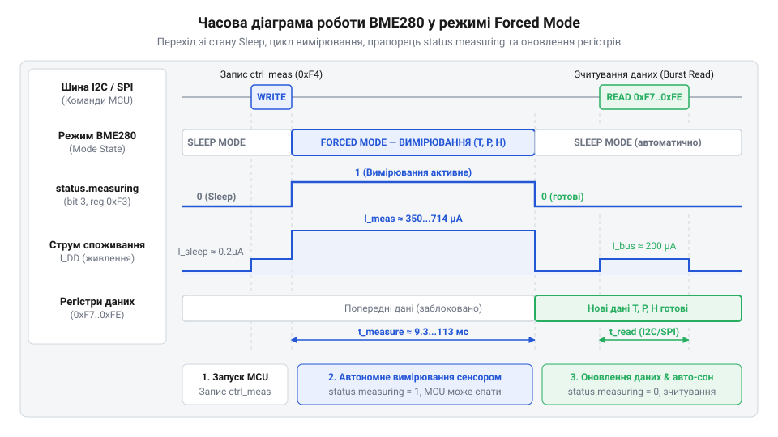
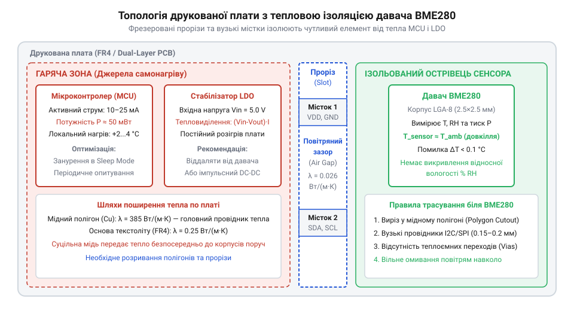

# Проєктування енергоефективного метеовузла на BME280

<preknowlist>
- [GY-BMP280](root:cat-hw-sensors/gy-bmp280) — Принцип організації регістрів та зчитування первинних відліків тиску й температури серії BMP.
</preknowlist>

## Пастка неперервного вимірювання у батарейному вузлі

Під час побудови вузла моніторингу довкілля початківці часто повторюють типову помилку: підключають давач до мікроконтролера, беруть готову стандартну бібліотеку та запускають нескінченний цикл опитування з функцією затримки на кілька секунд. За такого підходу батарея місткістю кількасот міліампер-годин повністю розряджається за лічені доби. Причина криється у тому, що давач за замовчуванням функціонує в неперервному режимі @@en|Normal Mode@@ (англ. *normal* — звичайний, *mode* — спосіб, режим), постійно оновлюючи внутрішні регістри на максимальній швидкості, а обчислювальне ядро мікроконтролера жодної мілісекунди не перебуває у стані сну, невпинно споживаючи від 10 до 25 мА струму.

Параметри атмосфери — температура, відносний тиск і вологість повітря — мають значну фізичну інертність. У закритих приміщеннях чи відкритому середовищі ці величини змінюються плавно впродовж хвилин, тому опитування середовища частіше ніж раз на 30–60 секунд генерує надлишкові дані, які не несуть нової інформації, але катастрофічно руйнують енергетичний баланс пристрою. Автономне живлення вимагає переходу до імпульсної шпаруватості, де вузол проводить 99.9% свого життєвого циклу в режимі глибокого сну @@en|Sleep Mode@@ (англ. *sleep* — сон), споживаючи одиниці мікроамперів, і прокидається лише на короткий проміжок часу для фіксації поточних показників.

Середнє споживання струму в такій системі визначається зважуванням струмів активної фази та фази очікування. Позначимо середній струм як `I_avg`, струм активного вимірювання мікроконтролера та сенсора як `I_active`, тривалість активної фази як `t_active`, струм системи у глибокому сні як `I_sleep`, тривалість перебування у сні як `t_sleep`, повний період циклу як `T_period` (`T_period = t_active + t_sleep`), а коефіцієнт заповнення @@en|duty cycle@@ (англ. *duty* — обов'язок, служба, *cycle* — цикл) як `D` (`D = t_active / T_period`):

    I_avg
    = (I_active · t_active + I_sleep · t_sleep) / T_period      [зважування споживання за часом]
    = I_active · D + I_sleep · (1 - D)                         [вираз через коефіцієнт заповнення]

Оскільки тривалість активної фази становить мілісекунди, коефіцієнт `D` має величину близько `10⁻⁴`, завдяки чому внесок активного струму зменшується на три порядки. Продемонструємо енергетичний виграш на практичному розрахунку автономного вузла на базі @@en|BME280@@.

**Розрахунок автономності метеовузла від батареї ємністю 2400 мА·год при інтервалі опитування 60 секунд:**

    I_avg
    = (5.0 · 10⁻³ · 0.015 + 6.0 · 10⁻⁶ · 59.985) / 60         [активний струм 5 мА впродовж 15 мс та сон 6 мкА]
    = (7.5 · 10⁻⁵ + 3.599 · 10⁻⁴) / 60                         [накопичений електричний заряд у кулонах]
    = 4.349 · 10⁻⁴ / 60                                        [сумарний заряд за період вимірювання]
    = 7.25 · 10⁻⁶ А = 7.25 мкА                                 [середньозважений струм споживання вузла]

    T_life
    = 2400 / 0.00725                                           [ділення ємності акумулятора на середній струм]
    ≈ 331 034 год ≈ 37.8 років                                 [теоретичний термін служби батареї]

У реальних умовах час роботи такого пристрою обмежений не струмом схеми, а внутрішнім хімічним саморозрядом елемента живлення, що гарантує від 5 до 10 років безперервної служби. Для порівняння, при неперервному активному опитуванні та сама батарея вичерпається менш ніж за двадцять діб (`2400 / 5 = 480 год`).

Постійна робота сенсора у @@en|Normal Mode@@ несе ще одну приховану загрозу — тепловий самонагрів кристала. Неперервна робота внутрішнього генератора й кіл перетворювача виділяє тепло безпосередньо в корпусі @@en|BME280@@. Температура чутливого елемента зростає на 0.5–1.5 °C відносно повітря, що автоматично спотворює розрахунок відносної вологості, занижуючи її на кілька відсотків. Архітектурні особливості [родини мікрокліматичних сенсорів](root:cat-hw-sensors/bosch-sensortec-mems-family-overview) передбачають спеціальний режим для усунення цих недоліків — @@en|Forced Mode@@ (англ. *force* — змушувати, вимагати). У цьому режимі прилад постійно спить зі струмом 0.1 мкА, прокидається на один цикл перетворення суворо за командою хоста і після збереження відліків автоматично засинає.

## Запуск Forced Mode та отримання первинних відліків

Переведення @@en|BME280@@ у режим поодинокого вимірювання @@en|Forced Mode@@ починається з конфігурування внутрішніх регістрів. На відміну від неперервної роботи, у @@en|Forced Mode@@ давач виконує цикл квантування лише один раз. Щойно завершується оцифрування аналогових сигналів тиску, температури та вологості, логіка кристала записує сирі коди у вихідні регістри даних і миттєво повертає чутливий елемент у @@en|Sleep Mode@@.


*Послідовність зміни станів BME280: перехід зі сну в активне квантування за командою у ctrl_meas, блокування шини на час вимірювання та автоматичне повернення у Sleep Mode з готовністю результатів у регістрах даних.*

Керування вимірювальним трактом вимагає врахування апаратної особливості чипів @@en|Bosch Sensortec@@. Сенсор дозволяє налаштувати @@en|оверсемплінг@@ (англ. *over* — понад, *sample* — вибірка, зразок) — апаратне усереднення певної кількості вибірок внутрішнього аналогово-цифрового перетворювача для фільтрації випадкових шумів. Налаштування оверсемплінгу вологості містяться в регістрі `ctrl_hum` (адреса `0xF2`), а температури, тиску та вибір режиму роботи — у `ctrl_meas` (адреса `0xF4`). Пастка полягає в тому, що запис нових бітів у регістр `ctrl_hum` апаратно не набуває чинності доти, доки не відбудеться наступний запис у регістр `ctrl_meas`. Якщо драйвер спочатку налаштує `ctrl_meas`, а потім `ctrl_hum`, поточний вимір вологості виконається зі старими або скинутими налаштуваннями.

Тому послідовність подачі команд обов'язково починається із запису `ctrl_hum`, після чого в `ctrl_meas` записуються маски оверсемплінгу та значення режиму `0b01`, що ініціює запуск перетворення.

:::tabs
@tab C
:::code proj-bme280-low-power-weather-node/c/src/bme280.c 172-199
@tab C++
:::code proj-bme280-low-power-weather-node/cpp/src/bme280.cpp 96-114
:::

Після запису команди хост-контролер повинен дочекатися завершення вимірювання. Тривалість квантування залежить від обраних коефіцієнтів оверсемплінгу й за документацією виробника розраховується за формулою `T_meas = 1.25 + 2.3 · osrs_t + (2.3 · osrs_p + 0.575) + (2.3 · osrs_h + 0.575)` мілісекунд, що для типового профілю становить близько 10–15 мс. Про стан оцифрування свідчить біт 3 (`measuring`) у статусному регістрі `status` (адреса `0xF3`). Поки цей біт дорівнює одиниці, аналоговий блок зайнятий. Щойно біт скидається в нуль, дані перенесено у вихідний буфер, а сенсор уже перебуває у @@en|Sleep Mode@@.

Зчитування результатів вимагає застосування суворого шинного правила. Вихідні дані займають вісім послідовних регістрів, починаючи з адреси `0xF7` (`press_msb`) і завершуючи `0xFE` (`hum_lsb`): три байти для 20-бітного тиску, три байти для 20-бітного значення температури та два байти для 16-бітної вологості. Якщо зчитувати ці регістри окремими транзакціями шини @@en|I2C@@ (англ. *Inter-Integrated Circuit*), виникає ризик часткового оновлення даних та розриву узгодженості між байтами. Щоб гарантувати атомарність вибірки, обов'язково застосовують пакетне читання @@en|burst read@@ (англ. *burst* — спалах, вибух, *read* — читання), вичитуючи всі 8 байтів за одну безперервну транзакцію із передачею початкової адреси та послідовним квитуванням байтів.

:::tabs
@tab C
:::code proj-bme280-low-power-weather-node/c/src/bme280.c 201-243
@tab C++
:::code proj-bme280-low-power-weather-node/cpp/src/bme280.cpp 116-174
:::

Прочитані 8 байтів упаковані у сирі цілі числа без знаку: біти зсуваються згідно зі специфікацією регістрів. Однак ці числа ще не є фізичними величинами тиску, температури чи вологості — це некомпенсовані відліки внутрішнього перетворювача.

## Фабричне калібрування та обчислення фізичних величин

Сирі відліки з регістрів даних не можна безпосередньо інтерпретувати як градуси чи паскалі. Кожен кристал мікроелектромеханічної системи має індивідуальні механічні напруження кремнієвої мембрани та технологічні похибки травлення мікроструктур. Під час заводського вихідного тестування інженери @@en|Bosch Sensortec@@ вимірюють відгук кожного кристала на еталонних стендах за різних температур і тисків, розраховують індивідуальні математичні поправки та записують їх у внутрішню енергонезалежну пам'ять @@en|NVM@@ (англ. *non-volatile memory*).

Калібрувальна таблиця розміщена у двох окремих адресних просторах. Перший блок займає 26 байтів від адреси `0x88` до `0xA1` і містить параметри температури `dig_T1..T3`, тиску `dig_P1..P9` та перший параметр вологості `dig_H1`. Другий блок займає 7 байтів від адреси `0xE1` до `0xE7` і містить решту коефіцієнтів вологості `dig_H2..H6`. Головна пастка десеріалізації другого блоку полягає в упаковці коефіцієнтів `dig_H4` та `dig_H5`. Задля економії кристалічного простору Bosch розбила ці 12-бітні знакові числа між трьома регістрами: старші 8 бітів `dig_H4` лежать у регістрі `0xE4`, а його молодші 4 біти — у молодшому ніблі регістру `0xE5`; натомість старші 8 бітів `dig_H5` лежать у `0xE6`, а його молодші 4 біти — у старшому ніблі того самого спільного регістру `0xE5`.

:::tabs
@tab C
:::code proj-bme280-low-power-weather-node/c/src/bme280.c 97-155
@tab C++
:::code proj-bme280-low-power-weather-node/cpp/src/bme280.cpp 45-94
:::

Зчитування таблиці @@en|NVM@@ виконується лише один раз під час ініціалізації драйвера, після чого коефіцієнти зберігаються в оперативній пам'яті хоста. Отримані матричні значення підставляються у поліноміальні формули компенсації.

В автономних батарейних вузлах мікроконтролери зазвичай побудовані на ядрах без апаратного блоку роботи з рухомою комою (FPU). Використання програмної емуляції чисел одинарної або подвійної точності збільшує розмір виконуваного коду на кілька кілобайтів і сповільнює розрахунки в десятки разів, нераціонально утримуючи процесор в активному режимі. Саме тому низькорівневий драйвер реалізує цілочисельну арифметику з фіксованою комою.

Алгоритм компенсації підпорядкований жорсткому правилу послідовності: температура ОБОВ'ЯЗКОВО розраховується першою. Під час обчислення температури формується проміжна глобальна величина високої точності @@en|t_fine@@. Вона відображає справжню температуру кристала і виступає обов'язковим базовим аргументом у нелінійних формулах для розрахунку атмосферного тиску та відносної вологості. Якщо порушити черговість і розрахувати тиск чи вологість раніше, у формулу потрапить застаріле або випадкове значення `t_fine`, що зведе точність вимірювання нанівець.

Розрахунок температури виконується у 32-бітній цілочисельній арифметиці. Позначимо 20-бітний сирий відлік температури як `adc_T`, калібрувальні коефіцієнти як `dig_T1` (ціле без знаку), `dig_T2` та `dig_T3` (цілі зі знаком), проміжні змінні як `var1` та `var2`, а шукану температуру в сотих частках градуса Цельсія як `T`:

    var1
    = (((adc_T >> 3) - (dig_T1 << 1)) · dig_T2) >> 11       [лінійна температурна поправка]
    var2
    = (((((adc_T >> 4) - dig_T1) · ((adc_T >> 4) - dig_T1)) >> 12) · dig_T3) >> 14 [квадратична нелінійність сенсора]
    t_fine
    = var1 + var2                                          [результуюча тонка температура кристала]
    T
    = (t_fine · 5 + 128) >> 8                             [масштабування до сотих часток градуса Цельсія]

Усі ділення на степені двійки реалізовані бітовими зсувами вправо `>>`, що виконуються процесором за один такт. Отримане значення `T = 2345` відповідає точній температурі 23.45 °C.

Отримане значення `t_fine` передається у модуль розрахунку тиску. Для тиску використовується 64-бітна арифметика (`int64_t`), оскільки формули містять піднесення до квадрата величин із широким динамічним діапазоном і множення на масштабний коефіцієнт 3125, що спричинило б переповнення 32-бітного регістра. Розрахунок видає тиск безпосередньо в цілих паскалях. Механіка обчислення тиску та температури повністю успадкована від [барометричного сенсора BMP280](root:cat-hw-sensors/gy-bmp280).

На відміну від барометра, канал вологості використовує специфічну 32-бітну формулу, де коефіцієнти `dig_H2..H6` компенсують нелінійну ємнісну характеристику полімерного шару відносно `t_fine`. Розрахунок повертає вологість у форматі з фіксованою комою @@en|Q22.10@@, де отримане ціле число є значенням відносної вологості у відсотках, помноженим на 1024. Обмежувач насичення гарантує відсікання значень менше 0% та понад 100% RH.

:::tabs
@tab C
:::code proj-bme280-low-power-weather-node/c/src/bme280.c 249-334
@tab C++
:::code proj-bme280-low-power-weather-node/cpp/src/bme280.cpp 193-240
:::

На виході легковаговий драйвер отримує вичерпні, фізично вивірені значення мікроклімату без жодної плаваючої коми та з мінімальним часом використання обчислювального ядра.

## Надійний цикл опитування та обробка збоїв шини

Маючи дієвий алгоритм розрахунку фізичних величин та десеріалізації коефіцієнтів, розробник постає перед архітектурною проблемою стабільності вбудованих систем. Помилково вважати, що зв'язок по шині I2C чи транзакції з цифровим давачем є ідеальними. На практиці в умовах вуличного середовища (перепади температур, електромагнітні перешкоди від довколишніх комунікацій, живлення від сонячних панелей із напіврозрядженими акумуляторами) виникають збої: зависання лінії SDA через те, що ведений пристрій залишив лінію у стані низького рівня (ACK-драйвер утримує нуль), втрата арбітражу, некоректні відповіді NACK або апаратні зависання тактового генератора. 

Якщо покластися на безкінечні цикли очікування (`while` без таймаутів) або ігнорувати коди повернення драйвера, мікроконтролер неминуче зависне назавжди, вичерпавши весь заряд батареї за кілька годин замість місяців автономної роботи. Для усунення цього ризику впроваджується кінцевий автомат (Finite State Machine, FSM) із жорстким часовим обмеженням (таймаутами) на рівні драйвера I2C HAL та програмним скиданням давача.

```c
bme280_err_t bme280_perform_forced_measurement(bme280_t *dev, bme280_data_t *data) {
    if (dev == NULL || data == NULL) {
        return BME280_ERR_NULL_PTR;
    }

    /* 1. Ініціалізація вимірювального циклу в Forced Mode */
    bme280_err_t err = bme280_trigger_forced_measurement(dev);
    if (err != BME280_OK) {
        return err;
    }

    /*
     * 2. Очікування закінчення квантування АЦП за прапорцем measuring у status.
     * Час квантування залежить від коефіцієнтів оверсемплінгу (типово 10..20 мс).
     */
    bool is_busy = true;
    uint32_t start_time = i2c_hal_get_ticks_ms();
    while ((i2c_hal_get_ticks_ms() - start_time) < 100) {
        err = bme280_is_measuring(dev, &is_busy);
        if (err != BME280_OK) {
            return err;
        }
        if (!is_busy) {
            break;
        }
        i2c_hal_delay_ms(2);
    }

    if (is_busy) {
        /* Таймаут вимірювання: виконуємо екстрене програмне скидання давача */
        bme280_soft_reset(dev);
        return BME280_ERR_TIMEOUT;
    }

    /* 3. Зчитування 8-байтного блоку сирих вибірок АЦП */
    bme280_raw_t raw;
    err = bme280_read_raw_data(dev, &raw);
    if (err != BME280_OK) {
        return err;
    }

    /* 4. Виконання компенсаційного розрахунку */
    return bme280_compensate_data(dev, &raw, data);
}
```

У наведеному циклі реалізовано захист від нескінченного зависання: якщо прапорець `measuring` не скидається протягом 100 мс (наприклад, через збій тактування всередині кремнію BME280), цикл переривається, викликається апаратне скидання через регістр `0xE0`, а функція повертає код `BME280_ERR_TIMEOUT`. Завдяки цьому мікроконтролер не застрягає в активному стані, а може повернутися до режиму сну (`Deep Sleep`), мінімізуючи споживання енергії до наступного циклу прокидання за таймером RTC.


## Конструктивна ізоляція сенсора від джерел тепла

Навіть за умови бездоганної реалізації програмного забезпечення, вибору `Forced Mode` та оптимізації енергобюджету, метрологічна точність метеовузла може бути зруйнована на рівні фізичної конструкції друкованої плати. Ключовою фізичною проблемою датчиків тиску, температури та вологості є явище **теплового самонагріву** (self-heating).

Метеорологічний вузол містить кілька потенційних джерел тепла:
1. **Мікроконтролер (MCU)**, який під час активної фази передачі даних або обчислень споживає десятки міліампер і нагрівається на кілька градусів вище за температуру довкілля.
2. **Лінійний стабілізатор напруги (LDO)** або імпульсний перетворювач живлення (DC-DC), падіння напруги на яких перетворюється на теплову енергію.
3. **Ключі живлення або радіомодуль (Wi-Fi / BLE)**, короткочасні імпульсні струми яких створюють локальні термічні хвилі на текстоліті.

Оскільки датчик BME280 вимірює температуру кристала з точністю до часток градуса, будь-який тепловий потік, що передається через мідні шари друкованої плати (PCB) або корпус мікросхеми, призводить до завищених показників температури та занижених (через зворотну залежність відносної вологості від температури) показу вологості. Похибка може досягати 2–5 °C, що є неприпустимим для кліматичного моніторингу.



Для розв'язання цієї проблеми на етапі трасування плати застосовуються такі інженерні прийоми:
- **Фізичне віддалення сенсора**: датчик BME280 розміщується на крайньому куті друкованої плати, максимально далеко від мікроконтролера та силових кіл живлення.
- **Теплові прорізи (Thermal Slots)**: навколо площі розміщення BME280 фрезеруються сквозні повітряні прорізи в текстоліті (slots), які переривають теплопровідність мідних полігонів землі (`GND`) та живлення (`VCC`). З'єднання плати з острівцем датчика залишається лише через мінімально необхідну кількість тонких мідних містків (traces), через які прокладено лінії I2C та живлення.
- **Виключення полігонів під сенсором**: безпосередньо під корпусом BME280 та на внутрішніх шарах плати видаляються будь-які суцільні мідні залишки заливки полігонів.
- **Вентиляційні отвори корпуса**: корпус пристрою повинен мати вільний доступ повітря ззовні без утворення замкнутих теплових кишень.

Застосування таких конструктивних заходів у поєднанні з імпульсним режимом роботи (`Forced Mode`) гарантує, що середня температура кристала давача відрізнятиметься від температури атмосферного повітря менш ніж на 0.1–0.2 °C, забезпечуючи високу вірогідність метеорологічних вимірювань.
