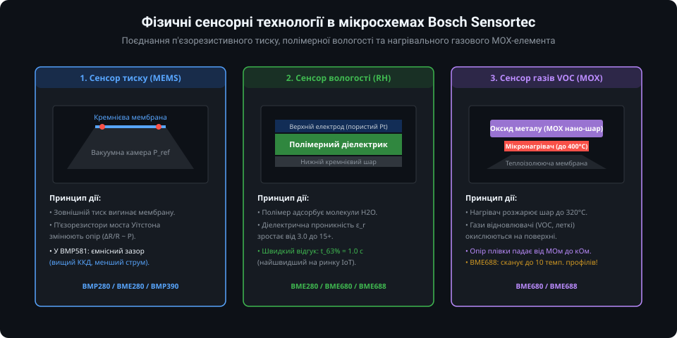
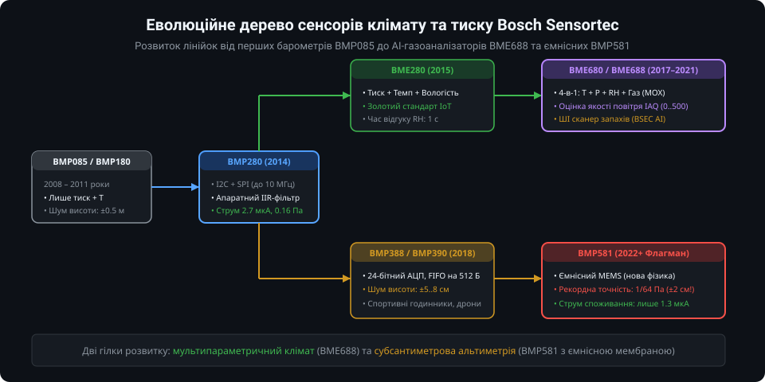
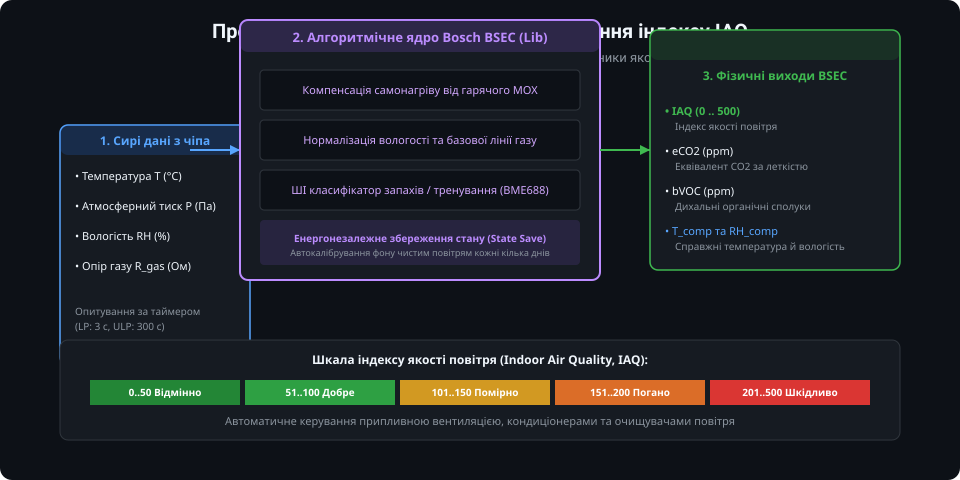
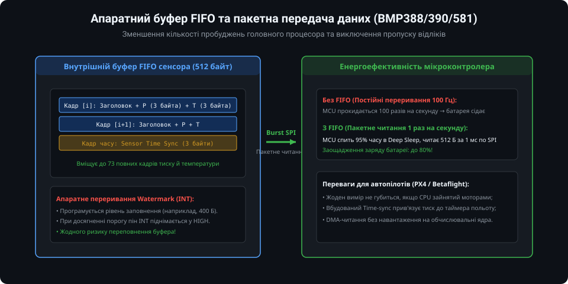
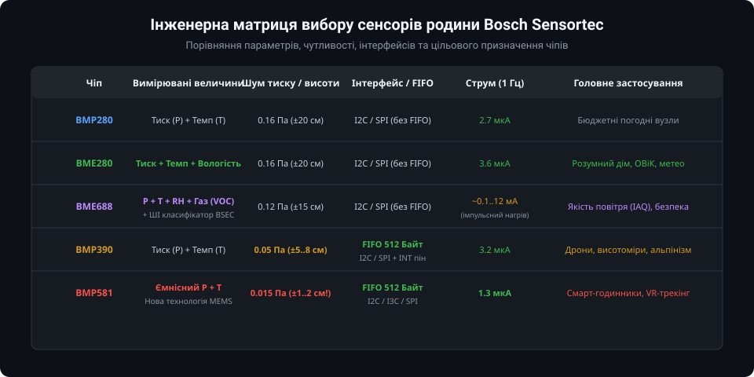

# Поглиблений аналіз та інженерна архітектура чіпів родини Bosch Sensortec MEMS

Датчики фізичних величин компанії Bosch Sensortec формують де-факто промисловий стандарт у портативній електроніці, автономній робототехніці, БПЛА та кліматичному контролі. У цьому поглибленому посібнику детально розглядаються фізичні принципи мікроелектромеханічних систем (MEMS), термодинамічні процеси газового аналізу MOX, внутрішня структура алгоритмічного рушія Bosch BSEC, апаратні можливості буферизації FIFO та низькорівнева реалізація драйвера на мові C з використанням структурованого API.

---

## 1. Архітектурна еволюція та фізика чутливих елементів: П'єзорезистивний vs Ємнісний MEMS

Еволюція барометричних сенсорів Bosch Sensortec охоплює кілька поколінь мікрообробки кремнію (silicon bulk and surface micromachining). Якщо перші покоління чіпів (BMP085, BMP180, BMP280, BME280) базувалися на п'єзорезистивному ефекті, то новітнє покоління (BMP581, BMP585) перейшло на революційний ємнісний принцип детектування.



### П'єзорезистивний принцип (BMP280, BME280, BMP388/390)
Чутливий елемент складається з пружної кремнієвої мембрани товщиною в кілька мікрометрів, над якою сформована вакуумна порожнина (еталонна камера опорного тиску). На краях мембрани методом дифузії або іонної імплантації вирощено чотири п'єзорезистори, з'єднані за схемою повного моста Вітстона (Wheatstone bridge):

- При зростанні зовнішнього тиску газу мембрана прогинається всередину порожнини.
- Механічні напруження розтягу та стиску в тілі кристала змінюють питомий опір напівпровідника завдяки п'єзорезистивному ефекту:
  
  ΔR / R = π_l · σ_l + π_t · σ_t

  де π_l та π_t — поздовжній та поперечний п'єзорезистивні коефіцієнти кремнію, σ_l та σ_t — механічні напруження.
- Несиметрія напруги діагоналі моста підсилюється малошумним інструментальним підсилювачем (PGA) та передається на 24-бітний сигма-дельта АЦП.
- Головні недоліки п'єзорезистивного підходу: висока температурна залежність нульового зміщення (TCO — Temperature Coefficient of Offset) та п'єзоелектричний дрейф під напругою, що вимагає постійного струму живлення моста близько 3–5 мкА навіть у режимах помірного оверсемплінгу.

### Ємнісний принцип нового покоління (BMP581)
У чіпі BMP581 розробники Bosch Sensortec реалізували ємнісну комірку тиску:
- Верхня гнучка електродна мембрана відокремлена субмікронним вакуумним проміжком від нижнього нерухомого металізованого електрода на кремнієвій підкладці.
- Ємність комірки визначається класичним виразом плоского конденсатора:
  
  C = ε_0 · ε_r · A / d

  де d — динамічна відстань між електродами під впливом атмосферного тиску.
- При прогині мембрани зміна ємності ΔC вимірюється спеціалізованим прецизійним перетворювачем ємність-код (CDC — Capacitance-to-Digital Converter) на перемиканих конденсаторах.
- Переваги ємнісної архітектури:
  1. Вкрай низький власний тепловий шум (noise floor): середньоквадратичне відхилення (RMS noise) знизилося до неймовірних 0.015 Па при максимальній фільтрації, що дозволяє фіксувати вертикальне переміщення сенсора на величину всього 1.2 сантиметра!
  2. Мінімальний струм споживання: оскільки в ємнісному мості відсутній постійний струм витоку через опір, BMP581 споживає всього 1.3 мкА при частоті опитування 1 Гц (включаючи температурну компенсацію).
  3. Майже нульовий температурний дрейф зміщення порівняно з п'єзорезистивними мостами (±0.5 Па/K проти ±1.5 Па/K у попередніх поколінь).

### Порівняльна таблиця фізичних та метрологічних характеристик

| Характеристика | BMP280 | BME280 | BMP390 | BMP581 | BME688 |
| :--- | :--- | :--- | :--- | :--- | :--- |
| **Фізичний тип тиску** | П'єзорезистивний | П'єзорезистивний | П'єзорезистивний | Ємнісний | П'єзорезистивний |
| **Діапазон тиску** | 300...1100 гПа | 300...1100 гПа | 300...1250 гПа | 300...1250 гПа | 300...1100 гПа |
| **RMS шум тиску** | 0.17 Па (~1.5 м) | 0.18 Па (~1.5 м) | 0.03 Па (~0.25 м) | 0.015 Па (~0.12 м) | 0.12 Па (~1.0 м) |
| **Абсолютна похибка** | ±1.0 гПа | ±1.0 гПа | ±0.5 гПа | ±0.3 гПа | ±0.6 гПа |
| **Час відгуку вологості** | — | 1.0 с (τ63%) | — | — | 8.0 с (τ63%) |
| **Апаратний FIFO буфер** | Немає | Немає | 512 байтів | 512 байтів | Немає |
| **Вбудований інтерфейс** | I2C / SPI (3/4w) | I2C / SPI (3/4w) | I2C / SPI (3/4w) | I2C / SPI / I3C | I2C / SPI (3/4w) |
| **Струм (1 Гц, норм. режим)** | 2.7 мкА | 3.6 мкА | 3.2 мкА | 1.3 мкА | ~12 мА (пік нагріву) |

---

## 2. Газовий сенсор MOX та динамічне термоциклування мікронагрівача (BME680 / BME688)

Чіпи BME680 та BME688 мають інтегрований хімічний сенсор на базі шару оксиду металу (Metal Oxide Semiconductor — MOX). Робота такого датчика кардинально відрізняється від статичних вимірювачів температури і тиску, оскільки він потребує активного керування температурою чутливого шару.



### Механізм поверхневої адсорбції
- Чутливий елемент являє собою мікроскопічну мембрану з діелектрика (SiO2/Si3N4), на поверхні якої розміщено платиновий або полікремнієвий мікронагрівач та наноструктурований шар оксиду металу (переважно SnO2 або леговані суміші WO3).
- За високої температури (200...400 °C) кисень повітря адсорбується на поверхні оксиду металу, захоплюючи електрони з зони провідності напівпровідника n-типу:
  
  O2(газ) + 2e- -> 2O-(адсорбований)

- Це створює збіднений електронами приповерхневий шар і формує високий потенційний бар'єр між зернами нанокристалів, що призводить до високого електричного опору плівки (R_base).
- Коли в повітрі з'являються гази-відновники — леткі органічні сполуки (VOC: етанол, ацетон, толуол, формальдегід), монооксид вуглецю (CO) або сірководень (H2S), вони вступають у каталітичну реакцію окиснення з адсорбованими іонами кисню:
  
  VOC + O- -> CO2 + H2O + e-

- Вивільнені електрони повертаються в зону провідності напівпровідника, потенційний бар'єр знижується, і опір газового шару різко падає (R_gas << R_base).

### Термодинаміка та енергетичні профілі мікронагрівача
Оскільки різні хімічні сполуки мають різні енергії активації окиснення на SnO2, сенсор може проявляти вибірковість залежно від робочої температури:
- **CO (чадний газ):** оптимальна температура реакції близько 150...200 °C.
- **Етанол та ацетон (VOC):** активне окиснення при 280...320 °C.
- **H2S та сірчані гази (задушливі запахи):** реакція протікає при 350...400 °C.

У сенсорі **BME688** реалізовано технологію багатокрокового сканування температури (Multi-Heater Profile). Мікроконтролер може задавати до 10 послідовних температурних кроків тривалістю від десятків мілісекунд до кількох секунд кожен (наприклад, 200 °C -> 250 °C -> 320 °C -> 150 °C).

```
Температура [°C]
  400 |                   +----+
  320 |         +----+    |    |
  250 |  +---+  |    |    |    |
  200 |  |   |  |    |    |    +----+
    0 +--+---+--+----+----+----+----+---> Час [мс]
      | 150ms| 200ms | 100ms| 300ms |
```

Зміна опору R_gas на кожному температурному кроці утворює характерний "відбиток газу" (Gas Fingerprint). Спеціалізоване програмне забезпечення Bosch AI Studio дозволяє натренувати компактну класифікаційну модель (Random Forest, SVM або мікро-нейромережу), яка розгортається на мікроконтролері та розпізнає присутність конкретних запахів: псування харчових продуктів (гниюче м'ясо/риба), тління проводки або запах свіжої кави.

---

## 3. Програмний стек Bosch BSEC та розрахунок індексу IAQ

Прямі покази опору газового сенсора (у кілоомах) не несуть однозначної інформації без знання історії чистоти середовища, вологості та температури. Для вирішення цього завдання компанія Bosch розробила закриту, але безкоштовну скомпільовану бібліотеку BSEC (Bosch Sensortec Environmental Cluster).



### Роль і внутрішні алгоритми BSEC
Бібліотека BSEC вирішує три критичні метрологічні завдання:
1. **Термічна декупляція (Thermal Decoupling):** Вбудований мікронагрівач розсіює до 10–12 мВт тепла, яке через корпус датчика нагріває суміжний кристал температури і вологості на 1.5–2.5 °C. BSEC містить математичну термодинамічну модель тепловідведення, що віднімає паразитний перегрів від каналів T і RH у реальному часі.
2. **Компенсація абсолютного вмісту вологи:** Молекули води (H2O) конкурують з іонами кисню на поверхні SnO2. Підвищення вологості штучно занижує опір газового шару. BSEC нормує покази опору за розрахованим абсолютним вмістом вологи (г/м³).
3. **Автоматичне калібрування базової лінії (Baseline Correction):** Чутливий шар старіє, а навколишній фон постійно коливається. BSEC веде статистичну модель історії показів за останні 4–28 днів, виявляючи найчистіший інтервал (максимальний опір у чистому провітреному приміщенні) і приймаючи його за реперну точку "ідеального повітря" (IAQ = 50).

### Шкала індексу якості повітря (IAQ Index)

| Індекс IAQ | Стан повітря | Концентрація eCO2 (еквівалент) | Рекомендована дія інженерної системи |
| :--- | :--- | :--- | :--- |
| **0 – 50** | Відмінно (Excellent) | 400 – 500 ppm | Вентиляція вимкнена, нормальний режим |
| **51 – 100** | Добре (Good) | 500 – 800 ppm | Повітря чисте, допустима пасивна вентиляція |
| **101 – 150** | Помірно (Lightly Polluted) | 800 – 1200 ppm | Рекомендується увімкнення припливної вентиляції |
| **151 – 200** | Забруднено (Moderately Polluted) | 1200 – 1800 ppm | Відчувається задуха, втома; обов'язкова вентиляція |
| **201 – 300** | Сильно забруднено (Heavily Polluted)| 1800 – 3000 ppm | Негативний вплив на здоров'я; форсована витяжка |
| **301 – 500** | Критично (Severely Polluted) | > 3000 ppm | Евакуація або негайне аварійне провітрювання |

### Збереження та відновлення стану BSEC
Оскільки алгоритм BSEC безперервно вивчає профіль базової лінії, перезавантаження мікроконтролера скидає накопичену історію. Для запобігання тривалому (до 48 годин) повторному калібруванню інженер повинен періодично зберігати стан BSEC (стан мікромоделі обсягом від 139 до 200 байтів залежно від версії) в енергонезалежну пам'ять (Flash / EEPROM) кожні 6–12 годин та відновлювати його під час ініціалізації MCU.

---

## 4. Робота з апаратним буфером FIFO та мікросекундними мітками часу (Sensor Time)

У системах керування польотом БПЛА, навігації всередині приміщень (indoor pedometry) та спортивних трекерах неприпустимо будити основний процесор на кожен одиничний відлік барометра (який може генеруватися на частотах 50–200 Гц). Барометри серій BMP388, BMP390 та BMP581 містять 512-байтний апаратний буфер FIFO.



### Формат кадру FIFO (Header-less vs Header-mode)
У режимі **Header-mode** кожен блок даних у буфері предваряється однобайтним заголовком, що визначає тип корисного навантаження:
- `0x80`: Помилка конфігурації або переповнення (FIFO overflow).
- `0x90`: Кадр містить тільки дані температури (3 байти).
- `0x94`: Кадр містить тільки дані тиску (3 байти).
- `0x98`: Кадр містить об'єднані дані температури (3 байти) та тиску (3 байти).
- `0xA0`: Кадр сенсорного часу (Sensor Time — 3 байти лічильника внутрішнього генератора).

```
+-------------+----------------------+--------------------+--------------------+
| Заголовок   | Дані температури     | Дані тиску         | Сенсорний час      |
| 1 байт      | 3 байти (24-біт АЦП) | 3 байти (24-біт)   | 3 байти (необов'яз)|
+-------------+----------------------+--------------------+--------------------+
```

### Синхронізація часу Sensor Time
Сенсор має автономний внутрішній тактовий генератор низької потужності, лічильник якого збільшується кожні 39.0625 мкс (частота квантування ~25.6 кГц). Коли в потік FIFO вставляється кадр Sensor Time, головний процесор отримує апаратну мітку точного моменту завершення перетворення АЦП без прив'язки до латентності шини I2C чи затримок обробки переривань в RTOS.

### Режим Watermark і зниження енергоспоживання
- Регістр `FIFO_WTM` встановлює поріг заповнення буфера (наприклад, 400 байтів із 512).
- Сенсор збирає дані автономно в режимі ультранизького енергоспоживання, доки кількість байтів у FIFO не досягне порогового значення Watermark.
- Після досягнення порогу активується апаратна лінія переривання `INT1`.
- Мікроконтролер виходить зі стану глибокого сну (Deep Sleep), за одну DMA-транзакцію по шині SPI на швидкості 10 МГц зчитує весь пакет (400 байтів за 350 мкс), передає відліки в фільтр Калмана навігаційного стека та повертається в режим сну.
- Це дозволяє знизити середній струм споживання мікроконтролера в 10–50 разів порівняно з покроковим опитуванням за таймером.

---

## 5. Промислова реалізація: C драйвер на основі Bosch Sensortec Sensor API

Компанія Bosch Sensortec надає відкриті бібліотеки низькорівневих драйверів мовою ANSI C для всієї лінійки чіпів. Архітектура драйвера повністю відокремлена від апаратної платформи за допомогою структури функціональних покажчиків зворотного виклику (Hardware Abstraction Layer).



Нижче наведено промисловий приклад конфігурації, ініціалізації та пакетного читання компенсованих даних для барометра **BMP390** з використанням офіційного API-патерну.

```c
/**
 * @file bmp390_industrial_driver.c
 * @brief Повний взірець промислової інтеграції барометра Bosch BMP390
 * @note Використовує апаратну абстракцію I2C/SPI та цілочисельну компенсацію
 */

#include <stdint.h>
#include <stdbool.h>
#include <string.h>

/* Визначення кодів помилок та констант BMP390 */
#define BMP390_CHIP_ID                 0x60
#define BMP390_REG_CHIP_ID             0x00
#define BMP390_REG_ERR                 0x02
#define BMP390_REG_STATUS              0x03
#define BMP390_REG_DATA_0              0x04  /* Регістри тиску XLSB, LSB, MSB */
#define BMP390_REG_DATA_3              0x07  /* Регістри темп. XLSB, LSB, MSB */
#define BMP390_REG_PWR_CTRL            0x1B
#define BMP390_REG_OSR                 0x1C
#define BMP390_REG_ODR                 0x1D
#define BMP390_REG_CONFIG              0x1F
#define BMP390_REG_CALIB_DATA          0x31

/* Структура коефіцієнтів калібрування з NVM пам'яті сенсора */
typedef struct {
    uint16_t par_t1;
    uint16_t par_t2;
    int8_t   par_t3;
    int16_t  par_p1;
    int16_t  par_p2;
    int8_t   par_p3;
    int8_t   par_p4;
    uint16_t par_p5;
    uint16_t par_p6;
    int8_t   par_p7;
    int8_t   par_p8;
    int16_t  par_p9;
    int8_t   par_p10;
    int8_t   par_p11;
    int64_t  t_lin; /* Розрахована лінеаризована температура для компенсації P */
} bmp390_calib_data_t;

/* Структура пристрою з функціональними покажчиками HAL */
typedef int8_t (*bmp3_read_fptr_t)(uint8_t reg_addr, uint8_t *read_data, uint32_t len, void *intf_ptr);
typedef int8_t (*bmp3_write_fptr_t)(uint8_t reg_addr, const uint8_t *write_data, uint32_t len, void *intf_ptr);
typedef void   (*bmp3_delay_us_fptr_t)(uint32_t period_us, void *intf_ptr);

typedef struct {
    uint8_t chip_id;
    void *intf_ptr;                     /* Вказівник на апаратний дескриптор I2C/SPI */
    bmp3_read_fptr_t read;              /* Зчитування блоку регістрів */
    bmp3_write_fptr_t write;            /* Запис блоку регістрів */
    bmp3_delay_us_fptr_t delay_us;      /* Прецизійна мікросекундна затримка */
    bmp390_calib_data_t calib;          /* Завантажені коефіцієнти компенсації */
} bmp390_dev_t;

/* Структура компенсованих вихідних інженерних даних */
typedef struct {
    double temperature_c;               /* Температура у градусах Цельсія */
    double pressure_pa;                 /* Тиск у Паскалях (Па) */
} bmp390_data_t;

/**
 * @brief Поліноміальна компенсація температури (Double precision IEEE 754)
 */
static double bmp390_compensate_temperature(uint32_t uncomp_temp, bmp390_dev_t *dev)
{
    double partial_data1;
    double partial_data2;

    partial_data1 = (double)(uncomp_temp - (256.0 * (double)dev->calib.par_t1));
    partial_data2 = (double)(dev->calib.par_t2 * partial_data1);
    
    double partial_data3 = partial_data1 * partial_data1;
    double partial_data4 = partial_data3 * (double)dev->calib.par_t3;
    
    double t_lin = partial_data2 + (partial_data4 / 1048576.0);
    dev->calib.t_lin = (int64_t)t_lin;

    return (t_lin / 512.0);
}

/**
 * @brief Поліноміальна компенсація тиску з використанням лінеаризованої температури
 */
static double bmp390_compensate_pressure(uint32_t uncomp_press, bmp390_dev_t *dev)
{
    double comp_press;
    double partial_data1;
    double partial_data2;
    double partial_data3;
    double partial_data4;
    double partial_out1;
    double partial_out2;

    partial_data1 = (double)dev->calib.par_p6 * (double)dev->calib.t_lin;
    partial_data2 = (double)dev->calib.par_p7 * ((double)dev->calib.t_lin * (double)dev->calib.t_lin);
    partial_data3 = (double)dev->calib.par_p8 * ((double)dev->calib.t_lin * (double)dev->calib.t_lin * (double)dev->calib.t_lin);
    partial_out1 = (double)dev->calib.par_p5 + (partial_data1 / 8.0) + (partial_data2 / 32768.0) + (partial_data3 / 4194304.0);

    partial_data1 = (double)dev->calib.par_p2 * (double)dev->calib.t_lin;
    partial_data2 = (double)dev->calib.par_p3 * ((double)dev->calib.t_lin * (double)dev->calib.t_lin);
    partial_data3 = (double)dev->calib.par_p4 * ((double)dev->calib.t_lin * (double)dev->calib.t_lin * (double)dev->calib.t_lin);
    partial_out2 = (double)uncomp_press * ((double)dev->calib.par_p1 + (partial_data1 / 16.0) + (partial_data2 / 65536.0) + (partial_data3 / 8388608.0));

    partial_data1 = (double)uncomp_press * (double)uncomp_press;
    partial_data2 = (double)dev->calib.par_p9 + (double)dev->calib.par_p10 * (double)dev->calib.t_lin;
    partial_data3 = partial_data1 * partial_data2;
    partial_data4 = partial_data3 + ((double)uncomp_press * (double)uncomp_press * (double)uncomp_press) * (double)dev->calib.par_p11;
    
    comp_press = (partial_out1 + (partial_out2 / 524288.0) + (partial_data4 / 4294967296.0));
    return comp_press;
}

/**
 * @brief Зчитування калібрувальних коефіцієнтів з NVM
 */
int8_t bmp390_read_calibration_data(bmp390_dev_t *dev)
{
    uint8_t reg_buf[21];
    int8_t rslt = dev->read(BMP390_REG_CALIB_DATA, reg_buf, 21, dev->intf_ptr);
    if (rslt != 0) return rslt;

    dev->calib.par_t1 = (uint16_t)(((uint16_t)reg_buf[1] << 8) | reg_buf[0]);
    dev->calib.par_t2 = (uint16_t)(((uint16_t)reg_buf[3] << 8) | reg_buf[2]);
    dev->calib.par_t3 = (int8_t)reg_buf[4];
    dev->calib.par_p1 = (int16_t)(((int16_t)reg_buf[6] << 8) | reg_buf[5]);
    dev->calib.par_p2 = (int16_t)(((int16_t)reg_buf[8] << 8) | reg_buf[7]);
    dev->calib.par_p3 = (int8_t)reg_buf[9];
    dev->calib.par_p4 = (int8_t)reg_buf[10];
    dev->calib.par_p5 = (uint16_t)(((uint16_t)reg_buf[12] << 8) | reg_buf[11]);
    dev->calib.par_p6 = (uint16_t)(((uint16_t)reg_buf[14] << 8) | reg_buf[13]);
    dev->calib.par_p7 = (int8_t)reg_buf[15];
    dev->calib.par_p8 = (int8_t)reg_buf[16];
    dev->calib.par_p9 = (int16_t)(((int16_t)reg_buf[18] << 8) | reg_buf[17]);
    dev->calib.par_p10 = (int8_t)reg_buf[19];
    dev->calib.par_p11 = (int8_t)reg_buf[20];

    return 0;
}

/**
 * @brief Повна ініціалізація та конфігурація датчика BMP390
 */
int8_t bmp390_init_and_configure(bmp390_dev_t *dev)
{
    uint8_t chip_id = 0;
    int8_t rslt;

    /* 1. Перевірка Chip ID */
    rslt = dev->read(BMP390_REG_CHIP_ID, &chip_id, 1, dev->intf_ptr);
    if (rslt != 0 || chip_id != BMP390_CHIP_ID) {
        return -1; /* Помилка зв'язку або невірний тип сенсора */
    }
    dev->chip_id = chip_id;

    /* 2. Завантаження калібрувальних коефіцієнтів */
    rslt = bmp390_read_calibration_data(dev);
    if (rslt != 0) return -2;

    /* 3. Налаштування оверсемплінгу (OSR): Тиск x8, Температура x2 */
    uint8_t osr_reg = (0x01 << 3) | (0x03); /* osr_t = 2x, osr_p = 8x */
    rslt = dev->write(BMP390_REG_OSR, &osr_reg, 1, dev->intf_ptr);
    if (rslt != 0) return -3;

    /* 4. Налаштування вихідної частоти (ODR): 50 Гц (sub-sampling) */
    uint8_t odr_reg = 0x02; /* 50 Hz */
    rslt = dev->write(BMP390_REG_ODR, &odr_reg, 1, dev->intf_ptr);
    if (rslt != 0) return -4;

    /* 5. Налаштування IIR фільтра: коефіцієнт згладжування 3 */
    uint8_t config_reg = (0x02 << 1); /* IIR filter coef = 3 */
    rslt = dev->write(BMP390_REG_CONFIG, &config_reg, 1, dev->intf_ptr);
    if (rslt != 0) return -5;

    /* 6. Увімкнення датчика в безперервний нормальний режим (Normal Mode) */
    /* PWR_CTRL: press_en = 1, temp_en = 1, mode = 0x03 (Normal mode) */
    uint8_t pwr_ctrl = (1 << 0) | (1 << 1) | (0x03 << 4);
    rslt = dev->write(BMP390_REG_PWR_CTRL, &pwr_ctrl, 1, dev->intf_ptr);
    if (rslt != 0) return -6;

    dev->delay_us(10000, dev->intf_ptr); /* Затримка 10 мс для виходу на робочий режим */
    return 0;
}

/**
 * @brief Пакетне зчитування вимірювань тиску та температури
 */
int8_t bmp390_get_sensor_data(bmp390_dev_t *dev, bmp390_data_t *data)
{
    uint8_t raw_data[6];
    int8_t rslt = dev->read(BMP390_REG_DATA_0, raw_data, 6, dev->intf_ptr);
    if (rslt != 0) return rslt;

    /* Розпакування 24-бітних слів АЦП */
    uint32_t raw_pressure = (uint32_t)((raw_data[2] << 16) | (raw_data[1] << 8) | raw_data[0]);
    uint32_t raw_temp = (uint32_t)((raw_data[5] << 16) | (raw_data[4] << 8) | raw_data[3]);

    /* Обов'язкова послідовність: спочатку рахується температура, оскільки вона оновлює t_lin */
    data->temperature_c = bmp390_compensate_temperature(raw_temp, dev);
    data->pressure_pa = bmp390_compensate_pressure(raw_pressure, dev);

    return 0;
}
```

### Практичні інженерні висновки та рекомендації
1. **Захист від світла та повітряних потоків:** Кристали барометрів мають відкритий отвір у металевій кришці. Попадання прямих сонячних променів на кремній викликає фотоелектричний ефект (стрибки тиску до 5–10 гПа). Вхідний порт повинен бути прикритий чорною світлонепроникною повітропроникною мембраною (наприклад, пористим фторопластом ePTFE).
2. **Паразитне нагрівання друкованої плати:** Датчики вологості та тиску слід розташовувати на краю друкованої плати, відокремлюючи їх фрезерованими тепловими пазами (thermal relief slots) від гарячих компонентів: силових перетворювачів DC-DC, зарядних чіпів акумулятора та радіомодулів (Wi-Fi, 4G, Bluetooth).
3. **Вибір комунікаційної шини:** При частотах опитування вище 25 Гц рекомендується використання інтерфейсу SPI (або I3C у випадку BMP581), оскільки стандартна шина I2C 100/400 кГц створює високе навантаження на процесор під час передачі великих пакетів FIFO.
