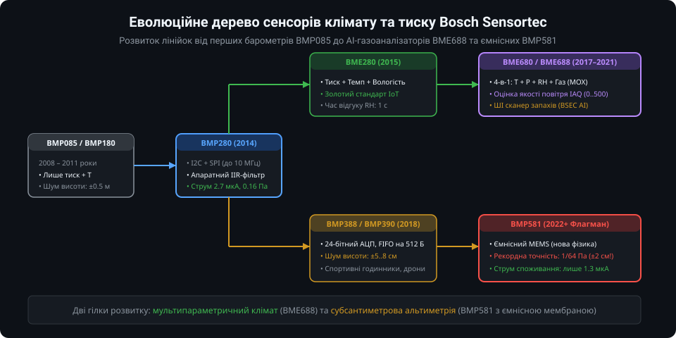
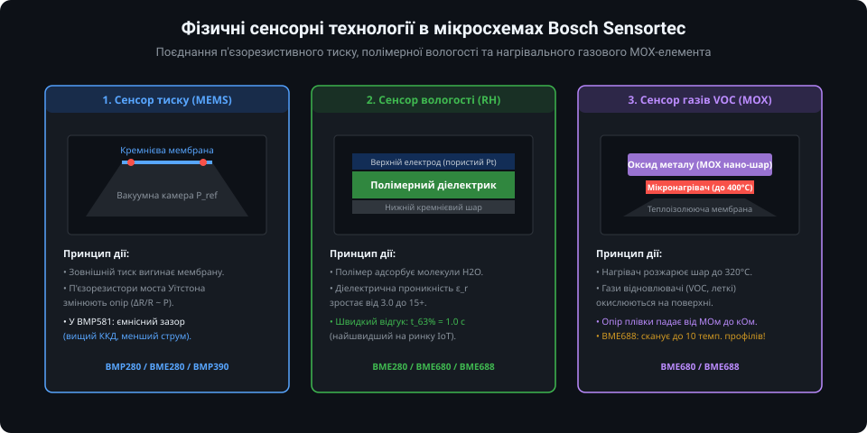
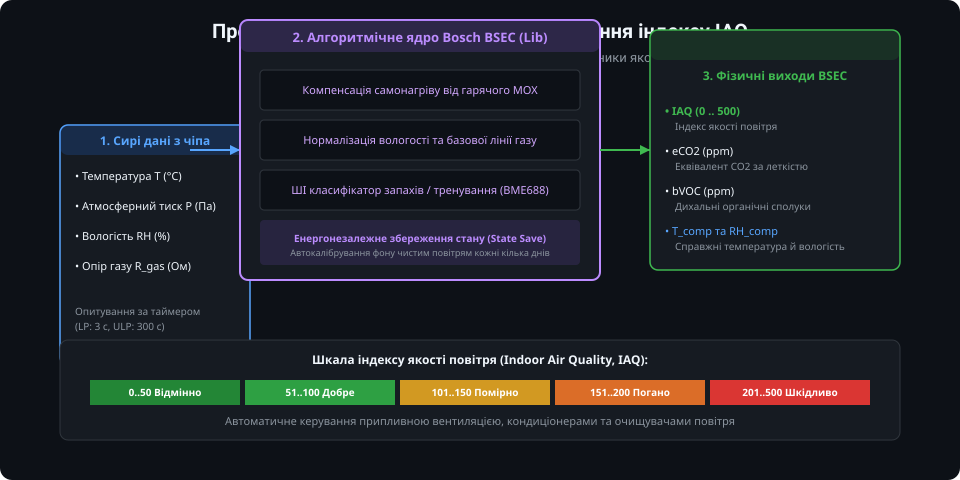
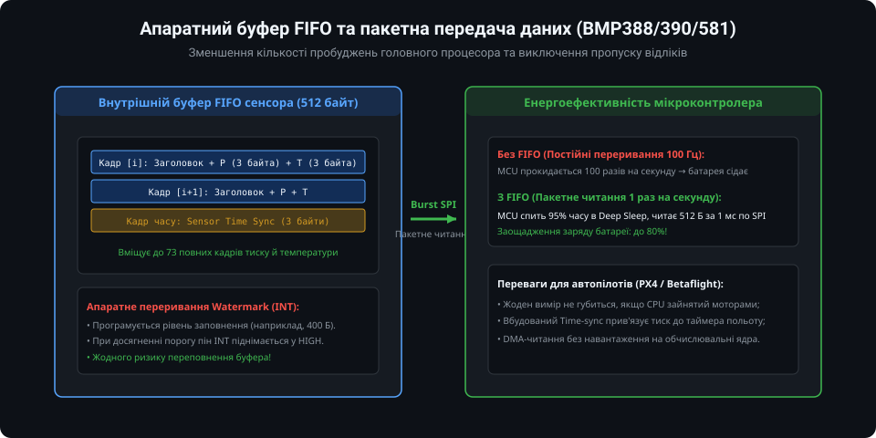
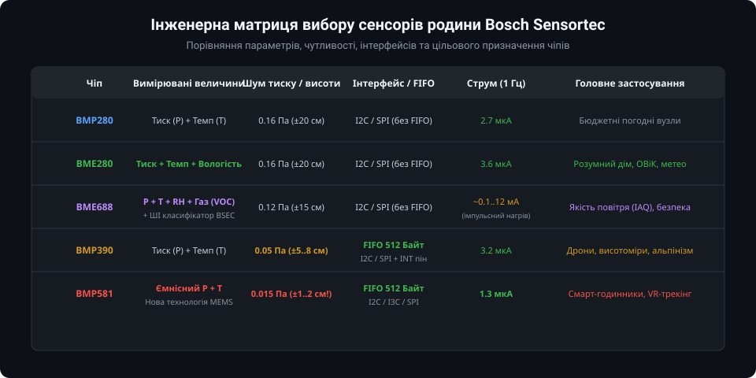

# Огляд родини мікрокліматичних та барометричних давачів Bosch Sensortec

Німецька компанія **Bosch Sensortec** є світовим піонером та беззаперечним лідером у сегменті мікроелектромеханічних систем (MEMS) для споживчої, автомобільної та промислової електроніки. Їхня лінійка мікрокліматичних та барометричних сенсорів формує де-факто стандарти для смартфонів, спортивних годинників, безпілотних літальних апаратів (дронів) та бездротових вузлів розумного дому.

---

### 1. Еволюційна дорожня карта: від BMP085 до BMP581

Розвиток лінійки датчиків тиску та клімату Bosch відбувався за двома взаємопов'язаними напрямками: розширення кількості вимірюваних середовищ (кліматична гілка) та підвищення субсантиметрової точності альтиметрії (барометрична гілка).

1. **Раннє покоління (BMP085, BMP180):**
   Перші масові цифрові барометри (2008–2011). Працювали виключно по I2C, мали фіксовану адресу 0x77 і вимагали від мікроконтролера ручного керування кожним тактом конверсії.
2. **Барометричний стандарт (BMP280):**
   Справжній індустріальний стрибок 2014 року: підтримка SPI та I2C, зменшення струму споживання до 2.7 мкА, вбудований автономний Normal-режим та апаратний IIR-фільтр низьких частот.
3. **Повний мікроклімат (BME280):**
   Об'єднання в одному корпусі 2.5x2.5 мм датчика атмосферного тиску, температури та надшвидкого ємнісного гігрометра з часом реакції 1 секунда. Став світовим "золотим стандартом" для метеостанцій та систем вентиляції HVAC.
4. **Газовий аналіз та якість повітря (BME680, BME688):**
   Додавання четвертого каналу — напівпровідникового газового сенсора летких органічних сполук (VOC) з керованим мікронагрівачем. Модель BME688 отримала можливість сканування газових сумішей за допомогою штучного інтелекту.
5. **Прецизійна навігація (BMP388, BMP390, BMP581):**
   Спеціалізовані барометри для дронів, альпінізму та фітнес-трекерів. Впровадження 24-бітного АЦП, апаратного буфера FIFO та перехід на ємнісну технологію MEMS у BMP581, що дозволило фіксувати вертикальні зміщення на рівні **±1–2 см**.

---

### 2. Фізичні принципи MEMS: як це влаштовано всередині

Корпус кожного сенсора Bosch містить мініатюрну кремнієву фабрику, де на кристалі реалізовано різні фізичні принципи детектування:

- **П'єзорезистивний та ємнісний тиск:**
  У датчиках BMP280/BME280/BMP390 тонка кремнієва мембрана перекриває герметичну вакуумну камеру. Деформація мембрани під дією атмосферного стовпа змінює опір п'єзорезисторів моста Уїтстона. У новітньому BMP581 застосовано ємнісний зазор: мембрана діє як рухома обкладка конденсатора, що кардинально знижує споживання струму (до 1.3 мкА) та усуває температурний дрейф резисторів.
- **Швидкісна полімерна вологість:**
  Мікроконденсатор із пористим верхнім електродом та спеціальним діелектричним полімером. Водяна пара миттєво дифундує в пори, збільшуючи діелектричну проникність пропорційно відносній вологості середовища (RH).
- **Газовий сенсор MOX (Metal Oxide Semiconductor):**
  У сенсорах BME680/BME688 встановлено мікроскопічний нагрівальний столик (Micro-hotplate), який розжарює оксидну плівку до 320–400 °C. Окислювально-відновні реакції молекул летких органічних сполук (спирти, альдегіди, ацетон, чадний газ) на гарячій поверхні викликають різке падіння електричного опору плівки.

---

### 3. Програмний комплекс BSEC та індекс якості повітря (IAQ)

Сам по собі газовий сенсор BME680/688 видає лише електричний опір нагрітого шару в Омах (`R_gas`), який залежить від поточної температури, вологості та передісторії датчика. Щоб перетворити це число у зрозумілі величини, Bosch створила закриту математичну бібліотеку **BSEC (Bosch Sensortec Environmental Cluster)**:

Алгоритм BSEC реалізує:
1. **Компенсацію взаємного впливу:** Нагрівач MOX розсіює тепло, тому BSEC автоматично коригує покази термометра і гігрометра кристала.
2. **Стеження за фоном (Baseline tracking):** Бібліотека постійно аналізує коливання опору за кілька діб, знаходячи стан "найчистішого повітря" у приміщенні та адаптуючи нульову точку.
3. **Обчислення індексу IAQ (Indoor Air Quality):**
   - **0..50 (Відмінно):** Чисте гірське або лісове повітря;
   - **51..100 (Добре):** Нормальний стан провітреної кімнати;
   - **101..150 (Помірно):** Рекомендовано провітрити приміщення;
   - **151..200 (Погано):** Висока концентрація летких речовин, зниження працездатності;
   - **201..500 (Шкідливо):** Необхідна термінова примусова вентиляція.
4. **Оцінку еквівалента CO2 (eCO2):** Розрахунок летких продуктів людського дихання в еквіваленті часток на мільйон (ppm).

---

### 4. Апаратний буфер FIFO в навігаційних датчиках

При встановленні датчика на швидколітаючий квадрокоптер або в спортивний GPS-годинник частота опитування тиску може досягати 50–200 Гц. Якщо мікроконтролер перериватиметься на кожен відлік, батарея пристрою розрядиться за лічені години.

У моделях **BMP388, BMP390 та BMP581** впроваджено апаратний буфер FIFO розміром 512 байтів:

- **Пакетне накопичення:** Сенсор самостійно вимірює тиск, температуру та мітку часу (Sensor Time), складаючи компактні кадри у чергу.
- **Переривання Watermark:** Коли буфер заповнюється до запрограмованого порогу (наприклад, 400 байт), сенсор піднімає пін `INT`.
- **Енергоефективність:** Головний мікроконтролер спить у режимі глибокого сну (Deep Sleep) 95% часу, прокидається 1 раз на секунду, миттєво вичитує весь пакет по шині SPI на швидкості до 10 МГц і знову засинає. Це продовжує час автономної роботи пристрою в рази.

---

### 5. Інженерна матриця вибору сенсора Bosch

Вибір конкретної моделі визначається технічними вимогами проекту та бюджетом компонентів:

1. **BMP280:** Оптимальний вибір для простих бюджетних проектів, де потрібен лише тиск і температура, або для заміни застарілих BMP180.
2. **BME280:** Бездоганне рішення для домашніх метеостанцій, кліматичних моніторів серверних шаф та автоматики теплої підлоги.
3. **BME688:** Найкращий вибір для моніторів якості повітря в офісах, школах, витяжках кухонь та раннього виявлення займання ізоляції (AI smell detection).
4. **BMP390:** Професійний вибір для квадрокоптерів (Betaflight, INAV, ArduPilot) та альпіністських годинників з апаратною фіксацією сходження сходами.
5. **BMP581:** Передовий флагман для носимої електроніки найвищого класу, де критична точність до 1–2 сантиметрів і мінімальний струм 1.3 мкА.

---

### Підсумки та висновки

Родина Bosch Sensortec покриває повний спектр кліматичних і барометричних задач: від недорогих рішень до передових комбінованих сенсорів з машинним навчанням. Інтеграція апаратних фільтрів, буферів FIFO та алгоритмів термокомпенсації робить ці чіпи світовим еталоном сучасної сенсорної мікроелектроніки.
