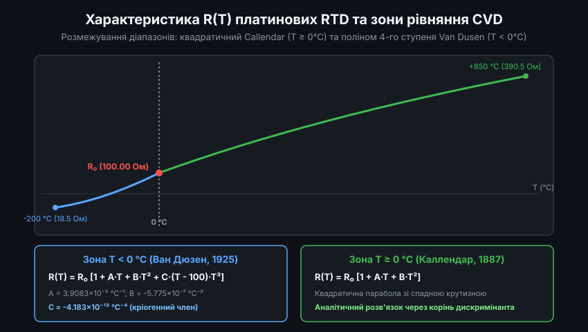
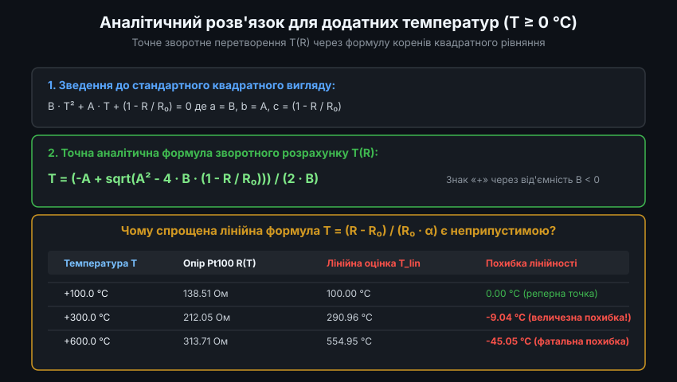
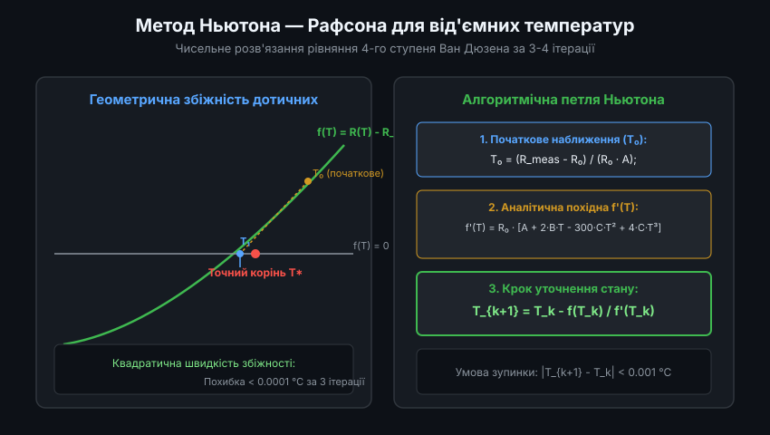
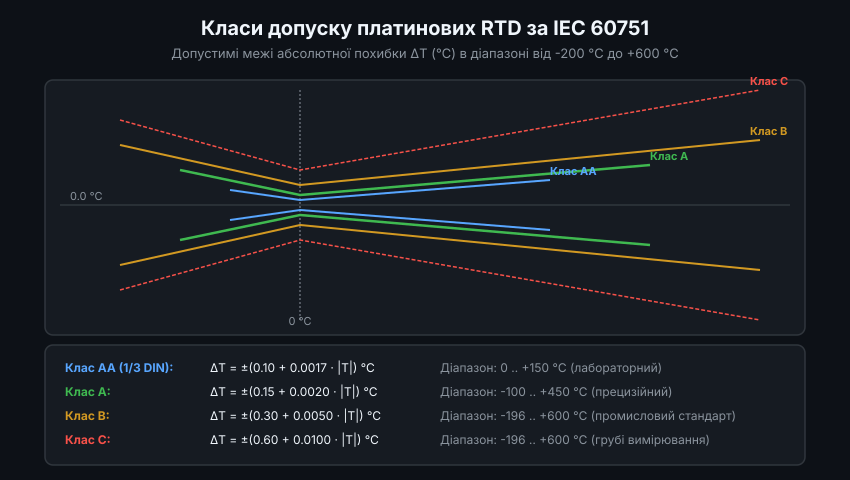
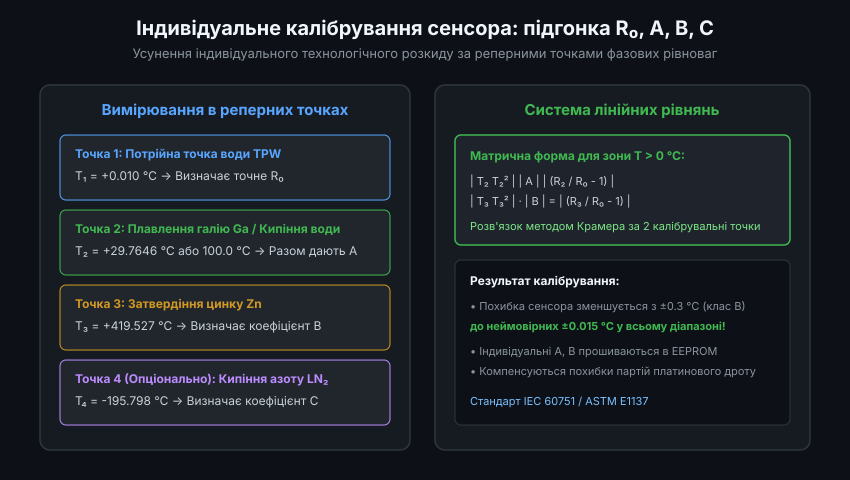

# Рівняння Каллендара — Ван Дюзена для платинових термоопорів RTD: Теорія, алгоритми та інженерна реалізація

Платинові резистивні термоперетворювачі (Resistance Temperature Detectors, RTD) є фундаментальною основою промислової термометрії. Хімічна інертність платини, стабільність її кристалічної решітки та висока температура плавлення (+1768 °C) забезпечують неперевершену повторюваність вимірювань. Проте закон зміни питомого електричного опору платини від температури суттєво відхиляється від лінійного закону Ома. Міжнародні стандарти IEC 60751, DIN EN 60751 та ASTM E1137 встановлюють як нормативну математичну модель рівняння Каллендара — Ван Дюзена (Callendar-Van Dusen, CVD).

---

### 1. Фізична природа опору платини та пряме рівняння CVD

У металах електричний опір визначається розсіюванням електронів провідності на теплових коливаннях кристалічної решітки (фононах) та на дефектах структури (домішках). За правилом Маттиссена питомий опір описується як `rho(T) = rho_ideal(T) + rho_residual`. Зі зростанням температури амплітуда коливань фононів зростає, що викликає монотонне зростання електричного опору.



Для чистої платини (чистота не менше 99.99%) математична модель розділена на два температурні діапазони відносно реперної точки плавлення льоду (0 °C):

#### Пряме рівняння R(T):
- **Діапазон T >= 0 °C (від 0 °C до +850 °C)**:
  `R(T) = R_0 * (1 + A * T + B * T^2)`
- **Діапазон T < 0 °C (від -200 °C до 0 °C)**:
  `R(T) = R_0 * (1 + A * T + B * T^2 + C * (T - 100) * T^3)`

де стандартні коефіцієнти для промислових сенсорів із температурним коефіцієнтом `alpha = 0.003851 °C^-1` становлять:
- `R_0`: номінальний опір при 0.0 °C (зазвичай 100.00 Ом для Pt100, 500.0 Ом для Pt500, 1000.0 Ом для Pt1000).
- `A = 3.9083 * 10^-3 °C^-1`
- `B = -5.7750 * 10^-7 °C^-2`
- `C = -4.1830 * 10^-12 °C^-4`

Зв'язок із класичними константами Каллендара (`alpha`, `delta`, `beta`):
`A = alpha * (1 + delta / 100)`
`B = -alpha * delta / 10000`
`C = -alpha * beta / 100000000`

Реалізація прямого розрахунку опору мовою C:

```c
#include <stdint.h>

double cvd_calculate_resistance(double temp_c, double r0, double a, double b, double c)
{
    if (temp_c >= 0.0) {
        return r0 * (1.0 + a * temp_c + b * temp_c * temp_c);
    } else {
        double t2 = temp_c * temp_c;
        double t3 = t2 * temp_c;
        return r0 * (1.0 + a * temp_c + b * t2 + c * (temp_c - 100.0) * t3);
    }
}
```

---

### 2. Аналітичний розв'язок зворотного завдання для T >= 0 °C

У вимірювальних приладах первинною виміряною величиною є опір `R`. Для діапазону температур від 0 °C до +850 °C рівняння Каллендара являє собою алгебраїчне квадратне рівняння відносно невідомої температури `T`.



Перетворимо рівняння:
`R / R_0 = 1 + A * T + B * T^2`
`B * T^2 + A * T + (1 - R / R_0) = 0`

Дискримінант квадратного рівняння:
`D = A^2 - 4 * B * (1 - R / R_0)`

Оскільки фізичний коефіцієнт `B` є від'ємним (`B = -5.775 * 10^-7`), величина `-4 * B` є додатною. Для всіх реальних опорів `R >= R_0` дискримінант є строго додатним, а знаменник `2 * B` — від'ємним. Щоб отримати додатне значення температури `T >= 0`, у чисельнику необхідно обрати знак «мінус» перед квадратним коренем, або, що еквівалентно при винесенні знака:

`T = (-A + sqrt(A^2 - 4 * B * (1 - R / R_0))) / (2 * B)`

Реалізація аналітичного розв'язку мовою C:

```c
#include <math.h>

double cvd_temperature_positive(double r_meas, double r0, double a, double b)
{
    // Захист від від'ємного підкореневого виразу
    double discriminant = a * a - 4.0 * b * (1.0 - (r_meas / r0));
    if (discriminant < 0.0) {
        return -999.0; // Помилка: недопустимий опір
    }

    double temp_c = (-a + sqrt(discriminant)) / (2.0 * b);
    return temp_c;
}
```

Обчислювальна складність формули становить лише одне взяття квадратного кореня, що виконується за лічені мікросекунди навіть на ядрах Cortex-M4F із одинарною чи подвійною точністю.

---

### 3. Чисельні методи зворотного розрахунку для від'ємних температур T < 0 °C

Для від'ємного діапазону температур (від -200 °C до 0 °C) пряме рівняння Ван Дюзена набуває вигляду полінома четвертого ступеня:
`f(T) = R_0 * (1 + A * T + B * T^2 - 100 * C * T^3 + C * T^4) - R_meas = 0`

Точний аналітичний розв'язок через формули Феррарі вимагає обчислення кубічних коренів і комплексних чисел, що є вкрай нестійким до похибок округлення у 32-бітних процесорах. Тому в реальних вимірювачах застосовують чисельний ітераційний метод дотичних Ньютона — Рафсона.



Аналітична похідна функції нев'язки за температурою:
`f'(T) = d(R)/dT = R_0 * (A + 2 * B * T - 300 * C * T^2 + 4 * C * T^3)`

Ітераційний крок розраховується як:
`T_{k+1} = T_k - f(T_k) / f'(T_k)`

Високоефективна реалізація алгоритму на C з гарантованою збіжністю:

```c
#include <math.h>

double cvd_temperature_newton(double r_meas, double r0, double a, double b, double c)
{
    // Початкове наближення за лінійною екстраполяцією
    double t_est = (r_meas - r0) / (r0 * a);

    const int max_iterations = 10;
    const double tolerance = 0.0001; // Точність 0.0001 °C (0.1 мК)

    for (int i = 0; i < max_iterations; i++) {
        double t2 = t_est * t_est;
        double t3 = t2 * t_est;
        double t4 = t3 * t_est;

        // Обчислення нев'язки f(T)
        double r_sim = r0 * (1.0 + a * t_est + b * t2 - 100.0 * c * t3 + c * t4);
        double f_val = r_sim - r_meas;

        // Перевірка умови зупинки
        if (fabs(f_val) < 0.00005) { // Відповідність по опору < 0.05 мОм
            break;
        }

        // Обчислення похідної f'(T)
        double f_prime = r0 * (a + 2.0 * b * t_est - 300.0 * c * t2 + 4.0 * c * t3);
        if (fabs(f_prime) < 1e-9) {
            break; // Захист від ділення на нуль
        }

        double delta_t = f_val / f_prime;
        t_est -= delta_t;

        if (fabs(delta_t) < tolerance) {
            break;
        }
    }

    return t_est;
}
```

Алгоритм виконує максимум 3-4 кроки циклу для досягнення метрологічної похибки менше 0.0005 °C у всьому діапазоні від -200 °C до 0 °C.

---

### 4. Нормативні класи точності за стандартом IEC 60751

Міжнародний стандарт IEC 60751 регламентує допустимі границі абсолютної похибки платинових RTD залежно від робочого діапазону температур.



#### Рівняння коридорів допуску:
- **Клас AA**: `Delta_T = +-(0.10 + 0.0017 * |T|) °C`, діє в межах 0 .. +150 °C.
- **Клас A**: `Delta_T = +-(0.15 + 0.0020 * |T|) °C`, діє в межах -100 .. +450 °C (для дротяних RTD: -200 .. +600 °C).
- **Клас B**: `Delta_T = +-(0.30 + 0.0050 * |T|) °C`, діє в межах -196 .. +600 °C.
- **Клас C**: `Delta_T = +-(0.60 + 0.0100 * |T|) °C`, діє в межах -196 .. +600 °C.

Таблиця допустимих відхилень опору та температури для Pt100 (R0 = 100.00 Ом):

| Температура T | Клас AA (ΔT / ΔR) | Клас A (ΔT / ΔR) | Клас B (ΔT / ΔR) | Клас C (ΔT / ΔR) |
| :--- | :--- | :--- | :--- | :--- |
| **-100 °C** | — | ±0.35 °C / ±0.14 Ом | ±0.80 °C / ±0.32 Ом | ±1.60 °C / ±0.64 Ом |
| **0 °C** | ±0.10 °C / ±0.04 Ом | ±0.15 °C / ±0.06 Ом | ±0.30 °C / ±0.12 Ом | ±0.60 °C / ±0.24 Ом |
| **+100 °C** | ±0.27 °C / ±0.10 Ом | ±0.35 °C / ±0.13 Ом | ±0.80 °C / ±0.30 Ом | ±1.60 °C / ±0.61 Ом |
| **+300 °C** | — | ±0.75 °C / ±0.25 Ом | ±1.80 °C / ±0.59 Ом | ±3.60 °C / ±1.18 Ом |
| **+500 °C** | — | — | ±2.80 °C / ±0.79 Ом | ±5.60 °C / ±1.57 Ом |

Для високоточних систем вимірювання (наприклад, вторинних термометрів) датчик класу B без індивідуального калібрування вносить неприпустимо велику невизначеність.

---

### 5. Індивідуальне багатоточкове калібрування сенсорів (CVD Parameter Fitting)

Для усунення виробничого розкиду партій платинового дроту та залишкових механічних напружень тонкої плівки виконують індивідуальну підгонку коефіцієнтів `R_0`, `A`, `B` за реперними точками.



#### Математичний апарат калібрування для зони T >= 0 °C:
Необхідно провести вимірювання опору RTD у трьох фіксованих точках:
1. `T_1 = 0.010 °C` (Потрійна точка води TPW, опір `R_1`). Звідси:
   `R_0 = R_1 / (1 + A * T_1 + B * T_1^2) ~ R_1`
2. `T_2 = 100.000 °C` (Точка кипіння води або 29.7646 °C плавлення галію, опір `R_2`).
3. `T_3 = 419.527 °C` (Точка затвердіння цинку, опір `R_3`).

Складається система лінійних рівнянь Вандермонда:
```
T_2 * A + T_2^2 * B = (R_2 / R_0) - 1
T_3 * A + T_3^2 * B = (R_3 / R_0) - 1
```

Позначимо:
`W_2 = (R_2 / R_0) - 1`
`W_3 = (R_3 / R_0) - 1`

Використовуючи метод Крамера:
`det = T_2 * T_3^2 - T_3 * T_2^2 = T_2 * T_3 * (T_3 - T_2)`
`A_fitted = (W_2 * T_3^2 - W_3 * T_2^2) / det`
`B_fitted = (T_2 * W_3 - T_3 * W_2) / det`

Реалізація розрахунку індивідуальних коефіцієнтів мовою C:

```c
typedef struct {
    double r0;
    double a;
    double b;
} cvd_calib_t;

void cvd_fit_coefficients(double t2, double r2, double t3, double r3, double r0, cvd_calib_t *out)
{
    out->r0 = r0;

    double w2 = (r2 / r0) - 1.0;
    double w3 = (r3 / r0) - 1.0;

    double det = t2 * t3 * (t3 - t2);

    out->a = (w2 * t3 * t3 - w3 * t2 * t2) / det;
    out->b = (t2 * w3 - t3 * w2) / det;
}
```

Індивідуальне визначення коефіцієнтів A та B дозволяє зменшити похибку вимірювання платинового термометра до менше ніж ±0.01 °C у діапазоні від 0 до 500 °C, що відповідає метрологічним вимогам прецизійних калібраторів температури.
