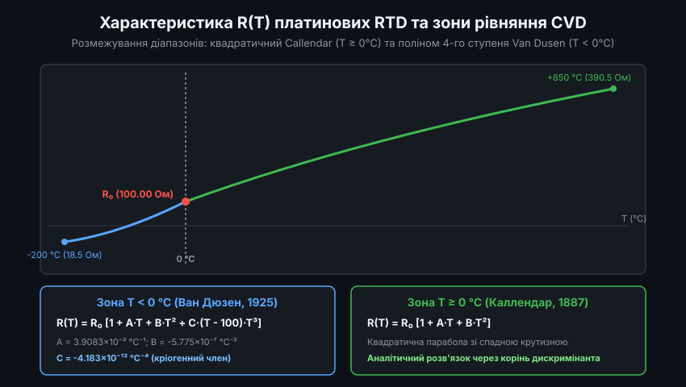
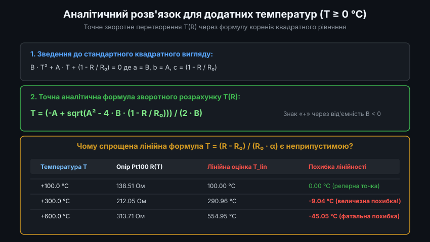
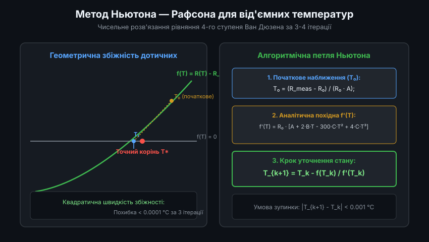
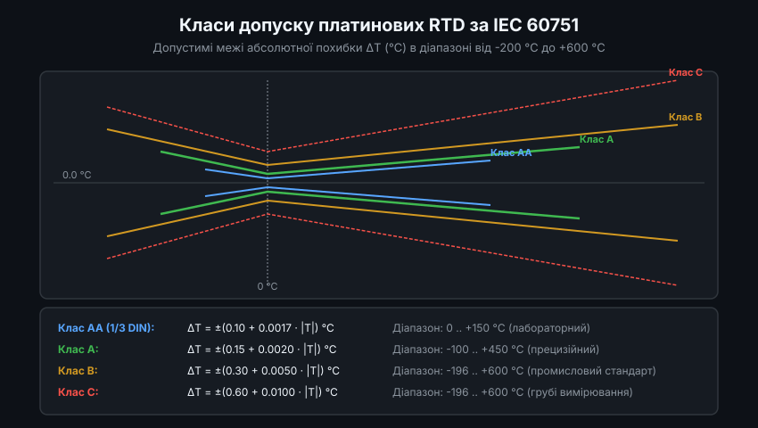
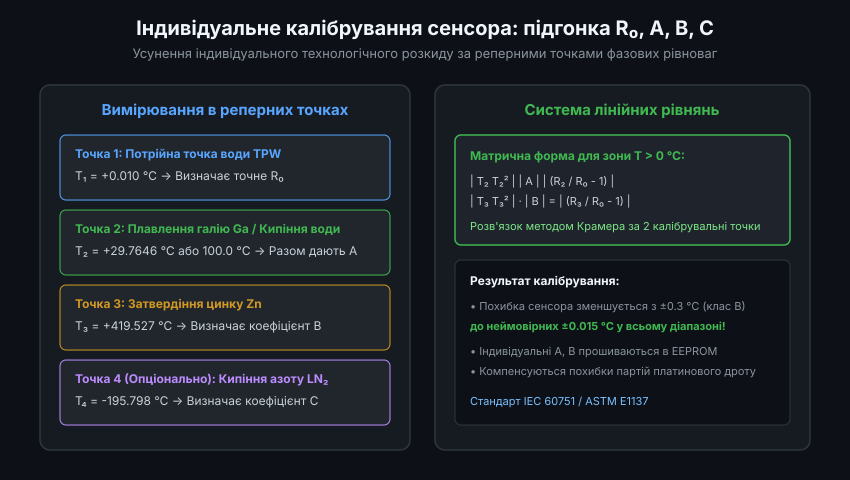

# Рівняння Каллендара — Ван Дюзена для платинових термоопорів RTD

Платинові резистивні давачі температури (Resistance Temperature Detectors, RTD), такі як Pt100 та Pt1000, є глобальним промисловим та лабораторним еталоном для високоточного вимірювання температури в діапазоні від -200 °C до +850 °C. Хоча платина володіє високою стабільністю та повторюваністю опору, її передатна характеристика R(T) не є строго лінійною. Стандартною математичною моделлю, що зв'язує електричний опір платини з температурою за стандартами IEC 60751 та ASTM E1137, є рівняння Каллендара — Ван Дюзена (Callendar-Van Dusen, CVD).

---

### 1. Історичний базис та структура прямого рівняння CVD R(T)

У 1887 році британський фізик Г'ю Лонгборн Каллендар встановив, що залежність електричного опору платинового дроту від температури для позитивного діапазону (вище 0 °C) чудово описується квадратичною параболою. Пізніше, у 1925 році, американський дослідник Мілтон Ван Дюзен виявив, що при кріогенних температурах нижче 0 °C (аж до точки кипіння рідкого кисню -182.96 °C) квадратична формула дає значні похибки, і доповнив рівняння четвертим поліноміальним членом.

Сьогодні рівняння Каллендара — Ван Дюзена формалізоване міжнародним стандартом IEC 60751 і складається з двох гілок:

1. **Для додатних температур (T >= 0 °C, від 0 °C до +850 °C)**:
   `R(T) = R_0 * (1 + A * T + B * T^2)`
2. **Для від'ємних температур (T < 0 °C, від -200 °C до 0 °C)**:
   `R(T) = R_0 * (1 + A * T + B * T^2 + C * (T - 100) * T^3)`

де стандартні константи платини DIN/IEC 60751 (із температурним коефіцієнтом альфа = 0.003851 °C^-1) дорівнюють:
- `R_0`: номінальний опір датчика при 0.0 °C (100.00 Ом для Pt100; 1000.0 Ом для Pt1000).
- `A = 3.9083 * 10^-3 °C^-1`
- `B = -5.7750 * 10^-7 °C^-2`
- `C = -4.1830 * 10^-12 °C^-4` (діє виключно при T < 0 °C).

---

### 2. Точний аналітичний розв'язок для діапазону T >= 0 °C

На практиці вимірювальна система (АЦП) фіксує падіння напруги на платиновому сенсорі та обчислює його фактичний опір R. Перед мікроконтролером постає зворотне завдання: обчислити температуру T за відомим опором R.

Для додатних температур рівняння Каллендара є звичайним квадратним рівнянням відносно змінної T:
`B * T^2 + A * T + (1 - R / R_0) = 0`

Використовуючи класичну шкільну формулу коренів квадратного рівняння, отримуємо точний аналітичний розв'язок:
`T = (-A + sqrt(A^2 - 4 * B * (1 - R / R_0))) / (2 * B)`

Оскільки коефіцієнт `B` є від'ємним числом (`-5.775 * 10^-7`), правильним фізичним розв'язком є саме корінь зі знаком «+» перед квадратним коренем дискримінанта. 

Використання лінійного наближення `T_lin = (R - R_0) / (R_0 * alpha)` є грубою помилкою: якщо при +100 °C похибка лінійності становить 0.4 °C, то при +300 °C вона сягає -9.0 °C, а при +600 °C перевищує катастрофічні -45.0 °C! Квадратична ж формула CVD дає математично точний результат у всьому діапазоні до +850 °C.

---

### 3. Чисельні методи розв'язання для від'ємних температур T < 0 °C

Для від'ємного діапазону температур (від -200 °C до 0 °C) рівняння Ван Дюзена є поліномом четвертого ступеня:
`R(T) = R_0 * (1 + A * T + B * T^2 - 100 * C * T^3 + C * T^4)`

Аналітичні формули Феррарі для коренів 4-го ступеня є занадто складними та обчислювально нестабільними на мікроконтролерах. Тому для визначення від'ємної температури застосовують чисельний метод дотичних Ньютона — Рафсона.

Алгоритм базується на ітераційному уточненні наближення за формулою:
`T_{k+1} = T_k - f(T_k) / f'(T_k)`

де:
- Невязка функції: `f(T) = R_0 * (1 + A * T + B * T^2 - 100 * C * T^3 + C * T^4) - R_meas`
- Аналітична похідна: `f'(T) = R_0 * (A + 2 * B * T - 300 * C * T^2 + 4 * C * T^3)`

Завдяки квадратичній швидкості збіжності методу Ньютона та високій гладкості фізичної функції опору платини, якщо взяти за початкове наближення лінійну оцінку `T_0 = (R_meas - R_0) / (R_0 * A)`, алгоритм досягає залишкової похибки менше 0.001 °C всього за 3-4 ітерації.

---

### 4. Класи точності платинових сенсорів за стандартом IEC 60751

При серійному виробництві платинових RTD тонкоплівкова технологія напилення або намотування платинового мікродроту має певний технологічний допуск. Міжнародний стандарт IEC 60751 регламентує 4 класи допуску, що визначають гранично допустиму абсолютну похибку вимірювання Delta_T.

Формули допустимої похибки залежно від модуля температури `|T|`:
- **Клас AA (прецизійний, 1/3 DIN)**: `Delta_T = +-(0.10 + 0.0017 * |T|) °C`. Діапазон дії від 0 °C до +150 °C. При 0 °C похибка не перевищує ±0.10 °C.
- **Клас A (високоточний)**: `Delta_T = +-(0.15 + 0.0020 * |T|) °C`. Діапазон дії від -100 °C до +450 °C. При 0 °C допуск становить ±0.15 °C (опір 100.00 ± 0.06 Ом).
- **Клас B (загальнопромисловий базовий)**: `Delta_T = +-(0.30 + 0.0050 * |T|) °C`. Діапазон дії від -196 °C до +600 °C. Найпоширеніший та найдешевший клас.
- **Клас C (грубий промисловий)**: `Delta_T = +-(0.60 + 0.0100 * |T|) °C`. Діапазон дії від -196 °C до +600 °C.

Знання коридорів допуску дозволяє інженеру правильно оцінити невизначеність вимірювального тракту та вибрати датчик, що відповідає технологічним регламентам процесу.

---

### 5. Індивідуальне калібрування сенсорів за методом підгонки коефіцієнтів

Стандартні константи IEC 60751 описують середньостатистичну поведінку платини. Якщо для лабораторного застосування або відповідального метрологічного контролю потрібна точність на рівні сотих часток градуса, використовують процедуру індивідуального калібрування сенсора.

Процедура базується на вимірюванні опору конкретного екземпляра термометра у термодинамічних реперних точках фазових рівноваг чистих речовин:
1. **Потрійна точка води TPW (+0.010 °C)**: дозволяє визначити індивідуальне базове значення `R_0` з похибкою менше 0.001 Ом.
2. **Точка плавлення галію (+29.7646 °C) або кипіння води (+100.0 °C)**: формує перше лінійне рівняння для коефіцієнта `A`.
3. **Точка затвердіння цинку (+419.527 °C)**: дозволяє обчислити квадратичний коефіцієнт `B` розв'язанням системи лінійних алгебраїчних рівнянь.
4. **Точка кипіння рідкого азоту (-195.798 °C)**: необхідна для знаходження індивідуального кріогенного параметра `C`.

Отримані індивідуальні значення `R_0`, `A`, `B`, `C` прошиваються в пам'ять контролера або вимірювального перетворювача. Це знижує сумарну похибку вимірювання платинового сенсора класу B з ±0.3 °C до фантастичних ±0.015 °C у всьому робочому діапазоні.
