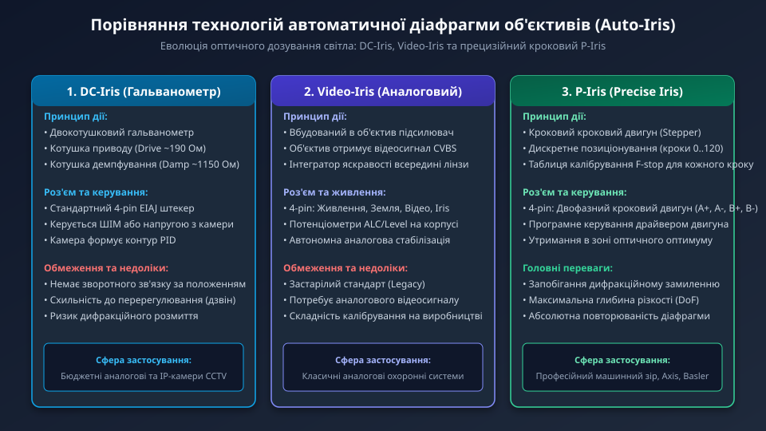
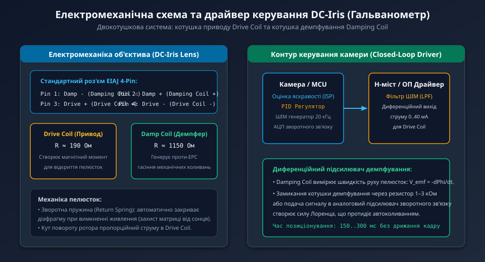
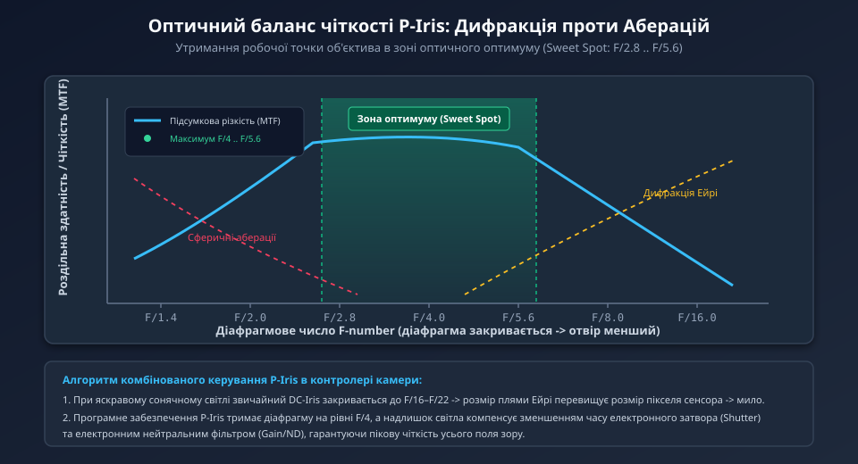

---
preknowlist:
  - "Геометрична оптика: фокусна відстань, вхідна зіниця та світлосила об'єктива"
  - "Основи роботи електромагнітних приводів та гальванометричних систем"
  - "Аналого-цифрове регулювання: принципи роботи ПІД-регуляторів та модуляції ШІМ"
---

# Автоматична діафрагма об'єктива (Auto-Iris)

В оптичних системах комп'ютерного зору, промислових камерах спостереження та системах автоматичної фіксації номерних знаків (ANPR/LPR) динамічний діапазон освітленості сцени може змінюватися більш ніж на 100–120 дБ — від прямих сонячних променів опівдні (до 100 000 люкс) до глибоких сутінків або штучного нічного підсвічування (менше 1 люкса). Сам по собі кремнієвий фотосенсор, навіть із застосуванням цифрової автоекспозиції (AEC/Shutter) та аналогового підсилення (AGC/Gain), не здатний впоратися з таким колосальним перепадом без втрати якості зображення або пересвічування матриці.

Для фізичного дозування світлового потоку безпосередньо в оптичному тракті використовується **автоматична діафрагма об'єктива (Auto-Iris)** — електромеханічний вузол, що динамічно змінює площу прохідного оптичного отвору за допомогою рухомих пелюсток.



---

## 1. Оптичні основи діафрагми: F-число та глибина різкості

Діафрагма (Aperture) — це круговий або секторний механічний отвір у площині вхідної зіниці об'єктива. Її геометричний розмір описується безрозмірним параметром — **діафрагмовим числом (F-number, F-stop)**:

```text
F_number = f / D
де:
  f — еквівалентна фокусна відстань об'єктива (в міліметрах),
  D — ефективний діаметр вхідної зіниці (отвору діафрагми).
```

Чим менше значення F-числа (наприклад, F/1.4 або F/2.0), тим ширше відкриті пелюстки діафрагми, тим більше світла потрапляє на сенсор, проте тим меншою стає **глибина різкості (Depth of Field, DoF)**. Навпаки, при закритті діафрагми (наприклад, F/8.0 або F/16):
- Світловий потік, що досягає матриці, зменшується пропорційно квадрату діаметра отвору: `E ~ (1 / F_number)^2`.
- Глибина різкості значно зростає, дозволяючи тримати у фокусі об'єкти, розташовані як на передньому, так і на задньому плані.
- При надмірному закритті отвору вступають у дію закони хвильової оптики (дифракція), які спричиняють загальне розмиття картинки.

---

## 2. Еволюція технологій: від Video-Iris до крокового P-Iris

Історично в системах відеоспостереження та машинного зору застосовувалися три основні класи приводів діафрагми:

1. **Video-Iris (Аналоговий інтегратор):**
   - Об'єктив оснащується внутрішньою електронною платою аналогового підсилювача.
   - Камера подає на об'єктив постійну напругу живлення та композитний аналоговий відеосигнал (CVBS).
   - Вбудована схема інтегрує амплітуду відеотракту (визначає середній рівень білого) і самостійно подає напругу на котушку приводу.
   - Складний в індивідуальному калібруванні та повністю застарів у цифрову епоху.
2. **DC-Iris (Гальванометричний привод без електроніки в лінзі):**
   - В об'єктиві розміщується лише електромеханічний вузол гальванометра з двома котушками.
   - Уся логіка вимірювання освітленості кадру, алгоритм зворотного зв'язку (ПІД-регулятор) та силова частина інтегровані безпосередньо в мікроконтролер або цифровий сигнальний процесор (DSP/ISP) камери.
   - З'єднання виконується через стандартизований квадратний 4-контактний штекер EIAJ.
3. **P-Iris (Precise Iris — прецизійна діафрагма):**
   - Замість нестабільного гальванометра використовується мініатюрний кроковий двигун (Stepper Motor).
   - Камера програмно керує кожним мікрокроком приводу, точно знаючи поточне геометричне положення пелюсток і відповідне значення F-stop.
   - Дозволяє реалізувати інтелектуальний комбінований алгоритм експозиції, уникаючи зон оптичної дифракції.

---

## 3. Електромеханічна структура DC-Iris: котушки Drive та Damping

Переважна більшість індустріальних об'єктивів стандартів C-mount та CS-mount використовують технологію **DC-Iris**. Серцем механізму є двокотушковий гальванометр, ротор якого пов'язаний із легкими металевими або полімерними пелюстками діафрагми.



Для керування використовуються дві окремі обмотки:

1. **Котушка приводу (Drive Coil):**
   - Має опір близько **190 Ом** (типово 180–200 Ом).
   - Протікання постійного струму або згладженого ШІМ-сигналу крізь цю котушку створює магнітне поле, яке повертає якір проти зусилля пружини, відкриваючи отвір діафрагми.
   - Зворотна пружина (Return Spring) гарантує, що при повному знеструмленні пелюстки автоматично закриються в положення «Closed», що рятує сенсор від деградації та теплового вигорання під прямими сонячними променями.
2. **Котушка демпфування (Damping / Brake Coil):**
   - Має значно вищий опір — близько **1150 Ом** (типово 700–1300 Ом).
   - Ця котушка намотана на той самий магнітопровід, але працює як генератор швидкості: під час будь-якого механічного руху ротора в ній наводиться проти-ЕРС індукції: `V_emf = -dPhi / dt`.
   - Якщо підключити виводи котушки демпфування до диференційного підсилювача зворотного зв'язку або замкнути через демпфуючий резистор, виникає гальмівний момент, що миттєво гасить перерегулювання та коливальні рухи пелюсток («дрижання» або «плавання» кадру).

---

## 4. Проблема оптичної дифракції та перехід до P-Iris

Традиційні системи DC-Iris страждають від критичної фундаментальної вади: об'єктив реагує на світло «сліпо». Коли камера виходить на відкрите яскраве сонце, контролер DC-Iris просто нарощує струм або знімає напругу, змушуючи пелюстки стискатися до мінімального отвору (F/16 або F/22).



При такому надмалому отворі розмір центральної плями дифракційного диска Ейрі перевищує розмір кремнієвого пікселя сучасної камери (наприклад, 2–3 мкм):

```text
d_airy = 2.44 * lambda * F_number
де:
  lambda — довжина хвилі світла (близько 550 нм для зеленого спектра),
  F_number — діафрагмове число.
```

При `F = 16`: `d_airy = 2.44 * 0.55 * 16 = 21.5 мкм`! Дифракційна пляма вдесятеро більша за піксель матриці, внаслідок чого зображення втрачає мікроконтраст і перетворюється на нечітке розмите «мило», незалежно від мегапіксельності сенсора.

**Рішення P-Iris:**
Технологія P-Iris (спільна розробка компаній Axis Communications та Kowa) замінила гальванометр кроковим двигуном із цифровим позиціонуванням на 70–120 дискретних кроків. Програмне забезпечення камери координує роботу трьох вузлів:
1. Діафрагма утримується виключно в **оптичній зоні оптимуму (Sweet Spot: F/2.8 .. F/5.6)**, де сферичні аберації вже придушені, а хвильова дифракція ще не проявляється.
2. Якщо освітленість перевищує можливості F/5.6, камера не закриває діафрагму далі, а скорочує час експозиції електронного затвора (Electronic Shutter до 1/10 000 с).
3. Якщо й цього замало, активується інтегрований нейтрально-сірий світлофільтр (Optical/Electronic Neutral Density — ND Filter).

---

## 5. Схемотехніка підключення та замкнений контур регулювання

Для керування об'єктивом DC-Iris контролер машинного зору використовує чотирипровідне підключення:

```text
[ Камера / MCU ]                                     [ Об'єктив DC-Iris ]
  PWM_Out (20 кГц) ----> [ LPF / Driver ] ---------> Pin 3 (Drive +)
  GND ---------------------------------------------> Pin 4 (Drive -)

  Damp_In (+)  <------- [ Диференційний ] <-------- Pin 2 (Damp +)
  Damp_In (-)  <------- [  Підсилювач   ] <-------- Pin 1 (Damp -)
```

1. **Генерація сигналу приводу:** Мікроконтролер формує апаратний ШІМ-сигнал із частотою 20–50 кГц (вище діапазону чутності людського вуха, щоб виключити акустичний писк об'єктива). Низькочастотний RC-фільтр перетворює ШІМ на постійну напругу від 0.5 до 4.5 В.
2. **Контур зворотного зв'язку за яскравістю:** Алгоритм камери розраховує гістограму яскравості кожного нового кадру (Luma Histogram). Різниця між цільовою яскравістю та реальною формує помилку для цифрового ПІД-регулятора, який коригує шпаруватість ШІМ.
3. **Аналогове придушення перерегулювання:** Сигнал із котушки демпфування заводиться в інтегруючу ланку зворотного зв'язку, що дозволяє системі змінювати положення діафрагми за 150–250 мс без виникнення автоколивань.

У наступному поглибленому розділі ми детально розглянемо математичну модель гальванометра, диференційні рівняння руху пелюсток, оптичну передавальну функцію MTF та практичну реалізацію дискретного регулятора на C++.
