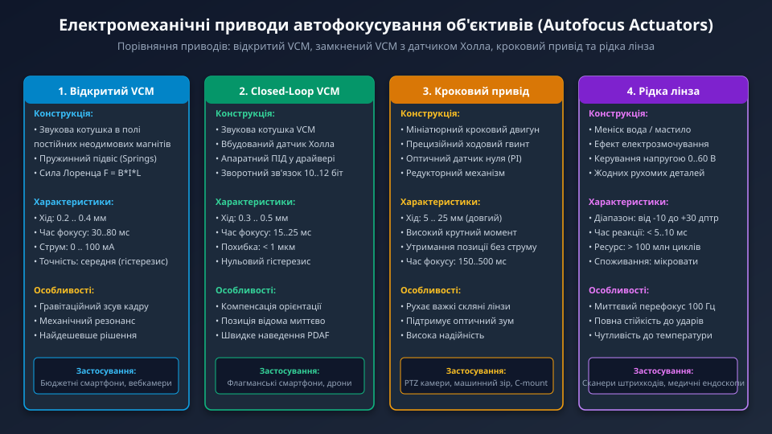
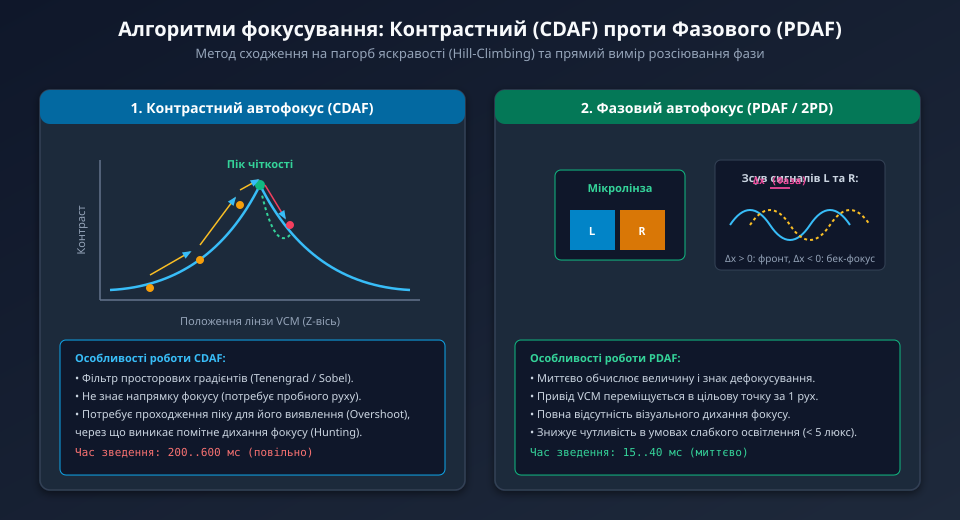
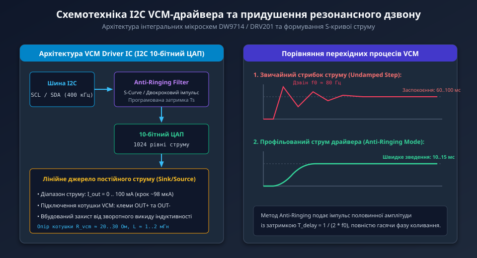

---
preknowlist:
  - "Геометрична оптика: формула тонкої лінзи, площина фокусування та глибина різкості"
  - "Електромагнетизм: сила Лоренца, рух провідника зі струмом у магнітному полі"
  - "Цифрова обробка зображень: алгоритми розрахунку просторових градієнтів та фільтри Собеля"
---

# Керування автофокусом об'єктива (Autofocus Control)

У сучасних системах машинного зору, роботизованих комплексах, сканерах штрихкодів та камерах мобільних пристроїв дистанція до об'єкта спостереження може динамічно змінюватися від кількох сантиметрів (режим макро) до нескінченності. Відповідно до формули тонкої лінзи Гауса:

```text
1 / f = 1 / d_obj + 1 / d_img
де:
  f — фокусна відстань об'єктива,
  d_obj — відстань від лінзи до об'єкта зйомки,
  d_img — відстань від лінзи до світлочутливої площини сенсора.
```

Зміна відстані до об'єкта `d_obj` зміщує площину чіткого зображення. Якщо оптичний блок зафіксований нерухомо (Fixed-Focus), об'єкти поза зоною глибини різкості неминуче розмиваються. Щоб повернути фокусну площину строго на поверхню матриці, оптична система повинна прецизійно переміщувати групу фокусувальних лінз вздовж оптичної осі на долі міліметра. Це завдання виконує підсистема **автофокусування (Autofocus, AF)**.



---

## 1. Електромеханічні приводи автофокусування: типи та порівняння

Залежно від габаритів лінз, необхідної швидкості та діапазону переміщення в оптиці застосовуються чотири основні класи актуаторів:

1. **Привід звукової котушки (Voice Coil Motor, VCM):**
   - Найпоширеніший актуатор у компактних камерах (смартфони, компактні камери для дронів та вебкамери).
   - Оптичний тубус підвішений на плоских пружинах із берилієвої бронзи всередині магнітної системи. Струм у котушці створює силу Лоренца, що висуває лінзу вперед.
   - Забезпечує мікропереміщення на 0.2–0.4 мм за час 20–50 мс.
2. **Замкнений привід VCM із датчиком Холла (Closed-Loop VCM):**
   - Доповнений прецизійним магнітним датчиком Холла на рухомій частині.
   - Дозволяє внутрішньому контролеру з високою точністю (менше 1 мкм) знати поточне положення лінзи, усуваючи гравітаційний зсув при зміні просторової орієнтації камери та ліквідуючи механічний гістерезис пружин.
3. **Кроковий привід із ходовим гвинтом (Stepper Motor + Lead Screw):**
   - Використовується у великогабаритних об'єктивах C-mount, PTZ-камерах спостереження та системах з оптичним зумом (Zoom Lenses).
   - Забезпечує довгий хід (від 5 до 25 мм) і високе тягове зусилля для переміщення важких скляних груп, утримуючи позицію без споживання енергії.
4. **Рідка лінза (Liquid Lens на базі електрозмочування):**
   - Не містить жодних рухомих механічних деталей. Складається з герметичної комірки з двома рідинами, що не змішуються (мастило та провідний водний розчин).
   - Подача високої напруги (від 0 до 60 В) змінює кут змочування та радіус кривизни меніска рідини за мілісекунди, змінюючи оптичну силу лінзи в діапазоні десятків діоптрій зі швидкістю понад 100 кадрів/с.

---

## 2. Будова та принцип дії VCM (Voice Coil Motor)

Класичний актуатор VCM використовує той самий фізичний принцип, що й динамічний гучномовець. Каркас із мідною багатовитковою котушкою закріплений безпосередньо на рухомому тубусі лінзи, який охоплюється постійними магнітами з високою залишковою індукцією (NdFeB).

Сила, що штовхає оптичний блок вздовж осі Z:
```text
F_lorentz = B * I * L
де:
  B — магнітна індукція в зазорі (типово 0.4 .. 0.7 Тл),
  I — електричний струм через котушку (від 0 до 100 мА),
  L — сумарна активна довжина провідника котушки в магнітному полі.
```

Цій силі протидіє механічна реакція поворотних пружин підвісу:
```text
F_spring = K_s * z
де K_s — жорсткість пружин (Н/м), z — лінійне зміщення лінзи (м).
```

У стані статичної рівноваги:
```text
z = (B * L / K_s) * I
```

Положення лінзи лінійно залежить від сили струму. Повна відсутність струму (`I = 0`) відповідає крайньому задньому положенню (фокус на нескінченність — Infinity). Зі зростанням струму лінза висувається вперед, фокусуючись на все більш близьких об'єктах (Macro).

---

## 3. Алгоритми автофокусування: CDAF проти PDAF

Оцінка різкості та прийняття рішення про переміщення лінзи виконується процесором сигналу зображення (ISP).



1. **Контрастний автофокус (Contrast Detection Autofocus, CDAF):**
   - Працює за принципом цифрового аналізу високочастотних просторових градієнтів у кадрі (фільтри Собеля або Лапласа).
   - Алгоритм виконує сканування простору (Hill-Climbing): зміщує лінзу вперед невеликими кроками, аналізуючи інтегральний показник чіткості (Focus Value, FV).
   - *Недолік:* Алгоритм не знає, де розташований фокус — спереду чи ззаду. Він змушений пройти точку оптимуму, зафіксувати падіння контрасту (Overshoot), а потім повернутися назад. Це спричиняє характерне коливальне «дихання» фокусу (Hunting) і вимагає від 200 до 600 мс.
2. **Фазовий автофокус (Phase Detection Autofocus, PDAF / 2PD):**
   - На поверхні CMOS-матриці розміщуються спарені фотодіоди з мікролінзою, що ділить вихідну зіницю об'єктива на ліву (L) та праву (R) половини.
   - Якщо об'єкт у фокусі, світлові хвилі L і R збігаються за фазою. Якщо об'єкт поза фокусом, фази зміщуються на величину дефокусу `Delta x`.
   - *Перевага:* За один кадр ISP миттєво обчислює напрямок (фронт- чи бек-фокус) та точну кількість мікрометрів, на які потрібно перемістити лінзу. VCM виконує перефокусування за один прямий рух усього за 15–40 мс без дрижання кадру.

---

## 4. Схемотехніка керування: інтегральні I2C-драйвери VCM

Оскільки котушка VCM є низькоомним навантаженням (активний опір провідника становить 20–35 Ом), подавати напругу безпосередньо з виходів мікроконтролера не можна — необхідний виділений аналоговий регулятор струму.



У камерах застосовуються спеціалізовані інтегральні мікросхеми драйверів (наприклад, **DW9714**, **DRV201**, **LC898122**):
- **Інтерфейс зв'язку:** Швидкісна шина I2C (до 400 кГц / 1 МГц), стандартна адреса на шині `0x18` (або `0x0C` у 7-бітному форматі).
- **Цифро-аналоговий перетворювач:** Вбудований монотонний 10-бітний ЦАП (1024 рівні струму). При робочому діапазоні 0–100 мА дискретність регулювання становить близько `98 мкА/крок`.
- **Лінійне джерело струму (Current Sink):** Прецизійний операційний підсилювач із вихідним польовим MOSFET-транзистором та внутрішнім датчиком струму компенсує коливання напруги живлення (1.8–3.3 В) та зміну опору міді від нагрівання.

---

## 5. Проблема механічного резонансу та технологія Anti-Ringing

Найважливішою проблемою відкритого приводу VCM є наявність яскраво вираженого **механічного резонансу**:

```text
f_0 = (1 / (2 * pi)) * sqrt(K_s / m)
де K_s — жорсткість пружин, m — маса рухомого оптичного блоку (0.1 .. 0.3 грама).
```

Власна резонансна частота типового смартфонного VCM потрапляє в діапазон **70–120 Гц**. Якщо контролер різко змінить уставку струму ЦАП з 20 на 60 мА звичайною «сходинкою» (Step response), лінза проскочить цільову точку, після чого коливатиметься з резонансною частотою протягом 60–100 мс. Увесь цей час кадр буде повністю розмитим.

Для усунення цього ефекту сучасні VCM-драйвери підтримують апаратний режим **Anti-Ringing (компенсація дзвону)**:
1. Замість миттєвого стрибка драйвер автоматично формує плавний S-подібний фронт струму (S-Curve Profile), або
2. Драйвер подає двокроковий імпульс: спочатку імпульс половинної амплітуди `I / 2`, а рівно через півперіоду механічного резонансу `T_delay = 1 / (2 * f_0)` — другу половину струму.
Коливання від другого імпульсу перебувають у протифазі до коливань від першого і повністю гасять механічну вібрацію.

Час встановлення фокусу скорочується з 80–100 мс до неймовірних **10–15 мс**, дозволяючи вести безперервне високоякісне відстеження динамічних об'єктів у реальному часі.
