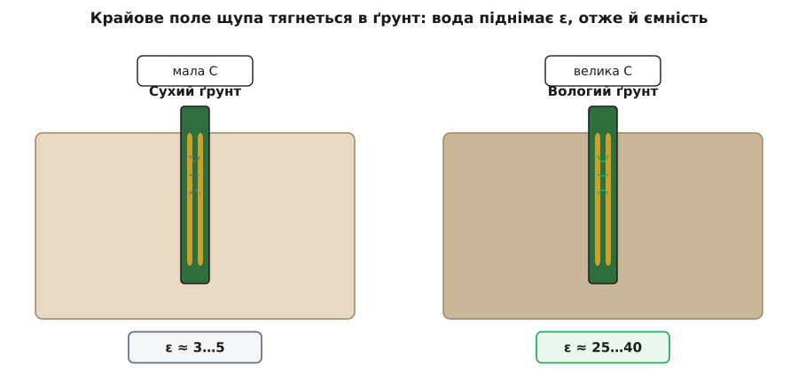
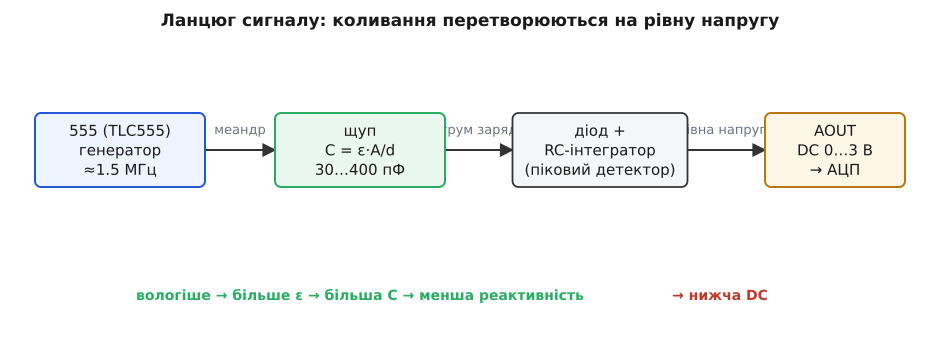
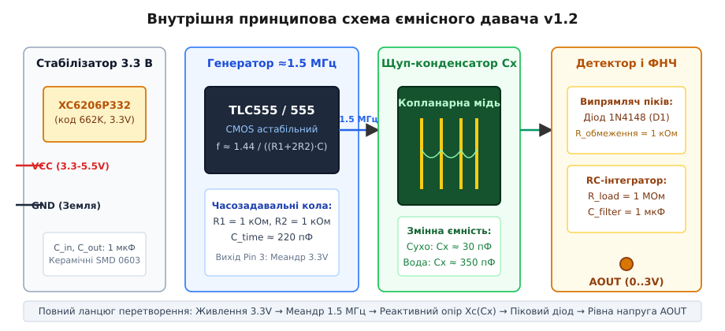
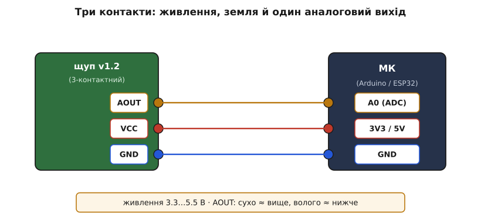
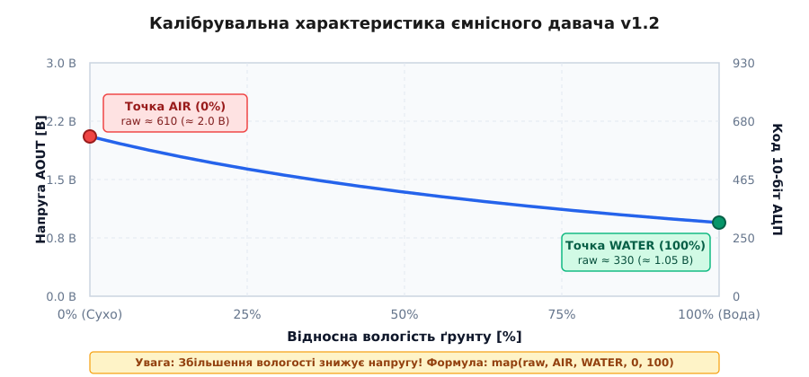

# Ємнісний давач вологості ґрунту (версія v1.2)

Ємнісний давач вологості ґрунту версії v1.2 — це надійне та довговічне інженерне рішення для автоматизованих систем кімнатного рослинництва, теплиць та автономного агромоніторингу. На відміну від застарілих резистивних датчиків, ємнісний щуп взагалі не контактує відкритим металом із вологим ґрунтом, що повністю усуває проблему електрохімічної корозії та забезпечує багаторічний термін експлуатації.

---

## 1. Принцип дії та фізика діелектричної проникності ґрунту

Ємнісний метод базується на прямому вимірюванні відносної діелектричної проникності навколишнього середовища:



- **Фізична основа (полярність води):** Сухий ґрунт складається з кварцових піщинок, алюмосилікатної глини та порід, діелектрична проникність яких становить ε = 3...5. Молекула чистої води є вираженим електричним диполем з аномально високою діелектричною проникністю ε ≈ 80.
- **Вплив зволоження:** Навіть незначне збільшення частки води в порах ґрунту викликає різке зростання узагальненої діелектричної проникності середовища навколо вимірювача (до ε = 25...40).
- **Копланарний конденсатор:** Провідні доріжки всередині текстоліту утворюють плоский розподілений конденсатор, ємність якого описується виразом:
  
  C = ε · ε_0 · A / d

  де A — площа взаємного перекриття доріжок, d — відстань між ними.
- **Крайове електричне поле:** Силові лінії високочастотного поля замикаються крізь шар ґрунту у вигляді дуг глибиною 3–6 мм. Що вологіший субстрат — то вища ємність датчика Cx (від 30 пФ на сухому повітрі до 350 пФ у рідкій воді).
- **Відсутність гальванічного струму:** Доріжки герметично вкриті суцільним шаром паяльної маски або водостійкого лаку. Струм через землю не тече, тому розчинення електродів та електроліз не відбуваються.

---

## 2. Апаратна структура та перетворення сигналу на платі

Оскільки мікроконтролер не може безпосередньо зчитувати статичну пікофарадну ємність, на верхній частині плати розташовано активну вимірювальну схему.



Схема перетворює зміну ємності на пропорційну постійну напругу (DC) у кілька послідовних етапів:



1. **Високочастотний генератор (таймер 555):** Інтегральний таймер (TLC555 або NE555) в астабільному режимі генерує безперервний прямокутний сигнал із частотою f ≈ 1.5 МГц.
2. **Реактивний подільник напруги:** Меандр надходить на щуп-конденсатор Cx. Реактивний опір конденсатора змінному струму зменшується зі зростанням ємності:
  
   Xc = 1 / (2 · π · f · Cx)

   У вологому ґрунті ємність Cx зростає, реактивний опір падає, і високочастотна амплітуда коливань на виході подільника зменшується.
3. **Піковий детектор та згладжувальний ФНЧ:** Швидкодіючий кремнієвий діод D1 (1N4148) зрізає від'ємну напівхвилю, а RC-інтегратор (R = 1 МОм, C = 1 мкФ) згладжує високочастотні імпульси в стабільну постійну напругу на клемі `AOUT`.

---

## 3. Схема підключення та вимоги до живлення

Модуль v1.2 надзвичайно простий в інтеграції, оскільки містить лише три виводи через роз'єм JST PH2.0:



| Вивід | Колір дроту | Призначення | Допустимий рівень | Підключення до MCU |
| :--- | :--- | :--- | :--- | :--- |
| **VCC** | Червоний | Живлення схеми | 3.3 В ... 5.5 В постійного струму | Шина живлення 3.3 В або 5 В |
| **GND** | Чорний | Загальна земля | 0 В | Спільна шина GND |
| **AOUT** | Жовтий / Синій | Аналоговий вихід постійної напруги | 0.8 В ... 3.0 В (залежно від вологості) | Вхід АЦП (ADC / A0) |

> ⚠️ **Критично важлива полярність сигналу:** Характеристика датчика є **оберненою**:
> - **Сухе повітря (0% вологи):** максимальна вихідна напруга (близько 2.0–2.8 В, код 10-бітного АЦП ~ 600–850).
> - **Вода або насичена земля (100% вологи):** мінімальна вихідна напруга (близько 0.9–1.2 В, код 10-бітного АЦП ~ 280–350).

---

## 4. Калібрування та інтерпретація оберненого сигналу

Оскільки точні значення напруги залежать від напруги живлення, типу ґрунту та партії комплектуючих, перед експлуатацією обов'язково виконують просте двоточкове калібрування.



### Процедура двоточкового калібрування:
1. **Точка «Сухо» (AIR):** Тримайте щуп у сухому повітрі. Зчитайте значення АЦП (`raw_air`, наприклад, 610).
2. **Точка «Вода» (WATER):** Занурте сенсор у склянку з водою строго до білої роздільної лінії друку. Зчитайте значення АЦП (`raw_water`, наприклад, 330).
3. **Лінійне масштабування:** Для переведення в діапазон від 0% до 100% застосовують функцію `map` з інвертованими опорними межами:

```cpp
/**
 * @file capacitive_soil_basic.ino
 * @brief Базове опитування ємнісного сенсора v1.2 з інвертованим калібруванням
 */

const int PIN_SOIL_ADC = A0;

// Опорні калібрувальні константи (зняті експериментально)
const int CALIB_AIR   = 610; // Сухе повітря (0%)
const int CALIB_WATER = 330; // Вода (100%)

// Читання сигналу з усередненням 8 вибірок
int readSmoothADC(int pin) {
  long sum = 0;
  for (int i = 0; i < 8; i++) {
    sum += analogRead(pin);
    delay(5);
  }
  return (int)(sum / 8);
}

void setup() {
  Serial.begin(115200);
}

void loop() {
  int raw_val = readSmoothADC(PIN_SOIL_ADC);
  
  // Зверніть увагу: першим аргументом передається CALIB_AIR, другим — CALIB_WATER!
  int moisture_percent = map(raw_val, CALIB_AIR, CALIB_WATER, 0, 100);
  moisture_percent = constrain(moisture_percent, 0, 100);

  Serial.print(F("Код АЦП: "));
  Serial.print(raw_val);
  Serial.print(F(" | Розрахована вологість: "));
  Serial.print(moisture_percent);
  Serial.println(F(" %"));

  delay(1000);
}
```

---

## 5. Апаратні особливості, підводні камені та типові помилки

Під час практичного використання плати v1.2 слід враховувати кілька ключових апаратних нюансів:

1. **Тип таймера 555 (TLC555 проти NE555):**
   - На якісних оригінальних модулях встановлено CMOS-таймер **TLC555** (або TL555), який надійно працює від напруги 2.0...15 В і генерує чіткий меандр на частотах до 2 МГц.
   - На дешевих клонах часто розпаюють застарілий біполярний **NE555**, мінімальна робоча напруга якого становить 4.5 В. При живленні такого клону від 3.3 В (ESP32 / STM32) генерація зривається, а на виході спостерігається нерухомий нуль або шум.
2. **Падіння напруги на стабілізаторі XC6206 (662K):**
   - Більшість плат містять лінійний LDO-стабілізатор на 3.3 В (маркування 662K). При подачі живлення рівно 3.3 В через падіння напруги на регуляторі (dropout ~0.25 В) таймер живиться напругою лише близько 3.05 В, що спричиняє температурний дрейф. Для живлення від 3.3 В стабілізатор часто закорочують перемичкою між входом і виходом.
3. **Межа занурення у ґрунт:**
   - Категорично заборонено занурювати плату вище за нанесений горизонтальний білий маркер. Верхня частина містить компоненти SMD і роз'єм, які не є водонепроникними. Потрапляння крапель поливу або конденсату на мікросхему призводить до виходу з ладу генератора.
4. **Мала глибина проникнення поля:**
   - Оскільки крайове електричне поле зосереджене в шарі товщиною 3–5 мм навколо пластини, будь-які повітряні каверни або нещільне прилягання ґрунту викликають занижені покази вологості. Землю навколо планки обов'язково треба ущільнити.
