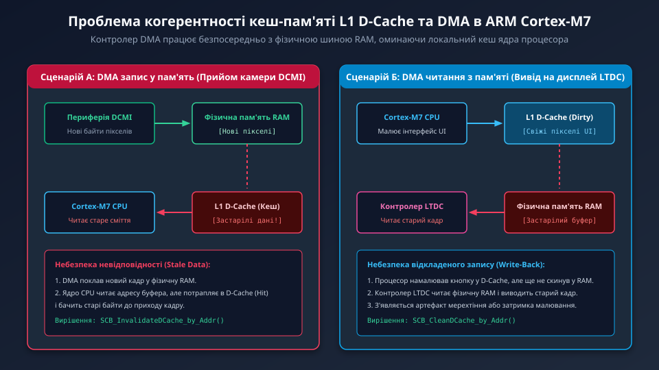
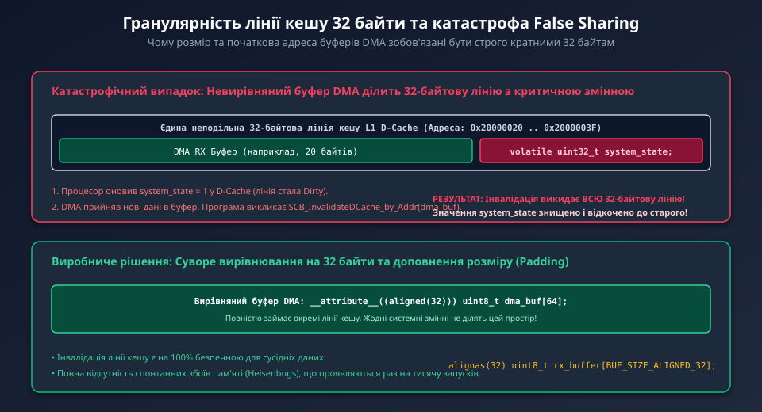
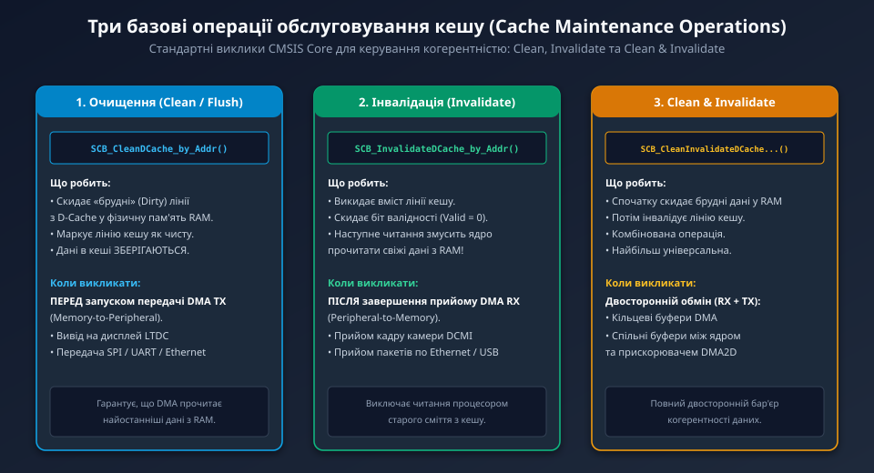

---
preknowlist:
  - "Гарвардська архітектура пам'яті ARM Cortex-M7: роздільні кеші I-Cache та D-Cache"
  - "Принципи прямого доступу до пам'яті (DMA): робота контролерів DMA1, DMA2 та MDMA на шині AXI"
  - "Поняття кеш-попадання (Cache Hit), промаху (Cache Miss) та політики відкладеного запису (Write-Back)"
---

# Когерентність кеш-пам'яті та операції DMA у процесорах ARM Cortex-M7

Процесори ARM Cortex-M7 (мікроконтролери STM32F7 та STM32H7), що працюють на тактових частотах від 216 до 480 МГц, оснащені надшвидкісною багаторівневою підсистемою пам'яті, включаючи кеш інструкцій (L1 I-Cache) та кеш даних (L1 D-Cache) обсягом від 4 до 64 КБ. Кеш даних використовує 4-канальну множинно-асоціативну архітектуру з фіксованим розміром рядка (Cache Line) **32 байти** та типовою політикою відкладеного запису (Write-Back, Write-Allocate).

Однак у мікроконтролерах Cortex-M7 апаратні контролери DMA (DMA1, DMA2, BDMA та MDMA) підключені безпосередньо до системної матриці шин AXI/AHB і взаємодіють із фізичною оперативною пам'яттю (SRAM1..SRAM4, AXI-SRAM, FMC SDRAM), **повністю оминаючи кеш ядра процесора**. У ядрі Cortex-M7 відсутній апаратний арбітр узгодженості (Hardware Cache Snooping), характерний для багатоядерних серверних процесорів Cortex-A. Якщо розробник не врахує цю особливість, відеотракт камери неминуче зіткнеться з фатальними проблемами розсинхронізації пам'яті (Cache Incoherency).



---

## 1. Сценарії розсинхронізації: прийом камери (DMA RX) проти виводу дисплея (DMA TX)

У мультимедійних системах виникають дві симетричні, але принципово різні апаратні колізії:

### Сценарій 1: Запис периферії в пам'ять (DMA Write / Camera RX)
1. Камера DCMI передає потік байтів пікселів. Контролер DMA записує новий кадр у фізичну пам'ять ОЗП.
2. Процесорне ядро звертається до масиву кадру для розпізнавання об'єкта або обробки.
3. Якщо відповідні адреси раніше вже потрапили в L1 D-Cache процесора, ядро отримає кеш-попадання (Cache Hit) і **прочитає старі, застарілі дані (Stale Data)**, що зберігалися там до приходу кадру!
4. Ще гірше: якщо процесор раніше встиг змінити якусь змінну у цьому ж рядку кешу (лінія позначена як Dirty), під час витіснення (Eviction) кеш автоматично скинеться в RAM і **поверхнево затре щойно прийняті пікселі камери**!

### Сценарій 2: Читання периферією з пам'яті (DMA Read / Display TX)
1. Процесорне ядро намалювало елемент графічного інтерфейсу (кнопку, текст або рамку) у пам'яті фреймбуфера.
2. У режимі відкладеного запису (Write-Back) нові байти пікселів залишаються виключно в L1 D-Cache і ще не потрапили у фізичний ОЗП.
3. Контролер LTDC або потік SPI DMA зчитує фізичну пам'ять і виводить на дисплей старе фонове зображення. На екрані виникає затримка оновлення або мерехтіння.

---

## 2. Гранулярність 32 байти та катастрофа False Sharing

Найбільш підступною помилкою при роботі з кешем є ефект **хибного розділення ліній (False Sharing)**:



Кеш-пам'ять Cortex-M7 фізично не здатна оперувати окремими байтами або 32-бітними словами — будь-яке читання, скидання чи інвалідація виконується **неподільними блоками рівно по 32 байти**.

Якщо буфер DMA виділений у пам'яті без суворого вирівнювання:
```c
/* ПОМИЛКА: Невирівняний масив ділить 32-байтову лінію з сусідніми змінними! */
uint8_t dma_rx_buf[20];
volatile uint32_t system_status; /* Розташований у тих самих 32 байтах кешу */
```

1. Процесор оновлює змінну `system_status = 1`. Лінія кешу стає «брудною» (Dirty).
2. Контролер DMA приймає 20 байтів у `dma_rx_buf`.
3. Щоб прочитати нові байти камери, програміст викликає функцію інвалідації кешу для адреси буфера.
4. Контролер кешу викидає **всі 32 байти** поточної лінії.
5. Значення `system_status = 1` безповоротно знищується і повертається до старого значення з фізичної пам'яті!

> **Суворе правило вирівнювання:** Кожен масив, що обслуговується контролером DMA, зобов'язаний бути вирівняний за адресою, кратною 32 байтам, а його сумарний розмір повинен бути доповнений (Padding) до величини, кратної 32 байтам:
> ```c
> alignas(32) uint8_t dma_rx_buffer[BUFFER_SIZE_ALIGNED_32];
> ```

---

## 3. Базові операції обслуговування кешу (Cache Maintenance Operations)

Стандартний заголовочний файл CMSIS Core (`core_cm7.h`) надає три базові низькорівневі операції керування когерентністю:



1. **Очищення кешу (Clean / Flush):**
   ```c
   SCB_CleanDCache_by_Addr((uint32_t *)addr, size);
   ```
   Примусово записує всі «брудні» лінії з D-Cache у фізичну пам'ять RAM і скидає біт модифікації. Вміст кешу залишається дійсним.
   - **Застосування:** Викликається *перед* запуском передачі DMA (TX).
2. **Інвалідація кешу (Invalidate):**
   ```c
   SCB_InvalidateDCache_by_Addr((uint32_t *)addr, size);
   ```
   Повністю скидає ознаку дійсності (Valid = 0) відповідних ліній кешу. Наступне звернення процесора до цієї пам'яті гарантовано спричинить Cache Miss і завантажить свіжі дані з фізичного ОЗП.
   - **Застосування:** Викликається *після* завершення прийому DMA (RX) перед тим, як процесор торкнеться буфера.
3. **Очищення та інвалідація (Clean & Invalidate):**
   ```c
   SCB_CleanInvalidateDCache_by_Addr((uint32_t *)addr, size);
   ```
   Спочатку скидає модифіковані дані у RAM, а потім інвалідує лінію.
   - **Застосування:** Використовується для двонаправлених кільцевих буферів або складних розділених структур.

---

## 4. Стратегія конфігурації MPU Non-Cacheable

Постійні виклики функцій `SCB_InvalidateDCache` та `SCB_CleanDCache` для швидкісних відеопотоків камери (наприклад, 30 кадрів/с SVGA) створюють додаткове навантаження на процесор і можуть призводити до випадкових помилок у разі пропуску виклику в одному з переривань.

Найбільш надійним інженерним підходом для відеотрактів реального часу є конфігурація виділеної ділянки пам'яті через **Memory Protection Unit (MPU)** як **Normal Non-Cacheable (некешована)**:

- Процесор звертається до цієї ділянки пам'яті напряму через шину без участі кешу.
- Контролер DMA пише в ту саму фізичну пам'ять.
- Досягається **100% апаратна когерентність без жодного виклику функцій обслуговування кешу**.

---

## 5. Практичний шаблон безпечного копіювання кадру камери

```c
#include "stm32f7xx_hal.h"

#define FRAME_WIDTH       320
#define FRAME_HEIGHT      240
#define FRAME_SIZE_BYTES  (FRAME_WIDTH * FRAME_HEIGHT * 2) /* 153600 байтів */

/* Гарантуємо вирівнювання за межею 32 байти */
__attribute__((aligned(32))) 
uint8_t camera_rx_frame[FRAME_SIZE_BYTES];

/**
 * @brief Обробник переривання завершення прийому кадру камери DCMI
 */
void HAL_DCMI_FrameEventCallback(DCMI_HandleTypeDef *hdcmi) {
    /* КРОК 1: Інвалідація кешу для щойно отриманого кадру.
     * Оскільки розмір 153600 ділиться на 32 (153600 / 32 = 4800 ліній),
     * операція на 100% безпечна від False Sharing */
    SCB_InvalidateDCache_by_Addr((uint32_t *)camera_rx_frame, FRAME_SIZE_BYTES);

    /* КРОК 2: Тепер процесор може абсолютно безпечно читати пікселі! */
    process_vision_frame(camera_rx_frame);
}
```

У наступному поглибленому розділі ми детально розберемо структуру бітових полів регістра конфігурації MPU, правила округлення адрес для SCB-функцій та порівняння швидкодії кешованої пам'яті проти некешованої у відеотракті.
