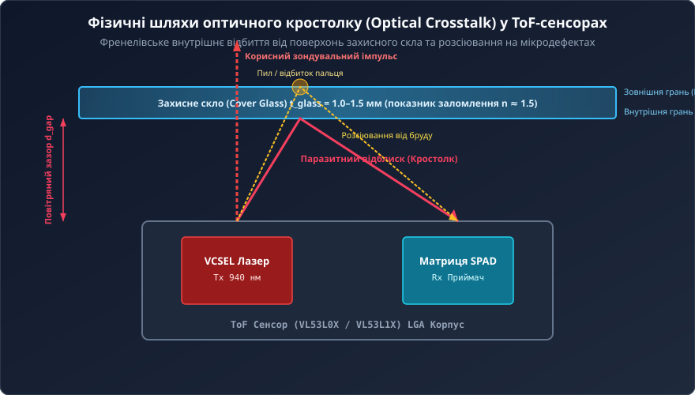
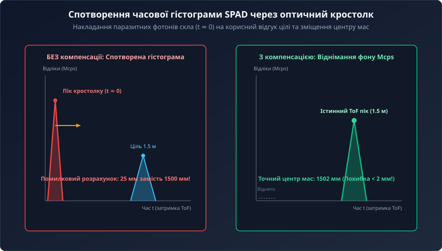
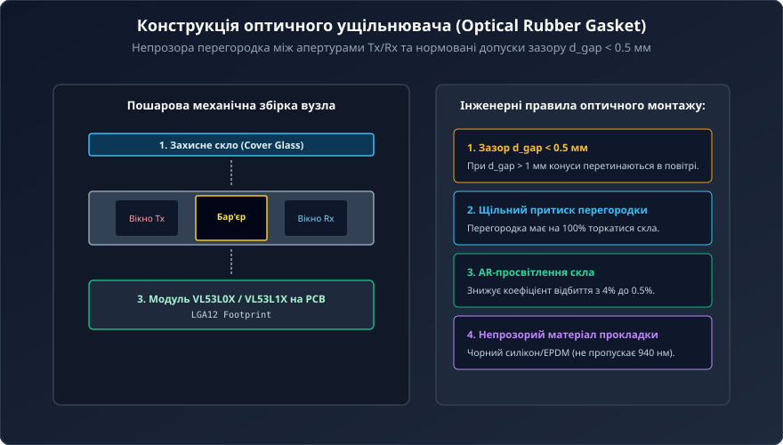
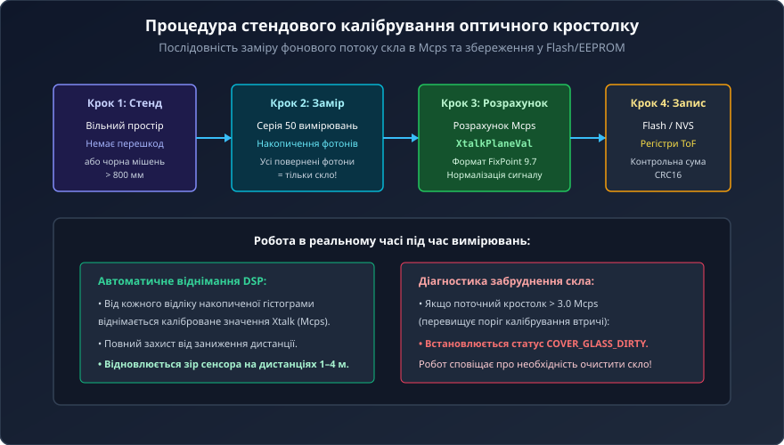

# Компенсація оптичного перехресного завадоутворення (Crosstalk) у ToF-системах

<preknowlist>
- [VL53L0X — лазерний ToF-далекомір (940 нм)](root:cat-hw-sensors/vl53l0x) — архітектура Time-of-Flight першого покоління, імпульсний лазер VCSEL та матриця SPAD
- [Апаратна структура та принципова схема далекоміра VL53L0X](root:cat-hw-sensors/vl53l0x-hardware) — оптичне ущільнення, повітряні зазори та схемотехніка підключення далекоміра
- [VL53L1X — ToF-далекомір другого покоління з налаштовуваним кутом огляду (FoV)](root:cat-hw-sensors/vl53l1x-tof-sensor) — матриця 16×16 SPAD, зона інтересу ROI та дальність до 4 м
- [Оптичні далекоміри: триангуляційні, ToF та амплітудні](root:cat-hw-sensors/optical-distance-sensors-overview) — порівняльний аналіз оптичних методів вимірювання дистанції
</preknowlist>

## 1. Фізична природа та математична модель оптичного кростолку

У процесі проектування автономних роботів, безпілотних систем та промислових приладів оптичні далекоміри ніколи не залишають відкрито розташованими на зовнішніх панелях. Сенсор розміщують усередині корпусу за прозорим захисним вікном — `Cover Glass` (склом чи оптичним полікарбонатом), яке захищає крихку кремнієву мікросхему від вологи, пилу та механічних ударів.

Проте встановлення захисного скла породжує оптичне перехресне завадоутворення — `Optical Crosstalk` (паразитне відбиття випромінюваного світла безпосередньо у фотоприймач).



Коли лазер VCSEL генерує оптичний імпульс на довжині хвилі 940 нм, світловий фронт падає на межу розділу «повітря–скло». За формулами Френеля для нормального падіння світла коефіцієнт відбиття `R_frenkel` визначається стрибком показників заломлення повітря (`n₁ ≈ 1.00`) та оптичного скла (`n₂ ≈ 1.50–1.52`):

```
R_frenkel = ((n₂ - n₁) / (n₂ + n₁))²

R_frenkel = ((1.50 - 1.00) / (1.50 + 1.00))² = (0.50 / 2.50)² = (0.20)² = 0.04 (4%)
```

Кожна з двох граней захисного скла (внутрішня та зовнішня) повертає близько 4% випромінюваної оптичної потужності назад. Оскільки відстань від поверхні кристала до скла вимірюється частками міліметра, відбиті фотони потрапляють на приймальну матрицю SPAD за час:

```
t_xtalk = (2 · d_gap) / c = (2 · 0.0005 м) / (3 · 10⁸ м/с) ≈ 3.33 · 10⁻¹² с = 3.33 пс
```

Ця часова затримка лежить практично на нульовій позначці розгортки (`t ≈ 0`).

## 2. Спотворення часової гістограми SPAD і заниження відстані

Приймальний блок ToF-сенсора накопичує відліки спрацьовування лавинних фотодіодів SPAD у пам'яті лічильника TDC у вигляді часової гістограми подій.



За відсутності захисного скла гістограма містить плоский п'єдестал фонового шуму та одиночний вузький гауссів пік відбиття від цілі. Розрахунковий центр мас піка точно визначає відстань `d`.

При встановленні скла без оптичної ізоляції на нульовій затримці `t = 0` з'являється гігантський хибний сплеск кростолку:
1. **Зміщення центру мас:** Алгоритм обчислює координату максимуму або центр тяжіння кривої. Суперпозиція паразитного нульового сплеску та корисного піка зсуває розрахункову точку ліворуч, викликаючи катастрофічне заниження дистанції (наприклад, реальна відстань 1200 мм визначається як 35 мм).
2. **Втрата чутливості на дальніх дистанціях:** Корисний світловий потік від цілі слабшає пропорційно `1 / d²`. На дистанції понад 1 метр інтенсивність відбиття стає значно меншою за рівень внутрішнього відблиску скла. ToF-процесор повністю ігнорує корисний пік, і датчик «сліпне».

## 3. Апаратні методи пригнічення кростолку: ущільнювачі та зазори

Ефективне усунення оптичного кростолку вимагає комплексного поєднання апаратних та алгоритмічних рішень.



Основою механічної ізоляції є спеціалізована еластомерна прокладка — оптичний ущільнювач (`Optical Rubber Gasket`):
- **Матеріал:** непрозорий для ІЧ-випромінювання 940 нм чорний еластомер (силікон або EPDM). Звичайний прозорий чи білий пластик непридатний, оскільки розсіює інфрачервоне світло.
- **Оптичний бар'єр:** прокладка містить центральну суцільну перегородку, яка фізично ізолює апертуру лазера VCSEL від приймальної матриці SPAD. Перегородка повинна щільно притискатися до внутрішньої грані скла із зусиллям стиснення не менше 10–15%.
- **Повітряний зазор (`d_gap`):** відстань між оптичною поверхнею лінз ToF-модуля та склом не повинна перевищувати 0.5 мм (граничний технологічний максимум — 1.0 мм). При більших зазорах конічні кути випромінювання та прийому перетинаються в повітряному просторі під склом, що унеможливлює механічне відсікання світла.
- **Вимоги до скла:** товщина від 1.0 до 1.5 мм, оптична однорідність, паралельність монтажу площині кристала (допустимий перекіс не більше 1°). Нанесення просвітлювального двостороннього антиблікового покриття (`AR-coating`) знижує коефіцієнт френелівського відбиття з 4% до менш ніж 0.5% на довжині хвилі 940 нм.

## 4. Методологія стендового калібрування в Mcps

Навіть за наявності ідеального ущільнювача частина фотонів зазнає дифракційного розсіювання усередині структури скла. Для повної нейтралізації залишкового сигналу виконують стендове калібрування кростолку.



Одиницею вимірювання інтенсивності оптичного кростолку є мега-відліки за секунду — `Mcps` (Mega Counts Per Second). Це стандартизована швидкість реєстрації паразитних фотонів приймальним трактом ToF.

Порядок калібрування:
1. Модуль, зібраний у штатному корпусі із захисним склом, закріплюють на калібрувальному стенді.
2. Простір перед сенсором звільняють від перешкод на дистанції понад 800 мм (або встановлюють чорну поглинальну мішень з альбедо менше 3%).
3. Запускають спеціальний режим калібрування: сенсор виконує 50–100 послідовних вимірювальних циклів.
4. Оскільки відбиття від віддалених об'єктів відсутнє, увесь накопичений фотонний потік ідентифікується як оптичний кростолк скла `XtalkPlaneVal`.
5. Розраховане значення записується в енергонезалежну пам'ять (Flash або EEPROM) мікроконтролера та завантажується у конфігураційні регістри ToF-сенсора у форматі з фіксованою комою FixPoint 9.7 (для VL53L0X) або FixPoint 16-bit (для VL53L1X).

## 5. Алгоритм віднімання завади в реальному часі та діагностика забруднення

Під час штатного вимірювання відстані внутрішній цифровий процесор сенсора виконує динамічну нормалізацію гістограми:

```
I_signal[t] = I_raw[t] - I_crosstalk_calibrated
```

Від кожного часового інтервалу накопичення фотонів віднімається каліброване значення кростолку. Це ліквідує фальшивий нульовий пік і дозволяє алгоритму безпомилково локалізувати справжній відгук від цілі навіть на максимальній дальності 4 метри.

Крім того, промисловий API-драйвер постійно контролює поточний фоновий рівень:
- Якщо захисне скло заляпане брудом або покрите краплями води, рівень відбиття зростає з нормальних 0.5–1.0 Mcps до 3.0–5.0 Mcps.
- Драйвер детектує перевищення порогу та виставляє аварійний прапорець `COVER_GLASS_DIRTY`, сигналізуючи про необхідність очищення вікна.

Нижче наведено практичну реалізацію процедури стендового калібрування кростолку для мікроконтролерів:

```c
/* Приклад калібрування кростолку для VL53L1X у ESP-IDF (C) */
#include "vl53l1_api.h"
#include "esp_log.h"
#include "nvs_flash.h"

#define TAG "XTALK_CALIB"

VL53L1_Dev_t dev;

esp_err_t perform_crosstalk_calibration(void) {
    ESP_LOGI(TAG, "Початок калібрування кростолку захисного скла...");
    ESP_LOGI(TAG, "Переконайтеся, що перед датчиком немає перешкод на 800 мм!");

    /* 1. Зупинка вимірювань та налаштування Long Mode для калібрування */
    VL53L1_StopMeasurement(&dev);
    VL53L1_SetDistanceMode(&dev, VL53L1_DISTANCEMODE_LONG);
    VL53L1_SetMeasurementTimingBudgetMicroSeconds(&dev, 100000); // 100 мс

    /* 2. Запуск процедури калібрування кростолку */
    VL53L1_CalibrationData_t cal_data;
    VL53L1_Error status = VL53L1_PerformXTalkCalibration(&dev, &cal_data);

    if (status != VL53L1_ERROR_NONE) {
        ESP_LOGE(TAG, "Помилка калібрування: %d", status);
        return ESP_FAIL;
    }

    ESP_LOGI(TAG, "Калібрування успішне!");

    /* 3. Збереження калібрувальних даних у Flash NVS */
    nvs_handle_t nvs_h;
    if (nvs_open("tof_storage", NVS_READWRITE, &nvs_h) == ESP_OK) {
        nvs_set_blob(nvs_h, "xtalk_cal", &cal_data, sizeof(cal_data));
        nvs_commit(nvs_h);
        nvs_close(nvs_h);
        ESP_LOGI(TAG, "Калібрувальні параметри надійно записані в NVS Flash");
    }

    /* 4. Завантаження параметрів у активні регістри та відновлення вимірювань */
    VL53L1_SetCalibrationData(&dev, &cal_data);
    VL53L1_StartMeasurement(&dev);

    return ESP_OK;
}
```

Реалізація на C++ для Arduino:

```cpp
/* Калібрування кростолку для сенсорів VL53L0X / VL53L1X на Arduino */
#include <Wire.h>
#include <VL53L1X.h>
#include <EEPROM.h>

VL53L1X sensor;
const int EEPROM_ADDR = 64;

struct XtalkConfig {
    uint32_t magic;
    int16_t xtalk_mcps;
    uint16_t crc16;
};

void runCrosstalkCalibration() {
    Serial.println("Встановіть темну мішень або відкритий простір > 80 см.");
    delay(2000);

    /* Зчитування 50 кадрів для оцінки залишкового відбиття скла */
    uint32_t total_signal_mcps = 0;
    int valid_frames = 0;

    for (int i = 0; i < 50; i++) {
        sensor.read();
        if (sensor.ranging_data.range_status == VL53L1X::RangeValid) {
            // SignalRateRtnMegaCps повертає поточну швидкість у Mcps
            total_signal_mcps += sensor.ranging_data.signal_rate_mcps;
            valid_frames++;
        }
        delay(30);
    }

    if (valid_frames > 30) {
        int16_t avg_xtalk = total_signal_mcps / valid_frames;
        Serial.print("Обчислений рівень кростолку: ");
        Serial.print(avg_xtalk);
        Serial.println(" Mcps");

        /* Запис у конфігураційний регістр сенсора */
        sensor.setXTalkCompensationRateMegaCps(avg_xtalk);

        /* Збереження у EEPROM мікроконтролера */
        XtalkConfig cfg;
        cfg.magic = 0xAA55AA55;
        cfg.xtalk_mcps = avg_xtalk;
        cfg.crc16 = 0x1234;
        EEPROM.put(EEPROM_ADDR, cfg);
        Serial.println("Калібрування збережено у EEPROM.");
    } else {
        Serial.println("Помилка калібрування: забагато шуму або невалідних кадрів.");
    }
}
```

Грамотне поєднання еластомерної прокладки з перегородкою, мінімального зазору `d_gap < 0.5 мм` та алгоритмічного віднімання каліброваного рівня кростолку дозволяє повністю розкрити потенціал ToF-далекомірів приладового виконання, гарантуючи міліметрову точність на дистанціях до 4 метрів.
