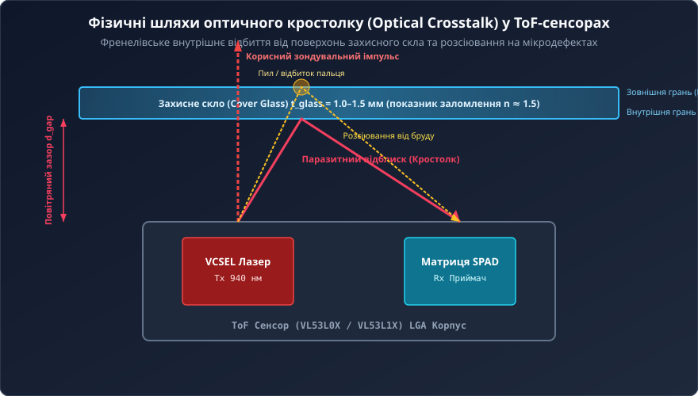
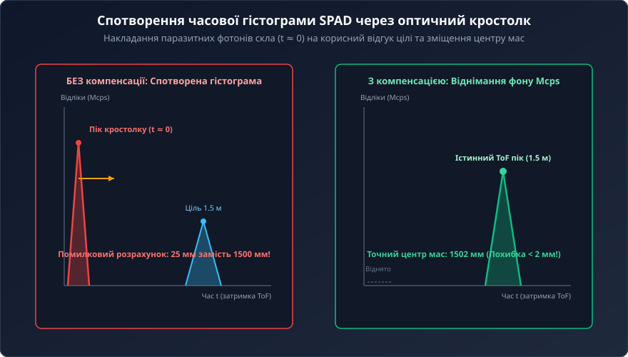
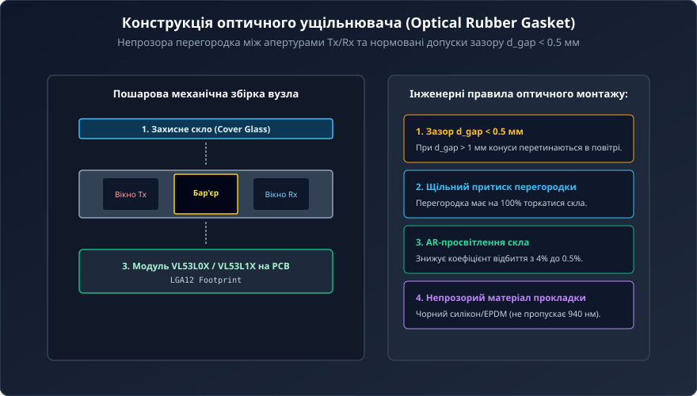
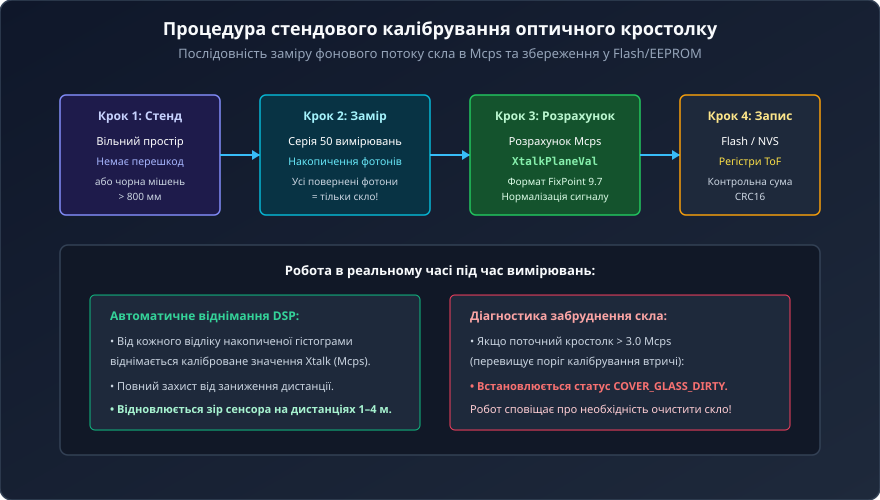

# Компенсація оптичного перехресного завадоутворення (Crosstalk) у ToF-системах

Вбудовування лазерних часопролітних сенсорів (ToF) сімейства FlightSense (VL53L0X, VL53L1X) всередину комерційних приладів та робототехнічних комплексів вимагає їх обов'язкового захисту прозорим вікном (Cover Glass) від пилу, вологи та механічних пошкоджень. Проте встановлення захисного скла породжує критичну оптичну проблему — оптичне перехресне завадоутворення (Optical Crosstalk), яке без належної апаратної ізоляції та алгоритмічної компенсації здатне повністю паралізувати роботу далекоміра.

## 1. Фізична природа оптичного кростолку в захисному склі

Оптичний кростолк виникає через те, що частина лазерного пучка, випромінюваного джерелом VCSEL (940 нм), відбивається від меж розділу середовищ «повітря–скло» та «скло–повітря» безпосередньо у приймальну апертуру фотоприймача SPAD, взагалі не доходячи до цільового об'єкта.

Фізичні причини виникнення паразитного сигналу:
1. **Френелівське відбиття:** стрибок показника заломлення від повітря (`n ≈ 1.0`) до скла чи полікарбонату (`n ≈ 1.5`) спричиняє відбиття близько 4% оптичної потужності на кожній грані вікна.
2. **Розсіювання на мікродефектах:** пил, відбитки пальців, подряпини та мікропори на поверхні захисного скла працюють як дифракційні розсіювачі, спрямовуючи частину випромінювання під широкими кутами прямо на приймач.
3. **Хвилеводний ефект:** усередині плоскопаралельної пластини скла світло може розповсюджуватися шляхом повного внутрішнього відбиття між гранями, потрапляючи з передавача в приймач.

## 2. Спотворення часової гістограми SPAD і заниження дистанції

Оскільки захисне скло розташоване на відстані менше міліметра від кристала, відбиті від нього фотони повертаються на лавинні фотодіоди SPAD майже миттєво — із затримкою лише в кілька пікосекунд.

У результаті в лічильнику TDC формується потужний хибний сплеск фотонів на нульовій затримці `t ≈ 0`:
- **Зміщення центру мас:** обчислювальний алгоритм знаходить центр ваги гістограми, де паразитний нульовий пік змішується зі справжнім відгуком від цілі, спричиняючи різке заниження виміряної дистанції (наприклад, сенсор показує 20–30 мм замість реальних 1.5 м).
- **Втрата дальніх цілей:** при відстанях понад 1 метр корисний фотонний сигнал слабшає пропорційно квадрату дистанції. Інтенсивність паразитного відблиску скла перевищує корисний сигнал у десятки разів, через що ToF-процесор повністю втрачає ціль («сліпота» на дальніх дистанціях).

## 3. Апаратні методи ізоляції: еластомерні ущільнювачі та зазор d_gap

Боротьба з оптичним кростолком починається з правильного механічного проектування корпусу пристрою.

Ключові конструктивні вимоги:
1. **Оптичний ущільнювач (Rubber Gasket):** використання прокладки з непрозорого еластомеру (чорного силікону або гуми EPDM), яка розділяє оптичні апертури Tx та Rx суцільною центральною перегородкою. Перегородка повинна щільно притискатися до внутрішньої грані скла без зазорів.
2. **Мінімальний повітряний зазор:** відстань `d_gap` від поверхні лінз сенсора до скла не повинна перевищувати 0.5 мм (критичний поріг — 1.0 мм). При більшому зазорі конуси передавача та приймача перетинаються в повітряному просторі під склом.
3. **Просвітлювальне покриття (AR-coating):** нанесення двостороннього антиблікового покриття зменшує коефіцієнт відбиття скла з 4% до менш ніж 0.5% на довжині хвилі 940 нм.
4. **Вибір матеріалу:** оптичне мінеральне скло або оптичний полікарбонат завтовшки 1.0–1.5 мм із коефіцієнтом пропускання >90%.

## 4. Процедура стендового калібрування кростолку

Навіть при ідеальному монтажі частина фотонів розсіюється всередині товщі скла. Для її нейтралізації застосовують процедуру калібрування кростолку.

Послідовність стендового калібрування:
1. Датчик, змонтований у корпусі за захисним склом, встановлюється навпроти відкритого простору або абсолютно чорної поглинальної мішені (альбедо < 3%) на відстані понад 800 мм.
2. За відсутності відбитого сигналу від мішені всі фотони, зареєстровані матрицею SPAD, вважаються паразитним фоном скла.
3. Програма виконує серію з 50–100 вимірювань і обчислює середню інтенсивність кростолку в мега-відліках на секунду — `Mcps` (Mega Counts Per Second).
4. Отримане калібрувальне число записується в енергонезалежну пам'ять (Flash/EEPROM) та в конфігураційний регістр сенсора ToF (у форматі FixPoint 9.7).

## 5. Алгоритм віднімання завади в реальному часі та діагностика забруднення

Під час штатної експлуатації вбудований цифровий процесор сенсора автоматично віднімає каліброване значення кростолку (в Mcps) з накопичувальної гістограми перед пошуком центру мас піка. Це повністю відновлює форму сигналу та повертає точність ±1–2 мм на дистанціях до 4 метрів.

Крім того, сучасні алгоритми драйвера виконують динамічний моніторинг стану захисного скла:
- Якщо поточний рівень завади перевищує фабричне значення у 3–4 рази (наприклад, понад 3.0 Mcps через бруд, жирні відбитки або краплі води), драйвер встановлює діагностичний статус `COVER_GLASS_DIRTY`.
- Це дозволяє автономному роботу вчасно повідомити оператора про необхідність протерти оптичне вікно сенсора до виникнення аварійної ситуації.
