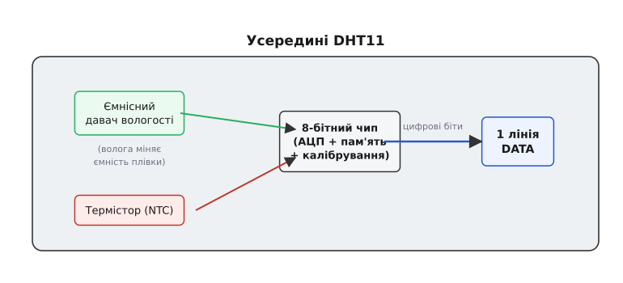
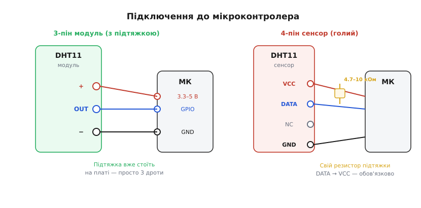
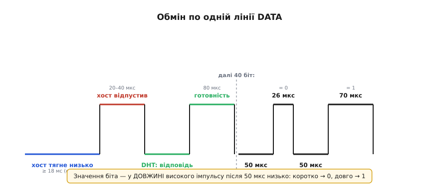

# DHT11 — давач температури й вологості

<preknowlist>
- [Вимірювання вологості](root:ph-thermodynamics/humidity-measurement) — концепція відносної вологості повітря (RH) та її термодинамічна залежність від температури
- [Ємнісний сенсор вологості](root:hw-sensing/capacitive-humidity-sensor) — зміна діелектричної проникності вологопоглинаючого шару та ємності сенсора
- [Термістор NTC](root:hw-sensing/ntc-thermistor) — нелінійне зменшення опору напівпровідника при нагріванні
- [Вихідний каскад із відкритим стоком](root:hw-digital/open-drain-output) — організація двонапрямної цифрової лінії з підтягувальним резистором
</preknowlist>

Сенсор **DHT11** від компанії Aosong є одним із найвідоміших та найдешевших цифрових давачів для аматорських і навчальних систем мікроклімату. Впізнаваний блакитний пластиковий корпус із вентиляційними ґратами поєднує два незалежні первинні вимірювальні елементи та вбудований мікроконтролер, який перетворює аналогові величини на послідовний цифровий код.

## Призначення та фізичні сенсори модуля DHT11

Модуль DHT11 призначений для комплексного контролю параметрів мікроклімату всередині приміщень: вимірювання температури сухого повітря та його відносної вологості.

Усередині пластикового корпусу змонтовано дві чутливі структури:
1. **Ємнісний датчик вологості:** тонка гігроскопічна полімерна плівка між пористими електродами, яка вбирає молекули водяної пари з повітря, змінюючи свою діелектричну проникність та електричну ємність.
2. **NTC-термістор:** напівпровідникова намистинка, електричний опір якої різко падає при підвищенні температури навколишнього повітря.


*Компоненти всередині корпусу DHT11. Внутрішній 8-бітний чип оцифровує первинні сигнали та видає готові дані через одну лінію DATA.*

Інтегрований 8-бітний мікроконтролер виконує циклічне вимірювання ємності та опору, застосовує зашиті під час заводського калібрування табличні коефіцієнти і формує 40-бітний пакет цифрових даних.

## Метрологічні характеристики та дискретність відліків

Метрологічні параметри сенсора оптимізовані для невибагливого побутового контролю:
- **Діапазон вимірювання температури:** від 0 °C до +50 °C із точністю ±2.0 °C. Сенсор принципово не розрахований на роботу за мінусових температур.
- **Діапазон вимірювання вологості:** від 20 % до 80 % RH із точністю ±5 % RH при нормальній температурі 25 °C.
- **Роздільна здатність:** строго цілі числа (1 °C та 1 % RH). Дробова частина відліків у протоколі DHT11 завжди дорівнює нулю.
- **Період опитування:** не частіше одного разу на 1–2 секунди.

Спроба занадто частого зчитування призводить до збоїв обміну або отримання застарілих значень із внутрішнього регістра.

## Схемотехніка, виводи та підтягувальний резистор

Сенсор постачається як окремий 4-вивідний компонент або у вигляді змонтованого 3-вивідного модуля:
- **Пін 1 (VCC):** живлення від 3.3 В до 5.5 В.
- **Пін 2 (DATA):** двонапрямна цифрова шина зв'язку.
- **Пін 3 (NC):** не підключений (присутній лише на 4-піновому компоненті).
- **Пін 4 (GND):** загальний провідник землі.


*Підключення датчика DHT11. Якщо використовується голий 4-вивідний сенсор, між виводами DATA та VCC обов'язково встановлюють зовнішній резистор 4.7–10 кОм.*

На окремих 3-пінових платах підтягувальний резистор уже розпаяний. Якщо ж підключається голий сенсор, відсутність зовнішнього резистора залишає лінію DATA у невизначеному плаваючому стані, блокуючи відповідь датчика.

## Фірмовий однопровідний протокол Aosong

Зв'язок хост-контролера з DHT11 здійснюється за спеціалізованим асинхронним протоколом:
1. **Стартовий імпульс хоста:** мікроконтролер притискає шину DATA до нуля на час не менше 18 мс, після чого переводить пін на вхід із високим рівнем на 20–40 мкс.
2. **Відповідь датчика:** сенсор підтверджує готовність серією двох імпульсів по 80 мкс: спершу низький рівень, потім високий.
3. **Пакет даних (40 біт):** передаються п'ять послідовних байтів:
   - Байт 1: ціла частина вологості (% RH).
   - Байт 2: дробова частина вологості (завжди 0 у DHT11).
   - Байт 3: ціла частина температури (°C).
   - Байт 4: дробова частина температури (завжди 0 у DHT11).
   - Байт 5: контрольна сума (молодші 8 біт суми перших чотирьох байтів).


*Часова діаграма протоколу DHT11. Кожен біт починається з 50 мкс низького рівня, після чого тривалість високого рівня кодує значення: 26–28 мкс — логічний 0, 70 мкс — логічна 1.*

## Робота з давачем у коді та практичні обмеження

Для взаємодії з DHT11 на Arduino найчастіше застосовують бібліотеку `DHT sensor library` від Adafruit:
```cpp
#include "DHT.h"

#define DHTPIN 2
#define DHTTYPE DHT11

DHT dht(DHTPIN, DHTTYPE);

void setup() {
  Serial.begin(115200);
  dht.begin();
  delay(1500); // Час на початковий вимір після увімкнення
}

void loop() {
  float h = dht.readHumidity();
  float t = dht.readTemperature();

  if (isnan(h) || isnan(t)) {
    Serial.println("Помилка читання з датчика DHT11!");
  } else {
    Serial.print("Вологість: "); Serial.print(h, 0); Serial.print(" % | ");
    Serial.print("Температура: "); Serial.print(t, 0); Serial.println(" °C");
  }
  delay(2000); // Інтервал між опитуваннями не менше 2 секунд
}
```

Під час розробки необхідно обов'язково фільтрувати повернені значення `isnan()`, оскільки випадкові таймінгові збої під час переривань процесора періодично спотворюють контрольну суму. DHT11 є оптимальним вибором для кімнатних метеостанцій та навчальних демонстрацій, де невисока точність компенсується мінімальною вартістю.
