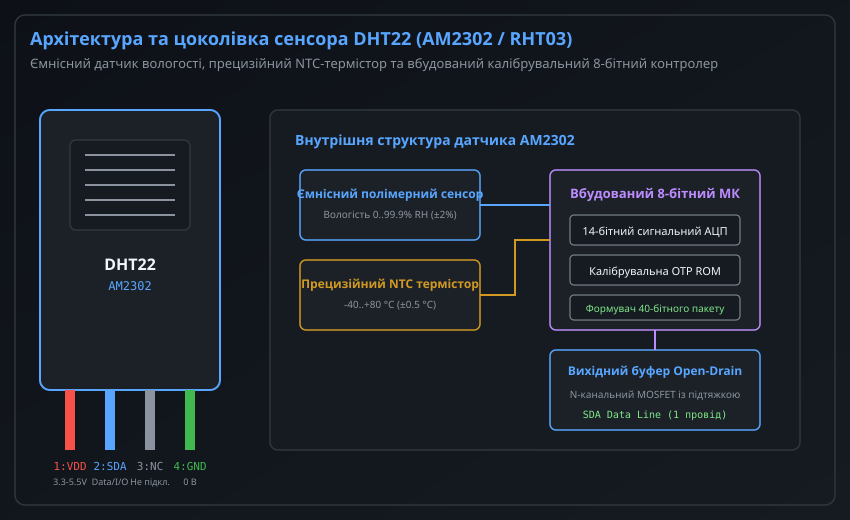
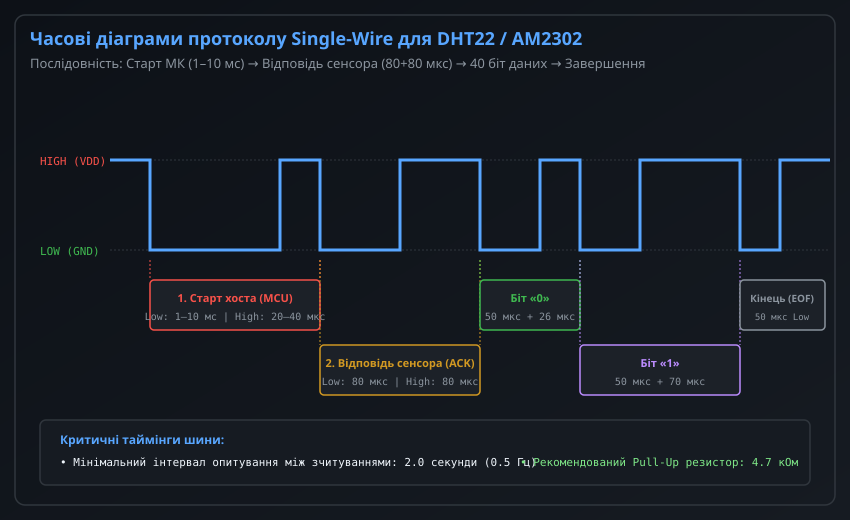
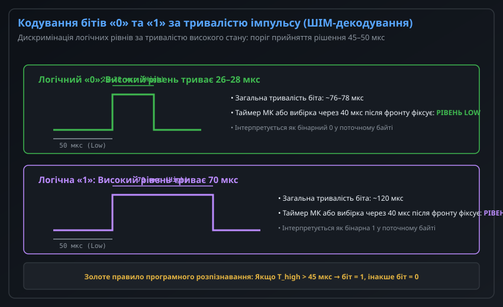
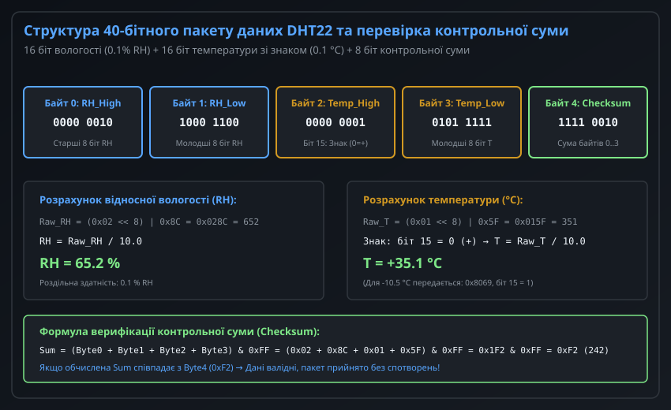
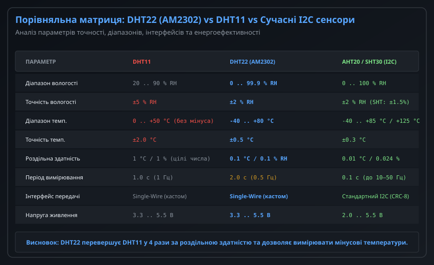

# Цифровий давач температури й вологості DHT22 (AM2302)

Цифровий датчик температури та відносної вологості DHT22 (також відомий під маркуванням AM2302 або RHT03) є одним із найпопулярніших модулів у системах моніторингу мікроклімату, метеостанціях, тепличних контролерах та автоматиці HVAC. На відміну від молодшого базового сенсора DHT11, модуль DHT22 оснащений ємнісним чутливим елементом вологості вищого класу, прецизійним NTC-термістором розширеного температурного діапазону та 14-бітним аналого-цифровим перетворювачем із заводським калібруванням.

Передача результатів вимірювань здійснюється через фірмовий однопровідний двонаправлений цифровий інтерфейс (Single-Wire), що дозволяє використовувати лише один сигнальний вивід мікроконтролера. 40-бітний протокол забезпечує передачу 16-бітних значень вологості та температури з дискретністю 0.1, а також 8-бітної контрольної суми для захисту від спотворень.

---

## 1. Архітектура, сенсорні елементи та цоколівка сенсора DHT22 (AM2302)

Конструктивно датчик виконано в компактному пластиковому перфорованому корпусі білого кольору, що забезпечує вільну конвекцію повітря навколо вимірювальних елементів за збереження механічного захисту від пилу та випадкових дотиків.



### Внутрішня побудова сенсорного вузла

Всередині корпусу AM2302 розміщено спеціалізовану друковану плату з такими ключовими вузлами:
1. **Ємнісний датчик відносної вологості (Capacitive RH Sensor):** Побудований на основі вологочутливого тонкоплівкового полімерного діелектрика, розміщеного між двома пористими золотими електродами. Молекули водяної пари дифундують у полімер, змінюючи його діелектричну проникність, що спричиняє лінійну зміну електричної ємності. Сенсор перекриває повний діапазон 0..99.9% RH із заводською точністю +/-2% RH.
2. **Прецизійний NTC-термістор:** Напівпровідниковий терморезистор з негативним температурним коефіцієнтом опору, оптимізований для роботи в діапазоні від -40 °C до +80 °C із похибкою не більше +/-0.5 °C.
3. **Обчислювальний 8-бітний мікроконтролер:** Спеціалізований контролер обробки сигналів виконує циклічне опитування датчиків за допомогою власного 14-бітного АЦП. Заводські калібрувальні коефіцієнти прошиті в енергонезалежну пам'ять OTP ROM під час вихідного заводського тестування.
4. **Вихідний буфер з відкритим стоком (Open-Drain):** N-канальний польовий транзистор, який керує сигнальною лінією SDA, здатний лише притискати лінію до потенціалу землі (LOW), тоді як повернення у високий стан (HIGH) забезпечується зовнішнім резистором підтяжки.

### Цоколівка та електричне підключення

Датчик має 4 виводи з кроком 2.54 мм (зліва направо, якщо дивитися на перфорацію корпусу виводами донизу):

| Номер виводу | Позначення | Тип лінії | Функціональне призначення |
| :--- | :--- | :--- | :--- |
| **1** | **VDD** | Живлення | Напруга живлення постійного струму від +3.3 В до +5.5 В |
| **2** | **DATA (SDA)** | Ввід / Вивід | Двонаправлена цифрова сигнальна шина Single-Wire |
| **3** | **NC** | Не підключено | Вільний вивід (у готових 3-пінових модулях на платі відсутній) |
| **4** | **GND** | Заземлення | Спільна шина живлення (0 В) |

Для стабільного функціонування шини Single-Wire між виводами 1 (VDD) та 2 (DATA) обов'язково встановлюється зовнішній підтягуючий резистор R_pull номіналом 4.7–10 кОм. При живленні 3.3 В або довжині сигнального дроту понад 1 метр рекомендовано застосовувати номінал 4.7 кОм або 3.3 кОм для забезпечення крутих фронтів наростання сигналу. Безпосередньо біля виводів живлення сенсора бажано встановити керамічний блокувальний конденсатор ємністю 100 нФ.

---

## 2. Однопровідний нестандартний протокол Single-Wire та фази зв'язку

Для обміну даними з AM2302 використовується фірмовий напівдуплексний протокол Single-Wire розробки компанії Aosong. Важливо зазначити, що цей інтерфейс **не є сумісним** зі стандартом 1-Wire компанії Dallas/Maxim (DS18B20): він не підтримує унікальну 64-бітну ROM-адресацію, не дозволяє паралельне підключення кількох сенсорів на одну шину без мультиплексування та використовує зовсім інші часові інтервали.



Сеанс зв'язку завжди ініціюється мікроконтролером (Master) і складається з чотирьох послідовних часових фаз:

### Фаза 1: Стартовий сигнал хоста (Master Start Signal)
У режимі очікування (Idle) шина утримується у високому логічному рівні завдяки резистору підтяжки. Коли мікроконтролеру необхідно отримати нові дані:
- Порт GPIO перемикається в режим виходу (Output Push-Pull або Open-Drain).
- МК притискає шину до рівня LOW на час не менше 1 мс і не більше 10 мс (зазвичай обирають 1.5–2.0 мс). Для порівняння, сенсор DHT11 вимагає утримання стартового імпульсу LOW щонайменше 18 мс.
- МК відпускає лінію (перемикає порт у режим високоімпедансного входу Input Floating) на 20–40 мкс. Підтягуючий резистор повертає напругу на шині до рівня HIGH.

### Фаза 2: Сигнал підтвердження від сенсора (Sensor ACK)
Виявивши стартовий імпульс і наступне звільнення лінії, вбудований контролер DHT22 надсилає відповідь:
- Датчик притискає лінію до рівня LOW на 80 мкс (+/-5 мкс).
- Датчик піднімає лінію до рівня HIGH на 80 мкс (+/-5 мкс).
Цей сигнал (80 мкс LOW + 80 мкс HIGH) є підтвердженням готовності до передачі виміряних значень. Якщо після стартового імпульсу хост не бачить спаду лінії до нуля через 50–100 мкс, це свідчить про обрив зв'язку або несправність сенсора.

### Фаза 3: Передача 40 бітів корисного навантаження
Безпосередньо після завершення 80 мкс високого рівня підтвердження датчик починає послідовну побітну передачу 40 бітів даних (5 байтів), починаючи зі старшого біта (MSB first).

### Фаза 4: Завершення передачі (End of Transmission)
Після передачі останнього 40-го біта сенсор притискає лінію до рівня LOW на 50 мкс, після чого остаточно закриває вихідний польовий транзистор. Резистор підтяжки повертає шину у вихідний високоімпедансний стан спокою (HIGH).

---

## 3. Дискримінація бітів за тривалістю імпульсу (ШІМ-декодування)

Кожен із 40 бітів у потоці даних передається методом широтно-імпульсної модуляції (Pulse Width Modulation), де значення біта визначається не рівнем напруги, а тривалістю перебування лінії у стані логічної одиниці (HIGH).



### Формат елементарного біта

Кожен біт складається з фіксованого стартового інтервалу низького рівня та змінного інтервалу високого рівня:
1. **Преамбула біта (LOW):** Лінія утримується на рівні LOW протягом рівно 50 мкс для кожного переданого біта (як «0», так і «1»).
2. **Інформаційна фаза (HIGH):**
   - **Логічний «0»:** Тривалість високого стану становить від 26 до 28 мкс. Повна тривалість біта на шині: 50 мкс + 27 мкс ≈ 77 мкс.
   - **Логічна «1»:** Тривалість високого стану становить 70 мкс. Повна тривалість біта на шині: 50 мкс + 70 мкс ≈ 120 мкс.

### Алгоритм програмного розпізнавання бітів

Для надійного декодування бітів у мікроконтролері використовують один із двох підходів:

1. **Апаратне захоплення таймера (Timer Input Capture):** Використання каналу захоплення таймера, налаштованого на вимірювання інтервалу між висхідним і низхідним фронтами сигналу на виводі GPIO. Це найбільш надійний промисловий спосіб, оскільки він не залежить від переривань процесора та джиттеру операційної системи.
2. **Пороговий замір затримкою (Threshold Sampling):** Програмний метод опитування (polling), за якого після фіксації переходу лінії з LOW у HIGH мікроконтролер витримує калібровану затримку 40–45 мкс, після чого перевіряє стан піна:
   - Якщо рівень на піні вже впав до нуля (LOW) — це був короткий імпульс (26–28 мкс), отже, прийнято **біт «0»**.
   - Якщо на піні все ще залишається високий рівень (HIGH) — триває довгий імпульс (70 мкс), отже, прийнято **біт «1»**.

Критичним правилом для програмного методу є тимчасове відключення глобальних переривань ядра МК на час прийому 40 бітів (загальний час транзакції становить близько 4–5 мс), оскільки будь-яке стороннє переривання спотворить мікросекундні затримки й призведе до збою контрольної суми.

---

## 4. Структура 40-бітного пакету даних, обчислення значень та перевірка контрольної суми

Корисне навантаження DHT22 передається строго фіксованим пакетом з 5 байтів (40 бітів).



### Формат байтів пакету

Пакет містить три функціональні секції:

```
[ Байт 0: RH_High ] [ Байт 1: RH_Low ] [ Байт 2: T_High ] [ Байт 3: T_Low ] [ Байт 4: Checksum ]
```

1. **Відносна вологість (Байт 0 та Байт 1):** Об'єднуються в 16-бітне ціле беззнакове число `uint16_t raw_rh = (Byte0 << 8) | Byte1`. Фізичне значення вологості отримують діленням на 10.0:
   ```
   RH (%) = raw_rh / 10.0
   ```
   *Приклад:* Якщо прийнято `Byte0 = 0x02`, `Byte1 = 0x8C`, то `raw_rh = 0x028C = 652`. Відносна вологість становить `652 / 10.0 = 65.2% RH`.

2. **Температура навколишнього середовища (Байт 2 та Байт 3):** Об'єднуються в 16-бітне число `uint16_t raw_temp = (Byte2 << 8) | Byte3`. 
   
   У DHT22 реалізовано підтримку від'ємних температур, де старший біт (біт 15, MSB байта 2) виконує роль знака:
   - Якщо біт 15 дорівнює **0**, температура є додатньою (+):
     ```
     T (°C) = raw_temp / 10.0
     ```
   - Якщо біт 15 дорівнює **1**, температура є від'ємною (-). Для отримання модуля температури маскують біт знака:
     ```
     T (°C) = -((raw_temp & 0x7FFF) / 10.0)
     ```
   *Приклад додатньої температури:* `Byte2 = 0x01`, `Byte3 = 0x5F` -> `raw_temp = 0x015F = 351`. Температура становить `+35.1 °C`.
   *Приклад від'ємної температури:* `Byte2 = 0x80`, `Byte3 = 0x69` -> біт 15 встановлено в 1. Маска `0x8069 & 0x7FFF = 0x0069 = 105`. Температура становить `-10.5 °C`.

3. **Контрольна сума Checksum (Байт 4):** Молодший байт арифметичної суми чотирьох інформаційних байтів:
   ```
   Checksum_calc = (Byte0 + Byte1 + Byte2 + Byte3) & 0xFF
   ```
   Якщо обчислене значення `Checksum_calc` суворо збігається з прийнятим `Byte4`, пакет вважається достовірним. Якщо значення не збігаються, це свідчить про наявність завад на сигнальній лінії або порушення таймінгів; такі дані обов'язково відкидаються, а алгоритм повторює опитування сенсора після обов'язкової паузи.

---

## 5. Порівняльний аналіз, типові проблеми експлуатації та рекомендації з інтеграції

Хоча сенсори родини DHT широко поширені в аматорських і навчальних проектах, їх застосування в надійних комерційних і промислових системах має низку важливих обмежень, які інженер зобов'язаний враховувати під час проектування.



### Порівняння DHT22 з DHT11 та сучасними I2C-аналогами

| Параметр системи | DHT11 | DHT22 (AM2302) | Сучасні I2C (AHT20 / SHT30) |
| :--- | :--- | :--- | :--- |
| **Діапазон вологості** | 20..90% RH | **0..99.9% RH** | 0..100% RH |
| **Похибка вологості** | +/-5% RH | **+/-2% RH** | +/-1.5..2% RH |
| **Діапазон температур** | 0..+50 °C (лише плюс) | **-40..+80 °C** | -40..+85 °C (+125 °C) |
| **Похибка температури** | +/-2.0 °C | **+/-0.5 °C** | +/-0.2..0.3 °C |
| **Роздільна здатність** | 1 °C / 1% RH (цілі числа) | **0.1 °C / 0.1% RH** | 0.01 °C / 0.024% RH |
| **Максимальна частота опитування** | 1 Гц (раз на 1 с) | **0.5 Гц (раз на 2 с)** | 10–50 Гц (раз на 20–100 мс) |
| **Цифровий протокол** | Single-Wire (власний) | **Single-Wire (власний)** | Стандартний I2C (з апаратним CRC-8) |
| **Стійкість до блокування RTOS** | Низька (вимагає зупинки переривань) | **Низька (блокує ядро на 4 мс)** | Висока (працює через DMA/I2C контролер) |

### Типові експлуатаційні проблеми та методи їх вирішення

1. **Перегрів та саморозігрів через часті опитування:** Сенсор DHT22 вимагає щонайменше 2.0 секунди паузи між сеансами зчитування. Якщо опитувати сенсор частіше (наприклад, 1 раз на 500 мс), внутрішній мікроконтролер не встигає завершити попереднє оцифрування, що призводить до саморозігріву полімерної мембрани на 0.5–1.5 °C, штучного заниження показів вологості або зависання видачі даних (повернення однакових значень).
2. **Ємність кабельних ліній та завал фронтів:** При довжині кабелю понад 2–3 метри паразитна ємність крученої пари (зазвичай 50–100 пФ/м) спотворює короткі імпульси високого рівня (26 мкс біта «0»). Для компенсації ємності слід зменшувати номінал підтягуючого резистора R_pull до 2.2–3.3 кОм або використовувати активні буфери шини.
3. **Деградація полімеру при забрудненнях:** Прямий контакт ємнісного елемента з масляними аерозолями, парами органічних розчинників (спирт, ацетон, леткі органічні сполуки) або постійною рідкою вологою (конденсатом) викликає дрейф калібрування до 5–10% RH. У таких випадках сенсор потребує відновлювального термопрогріву (Baking: 80 °C за вологості < 5% протягом 24 годин).
4. **Конфлікт із багатоозадачними ОС (FreeRTOS, Linux):** Через необхідність відключення переривань на 4–5 мс під час програмного прийому пакету Single-Wire страждає решта критичних до часу задач системи (обробка USB, CAN, радіостеків Wi-Fi/BLE). Для промислових контролерів рекомендовано використовувати прийом через апаратний таймер захоплення або переходити на сенсори з інтерфейсом I2C.
