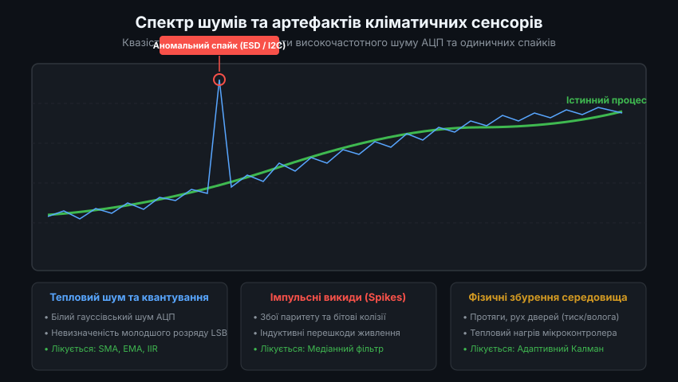
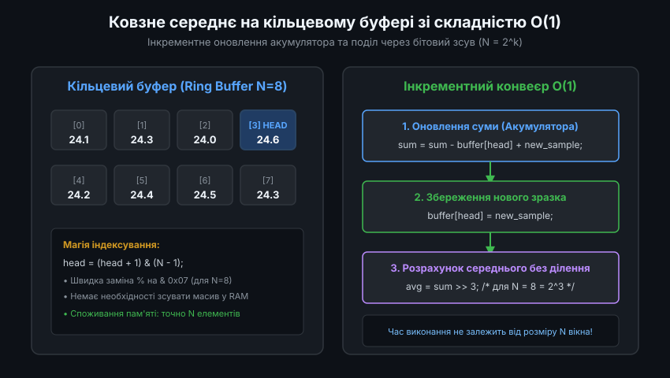
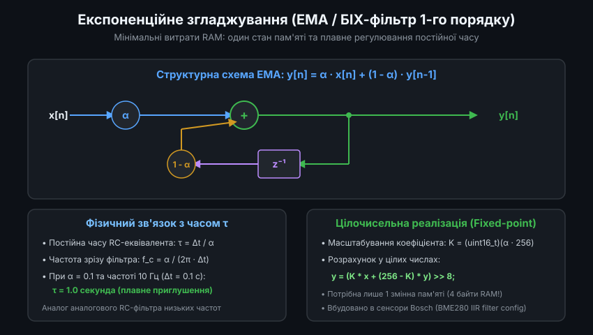
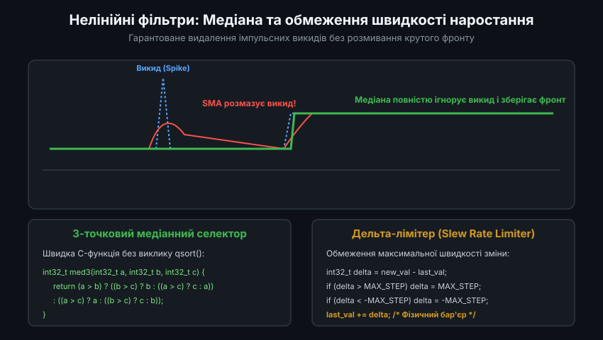
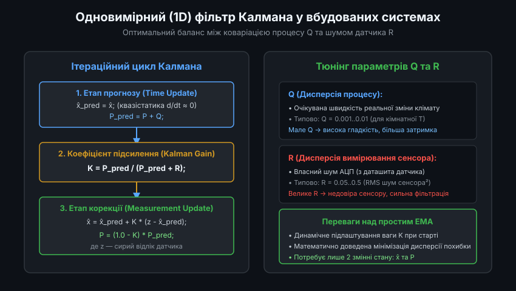

# Цифрова фільтрація кліматичних даних у мікроконтролерах: Архітектура та оптимізація алгоритмів

У вбудованих системах моніторингу навколишнього середовища, автоматизації будівель (HVAC) та автономних польових логерах первинні дані датчиків температури, вологості та барометричного тиску рідко використовуються в необробленому вигляді. Наявність випадкового шуму квантування АЦП, теплових флуктуацій чутливих елементів та спорадичних спотворень на шинах зв'язку вимагає застосування спеціалізованих алгоритмів цифрової фільтрації (Digital Signal Processing, DSP). При цьому розробник обмежений жорсткими рамками ресурсів мікроконтролера: невеликим обсягом оперативної пам'яті (SRAM), обмеженою тактовою частотою процесорного ядра та суворими вимогами до енергоспоживання при періодичному пробудженні з глибокого сну.

---

### 1. Частотний спектр шумів та математична класифікація завад

Фізичні процеси теплообміну, дифузії вологи та зміни атмосферного фронту характеризуються дуже низькими граничними частотами — типово нижче 0.01 Гц для приміщень і рідко перевищують 0.1 Гц для динамічних каналів вимірювання. У той же час спектр шумів, що потрапляють у вимірювальний тракт, поширюється від одиниць герц до сотень кілогерц.



Математична модель вимірюваного сигналу описується сумою трьох компонентів:
`z[n] = s[n] + v[n] + eta[n]`

де:
- `s[n]` — корисний квазістатичний фізичний процес (істинна температура чи вологість).
- `v[n]` — випадковий некорельований білий шум із нульовим математичним сподіванням `E{v[n]} = 0` та кінцевою дисперсією `sigma_v^2`. Він складається з теплового шуму Джонсона-Найквіста аналогового сенсора, флікер-шуму (1/f) підсилювача та шуму квантування АЦП з дисперсією `q^2 / 12` (де q — ціна одиниці молодшого розряду LSB).
- `eta[n]` — аномальні імпульсні викиди (Spikes). Це випадковий процес бернуллівсько-гауссівського типу: у більшості відліків `eta[n] = 0`, але з невеликою ймовірністю виникає відлік з амплітудою, що в сотні разів перевищує `sigma_v`.

Джерела виникнення імпульсних викидів `eta[n]`:
1. Електромагнітна інтерференція (EMI) від комутації індуктивних навантажень (компресори, контактори, вентилятори), що наводить синфазні завади на сигнальні лінії I2C (SDA/SCL).
2. Зависання шини або поява фальшивого біта підтвердження (ACK), що зміщує байти у кадрі зчитування, перетворюючи коректне значення 23.4 °C на 85.0 °C або -40.0 °C.
3. Електростатичні розряди (ESD) при низькій вологості в приміщенні.

Спроба застосувати до такого комбінованого сигналу звичайний низькочастотний лінійний фільтр призводить до того, що одиночний імпульсний викид "розмазується" на тривалий час, спотворюючи роботу ПІД-регуляторів температури. Тому алгоритмічний конвеєр має обов'язково бути двостадійним: первинне відсікання спайків нелінійним методом та вторинне згладжування білого шуму.

---

### 2. Кільцевий буфер ковзного середнього з обчислювальною складністю O(1)

Просте ковзне середнє (Simple Moving Average, SMA) розміром N розраховує середнє арифметичне вікна останніх відліків:
`y[n] = (1 / N) * sum(x[n - i]), де i від 0 до N - 1`

Класична наївна реалізація, що циклічно підсумовує весь масив при кожному виклику, вимагає N операцій додавання та однієї операції ділення. При збільшенні вікна N до 32 чи 64 процесор втрачає критичні цикли. Промислове вбудоване рішення реалізується на базі кільцевого буфера з інкрементним оновленням акумулятора за фіксований час O(1).



Ключові інженерні принципи реалізації:
- **Інкрементний акумулятор**: зберігається поточна сума елементів буфера. При надходженні нового відліку старе значення з поточної позиції віднімається від суми, на його місце записується новий відлік, і він же додається до суми.
- **Степінь двійки (N = 2^k)**: якщо вибрати розмір буфера кратним ступеню двійки (4, 8, 16, 32, 64), операція обчислення кільцевого індексу оптимізується до побітового І: `head = (head + 1) & (N - 1)`. Це позбавляє мікроконтролер від важкої апаратної інструкції ділення `UIDIV`, яка на ядрах Cortex-M0/M0+ взагалі емулюється програмно через десятки тактів.
- **Швидке ділення**: обчислення кінцевого середнього значення замінюється арифметичним зсувом суми вправо на k бітів: `y = sum >> k`.

Зразок високоефективної реалізації мовою C для цілих 32-бітних чисел:

```c
#include <stdint.h>

#define SMA_POWER_OF_TWO  4               // k = 4
#define SMA_WINDOW_SIZE   (1 << SMA_POWER_OF_TWO) // N = 16
#define SMA_INDEX_MASK    (SMA_WINDOW_SIZE - 1)   // 0x0F

typedef struct {
    int32_t buffer[SMA_WINDOW_SIZE];
    int32_t accumulator;
    uint8_t head;
    uint8_t count;
} sma_filter_t;

void sma_filter_init(sma_filter_t *f, int32_t initial_val)
{
    f->accumulator = 0;
    f->head = 0;
    f->count = 0;
    for (int i = 0; i < SMA_WINDOW_SIZE; i++) {
        f->buffer[i] = initial_val;
        f->accumulator += initial_val;
    }
}

int32_t sma_filter_update(sma_filter_t *f, int32_t new_sample)
{
    // Віднімаємо найстаріше значення з позиції head
    f->accumulator -= f->buffer[f->head];
    // Зберігаємо новий зразок
    f->buffer[f->head] = new_sample;
    // Додаємо новий зразок до акумулятора
    f->accumulator += new_sample;

    // Циклічний інкремент покажчика без умовних переходів
    f->head = (f->head + 1) & SMA_INDEX_MASK;

    // Швидке ділення через бітовий зсув на k розрядів
    return (f->accumulator >> SMA_POWER_OF_TWO);
}
```

Фільтр SMA гарантує зменшення дисперсії білого шуму у N разів (`sigma_out^2 = sigma_in^2 / N`), проте вносить постійну затримку фази сигналу, рівну `(N - 1) / 2` періодів дискретизації.

---

### 3. Експоненційне згладжування (EMA) та дискретний БІХ-фільтр

Експоненційне згладжування (Exponential Moving Average, EMA) являє собою нескінченний імпульсний відгук (БІХ / IIR) першого порядку. Його передатна функція в z-області описується як:
`H(z) = alpha / (1 - (1 - alpha) * z^-1)`



Рівняння у часовій області:
`y[n] = alpha * x[n] + (1 - alpha) * y[n-1] = y[n-1] + alpha * (x[n] - y[n-1])`

#### Фізичне узгодження з параметрами вимірювання
Коефіцієнт `alpha` (в межах від 0 до 1) визначає ступінь згладжування і безпосередньо узгоджується з бажаною постійною часу зрізу `tau` (секунди) та періодом квантування `dt` (секунди):
`alpha = dt / (tau + dt)`

Наприклад, якщо сенсор опитується з періодом `dt = 0.5 с`, і необхідно згладжувати теплові коливання з постійною часу `tau = 4.5 с`, коефіцієнт становить:
`alpha = 0.5 / (4.5 + 0.5) = 0.1`

#### Реалізація з фіксованою комою (Fixed-Point)
Для мікроконтролерів без апаратного модуля FPU операції з плаваючою комою `float` суттєво уповільнюють виконання. Оптимальним є представлення коефіцієнта `alpha` у форматі цілого числа з масштабом 256 (формат Q8):
`K = (uint16_t)(alpha * 256)`

```c
typedef struct {
    int32_t state; // Зберігається з підвищеною точністю Q8 (масштаб * 256)
    uint16_t k;    // Коефіцієнт альфа у форматі Q8 (0..256)
} ema_fixed_t;

void ema_fixed_init(ema_fixed_t *f, int32_t initial_val, uint16_t k_q8)
{
    f->state = initial_val << 8;
    f->k = k_q8;
}

int32_t ema_fixed_update(ema_fixed_t *f, int32_t new_sample)
{
    // state = state + k * (new_sample - (state >> 8))
    int32_t current_val = f->state >> 8;
    int32_t error = new_sample - current_val;
    f->state += (int32_t)f->k * error;

    return (f->state >> 8);
}
```

Перевага підходу: витрата RAM становить лише 6 байтів на один сенсорний канал, а обчислення займає лічені цикли CPU.

---

### 4. Нелінійні медіанні фільтри без розгалужень та дельта-лімітери

Лінійні фільтри (SMA та EMA) є принципово безсилими проти аномальних спайків. Якщо на вхід EMA надходить одиничний імпульс високої амплітуди, фільтр формує експоненційний "хвіст", що спотворює подальші вимірювання. Для повного видалення імпульсного шуму застосовують медіанний фільтр рангового типу.



Для збереження швидкодії у мікроконтролерах неприпустимо викликати бібліотечну функцію сортування `qsort()`. Для малого вікна (3 або 5 точок) використовують спеціалізовані безрозгалужені мережі сортування (Sorting Networks).

#### Швидкий 3-точковий медіанний фільтр
Для 3 відліків `[a, b, c]` медіана знаходиться за 3 операції порівняння:

```c
int32_t median3(int32_t a, int32_t b, int32_t c)
{
    if (a > b) {
        if (b > c) return b;
        return (a > c) ? c : a;
    } else {
        if (a > c) return a;
        return (b > c) ? c : b;
    }
}
```

#### Дельта-лімітер (Slew Rate Limiter)
Дельта-лімітер використовує знання фізики процесу: теплоємність корпусу датчика не дозволяє йому змінити температуру швидше, ніж на певну величину за одиницю часу:

```c
typedef struct {
    int32_t last_output;
    int32_t max_rate_per_tick;
    uint8_t initialized;
} slew_limiter_t;

int32_t slew_limiter_update(slew_limiter_t *lim, int32_t input)
{
    if (!lim->initialized) {
        lim->last_output = input;
        lim->initialized = 1;
        return input;
    }

    int32_t delta = input - lim->last_output;
    if (delta > lim->max_rate_per_tick) {
        delta = lim->max_rate_per_tick;
    } else if (delta < -lim->max_rate_per_tick) {
        delta = -lim->max_rate_per_tick;
    }

    lim->last_output += delta;
    return lim->last_output;
}
```

Каскадне включення `Raw ADC -> Slew Limiter -> Median-3 -> EMA` забезпечує 100% захист від апаратних збоїв I2C та плавний сигнал для регуляторів.

---

### 5. Одновимірний (1D) фільтр Калмана: Математика та дискретна реалізація

Для відповідальних систем (метеорологічні комплекси, медичне обладнання) найкращу фільтрацію забезпечує одновимірний фільтр Калмана. Він реалізує оптимальну байєсівську оцінку при невідомому точному рівні збурень.



Дискретна модель стану системи з незмінною в середньому величиною:
- Рівняння стану: `x[n] = x[n-1] + w[n]`, де `w[n] ~ N(0, Q)` — шум процесу з дисперсією `Q`.
- Рівняння вимірювання: `z[n] = x[n] + v[n]`, де `v[n] ~ N(0, R)` — шум сенсора з дисперсією `R`.

Алгоритм виконує дві послідовні фази:

```
1. Фаза прогнозу (Time Update):
   x_pred = x_est
   P_pred = P + Q

2. Фаза корекції (Measurement Update):
   K = P_pred / (P_pred + R)
   x_est = x_pred + K * (z - x_pred)
   P = (1.0 - K) * P_pred
```

Реалізація мовою C з плаваючою комою одинарної точності (`float`):

```c
typedef struct {
    float q;      // Коваріація процесу (дисперсія реальної зміни середовища)
    float r;      // Коваріація вимірювання (дисперсія шуму сенсора)
    float x_est;  // Оцінка істинного значення
    float p;      // Коваріація похибки оцінки
    float k;      // Коефіцієнт підсилення Калмана
} kalman_1d_t;

void kalman_1d_init(kalman_1d_t *kf, float q, float r, float initial_val)
{
    kf->q = q;
    kf->r = r;
    kf->x_est = initial_val;
    kf->p = 1.0f; // Початкова невизначеність
    kf->k = 0.0f;
}

float kalman_1d_update(kalman_1d_t *kf, float measurement)
{
    // Етап 1: Прогноз
    float p_pred = kf->p + kf->q;

    // Етап 2: Розрахунок коефіцієнта Калмана
    kf->k = p_pred / (p_pred + kf->r);

    // Етап 3: Корекція оцінки станом вимірювання
    kf->x_est = kf->x_est + kf->k * (measurement - kf->x_est);

    // Етап 4: Уточнення коваріації похибки
    kf->p = (1.0f - kf->k) * p_pred;

    return kf->x_est;
}
```

#### Порівняльна таблиця характеристик цифрових фільтрів для МК:

| Тип фільтра | Витрати RAM | Такти CPU (M0+) | Придушення білого шуму | Захист від спайків | Затримка фази (Lag) |
| :--- | :--- | :--- | :--- | :--- | :--- |
| **SMA (N=16, O(1))** | 68 байтів | ~25 тактів | Високе (-12 dB) | Слабкий (розмазує) | Середня ((N-1)/2) |
| **EMA (Q8 Fixed)** | 6 байтів | ~15 тактів | Регульоване (-6..-20 dB) | Дуже слабкий | Експоненційна (tau) |
| **Median-3** | 12 байтів | ~18 тактів | Низьке (-3 dB) | **Ідеальний (100%)** | Мінімальна (1 такт) |
| **Slew Limiter** | 8 байтів | ~10 тактів | Відсутнє | **Високий (зрізає)** | Нульова в зоні норми |
| **Kalman 1D** | 20 байтів | ~90 тактів (float)| **Оптимальне** | Посередній | Адаптивна мінімальна |

Вибір конкретного ланцюжка фільтрації дозволяє досягти бездоганної стабільності вимірювань кліматичних параметрів при збереженні мікроспоживання енергії.
